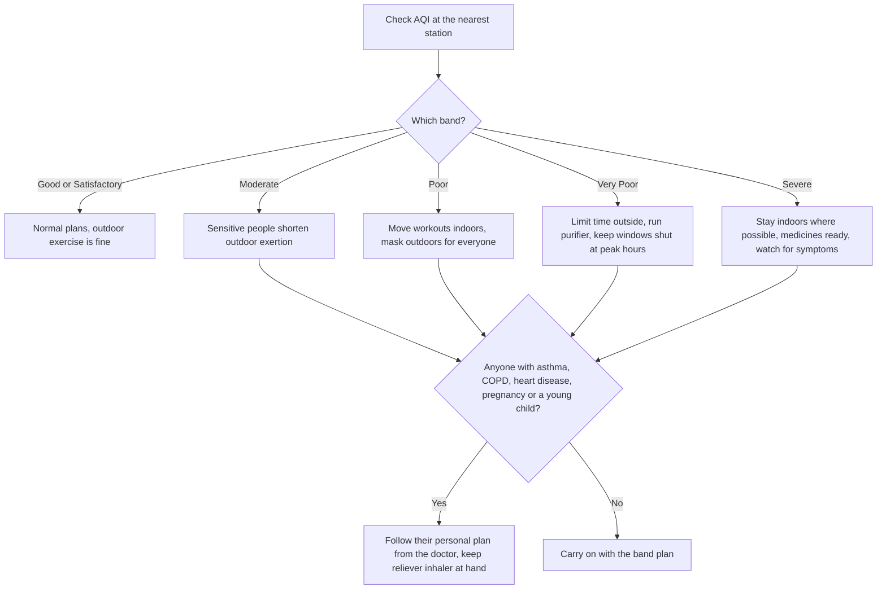

:::answer
Air pollution is one of India's biggest health risks: a Global Burden of Disease analysis linked about 1.67 million deaths in India in 2019 to air pollution, roughly 17.8% of all deaths that year. The tiny particles called PM2.5 reach deep into the lungs and bloodstream and affect the heart, brain and pregnancy, not just breathing. You can lower your own exposure a lot: check the AQI each morning, move exercise indoors or to cleaner hours when it is "Poor" or worse, wear a well-fitted N95 or FFP2 mask outdoors on bad days, keep indoor air clean (no agarbatti or mosquito coils, a HEPA purifier in the bedroom if you can), and have a written plan for children, older parents and anyone with asthma, COPD or heart disease.
:::

## The scale of the problem

A study from the India State-Level Disease Burden Initiative, published in The Lancet Planetary Health, estimated that 1.67 million deaths in India in 2019 were attributable to air pollution, about 17.8% of all deaths in the country ([Lancet Planetary Health, 2021](https://pubmed.ncbi.nlm.nih.gov/33357500/)). Outdoor particulate pollution accounted for the larger share, with household air pollution (mostly from burning solid fuels for cooking) the rest. The same analysis found that death rates from household pollution had fallen substantially since 1990, while those from outdoor particulate pollution had risen.

Numbers this large can feel abstract. What they mean for one family is simpler: on many winter days in north India, simply breathing outdoors is a health exposure, and on some days indoors too.

## What pollution actually does inside your body

The main villain is PM2.5: particles smaller than 2.5 micrometres, about thirty times thinner than a human hair. They come from vehicle exhaust, construction dust, burning of waste and crop stubble, industry, coal, and household fuels.

Because they are so small, PM2.5 particles get past the nose and throat, go deep into the lungs, and some pass into the bloodstream. From there they cause inflammation in blood vessels and organs. That is why air pollution is linked not only to cough, asthma attacks and COPD, but also to heart attacks, strokes, lung cancer, problems in pregnancy, and effects on children's lung growth.

The World Health Organization's 2021 air quality guidelines set very low recommended levels: an annual average of 5 micrograms per cubic metre of PM2.5, and a 24-hour average of 15 ([WHO, 2021](https://www.who.int/publications/i/item/9789240034228)). WHO also gives interim targets, because many cities, including in India, are far above these levels. There is no level of PM2.5 known to be completely harmless, which is why reducing exposure, even partly, is worthwhile.

[[ad]]

## Reading the AQI the right way

India's National Air Quality Index, run by the Central Pollution Control Board, turns the levels of several pollutants into one number from 0 to 500 and six colour-coded bands ([CPCB](https://cpcb.nic.in/)):

| AQI | Category | What CPCB says it can mean |
|---|---|---|
| 0–50 | Good | Minimal impact |
| 51–100 | Satisfactory | Minor breathing discomfort in sensitive people |
| 101–200 | Moderate | Breathing discomfort for people with lung disease, heart disease, children and older adults |
| 201–300 | Poor | Breathing discomfort for most people on prolonged exposure |
| 301–400 | Very Poor | Respiratory illness on prolonged exposure |
| 401–500 | Severe | Affects healthy people and seriously affects those with existing disease |

Three practical tips for reading it:

1. **Check the station nearest you**, not just the city average. AQI can differ a lot between a busy junction and a residential sector a few kilometres away.
2. **Look at the trend through the day.** In north Indian winters, pollution often builds overnight and in the early morning when the air is still and cold, and may ease by afternoon when the sun warms the ground and winds pick up.
3. **Know your "trigger" level.** For a healthy adult, "Poor" may be the point to change plans. For a child with asthma or a parent with heart disease, "Moderate" may already be the point.

In Delhi-NCR, the Commission for Air Quality Management's Graded Response Action Plan adds restrictions (on construction, certain vehicles and more) as AQI rises through its stages ([CAQM](https://caqm.nic.in/)). Those are city-level measures; this guide is about what you can do at home.

## Your family AQI action plan

Write this down and stick it on the fridge. A plan made in advance is much easier to follow on a smoggy morning than a decision made in a hurry.

### Who needs a stricter plan
- **Children**: they breathe faster, spend more time outdoors and their lungs are still growing.
- **Older adults**, especially with heart or lung disease.
- **Pregnant women**.
- **People with asthma, COPD, heart disease, diabetes or past stroke**.
- **Outdoor workers**: traffic police, delivery riders, construction workers, street vendors.

For these groups, ask your doctor for a written plan: which symptoms to watch, when to use a reliever inhaler, and when to seek help.

[[ad]]

## Masks: which ones work, and how to wear them

Cloth masks and loose surgical masks do little against PM2.5, because the particles are tiny and air leaks around the edges. What helps outdoors on bad days:

- **N95 (US standard) or FFP2 (European standard) respirators**, which are designed to filter at least 95% (N95) or about 94% (FFP2) of fine particles when they fit properly.
- **Fit matters more than brand.** It should seal around the nose and under the chin. If your glasses fog up, air is leaking at the top: press the metal nose strip firmly.
- **Masks with exhalation valves** are comfortable but don't filter the air you breathe out; fine for pollution, not ideal for infection control.
- **Replace** when it becomes damp, dirty, damaged or harder to breathe through.

Masks are a supplement, not a solution. They help most for necessary time outdoors: the commute, the walk to the market, waiting at a bus stop.

Some people should be careful with tight respirators: young children (masks are hard to fit and can be unsafe for babies), and people with severe heart or lung disease, who should ask their doctor first.

## Clean air at home: where most of your hours are spent

Most people spend most of their day indoors, so indoor air matters a great deal. Indoor air in Indian homes has its own sources too.

### Remove indoor sources
- **Agarbatti, dhoop and mosquito coils** release smoke and fine particles. Use electric or plug-in alternatives for mosquitoes, and keep incense brief and in a ventilated space.
- **Cooking**: frying and tadka at high heat release particles. Use the kitchen chimney or exhaust fan every time, and keep the kitchen door closed while frying.
- **Never smoke indoors**, and ask visitors not to.
- **Solid fuels** (wood, dung, coal, kerosene) for cooking or heating are a major source; LPG or electric cooking is far cleaner.
- **Sweep less, mop more**: dry sweeping throws dust back into the air.

### Filter what comes in
- **HEPA air purifiers** can substantially reduce PM2.5 in a closed room. Choose one sized for the room (check its clean air delivery rate, CADR, against your room size), run it continuously during polluted periods, and keep doors and windows of that room closed.
- **Prioritise the bedroom.** You spend a third of your life sleeping; one purifier in the bedroom gives the biggest return.
- **Change filters** as the manufacturer advises.
- **Ventilate when outdoor air is better**, often in the afternoon on winter days, for a short time.

Indoor plants are pleasant, but at realistic numbers in a home they don't clean air in any meaningful way. Don't rely on them.

:::tip Smart, low-cost habits for bad-air season
- Make AQI part of your morning routine, like checking the weather.
- Keep N95 or FFP2 masks by the door, in the car and in office bags.
- Shut windows during early-morning and late-night peaks; air out the house briefly in the afternoon if AQI dips.
- Run the kitchen exhaust every time you cook, and keep frying for good-air days when you can.
- Drink enough water and eat plenty of fruits and vegetables; a healthy diet supports your body, though no food "detoxes" pollution.
- Don't burn leaves, garbage or firecrackers; your own family breathes it first.
:::

## Exercise and pollution: when, where and how hard

Exercise makes you breathe faster and deeper, so you take in more air, and more pollutant, per minute. That doesn't mean you should stop exercising; inactivity is harmful too. It means being smart about timing and place.

- **On Good to Moderate days**, outdoor exercise is generally fine for healthy adults. Choose parks and green areas over roadsides.
- **On Poor days**, move intense workouts indoors. A walk is fine; a hard 10 km run along a main road is not.
- **On Very Poor or Severe days**, exercise indoors, ideally in a space with filtered air. Keep sessions moderate.
- **Avoid exercising next to traffic** at any AQI. Even a block away from a main road can mean much lower exposure.
- **Watch the time of day**: in winter, early mornings are often the worst. Late-morning or afternoon may be better.
- **Listen to your body**: chest tightness, wheeze, unusual breathlessness or palpitations are reasons to stop.

For people with asthma, a doctor may advise using the reliever inhaler before exercise. Follow your own plan.

## Commute, car and office: the hours people forget

A large share of daily exposure happens on the way to work and school, which is exactly when many people think least about it.

- **In the car**, keep windows up and set the air conditioning to recirculate on smoggy days; in heavy traffic, outside air can be far dirtier than the air in a closed cabin. Replace the cabin air filter on schedule.
- **On a two-wheeler or in an auto**, a well-fitted N95 or FFP2 mask makes the biggest difference, because you sit right in the exhaust stream. Where you can, choose routes away from the most congested roads.
- **Walking or cycling**, side streets a block away from the main road usually mean much lower exposure.
- **At the office**, ask whether the building filters its air. A desk-sized purifier near where you sit helps in a small cabin; in a large open office it does far less.
- **For children's school runs**, avoid waiting in queues of idling vehicles, and ask the school about indoor play on bad days.

If you have heart disease, diabetes or a lung condition, also make sure your regular medicines are taken on time and that you have enough stock through the winter. Never change your medicines because of pollution without asking your doctor; if your symptoms worsen in the smog season, that is a reason for a check-up, not for doubling up on your own.

## How to tell if pollution is affecting you

Common short-term effects include sore or scratchy throat, cough, burning eyes, runny nose, headache, tiredness and worsening of existing asthma or allergies. These often improve when air quality improves. Persistent symptoms, symptoms that get worse each winter, or any of the warning signs below deserve a doctor's visit.

:::warning See a doctor promptly or go to hospital if
- You or your child are breathless at rest, or breathing fast with the ribs pulling in
- Lips or fingertips look bluish or grey
- A reliever inhaler isn't helping, or you need it much more often than usual
- You have chest pain, pressure or a racing heartbeat, especially if you have heart disease
- A child is unusually drowsy, can't speak in full sentences, or can't feed
- An older person becomes confused or suddenly very weak
- You cough up blood
:::

[[ad]]

## Myths about pollution and protection

:::mythfact
| Myth | Fact |
|---|---|
| "A cloth mask or handkerchief is enough." | Cloth and loose masks let most fine particles through. A well-fitted N95 or FFP2 works far better outdoors. |
| "Indoors, we're safe." | Outdoor PM2.5 seeps in, and agarbatti, coils, cooking smoke and smoking add more. Clean the indoor air too. |
| "Morning walks are always the healthiest." | In north Indian winters, early mornings can be the most polluted. Check the AQI and shift timing. |
| "Plants will purify my home's air." | At realistic numbers in a home, plants don't meaningfully clean the air. A sized HEPA purifier does. |
| "Jaggery or special drinks detox pollution." | No food or drink removes inhaled particles. A healthy diet supports your body, but exposure reduction is what protects you. |
| "If I feel fine, the air isn't hurting me." | Many effects, especially on the heart and blood vessels, build silently over years. |
:::

## A one-week plan to set up your home

**Day 1:** Install an AQI app or bookmark your nearest monitoring station. Decide your family's trigger levels.

**Day 2:** Buy a box of well-fitted N95 or FFP2 masks. Practise fitting them with the family.

**Day 3:** Remove indoor sources: switch to electric mosquito repellents, limit agarbatti, check the kitchen exhaust works.

**Day 4:** If you can, get a HEPA purifier sized for your bedroom. If not, keep the bedroom door and windows shut at peak times.

**Day 5:** Plan indoor workouts for bad days: a home routine, a gym, or an indoor walking space.

**Day 6:** Talk to your doctor about written plans for anyone with asthma, COPD, heart disease or pregnancy.

**Day 7:** Stick the action plan on the fridge.

## Common questions

:::faq
### Which AQI level is safe for outdoor exercise?
For healthy adults, Good and Satisfactory days are generally fine, and Moderate days are usually fine for shorter or lighter sessions. When AQI is Poor or worse, move intense exercise indoors. People with asthma, heart disease or other conditions, and children, may need to be more cautious; follow your doctor's advice.

### Do N95 masks really work against PM2.5?
Yes, when they fit well. N95 and FFP2 respirators are designed to filter most fine particles. Leaks around the nose and chin reduce protection a lot, so fit matters as much as the mask itself.

### Are air purifiers worth the money?
A HEPA purifier sized for the room can substantially reduce indoor PM2.5 when doors and windows are kept closed. If you can afford one, the bedroom gives the best return. Change filters as advised.

### Is pollution harmful during pregnancy?
Air pollution has been linked to problems in pregnancy, including effects on the baby's growth. Pregnant women should reduce exposure where they can, use clean indoor air, wear a well-fitted mask outdoors on bad days, and discuss concerns with their doctor.

### Should children go to school on Severe days?
That depends on school and government advisories, which often close schools or move classes online on the worst days. At home, keep children indoors in clean air, limit outdoor play, and watch for breathing symptoms, especially if they have asthma.
:::

## The bottom line

You can't fix the city's air on your own, but you can cut your family's exposure a lot. Check the AQI, change plans on bad days, wear a good mask outdoors, clean the air where you sleep, remove indoor smoke, and protect the people most at risk first.

When outdoor air is bad, training doesn't have to stop. Royal Fitness Club in Sector 93, Noida is an indoor space where you can keep your routine going through the smog season; book a free trial session to see it.
