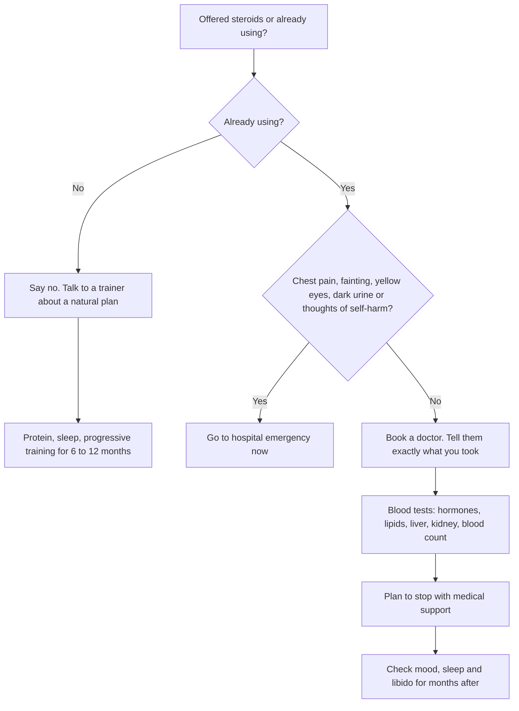

:::answer
Anabolic steroids are man-made versions of testosterone. Doctors prescribe testosterone for a small group of men with proven hormone deficiency. Taken for muscle, at gym-culture amounts and without a doctor, they can weaken the heart's pumping, speed up artery plaque, shrink the testicles, leave your own testosterone low for years after you stop, and change your mood. Fake and contaminated products make the risk harder to judge. If you have already used them, the safest step is an honest conversation with a doctor. Stopping is possible, and help exists.
:::

This guide is for the young man in the gym who has been offered "a small course" by a friend, a trainer or an Instagram seller. It is also for parents, partners and anyone who has already used. We won't tell you how to use steroids, and we won't share cycles, doses or sources. We will tell you what the research shows, in plain words, so you can decide with real information.

## What anabolic steroids are, and where they belong

"Anabolic-androgenic steroids" (AAS) are lab-made relatives of testosterone, the main male hormone. "Anabolic" means they build tissue, such as muscle. "Androgenic" means they cause male features, such as body hair and a deeper voice. You cannot get one effect without the other.

They are different from corticosteroids like prednisolone, which doctors give for asthma, arthritis or allergies. Those are also called "steroids" in Indian homes, which causes a lot of confusion. This article is only about the muscle-building kind.

Testosterone has real medical uses. The main one is hypogonadism: the body itself does not make enough testosterone. The Endocrine Society guideline says doctors should diagnose this only in men who have symptoms and signs of deficiency plus testosterone that is clearly and consistently low, confirmed by repeating a fasting morning blood test ([Bhasin et al., JCEM 2018](https://pubmed.ncbi.nlm.nih.gov/29562364/)). The same guideline advises against starting testosterone in men who plan to father a child soon. Treatment aims to bring levels back to the normal range, and the patient is monitored with regular blood tests.

Gym use is a different thing. People take amounts well above what the body makes, often combine several drugs, and almost never get monitored. The Endocrine Society's scientific statement on performance-enhancing drugs points out that most users are not elite athletes but ordinary gym-goers, and that many wrongly believe these drugs are safe ([Pope et al., Endocrine Reviews 2014](https://pubmed.ncbi.nlm.nih.gov/24423981/)).

### How common is steroid use?

A global meta-analysis estimated that about 6.4% of men and 1.6% of women have used anabolic steroids at some point in their lives, with an overall figure of 3.3% ([Sagoe et al., Annals of Epidemiology 2014](https://pubmed.ncbi.nlm.nih.gov/24582699/)). There is no good national survey for Indian gym-goers yet, so nobody can give you an honest India number. What we do know is that enforcement is catching up. In October 2025, Telangana's drug regulator inspected 20 gyms in Hyderabad after reports that gyms were selling steroids and a cardiac stimulant injection to members ([Medical Dialogues, 2025](https://medicaldialogues.in/amp/news/industry/pharma/telangana-issues-advisory-to-retail-wholesale-medical-shops-amid-prescription-medicines-misuse-in-gyms-157521)).

## Your heart: the damage you can't see in the mirror

This is the part that worries cardiologists most, because it is silent for years.

In a study published in *Circulation*, researchers in the US compared 86 experienced male weightlifters who had used steroids for at least two years in total with 54 weightlifters who had never used them ([Baggish et al., Circulation 2017](https://pubmed.ncbi.nlm.nih.gov/28533317/)). Here is what they found:

- **Weaker pumping.** The heart's ejection fraction (the share of blood pumped out with each beat) averaged 52% in users and 63% in non-users. Current users averaged 49%, and men who had stopped averaged 58%.
- **Stiffer relaxation.** The heart also relaxed less well between beats in users.
- **More artery plaque.** Steroid users had more plaque in the arteries that feed the heart. The longer the total years of use, the more plaque they had.

Many of these men looked strong and fit. Their scans told a different story.

Beyond the heart muscle itself, the NHS lists heart attack, stroke, high blood pressure, high cholesterol and blood clots among the known effects ([NHS](https://www.nhs.uk/conditions/anabolic-steroid-misuse/)). Indians already develop heart disease at younger ages, which is why our [heart attacks under 40 guide](/health/blog/heart-attack-under-40-india) matters here too.

### Do people actually die earlier?

A Danish study followed 545 men who tested positive for steroids in doping tests at fitness centres and compared them with 5,450 men of the same age. The steroid users had about three times the death rate over the follow-up period, and they visited hospital more than twice as often ([Horwitz et al., Journal of Internal Medicine 2019](https://pubmed.ncbi.nlm.nih.gov/30460728/)). An observational study like this can't prove that steroids alone caused every extra death, because users may differ in other ways. Still, it fits with the heart findings above.

## Your liver and kidneys

Steroid tablets taken by mouth are chemically changed so the liver doesn't break them down straight away. That change is also what makes them hard on the liver. The Endocrine Society statement lists liver problems among the recognised harms of these drugs, including blocked bile flow (which causes jaundice) and, rarely, liver tumours ([Pope et al., 2014](https://pubmed.ncbi.nlm.nih.gov/24423981/)). The NHS also lists liver and kidney damage or failure ([NHS](https://www.nhs.uk/conditions/anabolic-steroid-misuse/)).

Many gym-goers in NCR also take very high protein, pre-workout stimulants and painkillers for sore joints at the same time. That adds more load on the kidneys and liver, and it makes it harder for a doctor to tell what caused a problem.

## Your hormones and fertility: the part young men regret

Your body makes testosterone through a feedback loop between your brain and your testicles. When you put large amounts of outside hormone in, your brain senses there is plenty and switches off its signals. The testicles get no instructions, so they shrink and stop making sperm.

The NHS lists reduced sperm count, infertility, shrinking testicles, erectile problems, hair loss and breast development in men ([NHS](https://www.nhs.uk/conditions/anabolic-steroid-misuse/)). In the Danish study, acne, breast tissue growth (gynaecomastia) and erectile dysfunction were each seen in more than 10% of users ([Horwitz et al., 2019](https://pubmed.ncbi.nlm.nih.gov/30460728/)).

### What happens after you stop

Many young men believe the body bounces back in a few weeks. For some, it doesn't.

A Danish case-control study measured hormones in 33 former users, on average two and a half years after they had stopped. Their median testosterone was 14.4 nmol/L, against 18.8 nmol/L in men who had never used. About 27% of the former users were below the normal lower limit, while none of the non-users were. Among former users, 40% reported low sex drive, 27% erectile problems and 24% depressive symptoms ([Rasmussen et al., PLoS One 2016](https://pubmed.ncbi.nlm.nih.gov/27532478/)).

This is called steroid-induced hypogonadism. It can make men feel tired, flat and low, which is one reason many restart. That is a trap, and a doctor can help you out of it.

## Skin, hair and appearance

The visible effects are often the first ones people notice:

- Severe acne on the back, chest and shoulders, sometimes leaving scars
- Faster hair loss in men who already carry the family tendency for baldness
- Breast tissue growth in men, which can become permanent and sometimes needs surgery
- Stretch marks from very fast muscle growth
- Water retention that makes the face look puffy

## Your mind: mood, aggression and dependence

The NHS lists aggression, mood swings, paranoia, manic behaviour and, in some cases, hallucinations or delusions ([NHS](https://www.nhs.uk/conditions/anabolic-steroid-misuse/)). Not every user becomes aggressive. Effects vary a lot between people, and research on "roid rage" is mixed. But people around you often notice changes before you do: a short temper, jealousy, risky decisions, poor sleep.

Steroids can also be addictive in a way people don't expect. The NHS describes users who crave them, need more for the same effect, and keep going despite unpleasant side effects ([NHS](https://www.nhs.uk/conditions/anabolic-steroid-misuse/)). Body image plays a big part. Some men feel they are never big enough, a pattern sometimes called muscle dysmorphia.

When people stop suddenly, they can get low mood, tiredness, poor sleep, low sex drive, poor appetite and aches. Depression after stopping is real and can be serious. If you have thoughts of harming yourself, please treat that as an emergency. Our [mental wellness page](/health/mental-wellness) lists support options.

## Women and steroids

Some women use steroids, often after being told a "mild" product won't cause male features. The NHS lists excess facial and body hair, a deeper voice, an enlarged clitoris, smaller breasts, period problems, hair loss and severe acne ([NHS](https://www.nhs.uk/conditions/anabolic-steroid-misuse/)). The deeper voice and clitoral changes may not reverse after stopping. Steroids are also dangerous in pregnancy. If you are a woman who wants to get stronger, our [women's weight training guide](/health/blog/women-weight-training-guide-india) shows how much you can achieve naturally.

## Injection risks and fake products

Most gym steroids in India are bought without a prescription, from someone you don't know, and often injected in a gym changing room or at home. That adds two risks on top of the drug itself.

**Infections.** Shared needles or vials can spread hepatitis B, hepatitis C and HIV, and injecting can damage veins and cause ulcers or abscesses ([NHS](https://www.nhs.uk/conditions/anabolic-steroid-misuse/)). Infection risk is not only about sharing needles: shared multi-use vials, unclean surfaces and unsterile products from unknown labs all add to it. If you have ever injected, ask your doctor for hepatitis B, hepatitis C and HIV tests. They are simple blood tests, and early treatment works well.

**Fakes.** A 2022 review pooled lab tests of black-market steroid samples from 19 studies. On average about 36% were counterfeit, meaning the wrong drug, no drug or extra ingredients. A further 37% were substandard, for example with the wrong amount ([Magnolini et al., BMC Public Health 2022](https://pubmed.ncbi.nlm.nih.gov/35842594/)). So many people don't actually know what they are putting in their body. That makes it impossible to blame or clear any one product when something goes wrong.

## Dope tests, NADA and the law in India

### Testing in sport

If you compete in any sport under a federation, including bodybuilding and powerlifting events affiliated with anti-doping rules, you can be tested. Anabolic agents are banned at all times, in and out of competition, on the WADA Prohibited List.

India's record here is poor. In WADA's testing report for 2024, India returned 260 adverse findings from 7,113 tests, a positivity rate of 3.6%, the highest among countries that ran a large number of tests. The year before, it was 3.8% ([Outlook India, December 2025](https://www.outlookindia.com/sports/others/india-highest-doping-positivity-rate-wada-2024-testing-report)). Behind those numbers are young athletes who lost years of their career, sometimes because of a product a coach or a shop gave them.

### What the law says

In India, testosterone and other anabolic steroids are prescription medicines under the Drugs and Cosmetics Act, 1940 and its rules. Chemists may sell them only on a valid prescription from a registered doctor and must keep records. Telangana's drug regulator said in 2025 that selling them for bodybuilding breaks these rules, and warned shops of licence cancellation and prosecution ([Medical Dialogues, 2025](https://medicaldialogues.in/amp/news/industry/pharma/telangana-issues-advisory-to-retail-wholesale-medical-shops-amid-prescription-medicines-misuse-in-gyms-157521)). A gym, trainer or online seller supplying them without a prescription is acting outside the law. Laws and enforcement vary by state, so treat this as general information, not legal advice.

:::tip How to talk to your doctor honestly
- Say it straight: "I have been using steroids for the gym." Doctors hear this more than you think, and they need the truth to help you.
- Bring the vials, strips or photos of the labels, even if you suspect they were fake. Write down roughly how long you used them and when you last took any.
- Mention everything else: pre-workouts, fat burners, painkillers, "hair fall" tablets, anything from a seller.
- Ask for the basics: blood pressure, lipid profile, liver and kidney tests, blood count (haemoglobin and haematocrit), and hormone tests.
- Ask about fertility if you want children one day. Do this early.
- Tell them about mood, sleep and sex drive. These are medical symptoms, not weakness.
- An endocrinologist (hormone specialist) is usually the right doctor for coming off. A cardiologist should check your heart if you used for long.
:::

## Getting off steroids safely

Stopping is the right goal, but you don't have to do it alone. A doctor can check where your hormones are, watch your heart and liver, and treat low mood or low testosterone symptoms properly. Do not follow "post-cycle" plans from forums or trainers. These involve more prescription drugs taken without supervision, and they are a big reason people end up in trouble.

Expect a few hard months. Strength and size will drop a bit, mood can dip, and sex drive may be low. That is your body restarting. Keep training, eat well, sleep seven to nine hours, and stay in touch with your doctor. If low mood gets heavy, ask for counselling. If anyone around you is pushing you to restart, distance yourself from them for a while.

:::warning See a doctor urgently or go to hospital if
- You have chest pain, pressure or tightness, especially during training
- You faint, nearly faint, or feel your heart racing or skipping
- Your eyes or skin turn yellow, your urine is dark, or you have pain under the right ribs
- One leg becomes swollen, painful and warm, or you suddenly feel breathless (possible clot)
- You have a sudden severe headache, weakness on one side or slurred speech
- An injection site becomes hot, red, swollen or leaks pus, or you have fever after injecting
- You feel very low, hopeless or have thoughts of harming yourself or others
:::

## Myths you will hear in the gym

:::mythfact
| Myth | Fact |
|---|---|
| "A small course is safe if you're young." | Heart pumping weakness and artery plaque were found in experienced users who looked healthy, and longer total use meant more plaque. |
| "Your natural testosterone comes back in a few weeks." | In one study, about 27% of former users still had low testosterone an average of two and a half years after stopping. |
| "Every big guy on Instagram is natural." | Many are not. You can't tell from a photo, and comparing yourself to them is a fast route to taking risks. |
| "Gym-bought steroids are pharmacy quality." | Pooled lab tests found about 36% of black-market steroids counterfeit and 37% more substandard. |
| "Only injections are risky. Tablets are mild." | Oral steroids are especially hard on the liver. Both forms affect the heart, hormones and mood. |
| "Natural vs steroid is only about size." | It is about your heart, your fertility, your mood and your future health, not only the mirror. |
:::

## What natural training can do

Many young men who try steroids do it out of impatience in their early years of training. That is the stage when natural progress is usually fastest. With a structured programme, enough protein from dal, paneer, eggs, chicken or soya, seven to nine hours of sleep and patience, a beginner can make large gains in the first year. Our [beginner gym guide](/health/blog/beginner-gym-guide-india) and [protein calculator](/health/blog/protein-requirement-calculator-india) are good places to start. If you want a supplement with solid research behind it, read our [creatine guide](/health/blog/creatine-guide-india) before anything else.

## Common questions

:::faq
### Is testosterone from a doctor the same as gym steroids?
It is the same type of hormone, but the purpose and the amount are different. A doctor prescribes it only after confirming a real deficiency with repeated blood tests, aims for normal levels, and monitors you. Gym use pushes levels far above normal without monitoring, which is where most of the harm comes from.

### I used steroids once, for a few weeks. Am I damaged?
Not necessarily. Many short-term users recover well. But you can't know without checking. See a doctor, be honest about what you used, and get basic heart, liver, lipid and hormone tests. If anything is off, catching it early helps.

### Will my testicles go back to normal size?
Many men see some recovery after stopping, but it can take months, and in one study about a quarter of former users still had low testosterone years later. A doctor can test your hormones and sperm count and tell you where you stand.

### Are SARMs a safer, legal alternative?
No. SARMs are experimental drugs not approved for human use, they also suppress your own testosterone, and liver injury has been reported. Our guide on [SARMs and spiked supplements](/health/blog/sarms-spiked-gym-supplements-india) explains the evidence.

### My friend uses steroids and is getting angry and low. What can I do?
Talk to him calmly when he is not angry, tell him what you have noticed, and encourage him to see a doctor. Don't lecture. If he talks about harming himself or someone else, get help immediately and don't leave him alone.
:::

## The bottom line

Anabolic steroids can build muscle fast, and they can also weaken your heart, shut down your own hormones, harm your liver and change your mind, often without warning signs until damage is done. Fake products add another layer of risk. If you are tempted, wait and train naturally for another year first. If you have already used, see a doctor and tell them the full truth. Stopping is possible, and help exists.

We made a short Hinglish video on this on our YouTube channel, [Royal Fitness TV](https://www.youtube.com/@RoyalFitnessTV?sub_confirmation=1).

The trainers at Royal Fitness Club in Sector 93, Noida coach natural training only and are happy to build you a plan that works without drugs.
