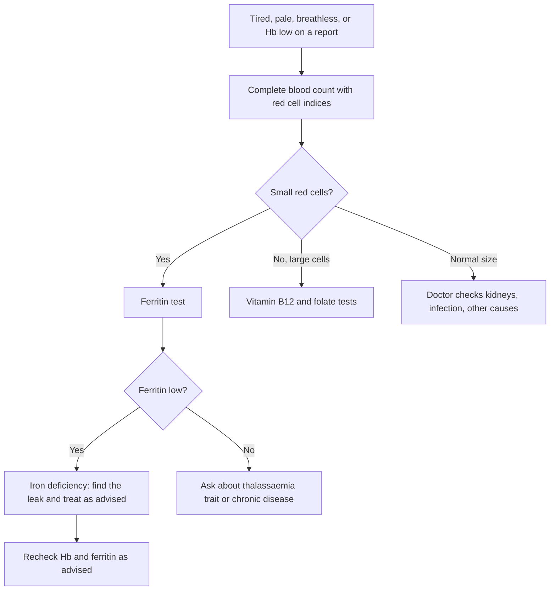

:::answer
Anaemia is extremely common in India: in NFHS-5 (2019–21), 57% of women aged 15–49 and 67.1% of children aged 6–59 months were anaemic. Iron tablets work very well when the problem really is iron deficiency, the tablets are taken correctly, and the cause of the iron loss is fixed. They "fail" when one of those three things is missing: the anaemia is actually due to B12, folate, thalassaemia trait or a chronic illness; the tablet is taken with chai or a calcium tablet; it is stopped as soon as Hb looks normal; or blood keeps leaking through heavy periods, piles, worms or an ulcer. A simple set of tests and a few habit changes solve most of these.
:::

## How big the problem is, in one paragraph

The fifth National Family Health Survey found anaemia in 67.1% of children aged 6–59 months, 59.1% of adolescent girls aged 15–19, 57.0% of women aged 15–49 and 25.0% of men aged 15–49 across India ([NFHS-5 India fact sheet](http://rchiips.org/nfhs/NFHS-5_FCTS/India.pdf)). These figures were higher than in the previous survey. That is why the government runs the Anemia Mukt Bharat programme, which combines iron-folic acid supplements, deworming, testing, treatment, fortified foods and awareness across six age groups ([Anemia Mukt Bharat](https://anemiamuktbharat.info/)).

So if you, your mother, your wife or your daughter has been told "Hb is low", you are far from alone. But "low Hb" is the start of a diagnosis, not the end of one.

## First, what anaemia actually is

Anaemia means your blood has less haemoglobin than it should. Haemoglobin is the iron-containing protein in red blood cells that carries oxygen. When it is low, every organ gets a little less oxygen, which shows up as tiredness, breathlessness on stairs, headaches, poor concentration, pale skin and nails, hair fall, cold hands and feet, and sometimes a racing heart. Children may have poor appetite, slower growth and trouble focusing at school. In pregnancy, anaemia raises risks for both mother and baby.

The World Health Organization's 2024 guideline sets the haemoglobin levels below which a person is considered anaemic, and these differ by age, sex and pregnancy ([WHO, 2024](https://www.who.int/publications/i/item/9789240088542)). Your lab report and doctor will interpret your number against the right cut-off for you.

Low Hb has many causes. Iron deficiency is the most common in India, but it is not the only one.

[[ad]]

## The seven reasons iron tablets "don't work"

### 1. The anaemia isn't (only) from iron

Several conditions make Hb low but don't respond to iron:

- **Vitamin B12 deficiency**, common in people who eat little or no milk, curd, paneer, eggs, fish or meat, and in people on long-term metformin or acid-reducing medicines. It often causes tingling, numbness, memory problems or a sore tongue too.
- **Folate deficiency**, linked to low intake of green leafy vegetables and pulses, and to pregnancy.
- **Thalassaemia trait** (also called thalassaemia minor), an inherited condition that makes red cells small. On a basic blood count it can look exactly like iron deficiency, but iron doesn't fix it, and taking extra iron without iron deficiency can be harmful over time.
- **Anaemia of chronic disease**, from long-term kidney disease, infections, arthritis or other inflammation.

This is the single most common reason for a "failed" iron course: the right medicine for the wrong problem.

### 2. The tablet is taken with chai, coffee, milk or a calcium tablet

The polyphenols in tea and coffee strongly reduce how much iron your gut absorbs from plant foods and supplements. In a classic study, a cup of tea with a meal cut iron absorption substantially compared with water ([British Journal of Nutrition, 1999](https://doi.org/10.1017/S0007114599000537)). Calcium (milk, curd, calcium tablets) and many antacids also interfere. Many Indians take their iron tablet with morning chai, or right after a calcium tablet, and then wonder why nothing changes.

### 3. Stopping as soon as Hb looks better

Hb often starts rising within a few weeks of the right treatment. But your body's iron stores (measured by ferritin) take much longer to refill. If you stop when Hb is normal, the stores stay empty, and Hb drops again a few months later. Your doctor will tell you how long to continue; it is usually longer than people expect.

### 4. Blood keeps leaking

Iron tablets cannot keep up with a tap that is still running. The most common leaks in India:

- **Heavy periods**: soaking a pad every hour or two, passing clots, periods longer than seven days, or needing to change at night. Many women think this is "normal" because their mother had the same.
- **Piles or fissures** with bleeding.
- **Stomach ulcers or gastritis**, sometimes from regular painkillers.
- **Hookworm and other intestinal worms**, especially in children and in areas where people walk barefoot.
- **Frequent blood donation** without enough recovery time.
- In older adults, any unexplained iron deficiency needs a check for slow bleeding in the gut.

### 5. Worms nobody checked for

Deworming is part of Anemia Mukt Bharat for exactly this reason. In children and adolescents, a periodic deworming dose as advised by the health worker or doctor can make the difference between iron that works and iron that doesn't.

### 6. The gut isn't absorbing

Celiac disease, long-term acid-reducing medicines, some stomach infections and past stomach surgery all reduce iron absorption. If you have taken iron correctly for months with no change, your doctor may look for these.

### 7. Side effects make people skip doses

Nausea, stomach pain, constipation and black stools are common with oral iron. Many people quietly stop. Doctors can often change the type of iron, the timing or the frequency. There is also interesting research on timing: in one study in young women with low iron stores, giving iron on alternate days rather than every day increased the fraction of iron absorbed, because a dose raises a hormone (hepcidin) that blocks absorption for about a day ([Lancet Haematology, 2017](https://doi.org/10.1016/S2352-3026(17)30182-5)). Don't change your own schedule based on this; ask your doctor whether a different plan suits you.

[[ad]]

## The tests that end the guesswork

A good first set, which your doctor will tailor:

1. **Complete blood count (CBC)** with red cell indices (MCV, MCH, RDW). Small cells point towards iron deficiency or thalassaemia trait; large cells towards B12 or folate deficiency.
2. **Serum ferritin**, the best simple marker of iron stores. The WHO 2020 guideline explains how ferritin should be read, including that infection or inflammation can push ferritin up and hide a real deficiency ([WHO, 2020](https://www.who.int/publications/i/item/9789240000124)).
3. **Vitamin B12 and folate**, especially for vegetarians, people on metformin, and anyone with tingling or numbness.
4. **Haemoglobin electrophoresis or HPLC** if thalassaemia trait is suspected, and before marriage or pregnancy if there is a family history.
5. **Stool tests, a gynaecology check or a gut evaluation** if a leak is suspected.

Ask for copies of all reports and keep them in one folder. Comparing ferritin over time tells you more than any single number.

## Eating for better iron: what actually helps

Food alone rarely corrects a real deficiency quickly, but it matters a lot for preventing it and for keeping stores full after treatment. The ICMR-NIN dietary guidelines encourage a varied diet with pulses, green leafy vegetables, whole grains and, for non-vegetarians, meat, fish and eggs ([ICMR-NIN, 2024](https://www.nin.res.in/dietaryguidelines/index.html)).

There are two kinds of iron in food. Haem iron, from meat, fish and poultry, is absorbed well. Non-haem iron, from plants such as dals, rajma, chana, leafy greens, millets (especially ragi and bajra) and jaggery, is absorbed less well, but you can boost it:

- **Add vitamin C to the same meal**: a squeeze of lemon on dal or sabzi, amla, guava, oranges, tomato, raw onion salad.
- **Ferment and sprout**: idli, dosa and dhokla batters and sprouted moong reduce compounds (phytates) that block iron.
- **Move chai and coffee away from meals**: keep them at least an hour before or after.
- **Cook in an iron kadhai** now and then; some iron moves into the food, particularly with sour dishes.
- **Space calcium**: if you take a calcium tablet, keep it apart from iron-rich meals and iron tablets.

For B12, the reliable vegetarian sources are dairy (milk, curd, paneer, buttermilk). Strict vegans usually need a supplement or fortified food, as advised by a doctor. Our [thali builder](/health/thali-builder) can help you plan meals that combine iron, vitamin C and protein.

:::tip Tips that make iron treatment work
- Take the iron tablet with water or a vitamin C source like lemon water or an orange, not with chai, coffee or milk, unless your doctor says otherwise.
- Set a phone alarm. Skipped doses are the quiet reason many courses fail.
- Black stools are expected with oral iron. Black, sticky stools with dizziness or belly pain are not: get checked.
- For constipation, add water, fruit, vegetables and a daily walk, and tell your doctor if it persists.
- Write down your period pattern for two cycles (days, pads per day, clots). Bring it to your doctor; it changes treatment.
- After treatment, recheck Hb and ferritin when your doctor advises, not "when you feel tired again".
:::

## Special situations

### Pregnancy
Iron needs rise sharply in pregnancy, and anaemia raises the risk of preterm birth and low birth weight. Antenatal iron-folic acid supplements are a core part of Indian maternal care; take them exactly as your doctor or ANM advises, and attend every antenatal check.

### Adolescent girls
Periods start, growth is fast, and diets are often low in iron. NFHS-5 found anaemia in more than half of girls aged 15–19. School-based weekly iron-folic acid supplementation and deworming under Anemia Mukt Bharat are designed for this group.

### Young children
Two in three young children in NFHS-5 were anaemic. Iron-rich complementary foods after six months, deworming as advised, and supplements through the anganwadi or paediatrician matter a lot for brain development. Don't give adult tablets to children; overdose of iron is dangerous for children, so keep tablets out of reach.

### Men and older adults
Iron deficiency in an adult man or in anyone older is less often from diet alone. It can be the first sign of slow bleeding in the gut, so it always deserves a proper look rather than just a strip of tablets.

[[ad]]

:::warning See a doctor promptly or go to hospital if
- You feel breathless at rest, have chest pain, or feel faint
- Your heart races or you collapse
- You vomit blood, or pass black, tarry stools or blood in the stool
- Your periods soak a pad every hour for several hours, or you pass large clots
- You are pregnant and feel very weak, breathless or dizzy
- A child has swallowed iron tablets meant for an adult (this is an emergency)
- Your Hb is falling despite treatment
:::

## Myths that keep India anaemic

:::mythfact
| Myth | Fact |
|---|---|
| "Low Hb always means eat more iron." | Low Hb can come from B12 or folate deficiency, thalassaemia trait or chronic disease. Test before you treat. |
| "Jaggery and spinach will fix it." | They help prevent deficiency, but rarely correct a real one on their own. Absorption from plant iron is modest unless paired with vitamin C. |
| "Take iron with chai so it doesn't upset the stomach." | Tea strongly reduces iron absorption. Ask your doctor for other ways to reduce stomach upset. |
| "Heavy periods are normal in our family." | Heavy bleeding is a common, treatable cause of anaemia. It deserves a doctor's visit. |
| "Hb is normal now, so I can stop." | Iron stores take longer to refill than Hb. Continue as long as your doctor advises. |
| "More iron is always better." | Too much iron, especially without deficiency, is harmful and dangerous for children. Take only what is prescribed. |
:::

## A four-week home routine that supports treatment

**Week 1:** Get the right tests done with your doctor. Start any prescribed treatment. Move chai and coffee at least an hour away from meals and tablets.

**Week 2:** Add a vitamin C food to two meals a day. Have one fermented or sprouted dish daily (idli, dosa, dhokla, sprouts). If you're vegetarian, include curd or paneer daily for B12.

**Week 3:** Track your periods and your bowel habits. Tell your doctor about any heavy bleeding, black stools or side effects.

**Week 4:** Keep the routine going. Light, regular exercise like walking helps energy and appetite, but don't push hard training while Hb is very low; ask your doctor when it is safe to increase intensity.

## Questions to take to your doctor

Doctor visits in India are often short, so walk in with your questions written down:

- What type of anaemia do I have, and what do my CBC and ferritin show?
- Should I be tested for vitamin B12, folate or thalassaemia trait?
- What is causing my iron loss, and how will we fix that cause?
- Which iron preparation suits me, and when exactly should I take it relative to meals, chai and other tablets?
- What should I do if the tablets upset my stomach, rather than stopping them?
- When should I repeat my Hb and ferritin, and what result are we aiming for?
- Do my family members need testing too?
- Is it safe for me to exercise, and how hard?

Taking your old reports, a list of every medicine and supplement you take, and your period notes will make the visit far more useful.

## Common questions

:::faq
### How long does it take to feel better on iron?
Many people start feeling more energetic within a few weeks of the right treatment, and Hb usually rises over the following weeks. Refilling iron stores takes longer. Your doctor will set the duration and the timing of repeat tests.

### Can I correct anaemia with diet alone?
Mild iron deficiency can sometimes improve with a better diet, but moderate or severe anaemia usually needs treatment prescribed by a doctor. Diet is excellent for prevention and for staying well after treatment.

### Why are my stools black on iron tablets?
Black stools are a common, harmless effect of oral iron. Black, sticky, tar-like stools together with dizziness, weakness or belly pain can mean bleeding and need urgent medical attention.

### Should my whole family get tested?
If one person has thalassaemia trait, close relatives may too, and it matters before marriage and pregnancy. For iron deficiency, testing others depends on symptoms and diet; ask your doctor.

### Is it safe to exercise when I'm anaemic?
Gentle activity like walking is usually fine and can help. Hard training while Hb is very low can cause breathlessness or fainting. Ask your doctor when to increase intensity, and stop if you feel dizzy or have chest pain.
:::

## The bottom line

Anaemia in India is common, but it is also very treatable. Test properly, treat the actual cause, take the medicine correctly and for long enough, and fix the leak. Those four steps turn "iron tablets didn't work" into a full recovery for most people.

If low energy has kept you away from exercise, the trainers at Royal Fitness Club in Sector 93, Noida can build a gentle plan that grows as your Hb and stamina return, in line with your doctor's advice.
