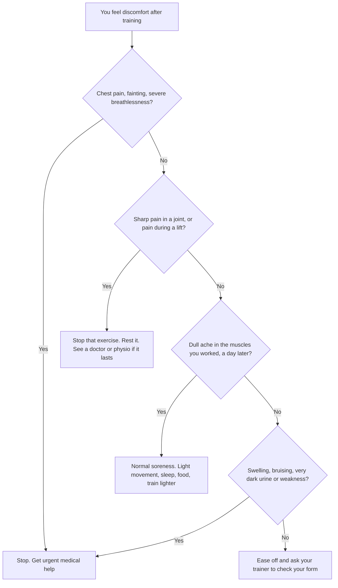

:::answer
For your first month, train your whole body two or three days a week, with one or two rest days between sessions. Pick six to eight basic exercises, do one to three sets of 8 to 12 reps with a weight you can control, and add a little weight only when the last set feels easy. Warm up first, learn form before load, and expect some muscle soreness in the first weeks, but treat sharp pain, joint pain or chest symptoms as a reason to stop. Add brisk walking or cycling to reach the WHO target of 150 to 300 minutes of moderate activity a week, sleep at least seven hours, and eat protein at every meal. If you have a heart condition, high blood pressure, dizzy spells or a long-term illness, check with your doctor first.
:::

## Why the first month matters most

Most people don't quit the gym because the plan was bad. They quit because the first two weeks hurt too much, they copied someone else's heavy routine, or nobody told them what normal soreness feels like. The first month is about building a habit and learning movements safely. Big weights can wait.

The need is real. WHO estimates that 31% of the world's adults, about 1.8 billion people, were not active enough in 2022 ([WHO, 2024](https://www.who.int/news-room/fact-sheets/detail/physical-activity)). Strength training is one of the best ways to change that, at any age.

## What the guidelines actually say

The WHO 2020 guidelines say all adults should do 150 to 300 minutes of moderate-intensity aerobic activity a week, or 75 to 150 minutes of vigorous activity, or a mix of both. On top of that, adults should do muscle-strengthening activity at moderate or greater intensity, working all the major muscle groups, on two or more days a week. Older adults should also do balance and strength work on three or more days a week ([WHO guidelines, BJSM 2020](https://pmc.ncbi.nlm.nih.gov/articles/PMC7719906/)). Some activity is better than none, and more is better up to these levels.

For beginners lifting weights, the American College of Sports Medicine (ACSM) position stand from 2009 recommends loads you can lift for 8 to 12 repetitions, training two to three days a week, and raising the load by 2 to 10% once you can do one or two reps more than your target ([ACSM, 2009](https://pubmed.ncbi.nlm.nih.gov/19204579/)).

In 2026, ACSM updated that advice with an overview of 137 systematic reviews covering more than 30,000 people. The headline: resistance training of almost any kind improves strength, muscle size, power and physical function compared with doing nothing. Strength improved more with heavier loads (80% or more of your one-rep max), full range of motion, two to three sets, doing the lift early in the session, and at least two sessions a week. Muscle size grew more with at least 10 sets per muscle group per week. Training to failure, machines versus free weights, and fancy periodisation did not consistently change results ([ACSM, 2026](https://doi.org/10.1249/MSS.0000000000003897)).

For a beginner, that is good news. You don't need a complicated split or a secret program. You need to turn up, train the whole body, and progress gradually.

## Before you start: do you need medical clearance?

The PAR-Q+ form itself says physical activity is very safe for most people. Still, a quick screen helps. The PAR-Q+ is a widely used questionnaire with seven yes-or-no questions. It asks whether a doctor has ever said you have a heart condition or high blood pressure, whether you get chest pain at rest, in daily life or during activity, whether you have lost balance from dizziness or lost consciousness in the past year, whether you have another long-term medical condition, whether you take prescribed medicines for one, whether a bone, joint or muscle problem could get worse with activity, and whether a doctor has said you should only exercise under medical supervision.

If you answer no to all seven, you are cleared to start, gradually. If you answer yes to any, the form leads you to follow-up questions or to a health professional before you increase your activity ([Bredin et al., Canadian Family Physician 2013](https://pmc.ncbi.nlm.nih.gov/articles/PMC3596208/)). The current version of the form also advises people over 45 who are not used to hard exercise to consult a qualified exercise professional before training at vigorous or maximal effort.

In India, many people have undiagnosed high blood pressure or diabetes. If you are over 40, have a family history of early heart disease, smoke, or have never had a basic check-up, get your blood pressure, sugar and cholesterol checked first. Our guide on [heart attacks under 40](/health/blog/heart-attack-under-40-india) explains the warning signs.

## Choosing a gym and a trainer

You don't need the fanciest gym. You need one you will actually reach on a tired Tuesday. Look for:

- A short commute and timings that fit your day
- Basic equipment: dumbbells, a squat rack or leg press, a cable machine, benches and some cardio machines
- Trainers who ask about your health and injuries before giving you a plan
- Clean floors, working fans or AC, drinking water and a first-aid kit
- A calm atmosphere where beginners are not laughed at

Ask the trainer to show you each exercise and watch you do it. A good trainer corrects your form in the first week and slows you down when you rush.

[[ad]]

## Warm-up and technique basics

### A simple warm-up

Spend a few minutes getting warm before you lift. Start with easy cardio such as brisk walking or cycling until you breathe a little faster. Then do a few mobility moves: arm circles, hip circles, bodyweight squats to a comfortable depth, and lunges. Finally, do one light set of your first exercise before your working sets. Never jump straight into a heavy lift from cold.

### Form basics that protect you

- **Control the weight.** Lower it in a steady, controlled way. If you have to swing it or bounce it, it is too heavy.
- **Use a full range you can control.** The 2026 ACSM review found full range of motion helped strength gains. Go as deep as you can while keeping good form, and build depth over weeks.
- **Brace your middle.** Take a breath, tighten your stomach as if someone might poke it, and keep your back in a neutral position.
- **Keep knees in line with toes** in squats and lunges. Knees caving inward is the common fault to fix.
- **Breathe.** Breathe out as you push or pull. Avoid holding your breath through long sets, especially if you have high blood pressure.
- **Leave a couple of reps in reserve.** You don't need to train to failure. Stop when you could do one or two more good reps.

## Your 4-week full-body plan

Train three days a week with a rest day between sessions, for example Monday, Wednesday and Friday. Alternate Workout A and Workout B. If three days is too much at first, two days still meets the WHO minimum for strength.

### Workout A

1. Goblet squat (holding one dumbbell at the chest) or leg press
2. Dumbbell bench press, or push-ups on a bench if needed
3. Seated cable row
4. Dumbbell Romanian deadlift (hip hinge)
5. Dumbbell shoulder press, seated
6. Plank, held for as long as your form is good

### Workout B

1. Leg press or step-ups onto a low box
2. Lat pulldown
3. Incline dumbbell press or machine chest press
4. Glute bridge or hip thrust
5. One-arm dumbbell row
6. Dead bug or bird dog for the core

Rest about one to two minutes between sets, which matches the ACSM 2009 advice for muscle-building sets ([ACSM, 2009](https://pubmed.ncbi.nlm.nih.gov/19204579/)).

### Week by week

1. **Week 1, learn the moves.** Two sets of 10 to 12 reps on each exercise with a light weight. You should finish each set feeling you could do three or four more reps. The goal is form, not fatigue.
2. **Week 2, build the habit.** Still two sets of 10 to 12. If the second set feels easy, go up to the next dumbbell.
3. **Week 3, add volume.** Three sets of 8 to 12 on the main lifts (the first four in each workout), two sets on the rest.
4. **Week 4, progress the load.** Three sets of 8 to 12. When you can do two reps more than your target on the last set, raise the load by a small step, in line with ACSM's 2 to 10% guidance.

By week 4, most muscle groups get several hard sets a week, moving you toward the 10 or more weekly sets that the 2026 ACSM review linked with more muscle growth.

### Where cardio fits

After strength work, or on rest days, add brisk walking, cycling or the cross-trainer. Build from 10 to 20 minutes and work up toward the WHO target of 150 to 300 moderate minutes a week. A 30-minute brisk walk on five days gives you 150.

## Progressive overload, explained simply

Your body adapts to what you ask of it. Once a weight feels easy, it stops being a reason to change. Progressive overload means slowly asking a little more. You can:

- Add a small amount of weight
- Do one or two more reps with the same weight
- Add a set
- Slow down the lowering part of the lift

Change one thing at a time. Write down your weights and reps in a notebook or phone. Seeing the numbers climb week by week is one of the best reasons to keep going.

[[ad]]

## Soreness vs pain: how to tell the difference

Delayed onset muscle soreness (DOMS) is the dull ache that comes on after a hard or unfamiliar workout, not during it. It is most common when you are new to an activity, and the lowering part of exercises (going down in a squat, lowering a dumbbell) causes the most of it. A sports medicine review found that light exercise relieves the ache, though only for a while, and recommended reducing intensity for a day or two after a very sore session and introducing new exercises progressively over one to two weeks ([Cheung et al., Sports Medicine 2003](https://pubmed.ncbi.nlm.nih.gov/12617692/)). That is why our plan starts light.

Normal soreness feels like a dull ache in the muscle you trained, gets better as you move, and fades over a few days. Pain that needs attention is sharp, sits in a joint, starts during a lift, makes you limp, or comes with swelling.

Very dark, cola-coloured urine with severe muscle pain and weakness after a hard session is different. It can be a sign of serious muscle breakdown (rhabdomyolysis) and needs a doctor the same day.

:::warning See a doctor or go to hospital if
- You get chest pain, pressure or tightness during or after exercise
- You faint, nearly faint, or feel your heart racing or skipping in a way that doesn't settle
- You are far more breathless than the effort explains
- Your urine turns very dark, like cola, with severe muscle pain or weakness
- A joint swells, locks, gives way, or you heard a pop at the time of injury
- Back pain spreads down a leg with numbness, tingling or weakness
- Any pain lasts more than a week, or gets worse instead of better
:::

## Food, rest and sleep

### Eat enough protein, from food first

Muscles grow between sessions, not during them. Protein helps the repair. The International Society of Sports Nutrition suggests 1.4 to 2.0 g of protein per kg of body weight a day for most people who exercise, spread across meals, and notes that whole foods can meet that need ([ISSN, 2017](https://pmc.ncbi.nlm.nih.gov/articles/PMC5477153/)). Dal, curd, paneer, eggs, soya, chicken and fish all count. Our [protein guide](/health/blog/protein-requirement-calculator-india) shows how to work out your number. A protein powder is optional, not a requirement for your first month.

Don't crash diet in your first month either. Training hard on very little food makes sessions miserable and recovery slow.

### Rest days are part of the plan

ACSM recommends two to three training days a week for beginners ([ACSM, 2009](https://pubmed.ncbi.nlm.nih.gov/19204579/)). Training every day in month one doesn't speed things up. Use rest days for walking, stretching or a game of badminton.

### Sleep at least seven hours

The American Academy of Sleep Medicine and Sleep Research Society recommend that adults sleep seven or more hours a night on a regular basis ([AASM and SRS, 2015](https://pmc.ncbi.nlm.nih.gov/articles/PMC4434546/)). If you train at 5:30 in the morning, that means going to bed early, not cutting sleep. Our [sleep guide](/health/blog/sleep-guide-indians) has practical tips.

:::tip Small habits that make the first month easier
- Fix your gym days in your calendar like meetings. Missing one is fine; missing two in a row is when habits break.
- Pack your bag the night before: shoes, towel, water bottle, a small lock.
- Eat a light snack an hour or two before training if you train after work, such as a banana or a bowl of curd.
- Carry water and drink through the session, more in Delhi-NCR summers.
- Keep a simple log of exercises, weights and reps. Progress you can see keeps you coming back.
- Judge progress by strength and how your clothes fit, not daily weight on the scale.
:::

## Gym etiquette nobody tells you

- Wipe down benches and machines after you use them. Carry a small towel.
- Put dumbbells and plates back where they belong. Leaving them on the floor is a tripping hazard.
- Don't sit on a machine scrolling your phone between sets when others are waiting. Offer to share ("work in") instead.
- Don't drop weights unless you are using bumper plates in a lifting area.
- Ask before you film, and never film other members without consent.
- Give advice only when asked. Ask a trainer, not the loudest person on the floor.
- Wear clean training shoes and use deodorant. It's a small space.

## Gym rumours you will hear in your first month

:::mythfact
| Myth | Fact |
|---|---|
| "Squats damage your knees." | A review of the biomechanics found deep squats do not increase injury risk to healthy knees when technique is learned under supervision and loads rise gradually. Heavy half squats may load joints more. |
| "Cardio kills your gains." | A 2022 meta-analysis of 43 studies found that adding aerobic training did not reduce muscle growth or maximal strength. Only explosive strength was slightly lower, mainly when both were done in the same session. |
| "No pain, no gain." | Mild soreness is common. Sharp or joint pain is a warning. You don't need to train to failure for good results. |
| "Machines are useless, only free weights work." | The 2026 ACSM review found equipment type did not consistently change results. Use what you can do safely. |
| "Train every day to see results faster." | Beginners do well with two or three days a week. Muscles grow during rest. |
| "You need supplements to start." | Food, sleep and steady training do the work. Protein powder is optional. |
:::

The squat and cardio rows come from two reviews: deep squats ([Hartmann et al., Sports Medicine 2013](https://pubmed.ncbi.nlm.nih.gov/23821469/)) and concurrent training ([Schumann et al., Sports Medicine 2022](https://pubmed.ncbi.nlm.nih.gov/34757594/)). If you already have knee pain, arthritis or a past knee injury, get it assessed and squat to a depth that stays pain-free.

## Common questions

:::faq
### How many days a week should a beginner go to the gym?
Two to three days of full-body strength training is the ACSM recommendation for beginners, with a rest day between sessions. Add walking or cycling on other days to reach the WHO aerobic target.

### How long should each session be?
For the plan above, a session usually fits within an hour, including the warm-up. A shorter session done regularly beats a long one you skip.

### Is it normal to feel very sore after the first workout?
Some soreness a day later is common when you start, especially after squats and lunges. It eases with light movement. Sharp pain, joint pain, swelling or very dark urine are not normal and need checking.

### Should I do cardio or weights first?
If your main goal is strength or muscle, do weights first while you are fresh. Research shows cardio does not block muscle growth, but doing both in one session can blunt explosive strength slightly.

### Do I need a doctor's clearance before joining a gym?
Most healthy people can start gradually. If you have a heart condition, high blood pressure, chest pain, dizzy spells, a long-term illness or a joint problem, answer the PAR-Q+ questions and check with a doctor first.

### When will I see results?
Many beginners feel stronger within the first few weeks as they learn the movements. Visible muscle changes take longer. Consistency over months matters more than any single week.
:::

:::takeaways
- WHO advises 150 to 300 minutes of moderate activity a week plus strength training on 2 or more days.
- Beginners do well with 2 to 3 full-body sessions a week, 8 to 12 reps, adding load in small steps.
- Learn form first, warm up every time, and leave a rep or two in reserve.
- Muscle soreness is common early; sharp, joint or chest pain is a reason to stop.
- Sleep at least 7 hours, eat protein at every meal, and treat supplements as optional.
:::

## The bottom line

Your first month in the gym is about learning, not proving anything. Train the whole body two or three times a week, start lighter than your ego wants, add weight in small steps, walk on your other days, and sleep well. Ignore the rumours about knees and cardio. Respect real warning signs and see a doctor when the body tells you something is wrong.

We made a short Hinglish video on these gym rumours on our YouTube channel, [Royal Fitness TV](https://www.youtube.com/@RoyalFitnessTV?sub_confirmation=1).

If you would like someone to check your form and set up this plan with you, the trainers at Royal Fitness Club in Sector 93, Noida work with beginners every day.
