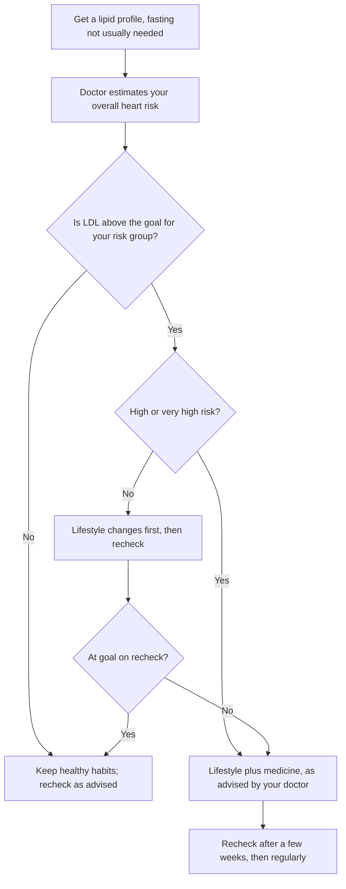

:::answer
A lipid profile measures fats in your blood: total cholesterol, LDL ("bad") cholesterol, HDL ("good") cholesterol and triglycerides, plus a few calculated values. LDL is the main number doctors treat, and the right target depends on your overall heart risk, not on the "normal range" printed on the report: the higher your risk, the lower your LDL should be. Indians often show a typical pattern of high triglycerides and low HDL, linked with belly fat, refined carbs, sugar and inactivity. Food, exercise and weight loss help a lot, especially for triglycerides, but people at high risk often also need medicine, decided with a doctor. Most people don't need to fast for the test.
:::

## Why this report matters for Indians

Heart attacks in India often strike earlier than in many Western countries, and abnormal blood fats are one of the biggest reasons. The national ICMR-INDIAB study found dyslipidaemia, meaning at least one abnormal lipid value, in about 81% of Indian adults it surveyed ([ICMR-INDIAB-17, 2023](https://doi.org/10.1016/S2213-8587(23)00119-5)). That makes the lipid profile one of the most useful and cheapest tests an adult can get.

The trouble is that most people only look for red or bold numbers on the report. A report can show every value "within range" and still be too high for someone with diabetes or a past heart attack. And a single "high" value may matter less than the overall picture. So it helps to know what each line means.

## The numbers, one by one

### LDL cholesterol
LDL carries cholesterol into artery walls, where it builds plaque over years. It is the main target of treatment in every major guideline ([ESC/EAS, 2019](https://doi.org/10.1093/eurheartj/ehz455)). Lower is better, and the target depends on your risk (see the table below).

Many Indian labs calculate LDL from the other numbers using a formula. When triglycerides are very high, roughly above 400 mg/dL, the formula becomes unreliable, and a "direct LDL" test is better.

### HDL cholesterol
HDL helps carry cholesterol away from arteries. Low HDL (commonly taken as below 40 mg/dL in men and below 50 mg/dL in women) is a warning sign, often travelling with belly fat, high triglycerides and insulin resistance. Raising HDL with tablets has not been shown to prevent heart attacks, so the focus is on the habits that raise it naturally and on lowering LDL.

### Triglycerides
Triglycerides are the fat your body stores and burns for energy. A fasting value under 150 mg/dL is generally considered desirable. They climb with excess calories, sugar and sweet drinks, refined carbs such as white rice, maida and sweets in large amounts, alcohol, uncontrolled diabetes, an underactive thyroid and some medicines. Very high values, around 500 mg/dL or more, raise the risk of pancreatitis, a painful and dangerous inflammation, and need prompt medical attention.

### Total cholesterol
This is LDL plus HDL plus a share of the triglyceride-carrying particles. On its own it can mislead: a high total with a high HDL is very different from a high total with a high LDL.

### Non-HDL cholesterol
Total cholesterol minus HDL. It adds up every particle that can block arteries, and is useful when triglycerides are high. Its target is usually 30 mg/dL above your LDL target.

### VLDL and ratios
VLDL is usually estimated from triglycerides. Ratios like total/HDL or LDL/HDL appear on many reports; they summarise risk but your doctor will mostly act on LDL and non-HDL.

### Lipoprotein(a), or Lp(a)
Lp(a) isn't part of the routine profile. It is mostly set by your genes, doesn't change much with diet, and raises heart risk when high. The ESC/EAS guideline suggests measuring it at least once in every adult's lifetime, to spot people with very high levels ([ESC/EAS, 2019](https://doi.org/10.1093/eurheartj/ehz455)). It is especially worth asking about if heart disease runs early in your family.

[[ad]]

## The Indian pattern: high triglycerides, low HDL

Many Indian reports don't show very high LDL. Instead they show triglycerides in the 150s to 300s, HDL in the 30s, and an LDL that looks "borderline". Doctors call this atherogenic dyslipidaemia. It usually comes with a bigger waist, fatty liver, prediabetes or diabetes, and high blood pressure.

This pattern is dangerous because it is easy to dismiss. LDL "only 120" can still mean many small, dense LDL particles that enter artery walls easily. That is why non-HDL cholesterol, waist size and sugar levels matter as much as the LDL line.

The good news: this pattern responds well to lifestyle. Triglycerides often fall sharply within weeks when sugar, sweet drinks, refined carbs and alcohol come down and activity goes up.

## LDL targets depend on your risk

The ESC/EAS guideline sets LDL goals by total cardiovascular risk ([ESC/EAS, 2019](https://doi.org/10.1093/eurheartj/ehz455)). The Lipid Association of India has proposed goals in the same spirit, and in some very-high-risk groups even stricter ones, because of the early and aggressive heart disease seen in Indians ([LAI, 2016](https://doi.org/10.4103/2250-3528.186492)).

| Your risk group (decided by your doctor) | Typical examples | LDL goal (ESC/EAS 2019) |
|---|---|---|
| Very high | Past heart attack, stroke or stent; diabetes with organ damage; severe kidney disease | Below 55 mg/dL and at least a 50% cut |
| High | Diabetes for 10+ years without organ damage; very high single risk factor such as familial hypercholesterolaemia | Below 70 mg/dL and at least a 50% cut |
| Moderate | Younger people with diabetes for under 10 years and no other risk factors; some middle-aged people with risk factors | Below 100 mg/dL |
| Low | Young, no diabetes, low overall risk | Below 116 mg/dL |

This is why two people with the same LDL of 110 can get completely different advice. For a healthy 28-year-old it may be acceptable; for someone who had a heart attack last year it is far too high. Your doctor uses your age, sex, blood pressure, smoking, sugar, kidney function and family history to place you in a group.

## A worked example

Here is a made-up report, to show how a doctor might read one. Imagine a 42-year-old man in Noida who works long hours at a desk, has a waist of 98 cm, doesn't smoke and has prediabetes. His report says:

| Test | Result | Lab range |
|---|---|---|
| Total cholesterol | 196 mg/dL | Below 200 |
| LDL (calculated) | 118 mg/dL | Below 130 |
| HDL | 34 mg/dL | Above 40 |
| Triglycerides | 220 mg/dL | Below 150 |
| Non-HDL | 162 mg/dL | Below 160 |

Only two lines are flagged, and he might feel relieved that his "cholesterol is normal". But read as a whole, this is the classic Indian pattern: high triglycerides, low HDL, a non-HDL just over the line, a large waist and rising sugar. His doctor would likely estimate his overall risk, set an LDL goal, and start with a firm plan to cut sweet drinks, sweets and refined carbs, walk daily, start strength training and lose a few centimetres off the waist, then recheck. If his risk turns out to be higher than it looks, medicine may be added. The point is that "in range" and "on target" are not the same thing.

## Before the test: fasting and timing

You don't usually need to fast. A European consensus concluded that non-fasting samples are fine for most people, with fasting reserved for cases such as very high non-fasting triglycerides, above about 400 mg/dL ([EAS and EFLM, 2016](https://doi.org/10.1093/eurheartj/ehw152)). Some Indian labs still ask for 10 to 12 hours of fasting; if you do fast, drink water and keep taking your usual medicines unless told otherwise.

A few tips for a fair reading:

- Avoid a very heavy, oily meal or alcohol the night before; both can push triglycerides up for a day.
- Don't test during an acute illness, fever or right after surgery; lipids can swing.
- Use the same lab when comparing reports over time, where possible.
- Tell your doctor about all medicines, including steroids, some contraceptive pills, retinoids and HIV medicines, which can affect lipids.

## Acting on your report

### What food can do
Diet changes typically lower LDL by a modest amount and can cut triglycerides a great deal. The ICMR-NIN guidelines advise limiting sugar, refined grains, deep-fried and ultra-processed foods and saturated fats, and eating more whole grains, pulses, vegetables, fruits and nuts ([ICMR-NIN, 2024](https://www.nin.res.in/dietaryguidelines/pdfjs/locale/DGI24thJune2024fin.pdf)). In an Indian kitchen, that looks like:

- Fewer sweets, sweet chai, cold drinks, packaged juices and bakery items. This is the fastest way to drop triglycerides.
- Smaller rice and roti portions; replace part of them with dal, chana, rajma, vegetables and salad.
- Less vanaspati, ghee and butter, and fewer fried snacks like samosa, pakora and namkeen. Use measured amounts of oils such as mustard, groundnut or rice bran, and rotate them.
- More fibre: oats, barley, methi seeds, whole dals, fruit and vegetables.
- A handful of nuts such as almonds or walnuts, instead of fried namkeen.
- Fish a couple of times a week for non-vegetarians.
- Little or no alcohol; it raises triglycerides strongly.

### What exercise does
Regular activity lowers triglycerides, raises HDL modestly and helps you lose belly fat. Aim for at least 150 minutes a week of brisk walking, cycling or similar, plus strength training two or three days a week. A short walk after meals also helps blood sugar.

### What medicine does
For people at high or very high risk, or with very high LDL such as familial hypercholesterolaemia, food alone usually can't bring LDL to goal. Statins are the most studied medicines for this and lower the risk of heart attacks and strokes. Other medicines may be added. Which medicine, which dose and how often to recheck are decisions for your doctor; take them only as advised and don't stop them on your own because the next report looks good. A good report on treatment usually means the treatment is working.

:::tip Habits that move the numbers
- Cut sugar-sweetened drinks and sweets first; recheck triglycerides after a few weeks.
- Fill half your plate with vegetables and dal before adding rice or roti.
- Walk 10 to 15 minutes after your two biggest meals.
- Lift weights or do bodyweight training two or three times a week.
- Measure your waist every month; it often falls before the scale moves.
- Keep a photo of each report in one phone folder, so trends are easy to see.
:::

[[ad]]

## Special situations

### Young people with very high LDL
An LDL of 190 mg/dL or more in a young adult, especially with a parent or sibling who had an early heart attack, can point to familial hypercholesterolaemia, a genetic condition. It needs a doctor's assessment and often treatment from a young age, and other family members, including children, may need testing.

### Diabetes
Diabetes alone pushes most people into the high or very high risk group, so LDL goals are stricter. Fixing blood sugar also improves triglycerides. See our [diabetes guide](/health/blog/complete-indian-guide-type-2-diabetes).

### Fatty liver
Fatty liver and high triglycerides often go together, and both respond to the same changes: less sugar and refined carbs, weight loss and regular exercise. Our [fatty liver guide](/health/blog/fatty-liver-reversal-guide) goes deeper.

### Thyroid
An underactive thyroid can raise LDL. If your cholesterol rises for no clear reason, your doctor may check thyroid function.

### Pregnancy
Lipids rise naturally in pregnancy, so reports taken then aren't compared with normal targets. Cholesterol medicines are usually stopped before or during pregnancy on medical advice.

:::warning See a doctor promptly if
- Your triglycerides are around 500 mg/dL or more, especially with belly pain
- Your LDL is 190 mg/dL or more, or a parent or sibling had a heart attack young (before 55 in men, 65 in women)
- You have chest pain, pressure or breathlessness on exertion, even if your report is "normal"
- You see yellowish bumps around the eyes, or on the tendons of the hands or heels
- You have diabetes, kidney disease or a past heart attack and haven't had a lipid test this year
- You get muscle pain or dark urine after starting a cholesterol medicine (don't just stop it; call your doctor)
:::

[[ad]]

## Myths about cholesterol

:::mythfact
| Myth | Fact |
|---|---|
| "My report has no red marks, so my heart is safe." | Lab ranges are for the general population. Your LDL goal depends on your own risk and may be much lower. |
| "I'm thin, so my cholesterol must be fine." | Genes, diet and belly fat matter. Thin people can have high LDL or Lp(a). |
| "Only ghee and oil raise cholesterol." | Sugar, refined carbs and alcohol drive up triglycerides, which are very common in Indians. |
| "Once my numbers are normal, I can stop the tablets." | Numbers usually look good because of the medicine. Stopping lets them rise again. Ask your doctor first. |
| "I must fast for 12 hours before the test." | Most people don't need to fast. Your doctor may ask you to if triglycerides were very high before. |
| "High HDL cancels out high LDL." | HDL doesn't cancel LDL. LDL remains the main treatment target. |
:::

## Common questions

:::faq
### What is a normal LDL cholesterol level?
There isn't one normal number for everyone. Guidelines set LDL goals by heart risk: below 116 mg/dL for low risk, below 100 for moderate, below 70 for high and below 55 for very high risk. Your doctor decides your group.

### Do I need to fast for a lipid profile?
Usually not. A European expert consensus found non-fasting samples are fine for most people. Your doctor may ask for a fasting test if your triglycerides were very high before. Follow your lab's instructions.

### Can diet alone lower cholesterol?
Diet and exercise can lower LDL modestly and triglycerides a lot. For people at high or very high risk, or with genetically high LDL, medicine is usually needed as well, as advised by a doctor.

### How often should I check my lipid profile?
It depends on your risk and treatment. After starting or changing treatment, doctors often recheck within a few weeks to three months, then regularly. Healthy adults with normal results can test less often, as their doctor advises.

### What does high triglycerides with low HDL mean?
It is a common Indian pattern linked with belly fat, insulin resistance, sugar and refined carbs, alcohol and inactivity. It raises heart risk even when LDL looks borderline, and often improves well with lifestyle changes.
:::

## The bottom line

Read your lipid profile as a whole, not line by line in red. LDL is the main target, and your goal depends on your risk. Indians often have high triglycerides and low HDL, which respond well to less sugar and refined carbs, more movement and a smaller waist. If you are at high risk, medicine is often part of the plan, so work with your doctor. And if heart disease runs early in your family, ask about Lp(a) once.

Regular exercise is one of the best tools for triglycerides and HDL. If you want a routine you can stick to, the trainers at Royal Fitness Club in Sector 93, Noida can help you build one around your work hours.
