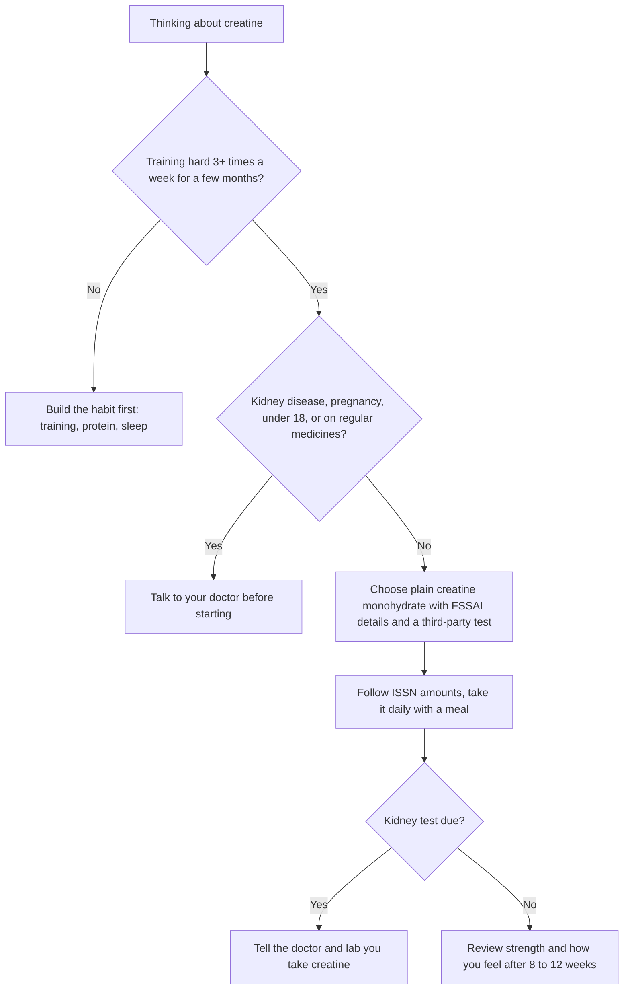

:::answer
Creatine is one of the best-studied supplements in sport. It helps you do a few more reps in short, hard efforts, and over weeks of training that adds up to more strength and muscle. In healthy adults, controlled studies at the amounts researchers recommend have not shown kidney damage, and the hair-loss fear comes from one small study that measured a hormone, not hair. You may gain 1 to 2 kg early on, mostly water inside muscle. Vegetarians start with less creatine in their muscles, so they may notice a bigger effect. If you have kidney disease, are pregnant, or are under 18, talk to a doctor before you start.
:::

## What creatine actually is

Creatine is a natural compound your body makes from three amino acids (arginine, glycine and methionine), mostly in the liver and kidneys. About 95% of it sits in your skeletal muscle, with small amounts in the brain and testes ([ISSN position stand, 2017](https://doi.org/10.1186/s12970-017-0173-z)).

Inside muscle, creatine is stored as phosphocreatine. When you sprint, jump, or push out a heavy set of squats, your muscle burns through its quick energy (ATP) in seconds. Phosphocreatine refills that ATP fast. More stored creatine means you can hold a hard effort a little longer, or recover a little faster between sets.

Roughly half of your daily need comes from food, and your body makes the rest. Meat and fish are the main food sources: a pound (about 450 g) of uncooked beef or salmon provides about 1 to 2 g of creatine ([ISSN, 2017](https://doi.org/10.1186/s12970-017-0173-z)). Milk, curd and paneer contain very little, and plant foods have essentially none. That is why the vegetarian question matters so much in India.

The position stand also notes that on a normal diet with 1 to 2 g of creatine a day, muscle stores are about 60 to 80% full. Supplements top them up.

## What the evidence says creatine does

The International Society of Sports Nutrition (ISSN) reviewed hundreds of studies and concluded that creatine monohydrate is the most effective nutritional supplement available for increasing high-intensity exercise capacity and lean body mass during training ([ISSN, 2017](https://doi.org/10.1186/s12970-017-0173-z)). After creatine loading, performance in high-intensity or repeated efforts generally improves by 10 to 20%, depending on how much muscle phosphocreatine rises.

In plain words, here is what you can expect:

- A couple of extra reps at the same weight, which over months means more strength
- Slightly better performance in repeated sprints, such as football, cricket fielding drills or kabaddi
- Somewhat faster recovery between hard sessions in some studies
- More muscle gain when combined with strength training, compared with training alone

Creatine does nothing useful if you don't train, and it won't burn fat. It helps people who already train regularly get a bit more out of each session.

Research on creatine for brain health and injury recovery is still early, so don't buy it expecting those effects.

[[ad]]

## How much: what the ISSN actually says

We only quote the amounts that the scientific position papers state. These are for healthy adults. Check with a doctor first if any of the "ask a doctor" situations later in this post apply to you.

The 2021 ISSN-linked review describes recommended amounts as **3 to 5 g a day, or about 0.1 g per kg of body weight a day** ([Antonio et al., JISSN 2021](https://doi.org/10.1186/s12970-021-00412-w)).

The 2017 position stand describes two ways to fill muscle stores ([ISSN, 2017](https://doi.org/10.1186/s12970-017-0173-z)):

1. **Faster "loading":** about 5 g four times a day (roughly 0.3 g per kg body weight a day) for 5 to 7 days, then 3 to 5 g a day to maintain. It adds that some larger athletes may need 5 to 10 g a day to maintain stores.
2. **Slower route:** 3 g a day for 28 days. This fills stores more gradually, so you may notice less effect in the first few weeks, but you skip the early water-weight jump and the stomach upset some people get with big servings.

The 2021 review says a loading phase is not required; about 3 to 5 g a day for at least four weeks reaches similar muscle saturation ([Antonio et al., 2021](https://doi.org/10.1186/s12970-021-00412-w)). For most Indian gym-goers, the slower route is simpler and kinder to the stomach.

Taking it daily matters more than timing. Mix it in water, milk or lassi with a meal. More than these amounts won't make you stronger, because muscles can only store so much.

## The kidney question: what the research shows

The 2021 review traced the kidney fear to two things ([Antonio et al., 2021](https://doi.org/10.1186/s12970-021-00412-w)):

- **Confusion between creatine and creatinine.** Your body breaks creatine down into creatinine, and doctors use blood creatinine to estimate kidney function (eGFR). Taking creatine, or eating a lot of meat, can raise blood creatinine a little without any kidney damage. The review warns that doctors must be cautious reading creatinine and eGFR in people who take creatine.
- **A 1998 case report** of a young man who already had kidney disease for eight years and was on a kidney-affecting medicine. His creatinine rose while taking creatine, and the case was widely repeated as "creatine damages kidneys".

Since then, controlled trials have looked directly at kidney function. The review concludes that in healthy people, creatine at recommended amounts does not cause kidney damage or kidney dysfunction. Other case reports of kidney problems were mixed up with medicines, existing kidney disease, other supplements or very high intakes.

The 2017 position stand describes one study in American college football players who took creatine for 21 months: there were no clinically significant differences from non-users in kidney markers, liver enzymes, blood counts or urine tests ([ISSN, 2017](https://doi.org/10.1186/s12970-017-0173-z)).

Two honest limits. First, "healthy" is the key word; people with kidney disease were not the focus of this safety research. Second, if you are getting a kidney test, tell your doctor and the lab that you take creatine, so a small rise in creatinine isn't misread. Our [creatinine and eGFR test guide](/health/lab-tests/creatinine) explains how that report works.

## Hair loss and DHT: one study, and what it didn't measure

If you have scrolled gym reels, you have seen "creatine = baldness". Almost all of that comes from a single 2009 study.

Researchers in South Africa gave 20 college rugby players creatine or placebo for three weeks (a week of loading, then two weeks of maintenance) ([van der Merwe et al., 2009](https://pubmed.ncbi.nlm.nih.gov/19741313/)). Testosterone didn't change. But DHT (dihydrotestosterone, a more potent hormone made from testosterone) rose by 56% after loading and stayed 40% above baseline after the maintenance weeks. The DHT-to-testosterone ratio rose 36% and then stayed 22% above the start.

DHT is linked to male-pattern hair loss in men whose hair follicles are sensitive to it. So the jump to "creatine causes baldness" is easy to see. Here is why that study doesn't prove it ([Antonio et al., 2021](https://doi.org/10.1186/s12970-021-00412-w)):

- **Nobody measured hair.** The study measured blood hormones only. No hair counts, no photos, no follow-up on hair.
- **The levels stayed within normal clinical limits.** The rise looked large in percentages because the starting numbers were small.
- **The groups started differently.** DHT was 23% lower in the creatine group at the start, and the placebo group's DHT fell slightly, which made the gap look bigger.
- **It was tiny and short.** Twenty men, three weeks, one study.
- **It hasn't been repeated.** The 2021 review found that other studies measuring testosterone, free testosterone or DHT did not show increases, and no study has reported hair loss in humans.

So what should you do? If male-pattern baldness runs strongly in your family and you are worried, it's reasonable to talk to a dermatologist before starting. That is a cautious personal choice, not a sign that the evidence shows harm. The honest summary: there is no good evidence that creatine causes hair loss, and the one hormone signal has not been confirmed.

:::mythfact
| Myth | Fact |
|---|---|
| "Creatine is a steroid." | Creatine is a compound your body makes and you get from meat and fish. Anabolic steroids are synthetic hormones with a different chemical structure and legal status. |
| "Creatine damages your kidneys." | In healthy people, controlled studies at recommended amounts have not shown kidney damage. It can raise blood creatinine a little, which can confuse a kidney report. |
| "Creatine makes you bald." | One small 2009 study saw a rise in a hormone (DHT), not hair loss. Later studies have not confirmed it. |
| "Whey protein is a steroid." | Whey is a milk protein. An Indian lab study of 36 protein powders found none with synthetic steroids, though many had less protein than labelled. |
| "The water weight is fat." | The early 1 to 2 kg gain is mostly water held inside muscle cells, and it's not fat. |
| "Creatine is banned in sport." | Creatine is not on the WADA prohibited list. The bigger doping risk is a contaminated product. |
:::

## Water retention: the 1 to 2 kg on the scale

Creatine draws a little water into muscle cells. The 2021 review notes that water retention in the first several days is the most common side effect, and that a loading phase of about 20 g a day for 5 to 7 days typically adds 1 to 3 kg of body weight, mostly water ([Antonio et al., 2021](https://doi.org/10.1186/s12970-021-00412-w)). Several longer studies found no lasting change in total body water relative to muscle.

If you compete in a weight category, plan around it with your coach. If you are losing weight, expect the scale to rise for a week or two, and judge progress by your waist and strength.

Creatine doesn't dehydrate you or cause cramps in the research reviewed by the ISSN. Its 2017 position stand states there is no evidence that creatine increases cramping, dehydration, stomach upset or kidney dysfunction ([ISSN, 2017](https://doi.org/10.1186/s12970-017-0173-z)). Still, drink water through the day, especially in Noida summers when gym sessions feel like a sauna.

[[ad]]

## Vegetarians: why you may notice more

This is where Indian readers stand out. Many of us are vegetarian or eat meat only now and then, so we get little or no creatine from food.

The ISSN reports that vegetarians have lower creatine stores in muscle, around 90 to 110 mmol per kg of dry muscle, compared with an average of about 120 mmol/kg for a 70 kg person on a mixed diet. The upper limit of storage for most people appears to be about 160 mmol/kg ([ISSN, 2017](https://doi.org/10.1186/s12970-017-0173-z)). Because vegetarians start lower, they may see a bigger rise in muscle creatine when they supplement.

Most commercial creatine monohydrate is made synthetically, not from animals, so it generally suits vegetarians. Check the capsule shell, though: some capsules use gelatin. Plain powder avoids that question.

A vegetarian gym diet has other gaps worth closing first: enough total protein (dal, chana, rajma, soya, paneer, curd, milk), and vitamin B12, which runs low in many Indian vegetarians. Our [B12 guide](/health/blog/vitamin-b12-vegetarian-india) and [protein guide](/health/blog/protein-requirement-calculator-india) cover both. Creatine is a small extra on top of a good plate, never a replacement for it.

## Older adults: creatine works best with weights

After 40, muscle and strength slowly fall. This is called sarcopenia, and it raises the risk of falls.

The 2021 review summarises a growing body of evidence that creatine, especially when combined with resistance training, improves strength, muscle mass and daily function in older adults ([Antonio et al., 2021](https://doi.org/10.1186/s12970-021-00412-w)). Three meta-analyses support the added muscle gain when creatine is paired with training. Some studies in postmenopausal women suggest a benefit for bone when combined with training.

The catch is the training. In one study, postmenopausal women who took 3 g of creatine a day for two years without exercise did not gain lean mass. Creatine alone is weak; creatine plus a sensible strength programme is where the benefit shows up.

Older adults are more likely to have kidney disease or take several medicines, so speak to your doctor first. Our guide to [keeping muscle after 40](/health/blog/muscle-after-40-sarcopenia-india) has a safe starting programme.

## Who should ask a doctor first

Creatine has a strong safety record in healthy adults, but the research is thinner, or doesn't apply, for some groups.

- **Kidney disease, or a past abnormal kidney test.** The safety studies were mostly in healthy people. If you have chronic kidney disease, diabetes with kidney involvement, or high blood pressure with a raised creatinine, your doctor needs to decide.
- **Pregnancy and breastfeeding.** Researchers are interested in creatine during pregnancy, and the ISSN position stand discusses early work, but this is not something to start on your own. Ask your obstetrician.
- **Teenagers under 18.** The 2021 review found that the limited evidence suggests creatine appears safe in adolescents, and it also calls for more research ([Antonio et al., 2021](https://doi.org/10.1186/s12970-021-00412-w)). For a 15-year-old, good food, sleep and proper coaching matter far more. Any use should be with a parent and a doctor involved.
- **Regular medicines.** Especially medicines that affect the kidneys, such as some painkillers taken daily or certain transplant and blood pressure medicines.
- **Any long-term condition under a specialist.** Heart, liver or mental health conditions included: tell your specialist about any supplement you add.

:::warning See a doctor promptly if
- You notice a big drop in how much urine you pass, or swelling of the feet or face
- Your urine turns dark like cola, especially after a very hard workout with muscle pain
- A routine test shows your creatinine or eGFR has changed, and you haven't told your doctor about creatine
- You get severe or persistent stomach pain, vomiting or diarrhoea after starting any supplement
- You feel chest pain, fainting, or a racing heartbeat during exercise (stop training and get checked)
- Your product contains "proprietary blends" or stimulants you didn't expect, and you feel unwell
:::

## Choosing a product in India

Creatine itself is cheap and simple. The risk lies in what else ends up in the tub, or what is missing from it.

Indian lab testing of protein powders gives a sense of the problem. The Citizens Protein Project tested 36 popular protein supplements sold in India and found that 25 of them (69.4%) had less protein than the label claimed, with some also containing aflatoxins, pesticide residues or heavy metals ([Medicine, 2024](https://pmc.ncbi.nlm.nih.gov/articles/PMC10994440/)). That study was about protein, not creatine, but many of the same companies sell both. A European study of 33 creatine samples found contaminants such as creatinine, and in about 15% of samples, a by-product called dihydrotriazine above the detection limit ([Food Chemistry, 2011](https://doi.org/10.1016/j.foodchem.2010.12.028)).

A short checklist:

1. **Plain creatine monohydrate.** It's the form used in nearly all the research. The 2017 position stand states that claims that other forms (ethyl ester, buffered, nitrate, citrate) work better are unfounded ([ISSN, 2017](https://doi.org/10.1186/s12970-017-0173-z)).
2. **One ingredient.** Avoid "creatine blends" with added stimulants, herbs or "test boosters".
3. **FSSAI details on the pack.** Under India's 2016 health supplement rules, labels must say "Health Supplement" and "Not for medicinal use", list nutrient amounts, warn of known side effects, and say keep away from young children ([NutraIngredients summary of FSSAI rules, 2016](https://www.nutraingredients.com/Article/2016/12/07/India-s-new-functional-food-and-supplements-rules-The-key-requirements-every-firm-needs-to-know/)). Look for the FSSAI licence number and the manufacturer's address. A missing one is a red flag.
4. **Third-party testing.** Look for a batch-wise lab report from an independent lab, or a sport-testing certification. This matters most for athletes.
5. **Authorised seller.** Buy from the brand's site or a known retailer. Very cheap "imported" tubs on social media are where fakes turn up.

### A note for tested athletes

Creatine is not on the World Anti-Doping Agency's 2026 Prohibited List ([WADA, 2026](https://www.wada-ama.org/en/prohibited-list)), and the ISSN notes that no sports body bans it. But NADA India follows WADA's rules, and you are responsible for anything in your sample. A contaminated tub or a "pre-workout creatine" spiked with a banned stimulant can still cost you your career. If you are tested, use only third-party tested products and keep the bill and batch number.

:::tip Make creatine simple and safe
- Train first. Creatine helps people who already lift or sprint regularly; give yourself two or three months of steady training before adding it.
- Pick one plain monohydrate powder, take it daily with a meal, and stop worrying about timing.
- Expect a small rise on the scale in the first weeks. Track your waist and the weight you lift instead.
- Tell your doctor and lab that you take creatine before any kidney test.
- Fix the basics first: protein at every meal, B12 if you're vegetarian, sleep of seven hours or more.
:::

## Creatine, whey and steroids are three different things

We hear this mix-up often from worried families: "Gym-wale steroids de rahe hain." Creatine is a natural compound found in meat and fish and made by your own body. Whey is milk protein, the watery part left after making paneer; the Citizens Protein Project found no synthetic steroids or hormones in any of the 36 Indian protein products it tested, though it found many quality problems ([Medicine, 2024](https://pmc.ncbi.nlm.nih.gov/articles/PMC10994440/)). Anabolic steroids are synthetic hormone drugs with a different chemical structure, and they are controlled drugs ([Antonio et al., 2021](https://doi.org/10.1186/s12970-021-00412-w)). Our post on [anabolic steroid side effects](/health/blog/anabolic-steroids-side-effects-india) explains their harms. The real danger is a supplement that has been secretly spiked, which is why the product checklist above matters more than the label's promises.

[[ad]]

## Common questions

:::faq
### Is creatine safe for daily use?
For healthy adults, the ISSN states that both short and long-term use has been safe and well tolerated in the studies it reviewed, at the amounts it describes. Daily use is how it's studied. If you have kidney disease, are pregnant or take regular medicines, ask your doctor first.

### Do I need a loading phase?
No. The 2021 review says about 3 to 5 g a day for at least four weeks fills muscle stores to a similar level. Loading only gets you there faster, with more early water weight and a higher chance of stomach upset.

### Will creatine make me fat?
No. Studies reviewed in 2021 did not show an increase in fat mass. The early scale gain is water inside muscle. If your waist grows, look at your food, not the creatine.

### Is creatine good for women?
Yes, women can use it. Most studies were in men, and some suggest women may gain a little less strength or muscle, but benefits have been reported in women, including older women who also strength train. Pregnant or breastfeeding women should ask their doctor first.

### Should I stop creatine before a blood test?
Tell your doctor and the lab you take it, especially before a creatinine or eGFR test. Your doctor may ask you to pause it for a while before a repeat test. Don't stop prescribed medicines on your own.

### Is creatine okay for a 16-year-old who plays cricket?
The limited evidence suggests it appears safe in adolescents, but more research is needed. For a teenager, coaching, enough food and sleep do far more. Any decision should involve a parent and a doctor.
:::

:::takeaways
- Creatine monohydrate is the best-supported gym supplement for strength and muscle, but only if you train.
- In healthy people, studies at recommended amounts show no kidney damage; tell your doctor before kidney tests.
- The hair-loss fear rests on one small hormone study; no human study has reported hair loss.
- Vegetarians start with lower muscle creatine and may notice more benefit.
- Ask a doctor first if you have kidney disease, are pregnant, are under 18 or take regular medicines.
- Choose plain monohydrate with full FSSAI details and third-party testing.
:::

## The bottom line

Creatine is about as close as sport supplements get to "it works and it's safe" for healthy adults who train. It won't build muscle without effort, it won't damage healthy kidneys at the amounts studied, and the baldness story rests on very thin evidence. Buy a plain, tested product, follow the amounts in the position papers, and keep your doctor in the loop if you have any health condition. We made a short Hinglish video on supplement myths, including creatine and whey, on our YouTube channel, [Royal Fitness TV](https://www.youtube.com/@RoyalFitnessTV?sub_confirmation=1).

If you want a training plan that makes creatine worth taking, the trainers at Royal Fitness Club in Sector 93, Noida can set one up for you.
