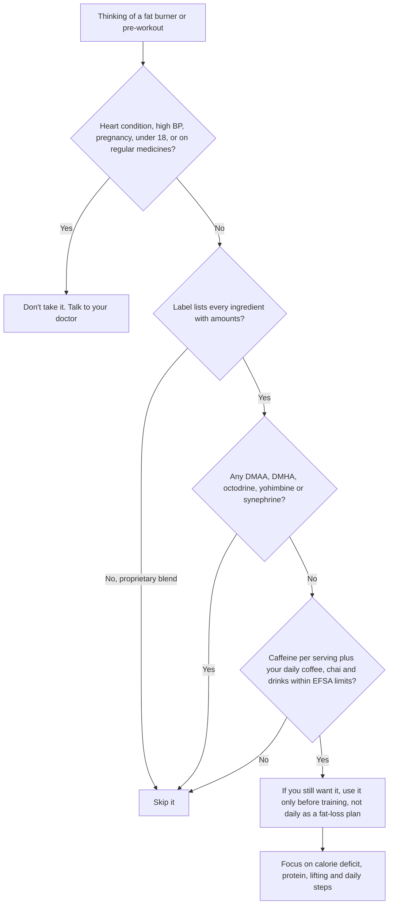

:::answer
Most fat burners and pre-workouts are built around stimulants, mainly caffeine, sometimes with bitter orange (synephrine), yohimbine or, in the worst cases, banned drugs like DMAA. Caffeine can help you train a little harder, but it barely moves fat loss on its own. Europe's food safety agency considers up to 200 mg at one time and 400 mg a day safe for healthy adults; stacking a pre-workout with coffee and an energy drink can go past that. Weight-loss supplements are a growing cause of liver injury in US data, and Indian lab tests keep finding products that don't match their labels. Fat loss comes from a steady calorie deficit, enough protein, strength training and moving more through the day. Chest pain, fainting or a racing heartbeat in the gym means stop and get checked.
:::

## What's actually in the tub

Read the back of most "shred", "thermo" or "pre" products and you will find some mix of the following:

- **Caffeine**, often listed as caffeine anhydrous, or hidden in "natural" forms such as green coffee, guarana or green tea extract
- **Synephrine** from bitter orange (Citrus aurantium)
- **Yohimbine** or yohimbe bark extract
- **Green tea extract, Garcinia cambogia**, and other herbal extracts sold as "metabolism boosters"
- **Beta-alanine** (the tingling feeling), citrulline, tyrosine and B vitamins
- **"Proprietary blends"** that list ingredients without amounts

The last item is the problem. When a label gives only one total weight for a named blend, you don't know how much of each stimulant you are swallowing. And as the sections below show, some products contain drugs that aren't on the label at all.

## Caffeine: the main ingredient, and its limits

Caffeine can make a hard session feel easier and help many people push a little more. Don't expect it to burn much fat: as the review of weight-loss supplements later in this post shows, the products built around it have a weak record.

The question that matters for your heart is how much. The European Food Safety Authority's 2015 scientific opinion, one of the most thorough reviews of caffeine safety, concluded the following for healthy adults ([EFSA, 2015](https://www.efsa.europa.eu/en/topics/topic/caffeine)):

- **Single amounts up to 200 mg** (about 3 mg per kg of body weight) from all sources do not raise safety concerns.
- **Up to 400 mg a day** (about 5.7 mg per kg), spread through the day, does not raise safety concerns, except in pregnancy.
- **Pregnant and breastfeeding women:** up to 200 mg a day from all sources.
- **Children and teenagers:** about 3 mg per kg of body weight a day.
- **Before exercise:** a single 200 mg taken less than two hours before intense exercise in normal conditions did not raise concerns. EFSA notes there are no studies in pregnant women or in middle-aged and older people doing intense exercise.
- **Sleep:** even 100 mg close to bedtime may affect sleep in some adults.

EFSA also gives typical amounts: an espresso (60 ml) has about 80 mg, a cup of filter coffee (200 ml) about 90 mg, a cup of black tea (220 ml) about 50 mg, a can of cola (355 ml) about 40 mg, and a 250 ml can of energy drink about 80 mg. Indian chai varies a lot with how strong you brew it.

### How people end up over the limit

Here is how it adds up on a normal evening session. Morning: two cups of strong coffee. Afternoon: a cola or an energy drink. 6 pm: a scoop of pre-workout. Then a "fat burner" capsule because the trainer's friend swears by it. Add up the caffeine printed on each label, and it's easy to go past 200 mg in one go, or 400 mg in a day, without ever noticing.

The fix is boring. Read the caffeine per serving on the label, add your coffee, chai and drinks, and stay within EFSA's numbers. If a label won't tell you how much caffeine is inside, don't take it.

### FSSAI rules on caffeinated drinks in India

India's food regulator, FSSAI, caps caffeine in caffeinated beverages at 145 to 300 mg per litre from all sources. Labels must say "consume not more than 500 ml per day" and carry the caution "Not recommended for children, pregnant or lactating women, persons sensitive to caffeine". In 2026 FSSAI also ordered brands to stop using "energy drink" as a product name, giving them until 29 September 2026 to re-label, and said energy-boosting claims are not permitted ([BeverageDaily, 2026](https://www.beveragedaily.com/Article/2026/08/27/not-enough-time-india-gives-90-day-deadline-to-re-label-energy-drinks/)).

A quick sum: 500 ml at the 300 mg per litre ceiling works out to 150 mg of caffeine. Have that with a pre-workout scoop and you are likely past EFSA's 200 mg single amount. Teenagers who drink these cans before cricket practice are the group the label warning is meant for.

[[ad]]

## Banned stimulants: DMAA, DMHA and their cousins

This is where pre-workouts can turn dangerous.

**DMAA** (1,3-dimethylamylamine, also called methylhexaneamine) is a synthetic stimulant that turned up in pre-workouts and fat burners. The US FDA banned it from dietary supplements and warned that it can pose heart and blood vessel risks ranging from high blood pressure to heart attacks ([Clinical Toxicology, 2018](https://pubmed.ncbi.nlm.nih.gov/29115866/)).

When DMAA was pushed out, look-alike stimulants moved in. A 2018 lab study of six US supplement brands with vague labels such as "DMHA" or "2-amino-isoheptane" found octodrine (DMHA), 1,4-DMAA, and the banned stimulants 1,3-DMAA and 1,3-DMBA ([Clinical Toxicology, 2018](https://pubmed.ncbi.nlm.nih.gov/29115866/)). The octodrine per serving was more than twice the largest amount once used in European medicines, and 1,4-DMAA had never been approved for humans, so its safety is simply unknown.

For athletes, the World Anti-Doping Agency lists methylhexaneamine (DMAA) and octodrine as stimulants prohibited in competition. Caffeine and synephrine are not banned; they sit on WADA's monitoring programme ([WADA, 2026](https://www.wada-ama.org/en/prohibited-list)). NADA India follows the WADA list, so a spiked pre-workout can end a sports career as well as hurting your heart.

Names to treat as a red flag on any label: DMAA, 1,3-dimethylamylamine, methylhexaneamine, DMHA, octodrine, 2-aminoisoheptane, DMBA, and "Aconitum" extracts listed as a stimulant. If you see them, put the tub down.

## Synephrine (bitter orange)

Synephrine is often sold as a gentler stimulant. A 2022 systematic review and meta-analysis of 18 studies found that with longer use, synephrine raised systolic blood pressure by about 6.37 mmHg and diastolic by about 4.33 mmHg on average. Weight loss in the synephrine groups was not significant, and body composition didn't change. The authors concluded that synephrine tends to raise blood pressure and heart rate, and there's no evidence it helps weight loss ([Nutrients, 2022](https://doi.org/10.3390/nu14194019)).

EFSA's caffeine opinion looked at caffeine combined with synephrine because so many weight-loss products pair them ([EFSA, 2015](https://www.efsa.europa.eu/en/topics/topic/caffeine)). Put simply: two ingredients that push blood pressure up, packaged together, with little benefit to show for it.

## Yohimbine

Yohimbine comes from the bark of an African tree and is sold as a "stubborn fat" burner. Extracts are banned in many countries. A 2016 study tested 49 US supplement brands labelled as containing yohimbe or yohimbine ([Drug Testing and Analysis, 2016](https://pubmed.ncbi.nlm.nih.gov/26391406/)). The amount per serving ranged from none detected to quantities the authors described as pharmaceutical. Only 11 brands (22%) listed a specific quantity, and most of those were wrong, with actual content between 23% and 147% of the label. Nine (18%) gave no information about side effects.

A product that might contain nothing, or a drug-level amount, with no warning on the label, is not something to take before squats.

## Liver injury: the quiet risk

Most people worry about the heart with stimulants. The liver is the other organ that pays.

The US Drug-Induced Liver Injury Network (DILIN) follows patients with liver damage from medicines and supplements. In its 2014 report, liver injury caused by herbal and dietary supplements rose from 7% to 20% of cases during the study period ([Hepatology, 2014](https://pmc.ncbi.nlm.nih.gov/articles/PMC4293199/)). Out of 839 patients, 130 (15.5%) had injury from supplements: 45 from bodybuilding products and 85 from other supplements, including weight-loss products.

The patterns differed. Bodybuilding supplements caused long-lasting jaundice in young men, with a median of 91 days, though no deaths or transplants. Non-bodybuilding supplements more often led to death or liver transplant than injury from medicines (13% versus 3%).

In India, the Citizens Protein Project tested 36 popular protein supplements and found that 25 (69.4%) had less protein than labelled. Some products also contained herbal extracts the authors flagged as liver-toxic, especially green tea extract and Garcinia cambogia, two of the commonest "fat burner" ingredients ([Medicine, 2024](https://pmc.ncbi.nlm.nih.gov/articles/PMC10994440/)). That study was on protein powders, but it shows how loosely the Indian supplement market is policed.

Warning signs of liver trouble: yellow eyes or skin, dark urine, pale stools, itching, loss of appetite, nausea and pain under the right ribs. Stop the product and see a doctor.

[[ad]]

## Do fat burners work at all?

The honest answer is: barely, and the evidence is poor.

A 2021 systematic review in the journal Obesity looked at 315 randomised controlled trials of 14 types of weight-loss supplements and alternative therapies ([Obesity, 2021](https://pmc.ncbi.nlm.nih.gov/articles/PMC8231729/)). Only 52 trials (16.5%) were low risk of bias and had enough data to judge. Of those, only 16 (31%) showed a significant difference in weight, ranging from 0.3 to 4.93 kg. The authors concluded these products have a limited high-quality evidence base.

So in the best trials, about a third showed any real difference, and even then it was often a kilo or two. Compare that with what changes in food and activity can do, and with the risks above.

:::mythfact
| Myth | Fact |
|---|---|
| "Fat burners melt belly fat." | No supplement removes fat from one spot. In the best-quality trials, most weight-loss supplements showed no significant effect. |
| "Natural or herbal means safe." | Green tea extract and Garcinia cambogia are flagged in liver-injury research. Supplements caused a rising share of liver injury in US data. |
| "More caffeine burns more fat." | Caffeine's effect on fat loss is small. Past EFSA's safe amounts you mostly get a racing heart, anxiety and poor sleep. |
| "Bitter orange is a gentle, safe stimulant." | A 2022 meta-analysis found it raised blood pressure, with no evidence it helped weight loss. |
| "If it's sold online in India, it must be approved." | Indian lab tests have found many supplements that don't match their labels. Banned stimulants can be hidden in blends. |
| "Energy drinks are fine before a workout." | FSSAI labels say not for children, pregnant women or caffeine-sensitive people. Combined with a pre-workout they can push caffeine past safe levels. |
:::

## What actually moves fat loss

The International Society of Sports Nutrition's position stand on diets and body composition says diets for fat loss are driven by a sustained calorie deficit ([ISSN, 2017](https://doi.org/10.1186/s12970-017-0174-y)). It also concludes that a wide range of approaches, from low-fat to low-carb, can work similarly well, that slower weight loss better protects muscle in leaner people, and that higher protein intakes help keep muscle while you diet.

Put into an Indian routine, that looks like this.

### 1. A steady calorie deficit you can live with

Eat a bit less than you burn, most days, for months. No single food is magic. Smaller rice and roti portions, fewer fried snacks, less sugar in chai, and fewer sweets and juices do most of the work. If you aren't sure where to start, check your [BMI](/health/health-calculators/bmi-calculator) and waist, and talk to a dietitian.

### 2. Protein at every meal

Protein keeps you full and protects muscle while you lose fat. Dal, chana, rajma, soya, paneer, curd, eggs, chicken and fish all count. Our [protein guide](/health/blog/protein-requirement-calculator-india) helps you work out your number from Indian foods.

### 3. Strength training two to four times a week

Lifting tells your body to keep muscle while fat comes off. Without it, more of what you lose can be muscle, which makes you weaker and slows your metabolism.

### 4. Move more outside the gym (NEAT)

NEAT stands for non-exercise activity thermogenesis: the energy you burn walking, standing, climbing stairs, doing housework and fidgeting. For many office workers, an hour in the gym is outweighed by ten hours of sitting. Take the stairs in your society, walk to the market, stand during calls, and aim for a daily step count you can keep.

### 5. Sleep and patience

Poor sleep makes it harder to train well and stick to your food plan. Aim for seven hours or more. Expect slow, uneven progress; the scale bounces with water, salt and periods.

[[ad]]

## Heart warning signs in the gym

Most people who train are safe, and exercise protects your heart over the long run. But stimulants plus a hot gym plus a hard set is a combination that deserves respect, especially after 35, with a family history of early heart disease, or if you smoke. Our guide to [heart safety in the gym](/health/blog/gym-heart-safety-chest-pain) and our post on [heart attacks under 40 in India](/health/blog/heart-attack-under-40-india) go into detail.

:::warning Stop training and get medical help now if you have
- Chest pain, pressure, squeezing or heaviness, especially if it spreads to the arm, jaw, neck or back
- Sudden breathlessness that is out of proportion to the effort
- Fainting, near-fainting, or sudden dizziness during or right after exercise
- A racing, pounding or irregular heartbeat that doesn't settle with rest
- Cold sweat, nausea or unusual weakness with any of the above
- A sudden severe headache, confusion, weakness on one side or trouble speaking (possible stroke)
- Yellow eyes, dark urine or pain under the right ribs after using a supplement (possible liver injury)
:::

Call an ambulance (112 in India) for chest pain or fainting. Don't drive yourself to hospital, and don't "walk it off". Take the supplement tub with you so doctors can see the label.

:::tip If you still want to use a pre-workout
- Check with your doctor first if you have high BP, a heart condition, thyroid problems, anxiety or take regular medicines.
- Choose a product that lists every ingredient with its amount. No proprietary blends.
- Add up caffeine from all sources and stay within EFSA's 200 mg at one time and 400 mg a day.
- Avoid DMAA, DMHA, octodrine, yohimbine and synephrine completely.
- Don't take stimulants within several hours of bedtime; sleep matters more for fat loss than any capsule.
- Never combine a pre-workout with energy drinks, alcohol or "fat burner" capsules.
- Under 18? Skip pre-workouts and energy drinks.
:::

## Common questions

:::faq
### Is black coffee before the gym okay?
For most healthy adults, a cup of coffee before training is fine and may help a little. Keep your total caffeine within EFSA's limits, and skip it if it makes your heart race, raises your BP or ruins your sleep.

### Can fat burners damage my liver?
Some can. US data show supplements caused a rising share of drug-induced liver injury, and ingredients such as green tea extract and Garcinia cambogia appear in liver-injury research. Stop and see a doctor if your eyes turn yellow or your urine goes dark.

### Are pre-workouts safe for teenagers?
No. FSSAI labels on caffeinated drinks say they're not recommended for children, and EFSA's limit for children and teens is based on body weight, so a scoop meant for an adult can easily exceed it. Teens need food, water and sleep before practice, not stimulants.

### What if I already took a supplement with DMAA?
Stop using it. If you have chest pain, a severe headache, a racing heartbeat or feel faint, get emergency care. If you feel fine, mention it to your doctor and have your blood pressure checked.

### Do I need anything to lose fat?
No supplement is required. A steady calorie deficit, protein at every meal, strength training and more daily steps do the work. Sleep and consistency decide whether you keep it off.
:::

:::takeaways
- Fat burners and pre-workouts are mostly stimulants; their effect on fat loss is small at best.
- EFSA's limits for healthy adults: 200 mg caffeine at one time, 400 mg a day; less in pregnancy and for teens.
- DMAA and look-alikes such as DMHA and octodrine carry heart risks and are prohibited in sport.
- Synephrine raised blood pressure in a meta-analysis without helping weight loss.
- Supplements are a growing cause of liver injury; Indian products often don't match their labels.
- Fat loss comes from a calorie deficit, protein, lifting and daily movement.
:::

## The bottom line

The tub promises fast fat loss. The research shows small effects at best, real risks to your heart and liver, and a market where the label may not tell you what's inside. If you choose caffeine before training, keep it within safe limits and skip anything with hidden blends or banned stimulants. We made a short Hinglish video on supplement myths, including fat burners, on our YouTube channel, [Royal Fitness TV](https://www.youtube.com/@RoyalFitnessTV?sub_confirmation=1).

If you want a fat-loss plan built on food, strength and daily movement, the trainers at Royal Fitness Club in Sector 93, Noida can set one up with you.
