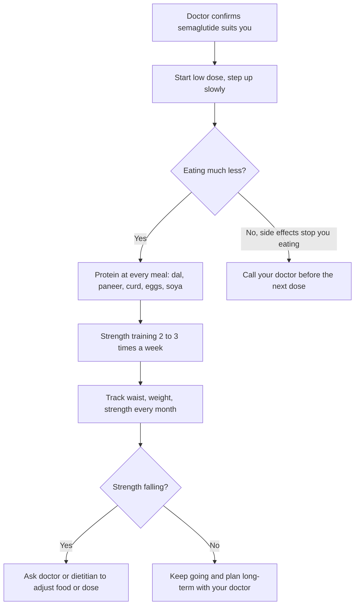

:::answer
Generic semaglutide (the medicine in Ozempic, Wegovy and Rybelsus) became legal for Indian companies to sell after the core patent lapsed in March 2026, and prices fell sharply. It is a prescription medicine for people with type 2 diabetes, or with obesity (or overweight plus a weight-related illness), not a shortcut for losing a few kilos before a wedding. In trials it led to large weight loss, but part of that loss was muscle, most people regained weight after stopping, and stomach side effects are common. If you and your doctor decide it suits you, treat it as one tool alongside protein at every meal and strength training two to three times a week.
:::

## What changed in 2026, in plain words

Semaglutide copies a gut hormone called GLP-1. It tells your brain you are full, slows how fast your stomach empties, and helps the pancreas release insulin when blood sugar is high. It is given as a once-a-week injection, and there is also a daily tablet.

Until early 2026, only the original maker sold it in India, at prices that kept it out of reach for most families. When the main Indian patent expired in March 2026, several Indian drug companies launched their own versions within days. News reports from that month describe originator prices of roughly ₹8,800 to ₹10,000 a month depending on the dose, while generic injections were launched at a fraction of that, with some companies announcing monthly prices in the low thousands of rupees and a few below that ([CNBC, March 2026](https://www.cnbc.com/2026/03/23/novo-nordisk-cheap-weight-loss-drugs-india-generic-ozempic-wegovy-semaglutide.html)). In May 2026 an oral generic was launched at a starting price reported as ₹99 a tablet ([Business Today](https://www.businesstoday.in/industry/pharma/story/dr-reddys-launches-oral-semaglutide-tablets-at-rs99-per-pill-in-india-532551-2026-05-20)).

Two honest warnings about those numbers. First, prices differ by brand, dose and pack, and they have been changing month to month, so treat any figure you read (including ours) as a rough guide and check with your pharmacist. Second, "cheaper" changes who can afford the medicine; it does not change who should take it.

[[ad]]

## Who semaglutide is actually for

Semaglutide is approved for two broad groups. The first is adults with type 2 diabetes whose sugar isn't controlled well enough. The second is adults living with obesity, or with overweight plus a weight-related condition such as high blood pressure, prediabetes, sleep apnoea or fatty liver.

For Indians, the word "obesity" needs a local lens. South Asians tend to carry more fat around the abdomen and develop diabetes and heart disease at lower body weights than Europeans. Indian expert consensus therefore uses lower cut-offs: a BMI of 23 and above counts as overweight and 25 and above as obesity, with waist size as an extra warning sign ([JAPI consensus, 2009](https://pubmed.ncbi.nlm.nih.gov/19582986/)). You can check your own number with our [BMI calculator](/health/health-calculators/bmi-calculator), and our [Indian Diabetes Risk Score](/health/india-risk) tool gives a quick read on diabetes risk.

A BMI number alone doesn't settle the decision. A good doctor will also look at:

- Your blood sugar (HbA1c), blood pressure, cholesterol and liver tests
- Whether you have tried a structured food and activity plan, and what got in the way
- Your medicines, because some interact or raise the risk of low sugar
- Your history of pancreatitis, gallstones, kidney problems or eating disorders
- Whether you are pregnant, breastfeeding or planning pregnancy
- Your family history of a rare thyroid cancer (medullary thyroid cancer) or the MEN2 syndrome

### Who should not use it, or should be extra careful

Semaglutide is not recommended during pregnancy or breastfeeding, and doctors usually advise stopping well before a planned pregnancy. People with a personal or family history of medullary thyroid cancer or MEN2 are told not to use it. Those with past pancreatitis, severe stomach problems, or diabetic eye disease need specialist input. Teenagers, older adults with low body weight, and anyone with a history of anorexia or bulimia need particular caution, because appetite suppression can do real harm.

## What the trials actually showed

The biggest weight-loss trial, STEP 1, gave adults with obesity (without diabetes) a weekly 2.4 mg injection for 68 weeks along with lifestyle advice. Average weight loss was about 14.9% of body weight, compared with about 2.4% in the placebo group ([NEJM, 2021](https://www.nejm.org/doi/full/10.1056/NEJMoa2032183)). That is a large effect by any standard: for someone weighing 90 kg, it means losing around 13 kg on average.

Averages hide a wide spread. Some people lost much more, and some lost very little. People with diabetes usually lose less weight on the same medicine than people without diabetes.

The SELECT trial asked a different question: does semaglutide protect the heart in people with existing heart disease and overweight or obesity, but no diabetes? Over about three years, major heart events (heart attack, stroke, or death from heart disease) were about 20% lower in the semaglutide group ([NEJM, 2023](https://www.nejm.org/doi/full/10.1056/NEJMoa2307563)). That benefit was shown in people who already had heart disease; it cannot simply be assumed for everyone.

### The part nobody puts on the poster: what happens when you stop

In the extension of STEP 1, people stopped the injection and the lifestyle support and were followed for a year. They regained about two-thirds of the weight they had lost, and the improvements in blood pressure and sugar mostly faded too ([Diabetes, Obesity and Metabolism, 2022](https://dom-pubs.onlinelibrary.wiley.com/doi/10.1111/dom.14725)). This tells us semaglutide treats a long-term condition; it doesn't reset your body permanently. That matters for your budget: a cheap month is only useful if you can sustain the plan, or have a clear way to come off it while keeping your habits.

[[ad]]

## Protecting your muscle: the most important section

When you eat much less, your body loses fat, but it also loses some muscle unless you give it a reason to keep it. In body-composition sub-studies of the semaglutide trials, a meaningful share of the weight lost was lean mass, which includes muscle. Losing fat is the goal. Losing muscle makes you weaker, lowers the calories you burn at rest, and makes weight regain more likely.

### Protein: how much, from where

The ICMR-NIN dietary guidelines encourage most of your protein to come from everyday foods rather than powders ([ICMR-NIN, 2024](https://www.nin.res.in/dietaryguidelines/index.html)). When your appetite is small, the trick is to eat the protein part of the meal first, before rice or roti fill you up.

Practical Indian sources that are easy on a sensitive stomach:

- Thick dal or sambar, moong dal chilla, besan chilla
- Curd, hung curd, buttermilk, paneer, tofu
- Eggs (boiled, bhurji with little oil), fish, chicken in soft curries
- Roasted chana, soya chunks in a pulao, sprouts in a chaat
- Milk or a small glass of lassi without sugar

If you eat only small portions, spread protein across four or five mini-meals rather than two large ones. Our [high-protein vegetarian guide](/health/blog/high-protein-vegetarian-india-guide) has full day plans.

### Strength training: the non-negotiable

Muscle is kept by using it against resistance. Two or three sessions a week of 30 to 45 minutes are enough for most beginners: squats to a chair, push-ups against a wall or bench, rows with resistance bands or dumbbells, hip bridges, and carrying a heavy bag for a few rounds. Add weight slowly over weeks. Walking is excellent for health, but walking alone does not protect muscle well during big weight loss.

On days when nausea is bad, do a lighter session rather than nothing. Dizziness, fainting or chest pain during exercise is a reason to stop and see a doctor.

:::tip Smart habits that make semaglutide easier
- Eat slowly and stop at "comfortably satisfied". On this medicine, the "full" signal arrives late, and overeating triggers nausea.
- Smaller, more frequent meals beat two heavy ones. Keep fried and very oily food for rare occasions, because fat slows the stomach even more.
- Sip water through the day. Nausea and smaller meals make dehydration easy, especially in Indian summers.
- Keep a simple log: weight, waist, the weight you lift in one exercise, and any side effects. Bring it to every doctor visit.
- Buy only from a licensed pharmacy with a prescription and an unbroken cold chain. Never buy "semaglutide" from social media sellers or unlabelled vials.
:::

## Side effects, honestly

The most common side effects are in the stomach: nausea, vomiting, diarrhoea, constipation, burping, bloating and reduced appetite. They usually appear when the dose is increased and settle over a few weeks. This is why doctors start low and step up slowly.

Less common but serious problems include:

- **Pancreatitis**: severe pain in the upper belly, often going to the back, with vomiting
- **Gallbladder problems**: pain under the right ribs, especially after meals, fever, yellow eyes
- **Dehydration and kidney strain**, especially after repeated vomiting or diarrhoea
- **Low blood sugar** when combined with insulin or sulfonylurea tablets
- **Worsening of diabetic eye disease** in some people whose sugar drops quickly

Hair fall can happen during any rapid weight loss, usually temporarily. Mood changes should always be mentioned to your doctor.

:::warning See a doctor urgently or go to hospital if
- You have severe or constant pain in the upper belly, with or without vomiting
- You cannot keep fluids down for a day, or you pass very little urine
- Your eyes or skin turn yellow, or you have fever with pain under the right ribs
- You feel shaky, sweaty and confused (possible low sugar), especially if you take insulin or diabetes tablets
- You notice a lump in your neck, trouble swallowing or a hoarse voice that won't go away
- You have sudden changes in your vision
- You have thoughts of harming yourself
:::

[[ad]]

## Myths you will hear at family gatherings

:::mythfact
| Myth | Fact |
|---|---|
| "It melts fat, so diet and exercise don't matter." | Trial results came with lifestyle support. Without protein and strength training, more of what you lose is muscle. |
| "Generic means low quality." | Generics must meet regulatory standards. The real risks are fakes, wrong storage and unlicensed sellers, so buy only from licensed pharmacies. |
| "Take it for three months and the weight stays off for good." | Most people regained most of the weight within a year of stopping. Plan long-term with your doctor. |
| "It's just for weight loss." | Semaglutide is also a diabetes medicine, and in one trial it lowered heart events in people with existing heart disease. |
| "If one injection works, a bigger dose works faster." | Doses are raised slowly to limit side effects. Jumping ahead raises the risk of vomiting, dehydration and pancreatitis. |
| "Ayurvedic powders do the same thing." | No herbal product has shown effects like this in trials. Some sold online have been found mixed with undeclared drugs. |
:::

## The real monthly cost: a worked example

The price on the pen is only part of the bill. A realistic monthly budget includes:

1. **The medicine itself**, which varies by brand and dose. Reported launch prices for generic injections in 2026 ranged from under ₹1,000 to a few thousand rupees a month, versus roughly ₹8,800 to ₹10,000 for the original brands ([CNBC](https://www.cnbc.com/2026/03/23/novo-nordisk-cheap-weight-loss-drugs-india-generic-ozempic-wegovy-semaglutide.html)). Ask your pharmacist for the current price at the dose your doctor prescribes.
2. **Doctor visits**, usually monthly while the dose is being adjusted.
3. **Blood tests**: HbA1c, kidney and liver function, lipids, at the start and periodically.
4. **Food changes**: more dal, curd, paneer, eggs or soya, which may cost a little more than a carb-heavy diet.
5. **Exercise**: a gym or trainer, or at least resistance bands and a pair of dumbbells at home.

A sensible plan budgets for at least a year, not a month. If you cannot afford it long-term, discuss a structured lifestyle plan, older and cheaper diabetes medicines, or a time-limited course with a clear exit plan.

## How a doctor usually starts and stops it

Doctors normally start at a low dose and increase it every few weeks until reaching the dose that suits you, watching for side effects. If nausea is strong, they may keep you on the same dose longer. Never change your dose, switch brands, or stop the medicine on your own; talk to your doctor first, because the plan depends on your health conditions and other medicines.

When stopping is planned, the safest route is a gradual one with your food and exercise habits already firmly in place. Many people find that keeping up strength training and a protein-first plate is what holds their result after the medicine ends.

## Questions to take to your doctor

- Is semaglutide right for me, given my BMI, waist and other conditions?
- Which form suits me, the weekly injection or the daily tablet, and why?
- What dose will we start with, and how will we increase it?
- What should I do if I vomit or can't eat for a day?
- Do any of my current medicines need changing, especially for diabetes or blood pressure?
- Which tests do I need, and how often?
- What is our plan if I stop, and how will we keep the weight off?

## Common questions

:::faq
### Is generic semaglutide as good as the original brand?
Approved generics have to contain the same medicine and meet regulatory standards for quality. Differences usually lie in the pen device, pack sizes and price. The bigger risks are counterfeit products and broken cold chains, so buy only with a prescription from a licensed pharmacy.

### Can I take semaglutide without a doctor if I only want to lose 5 kg?
No. It is a prescription medicine with real side effects, meant for diabetes or obesity. For a few kilos, a protein-first diet, strength training and better sleep are safer and cheaper. Talk to a doctor if you are unsure where you stand.

### Will I lose muscle on semaglutide?
Some of the weight you lose can be muscle, especially if you eat very little protein and don't do strength training. Eating protein at every meal and training against resistance two to three times a week helps you keep more muscle. Tracking your strength each month tells you whether it is working.

### What happens if I stop the injection?
In trials, most people regained a large part of the lost weight within a year after stopping, and blood pressure and sugar improvements faded. Plan any stop with your doctor, and keep your food and exercise habits going.

### Is the tablet better than the injection?
Both contain semaglutide. The tablet is taken daily with strict rules about timing and water, while the injection is weekly. Which suits you depends on your conditions, routine and budget, and is a decision for you and your doctor.
:::

## The bottom line

Cheaper semaglutide is good news for many Indians with diabetes or obesity who could not afford it before. It is a serious medicine, not a lifestyle supplement. Used with a doctor's guidance, protein at every meal and regular strength training, it can be a powerful tool. Used alone, bought from unlicensed sellers, or stopped abruptly, it can disappoint or do harm.

If you want help building the strength-training side of the plan, the trainers at Royal Fitness Club in Sector 93, Noida can set up a safe beginner programme alongside your doctor's advice.
