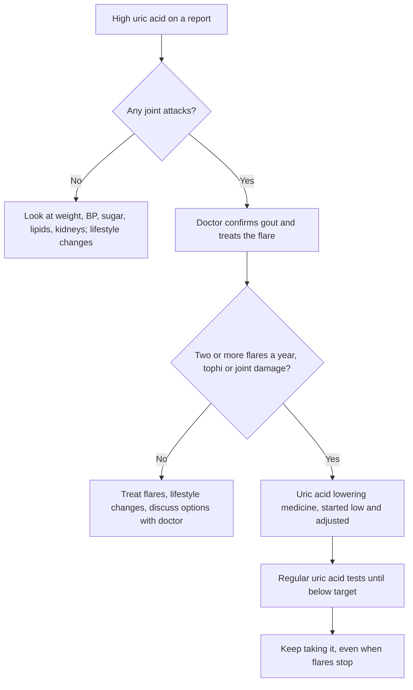

:::answer
Uric acid is a normal waste product. A high level on a blood report is common, and most people with it never get gout. Gout is what happens when uric acid forms crystals in a joint, causing sudden, severe pain and swelling, very often in the big toe. Flares are commonly triggered by alcohol (especially beer), sugary drinks, large meat or seafood meals, dehydration, crash diets and some medicines. Dal, paneer and tomatoes are usually blamed, but research hasn't shown that plant purines raise gout risk the way meat and seafood do. People with repeated flares often need long-term uric acid lowering medicine, started and adjusted by a doctor to reach a target level. A high uric acid number with no symptoms usually isn't treated with medicine.
:::

## Uric acid vs gout: not the same thing

Your body makes uric acid when it breaks down purines. Most purines come from your own cells, and a smaller share from food. The kidneys filter uric acid into urine, and some leaves through the gut.

When blood uric acid rises above roughly 6.8 mg/dL, it can come out of solution and form needle-shaped crystals, mainly in cooler joints such as the big toe. That is why many labs flag values above about 7 mg/dL in men and somewhat lower in women. But crystals don't form in everyone with a high level, and of those who do form them, many never have symptoms.

So there are two separate situations:

- **High uric acid with no symptoms (asymptomatic hyperuricaemia).** Very common, often found on a routine health check. The 2020 American College of Rheumatology (ACR) guideline advises against starting uric acid lowering medicine in most people in this situation ([ACR, 2020](https://doi.org/10.1002/acr.24180)). It's still a useful signal: high uric acid travels with belly fat, high blood pressure, fatty liver, high triglycerides and kidney problems, so it is worth looking at the whole picture.
- **Gout.** Crystals in a joint cause attacks (flares) of pain and swelling, and if untreated over years, lumps of crystal (tophi) and joint damage. This needs a doctor and usually a long-term plan.

## What a gout flare feels like

A typical gout attack:

- Starts suddenly, often at night or early morning
- Hits one joint, most often the big toe, but also the ankle, foot, knee, wrist or fingers
- Becomes extremely painful within hours; even a bedsheet touching the toe can hurt
- Makes the joint red or purplish, swollen, hot and shiny
- Settles over one to two weeks, even without treatment, then may return months later

Not every painful joint with a high uric acid is gout. Infection in a joint, another crystal disease (pseudogout), injury and other types of arthritis can look similar. A doctor may test fluid from the joint for crystals, which is the most certain way to confirm gout. Blood uric acid can even be normal during a flare, so a normal reading at that moment doesn't rule it out.

[[ad]]

## What really triggers flares

Gout flares usually follow a change that pushes uric acid up or down quickly, or that dehydrates you. Common triggers:

- **Alcohol, especially beer and spirits**, and binge drinking in particular
- **Sugar-sweetened drinks.** In a 12-year study of over 46,000 men, those drinking two or more servings of sugary soft drinks a day had a clearly higher risk of gout than those who rarely drank them; diet drinks showed no link ([BMJ, 2008](https://doi.org/10.1136/bmj.39449.819271.BE)). Packaged fruit juices with added sugar likely act the same way.
- **Large meals of red meat, organ meat and seafood**, such as at weddings, parties and festivals
- **Dehydration**: hot summers, long hours without water, heavy sweating in the gym, or illness with fever or diarrhoea
- **Crash diets and long fasts**, which briefly raise uric acid
- **Some medicines**, such as certain water pills (diuretics) for blood pressure, and low-dose aspirin. Never stop a prescribed medicine yourself; ask your doctor whether an alternative suits you.
- **Starting uric acid lowering medicine**, because a falling level can loosen crystals. Doctors usually cover this period with preventive treatment.
- **Injury, surgery or a sudden illness**

## The diet myths: dal, tomatoes and paneer

Many Indians with gout are told to give up all dal, rajma, chana, paneer, spinach, mushrooms and tomatoes. The evidence doesn't back such a wide ban.

A large study following over 47,000 men for 12 years found that higher intake of meat and seafood was linked with more gout, but **purine-rich vegetables and total protein intake were not linked with a higher risk**, and **dairy intake was linked with a lower risk** ([NEJM, 2004](https://doi.org/10.1056/NEJMoa035700)). Dal, legumes and vegetables are central to a healthy Indian diet, and the ICMR-NIN guidelines recommend them for heart and metabolic health ([ICMR-NIN, 2024](https://www.nin.res.in/dietaryguidelines/pdfjs/locale/DGI24thJune2024fin.pdf)).

Some people with gout notice that a specific food seems to trigger their flares, tomatoes included. If that is consistent for you, it is reasonable to cut back. But removing all dal and vegetables usually makes the overall diet worse, and doesn't address the bigger drivers: alcohol, sugar, excess weight and dehydration.

The ACR guideline conditionally recommends limiting alcohol, purine intake and high-fructose corn syrup, and losing weight if overweight, but it also notes these changes alone rarely bring uric acid down enough for people who already have frequent gout ([ACR, 2020](https://doi.org/10.1002/acr.24180)). Diet supports treatment; it rarely replaces it once gout is established. The same guideline advises against taking vitamin C supplements for gout.

## A gout-friendly Indian day of eating

This is a general pattern, not a prescription. Adjust it with your doctor or dietitian, especially if you also have diabetes or kidney disease.

- **Morning:** water first, then tea or coffee without much sugar. Breakfast of vegetable poha, upma, besan chilla or oats, with a bowl of low-fat curd.
- **Mid-morning:** a fruit such as guava, orange, apple or papaya, rather than packaged juice.
- **Lunch:** dal or rajma, a large serving of sabzi, salad, and a moderate amount of roti or rice. Buttermilk instead of a cold drink.
- **Evening:** roasted chana or a handful of nuts with tea, and another glass of water.
- **Dinner:** paneer, tofu or egg, or a small portion of chicken or fish for non-vegetarians, with vegetables and a roti or two.
- **Through the day:** enough water that your urine stays pale yellow.

What's missing: cold drinks, sweet lassi, mithai every day, large plates of mutton or organ meat, and alcohol. Those are the swaps that matter most.

## Gout in women and older adults

Gout is much more common in men, but women's risk rises after menopause, when oestrogen, which helps the kidneys clear uric acid, falls. In older adults, gout can look different: several joints at once, a slower start, or lumps of crystal in the fingers, often in people taking diuretics for blood pressure or heart failure. Older people are also more likely to have kidney problems and to take many medicines, so the choice of flare treatment needs extra care. If an older parent has a swollen, painful joint, a doctor should see it rather than relying on painkillers from the chemist.

## Long-term treatment

### Treating a flare
Flares are usually treated with anti-inflammatory medicines, colchicine or steroids, depending on your other health conditions, especially kidney function, stomach problems and diabetes. Which one and how much is for your doctor to decide. At home, rest the joint, raise it, use a cold pack wrapped in cloth for short periods, and drink water.

### Lowering uric acid for the long term
Both the ACR and EULAR guidelines recommend long-term uric acid lowering medicine for people with frequent flares, tophi or joint damage, and a "treat to target" approach: the dose is raised step by step until the blood level is below 6 mg/dL, and lower for severe disease ([ACR, 2020](https://doi.org/10.1002/acr.24180); [EULAR, 2016](https://doi.org/10.1136/annrheumdis-2016-209707)).

A few things people often get wrong:

- **The first months can bring more flares, not fewer.** That doesn't mean the medicine isn't working. Doctors usually give preventive treatment for the first three to six months.
- **Don't stop the medicine during a flare** unless your doctor tells you to.
- **It is usually long term.** Stopping when you feel well lets crystals form again.
- **Get your blood tested as advised.** The dose is adjusted to the number, not set once.
- **Some people need extra checks before starting.** For certain medicines, doctors may test for genetic risk of a serious skin reaction in people of some Asian backgrounds, or adjust for kidney function. Report any new rash on a uric acid medicine to your doctor straight away.

All doses are set and changed by your doctor. Please don't buy uric acid tablets over the counter based on a lab report.

:::tip Everyday habits that help
- Keep water nearby and drink through the day; more in summer and on gym days.
- Cut sugar-sweetened drinks, packaged juices and sweet lassi.
- Keep alcohol low, and avoid beer and binge drinking.
- At weddings and parties, go easy on mutton, organ meat and seafood; fill up on dal, sabzi and salad.
- Lose weight slowly with steady habits, not crash diets or long fasts.
- Choose low-fat milk and curd; they are linked with lower gout risk.
:::

[[ad]]

## Gout, kidneys and the heart

Gout is rarely "just a joint problem". Uric acid can form kidney stones, and long-standing gout is linked with kidney disease. Gout also commonly comes with high blood pressure, diabetes, high triglycerides, fatty liver and heart disease. Your doctor will usually check blood pressure, sugar, lipids and kidney function when gout is diagnosed. If you have high blood pressure as well, ask whether your BP medicine is the best fit for someone with gout; some options raise uric acid while others don't.

A practical tip: when you see your doctor about gout, carry your last few reports together, including uric acid, creatinine or eGFR, sugar (HbA1c), lipid profile and blood pressure readings, plus a list of every medicine and supplement you take. It saves time and helps your doctor choose treatments that suit your kidneys and heart, not just your joints.

Kidney stones made of uric acid are more likely with low urine output and acidic urine. Drinking enough water to keep your urine pale is one of the simplest protections.

## Exercise with gout

Regular exercise helps with weight, blood pressure, sugar and triglycerides, all of which matter in gout. Between flares, you can usually train normally:

- During a flare, rest the joint. Don't push through gout pain; it is inflammation, not stiffness.
- Once it has settled, ease back in with walking, cycling, swimming and strength training, starting lighter.
- Drink water before, during and after training, especially in hot gyms and summer.
- Avoid extreme cutting diets, dehydration for "weight cutting" and heavy alcohol after sport.
- Supplements: high-dose protein powders aren't needed for most people, and some pre-workouts contain ingredients that dehydrate. Ask before adding them.

:::warning See a doctor promptly if
- A joint suddenly becomes hot, red, swollen and very painful, especially with fever or chills (it could be an infection, which is an emergency)
- This is your first attack of what looks like gout
- You have two or more flares a year, or lumps under the skin near joints or on the ears
- You notice blood in the urine, severe one-sided back or side pain, or pass a stone
- You get a new rash, sores in the mouth or fever after starting a uric acid medicine
- You have kidney disease, heart disease or diabetes and are unsure which pain medicines are safe for you
:::

## Myths about uric acid and gout

:::mythfact
| Myth | Fact |
|---|---|
| "High uric acid on my report means I have gout." | Most people with high uric acid never get gout. Gout means crystals causing joint attacks. |
| "Dal, paneer and tomatoes cause gout, so stop them all." | Research hasn't linked purine-rich vegetables with more gout; dairy is linked with less. Alcohol, sugary drinks and meat matter more. |
| "If my uric acid is normal during a flare, it isn't gout." | Uric acid can drop during a flare. A normal reading at that moment doesn't rule gout out. |
| "Once the pain stops, I can stop the medicine." | Long-term medicine keeps crystals from re-forming. Stopping it usually brings the flares back. |
| "Diet alone can control gout." | Diet helps, but people with frequent flares usually need medicine to reach the target level. |
| "Vitamin C tablets lower uric acid enough to treat gout." | The ACR guideline advises against vitamin C supplements for gout. |
:::

## Common questions

:::faq
### What is a normal uric acid level?
Labs often give a range up to about 7 mg/dL for men and somewhat lower for women. For people on gout treatment, guidelines aim for below 6 mg/dL. A high number without symptoms usually isn't treated with medicine, but it is a reason to check weight, blood pressure, sugar and kidneys.

### Can I eat dal if I have high uric acid?
For most people, yes. A large study found purine-rich vegetables were not linked with more gout, while meat and seafood were. If a particular dal or vegetable seems to trigger your flares, cut back on that one rather than all of them.

### Which drinks are bad for gout?
Alcohol, especially beer and spirits, and sugar-sweetened drinks are the main ones. Packaged juices with added sugar are best limited. Water is the best drink; low-fat milk is fine.

### How long do I need to take uric acid medicine?
Usually long term. Guidelines aim to keep uric acid below 6 mg/dL so crystals dissolve and don't re-form. Your doctor decides the dose and checks it with blood tests. Don't stop it on your own.

### Does exercise make gout worse?
Regular exercise between flares helps, because it improves weight, blood pressure and sugar. Rest during a flare, drink enough water, and avoid dehydration and crash diets around training.
:::

## The bottom line

A high uric acid report is a nudge to look at your weight, blood pressure, sugar, lipids and kidneys, not a reason to panic or to give up dal. Gout is different: it needs a doctor, flares need proper treatment, and frequent flares usually need long-term medicine adjusted to a target level. Meanwhile, the habits that help most are simple: water through the day, little alcohol, no sugary drinks, moderate meat and seafood, and steady weight loss if you need it.

If you want a training plan that works around gout and fits your job, the trainers at Royal Fitness Club in Sector 93, Noida can help you start gently and build up.
