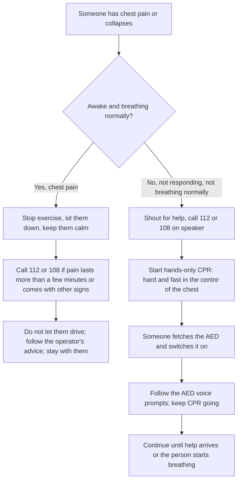

:::answer
Chest pressure, tightness or pain during or after a workout should be treated as a possible heart problem until a doctor says otherwise. Stop exercising, sit down, and call 112 (or 108 for an ambulance) if it lasts more than a few minutes or comes with breathlessness, sweating, nausea, or pain in the arm, jaw, back or upper stomach. Cardiac arrest during exercise is rare, and regular exercisers have a lower risk than people who exercise only now and then. When it does happen, fast hands-only CPR and an AED make the biggest difference to survival. The safest gym habits are simple: a proper warm-up, building up slowly, water in hot weather, no steroids, care with high-caffeine pre-workouts, and never training through chest pain.
:::

## "Bhai, gas hai, ENO le le"

If you have spent time in an Indian gym, you have heard this. Someone stops mid-set, rubs their chest, says it's tight. A friend suggests acidity, maybe a soda or an antacid, and five minutes of rest before the next set.

Sometimes it really is acidity or a pulled chest muscle. The trouble is that you can't tell the difference by feel, and the cost of guessing wrong is very high. Heart pain often doesn't feel like the sharp, dramatic pain in films. It can feel like pressure, heaviness, burning or fullness, and it can sit in the upper stomach. That is exactly why so many people mistake it for gas.

This guide covers what heart warning signs look like, how common heart events during exercise really are, what to do in the first minutes if someone collapses, and how to train in a way that keeps your heart safe.

## Heart attack and cardiac arrest: two different emergencies

People often use these words as if they mean the same thing. They don't, and the first-aid response differs.

- A **heart attack** happens when a blocked artery stops blood reaching part of the heart muscle. The person is usually awake and talking, often with chest discomfort. It is a circulation problem, and it is serious ([American Heart Association](https://www.heart.org/en/health-topics/cardiac-arrest/about-cardiac-arrest)).
- **Cardiac arrest** happens when the heart's electrical system goes wrong and the heart stops pumping properly. The person collapses, does not respond, and stops breathing normally. Without CPR and a defibrillator, death can follow within minutes ([American Heart Association](https://www.heart.org/en/health-topics/cardiac-arrest/about-cardiac-arrest)).

A heart attack can trigger a cardiac arrest, so the two are linked. But a young person can also have a cardiac arrest from an inherited heart muscle or rhythm problem without any blocked artery.

### Heart attack warning signs

The American Heart Association lists these signs ([AHA, Warning Signs of a Heart Attack](https://www.heart.org/en/health-topics/heart-attack/warning-signs-of-a-heart-attack)):

- **Chest discomfort**, usually in the centre of the chest, lasting more than a few minutes, or going away and coming back. It can feel like pressure, squeezing, fullness or pain.
- **Discomfort in other parts of the upper body**: one or both arms, the back, neck, jaw or stomach.
- **Shortness of breath**, with or without chest discomfort.
- **Other signs**: breaking out in a cold sweat, nausea, a rapid or irregular heartbeat, unusual tiredness, or feeling lightheaded.

The AHA notes that chest pain or discomfort is the most common symptom in women too, but women are more likely to have other symptoms such as breathlessness, nausea, vomiting, upset stomach, pain in the shoulder, back or arm, anxiety, and unusual tiredness. This "upset stomach" pattern is a big reason heart attacks in women get dismissed as acidity.

The AHA's advice is clear: if you're not sure, get checked. Minutes matter, and calling emergency services is usually the fastest way to treatment.

[[ad]]

## How common are heart events during exercise?

The honest answer: rare, but real, and more common than gym talk suggests.

### The numbers from big studies

A US study of marathons and half-marathons between 2000 and 2010 tracked 10.9 million runners. There were 59 cardiac arrests, an incidence of about 0.54 per 100,000 participants. The rate was higher in men (0.90 per 100,000) than in women (0.16 per 100,000). Of the 59 arrests, 42 (71%) were fatal. The most common causes were hypertrophic cardiomyopathy (an inherited thickening of the heart muscle) and coronary artery disease. Among cases with full data, people who got CPR from a bystander were more likely to survive ([NEJM, 2012](https://doi.org/10.1056/NEJMoa1106468)).

A national study in France looked at sports-related sudden death in the general population aged 10 to 75. It found about 4.6 cases per million people per year, and the authors thought the true figure could be higher because of under-reporting. More than 90% of cases happened during recreational sport, not in professional athletes. The average age was 46 and 95% were men ([Circulation, 2011](https://doi.org/10.1161/CIRCULATIONAHA.110.008979)).

### Why regular exercise still protects you

A long study of 21,481 male doctors in the US found that the risk of sudden cardiac death was about 17 times higher during and in the 30 minutes after vigorous exercise than at other times. That sounds frightening, but the absolute risk was extremely low, about 1 sudden death per 1.51 million episodes of vigorous exercise. Most importantly, men who exercised vigorously more often had a smaller rise in risk during each session ([NEJM, 2000](https://doi.org/10.1056/NEJM200011093431902)).

In plain words: the dangerous pattern is the weekend warrior who does nothing all week and then goes all-out. Regular training, built up slowly, lowers the risk each session carries. An American College of Sports Medicine expert panel made the same point: exercise is safe for most people, the cardiovascular risk of exercise falls as people become fitter, and exercise-related heart events are often preceded by warning signs or symptoms ([ACSM, 2015](https://doi.org/10.1249/MSS.0000000000000664)). Those warning signs are your chance to act.

## Young Indians and heart disease

"He was only 32 and so fit" is a sentence heard too often in NCR. Indians and other South Asians tend to have heart attacks younger. In the large international INTERHEART study, the average age at a first heart attack was 53.0 years in South Asian countries versus 58.8 years elsewhere. The study found this was largely explained by higher levels of the usual risk factors at younger ages. Among South Asian people without heart disease, only 6.1% did regular moderate or vigorous exercise, compared with 21.6% in other countries ([JAMA, 2007](https://doi.org/10.1001/jama.297.3.286)).

So the answer is to exercise, and to know your risk while you do it. The usual risk factors in young Indians include tobacco (smoked or chewed), high LDL cholesterol, diabetes or prediabetes, high blood pressure, belly fat, poor sleep and stress, sometimes with an inherited problem like high lipoprotein(a). We cover these, and the blood tests worth asking about, in our guide to [heart attacks in Indians under 40](/health/blog/heart-attack-under-40-india).

## Gym habits that strain the heart

### High-caffeine pre-workouts and fat burners

Many pre-workout powders and "fat burners" contain large amounts of caffeine, sometimes along with other stimulants, and some products sold online or loose in gyms don't list everything inside. Stimulants raise heart rate and blood pressure. If you have palpitations, chest discomfort or dizziness after a pre-workout, stop it and tell your doctor. People with high blood pressure, heart rhythm problems or a family history of sudden death should be especially careful. Read the details, including which ingredients have caused harm, in our post on [fat burners and pre-workout risks](/health/blog/fat-burners-pre-workout-risks-india).

### Anabolic steroids

Steroids are one of the clearest heart risks in gym culture. A study of experienced male weightlifters aged 34 to 54 compared 86 long-term steroid users with 54 non-users. Users had weaker heart pumping (average ejection fraction 52% versus 63%), stiffer heart relaxation, and more plaque in their heart arteries. The longer the use, the more plaque ([Circulation, 2017](https://doi.org/10.1161/CIRCULATIONAHA.116.026945)). Our posts on [anabolic steroids](/health/blog/anabolic-steroids-side-effects-india) and [SARMs hidden in supplements](/health/blog/sarms-spiked-gym-supplements-india) explain the wider harms. There is no safe way to use them for looks.

### "No pain, no gain"

Muscle burn in the last reps of a set is normal. Chest pain, pressure, sudden breathlessness, fainting or a racing irregular heartbeat are not. Pushing through those is how a warning sign turns into an emergency.

### Heat and dehydration

Delhi-NCR summers, crowded gyms with weak air-conditioning, and sweating through a long session can leave you dehydrated. Dehydration makes the heart work harder and can cause dizziness and fainting. Drink water before and during training, train lighter on very hot days, and stop if you feel faint, confused or stop sweating in the heat.

## Hands-only CPR: what to do in the first minutes

The AHA says CPR can double or triple the chances of surviving a cardiac arrest ([AHA News, 2018](https://www.heart.org/en/news/2018/07/12/cpr-is-key-to-survival-of-sudden-cardiac-arrest)). In the French study, most sports-related arrests were witnessed (93%), yet bystanders started CPR in only 30.7% of cases. Only 15.7% survived to leave hospital. Bystander CPR and early use of a defibrillator were each linked to about 3.7 times higher odds of survival ([Circulation, 2011](https://doi.org/10.1161/CIRCULATIONAHA.110.008979)).

These are the steps for an adult or teen who collapses, based on AHA guidance for hands-only CPR ([AHA News, 2018](https://www.heart.org/en/news/2018/07/12/cpr-is-key-to-survival-of-sudden-cardiac-arrest)):

1. **Check safety and response.** Tap their shoulders and shout. If they don't respond and aren't breathing normally (gasping doesn't count), treat it as cardiac arrest.
2. **Call for help.** Call 112 (or 108 for an ambulance) on speaker, and send someone to get the AED if the gym has one.
3. **Push hard and fast.** Put the heel of one hand on the centre of the chest, the other hand on top. Lock your elbows, keep your shoulders over your hands, and push down at least 2 inches (about 5 cm) using your body weight.
4. **Keep the rhythm.** Aim for 100 to 120 pushes a minute. The beat of "Stayin' Alive" is the right speed. Let the chest come back up fully between pushes.
5. **Use the AED as soon as it arrives.** Switch it on and follow the voice prompts. With two people, one keeps doing compressions while the other sets up the AED.
6. **Don't stop.** Keep going until trained help takes over or the person starts breathing normally. Swap with someone every couple of minutes if you get tired.

You can't make things worse for someone in cardiac arrest by trying. Without CPR, their chance of survival falls with every passing minute. A short in-person CPR course, which many hospitals and first-aid organisations run, gives you the confidence to act. It is worth an afternoon.

### For chest pain without collapse

If someone is awake with chest pain or other warning signs, stop them exercising, sit them down, and call 112 or 108. Don't let them drive themselves to hospital. Don't give them any medicine on your own; follow what the emergency operator or a doctor tells you.

:::warning Stop training and get medical help if you have
- Chest pain, pressure, tightness or burning during or after exercise, especially if it lasts more than a few minutes or keeps coming back
- Pain spreading to the arm, jaw, neck, back or upper stomach
- Breathlessness out of proportion to the effort
- Fainting, near-fainting or sudden dizziness during exercise
- A racing, pounding or irregular heartbeat that doesn't settle with rest
- Cold sweat, nausea or unusual tiredness with any of the above
- A family member who died suddenly before 50, or a known heart condition, and you haven't had a check-up before starting hard training
:::

## Screening: who needs a check before starting

Most healthy people can start exercise without a doctor's visit. ACSM's screening model asks three questions: how active you are now, whether you have symptoms or known heart, metabolic or kidney disease, and how hard you plan to train ([ACSM, 2015](https://doi.org/10.1249/MSS.0000000000000664)).

A simple tool for yourself is the **PAR-Q+**, a free questionnaire used internationally before starting exercise. If any answer flags a concern, it guides you to further questions and, where needed, to a doctor or qualified exercise professional ([PAR-Q+ Collaboration](https://eparmedx.com/)).

### When to see a doctor first

- You've had chest pain, fainting, palpitations or unusual breathlessness, at rest or during exercise
- You have diabetes, high blood pressure, high cholesterol, kidney disease or a known heart condition
- A close family member had a heart attack young or died suddenly and unexpectedly
- You smoke or chew tobacco and are over 35 and inactive, and want to start intense training
- You have used steroids or high-stimulant products

Whether you need an ECG, echocardiogram, treadmill test (TMT) or other tests is for your doctor to decide based on your history and examination. A normal test doesn't give you permission to ignore new symptoms later, and a test is no substitute for knowing the warning signs.

:::tip Smart habits for a heart-safe workout
- Warm up for 5 to 10 minutes before heavy lifting or hard cardio, and cool down slowly instead of stopping dead.
- Build intensity over weeks. If you've been away from the gym for months, start lighter than your old numbers.
- Drink water through your session, and go lighter on hot, humid days.
- Breathe out during the effort. Long, hard breath-holding on heavy lifts sends blood pressure very high.
- Skip the gym when you have fever or a bad viral illness, and come back gradually.
- Know where your gym's AED and first-aid kit are, and save 112 and 108 on your phone.
:::

## What every gym should have

If you run or choose a gym, look for these:

- **An AED** that is easy to reach, checked regularly, and that staff know how to use
- **Staff trained in CPR**, with refresher training
- **An emergency plan**: who calls for help, who starts CPR, who fetches the AED, who meets the ambulance at the gate
- **A health questionnaire** like the PAR-Q+ for new members, with a clear route to a doctor when needed
- **Good ventilation and drinking water**, especially in summer
- **Trainers who don't push** members through chest pain, dizziness or fainting

Early CPR and defibrillation are the two biggest things anyone can do to improve survival from cardiac arrest, and both depend on the people in the room.

[[ad]]

## Myths you'll hear on the gym floor

:::mythfact
| Myth | Fact |
|---|---|
| "Chest pain during a workout is just gas." | Heart pain can feel like pressure, burning or fullness and can sit in the upper stomach. Stop, and get checked if it doesn't settle quickly or comes with other signs. |
| "Fit young people don't get heart attacks." | South Asians have their first heart attack younger on average, and inherited heart conditions can affect fit people. |
| "No pain, no gain." | Muscle burn is normal. Chest pain, fainting, sudden breathlessness or an irregular heartbeat are warning signs to stop. |
| "Exercise causes heart attacks, so it's safer to avoid it." | Risk rises briefly during vigorous exercise, but the risk per session is extremely low, and regular exercisers have a smaller rise. |
| "CPR is only for doctors." | Anyone can do hands-only CPR. Pushing hard and fast on the chest can double or triple the chance of survival. |
| "A stronger pre-workout gives a better workout." | High-stimulant products raise heart rate and blood pressure and can trigger palpitations. More is not better. |
:::

## Common questions

:::faq
### How do I know if chest pain is my heart or just a muscle pull?
You often can't tell on your own. Pain that gets worse with effort, feels like pressure or heaviness, spreads to the arm, jaw or back, or comes with breathlessness or sweating needs urgent medical attention. Pain that only hurts when you press on one spot or move a certain way is more likely muscular, but get it checked if in doubt.

### Should I take a tablet if I think I'm having a heart attack?
Don't take any medicine on your own. Call 112 or 108, describe the symptoms, and follow what the operator or doctor tells you. Some heart medicines are harmful for certain people.

### Do I need a TMT or ECG before joining a gym?
Most healthy people don't. If you have symptoms, a known heart, kidney or metabolic condition, or a family history of early heart disease or sudden death, see a doctor first. The doctor decides which tests you need.

### Is CPR safe to do on someone who might not be in cardiac arrest?
If the person is unresponsive and not breathing normally, start CPR. The harm from delaying CPR in cardiac arrest is far greater than the risk of doing it. An AED only delivers a shock if it detects a rhythm that needs one.

### Is pre-workout safe if I'm healthy?
Many healthy adults use moderate caffeine without problems, but some products pack very high stimulant amounts or undeclared ingredients. If you feel palpitations, chest discomfort or dizziness, stop. People with heart conditions or high blood pressure should ask their doctor first.
:::

:::takeaways
- Treat chest pain during exercise as a heart warning until proven otherwise: stop, sit, and call 112 or 108 if it doesn't settle.
- Cardiac arrest during exercise is rare, and regular exercise lowers the risk each session carries.
- Hands-only CPR at 100 to 120 pushes a minute, at least 2 inches deep, plus an AED, saves lives.
- Steroids and high-stimulant pre-workouts add real heart risk.
- If you have symptoms, known heart disease or a family history of early sudden death, see a doctor before hard training.
:::

## The bottom line

Exercise is one of the best things you can do for your heart, and heart events in the gym are rare. The danger comes from ignoring warning signs, going from zero to all-out, steroids and stimulant-heavy products, and a room full of people who don't know CPR. Learn the signs, never train through chest pain, build up gradually, and learn hands-only CPR. Those few steps make any gym much safer.

We made a short Hinglish video busting five heart myths on our YouTube channel, [Royal Fitness TV](https://www.youtube.com/@RoyalFitnessTV?sub_confirmation=1).

At Royal Fitness Club in Sector 93, Noida, our trainers can help you build up training safely, with a proper warm-up and a plan that fits your health.
