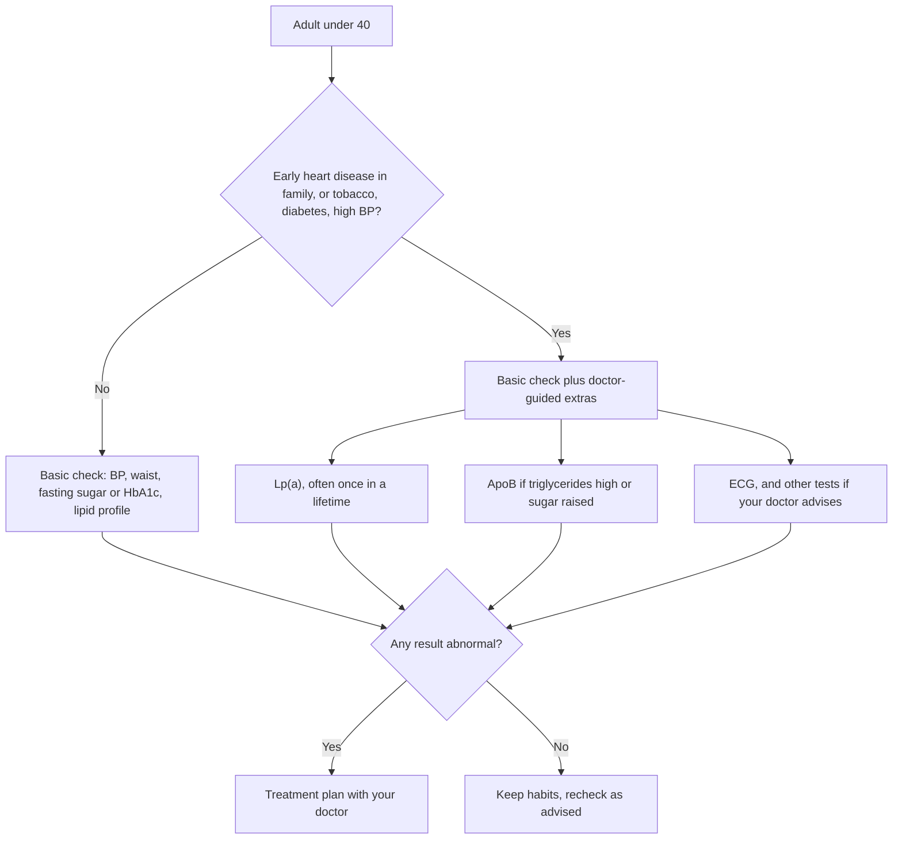

:::answer
Indians, like other South Asians, tend to have their first heart attack years earlier than people in many other parts of the world. For a young adult, the usual culprits are smoking or chewing tobacco, high LDL cholesterol, diabetes or prediabetes, high blood pressure, belly fat, poor sleep and stress, sometimes on top of an inherited problem such as high lipoprotein(a) or familial high cholesterol. A basic lipid profile misses some of this. If heart attacks run early in your family, ask your doctor about Lp(a) (often tested once in a lifetime) and ApoB. You can keep training hard, but learn the warning signs, build up gradually, avoid steroids and stimulant-heavy pre-workouts, and never "push through" chest pain.
:::

## Why "too young for a heart attack" isn't true here

The large international INTERHEART study compared people having a first heart attack across 52 countries. South Asians had their first heart attack at an average age of about 53, compared with about 59 in people from other countries, and the gap was largely explained by a higher burden of the usual risk factors at younger ages ([JAMA, 2007](https://doi.org/10.1001/jama.297.3.286)).

That average hides a tail that worries every Indian cardiologist: a steady stream of men and women in their thirties and even twenties arriving with heart attacks. Almost all have at least one identifiable risk factor; many have several that were never checked because "you're young, you're fine".

This guide is about finding those risks early, while you can still do something about them, and about training in a gym without turning a hidden problem into an emergency.

## The usual suspects, in a young Indian

### Tobacco in any form
Cigarettes, bidis, hookah and smokeless tobacco (gutka, khaini, paan masala with tobacco) all damage the arteries and make blood more likely to clot. In India's second Global Adult Tobacco Survey, 28.6% of adults used tobacco in some form (Global Adult Tobacco Survey 2, 2016–17). In young heart attack patients, tobacco is one of the most common findings. Quitting starts lowering your risk quickly, and it is the single best thing a smoker can do for their heart.

### LDL cholesterol that nobody measured
LDL ("bad" cholesterol) builds plaque silently from your teens onward. The higher it is and the longer it stays high, the more plaque you build. Many young Indians have never had a lipid profile, and those who have often don't know their LDL number.

### Diabetes, prediabetes and belly fat
Indians develop insulin resistance at lower body weights than many other groups, and fat around the belly is a stronger warning than weight alone. A "thin-fat" body, with a normal BMI but a large waist and little muscle, is common. Prediabetes in your twenties or thirties is a heart risk, not just a sugar risk.

### High blood pressure
High BP in young adults is often missed because nobody checks it. It damages arteries quietly for years.

### Sleep, stress and alcohol
Short sleep, untreated sleep apnoea, chronic stress and heavy drinking all push blood pressure, sugar and weight in the wrong direction.

[[ad]]

## The inherited part: family history, Lp(a) and familial high cholesterol

### Family history that counts
Doctors usually call a family history "premature" when a father, brother or son had heart disease before 55, or a mother, sister or daughter before 65. If that applies to you, your risk is higher even if you feel perfectly well, and you deserve a fuller check earlier in life.

### Lipoprotein(a): the number most people never get
Lipoprotein(a), written Lp(a), is an LDL-like particle whose level is mostly set by your genes. Diet and exercise barely change it. High Lp(a) raises the risk of heart attack and of narrowing of the aortic valve. A European Atherosclerosis Society consensus statement recommends measuring Lp(a) at least once in every adult's lifetime, because the level is largely stable and a high result changes how aggressively other risk factors should be managed ([European Heart Journal, 2022](https://doi.org/10.1093/eurheartj/ehac361)). An Indian review in the Indian Heart Journal makes a similar case for Indian patients, especially those with premature heart disease in themselves or their family ([Indian Heart Journal, 2024](https://doi.org/10.1016/j.ihj.2023.12.010)).

A high Lp(a) is not a reason to panic. It is a reason to be stricter about everything else: LDL, blood pressure, sugar, tobacco and weight. Your doctor will explain what your number means for you.

### ApoB: counting the harmful particles
ApoB is a protein found on each LDL-type particle, so measuring it is like counting the particles that can enter your artery wall. European guidelines note that ApoB can be a more accurate marker than LDL cholesterol in people with high triglycerides, diabetes, obesity or very low LDL ([ESC/EAS, 2019](https://doi.org/10.1093/eurheartj/ehz455)). That describes many Indians: high triglycerides and low "good" HDL are a common Indian pattern.

### Familial hypercholesterolaemia
Some families carry a gene that makes LDL very high from birth. Clues include an LDL that is very high even in a slim, active young person, yellowish deposits on tendons or around the eyes, or several relatives with early heart attacks. This needs specialist care, and relatives should be tested too.

## Which tests to ask about

A sensible starting point, which your doctor will adjust:

- **Blood pressure**, measured properly, and repeated at home if borderline
- **Waist circumference** and weight
- **Fasting glucose or HbA1c**
- **Lipid profile**: total cholesterol, LDL, HDL, triglycerides
- **Lp(a)** if you have premature heart disease in the family, very high LDL, or your doctor advises it
- **ApoB** if your triglycerides are high, you have diabetes or prediabetes, or your doctor wants a clearer picture
- **ECG**, and further tests only if symptoms or results call for them

Expensive "full body" packages are no substitute for a doctor who reads your results with your history in mind.

[[ad]]

## Training hard without risking your heart

Exercise is one of the best things you can do for your heart. The aim of this section isn't to scare you away from the gym; it is to help you train in a way that is safe even if you carry a risk you don't know about.

### Before you start a hard programme
If you have any of these, see a doctor before high-intensity training: chest pain or pressure on exertion, fainting or near-fainting during exercise, unexplained breathlessness, palpitations, a family history of sudden death at a young age, known heart disease or a heart murmur, or several risk factors (tobacco, diabetes, high BP, high LDL) together.

### During training
- **Warm up for 5–10 minutes** and cool down gradually. Sudden maximal effort from cold is a common pattern in exercise-related emergencies.
- **Build up over weeks**, not days. Add load or intensity gradually.
- **Breathe**: avoid holding your breath on heavy lifts for long periods, which can spike blood pressure.
- **Hydrate**, especially in Indian summers and in poorly ventilated gyms.
- **Respect illness**: don't train hard with a fever or right after a viral infection. Get back slowly.

### What to avoid entirely
- **Anabolic steroids and other performance drugs**: they raise blood pressure, worsen cholesterol, thicken the heart muscle and are linked to heart attacks in young users.
- **Stimulant-heavy pre-workout products**, especially combined with energy drinks or several cups of coffee.
- **Crash dieting and severe dehydration** to "cut" for photos or competitions.
- **Training through warning symptoms** because a coach or friend says "no pain, no gain".

:::tip Heart-smart habits for young adults
- Know your four numbers: BP, waist, HbA1c and LDL. Write them in your phone notes.
- If you use tobacco in any form, set a quit date and ask for help; quitting is the biggest win.
- Get 7 or more hours of sleep. Loud snoring with daytime sleepiness needs a check for sleep apnoea.
- Build your plate around dal, vegetables, whole grains, curd and nuts; keep fried snacks, sweets and sugary drinks occasional.
- Strength train two or three times a week and walk daily; both protect the heart.
- Learn hands-only CPR. It takes 15 minutes and could save a friend at the gym.
:::

## Young women: the risk that gets dismissed

Heart disease is often thought of as a "men's problem", so young women's symptoms are more likely to be put down to acidity, anxiety or tiredness. Women can have the same risk factors as men, and some extra ones:

- **Diabetes** removes much of the natural protection women have before menopause.
- **Pregnancy complications** such as high blood pressure in pregnancy (pre-eclampsia) or gestational diabetes are now recognised as early warnings of later heart disease. If you had either, tell every doctor you see, and keep checking your blood pressure and sugar after delivery.
- **PCOS** often comes with insulin resistance, higher triglycerides and weight gain, all of which matter for the heart.
- **Smoking with hormonal contraceptives** raises clotting risk.
- **Early menopause**, natural or after surgery, brings heart risk forward.

The warning signs in the box below apply to women just as much, and women are more likely to have the "quieter" symptoms: breathlessness, sweating, nausea, back or jaw pain, or sudden exhaustion.

## Questions to take to your doctor

- Given my family history, should I have Lp(a) or ApoB tested, and when?
- What is my LDL target, and how far am I from it?
- Do I have prediabetes, and what does that mean for my heart?
- Is my blood pressure truly normal, or should I check it at home?
- Is it safe for me to do high-intensity training, and is there anything I should avoid?
- Should my brothers, sisters or children be tested too?

## Know the warning signs, including the quiet ones

Heart attacks in young people are often missed because they don't look like the movies. Symptoms can include:

- Pressure, tightness, squeezing or heaviness in the chest, lasting more than a few minutes or coming and going
- Pain spreading to the arm, shoulder, neck, jaw, back or upper belly
- Breathlessness, sweating, nausea or sudden tiredness, sometimes without much chest pain (more common in women and people with diabetes)
- "Gas" or "acidity" that doesn't settle and comes with sweating or breathlessness

:::warning Call 112 or 108 and go to hospital immediately if
- You have chest pain, pressure or discomfort lasting more than a few minutes, especially with sweating, nausea or breathlessness
- Chest discomfort comes on with exercise and doesn't settle quickly with rest
- Someone collapses and isn't breathing normally: call for help and start hands-only CPR straight away
- You faint during exercise
- You have sudden severe breathlessness, or palpitations with dizziness

Don't drive yourself to hospital, don't wait to "see if it passes", and don't take someone else's medicine.
:::

## Hands-only CPR in four lines

If an adult collapses and isn't breathing normally: call for help and an ambulance; place the heel of your hand in the centre of the chest with the other hand on top; push hard and fast, about 100 to 120 times a minute, letting the chest come back up each time; and don't stop until help arrives or the person starts breathing. If an AED (defibrillator) is available, switch it on and follow its voice instructions ([AHA, 2020](https://doi.org/10.1161/CIR.0000000000000916)). Every gym should have staff trained in this.

[[ad]]

## Myths young Indians believe about their hearts

:::mythfact
| Myth | Fact |
|---|---|
| "I'm under 40 and fit, so my heart is fine." | South Asians tend to have heart attacks younger, and fitness doesn't cancel tobacco, high LDL, high Lp(a) or a family history. |
| "My cholesterol is normal, so I'm safe." | A normal total cholesterol can hide a high LDL, high triglycerides or high Lp(a). Know the individual numbers. |
| "Lp(a) can be fixed with diet." | Lp(a) is mostly genetic. Diet barely moves it, but managing every other risk factor becomes more important. |
| "Chewing tobacco is safer than smoking." | Smokeless tobacco also harms the heart and causes oral cancers. No form of tobacco is safe. |
| "Chest pain in the gym is just a pulled muscle." | Sometimes it is, but chest pressure with exertion is a warning sign. Stop, rest, and get checked. |
| "Steroids are fine if you cycle them." | Anabolic steroids harm the heart, blood pressure and cholesterol, and are linked to heart attacks in young users. |
:::

## A 12-week plan to lower your heart risk

**Weeks 1–2: Measure.** Get BP, waist, HbA1c and a lipid profile done. If your family history is early, ask your doctor about Lp(a) and ApoB. Write down your numbers.

**Weeks 3–6: Remove the biggest risk.** If you use tobacco, quit with support. If not, pick your worst number (LDL, sugar, BP or waist) and work on it with your doctor.

**Weeks 7–12: Build the habits.** Walk daily, strength train two or three times a week, sleep seven or more hours, and cook more at home. Recheck the numbers your doctor asked you to.

Then keep going. Heart protection is about decades, not a 12-week challenge.

## Common questions

:::faq
### Should every young adult get an Lp(a) test?
European experts recommend measuring Lp(a) at least once in every adult's lifetime. It is most useful if you have early heart disease in your family, very high LDL, or your own early heart disease. Ask your doctor whether and when to test.

### What's the difference between LDL and ApoB?
LDL cholesterol measures how much cholesterol is carried in LDL particles; ApoB counts the particles themselves. In people with high triglycerides, diabetes or obesity, ApoB can give a clearer picture of risk. Your doctor decides whether you need it.

### Is it safe to lift heavy weights if my father had a heart attack young?
Usually yes, with a doctor's check first and a sensible, gradual programme. Strength training is good for the heart. Learn the warning signs, avoid steroids and stimulant-heavy supplements, and stop if you have chest pain or feel faint.

### Can a heart attack happen without chest pain?
Yes. Some people, especially women and people with diabetes, have breathlessness, sweating, nausea, back or jaw pain, or sudden tiredness without much chest pain. If in doubt, get checked urgently.

### Does quitting smoking really help if I've smoked for years?
Yes. The heart starts benefiting soon after quitting, and the risk keeps falling over the following years. It is never too late, and help from a doctor or quitline makes success more likely.
:::

## The bottom line

Heart attacks before 40 are not bad luck. They usually come from risks that were present, measurable and treatable for years. Know your numbers, take your family history seriously, ask about Lp(a) and ApoB when it applies, drop tobacco, and train in a way that builds your heart rather than testing it.

At Royal Fitness Club in Sector 93, Noida, our trainers build programmes that start gradually, include proper warm-ups, and never encourage anyone to train through warning signs. A free trial session is a good place to start.
