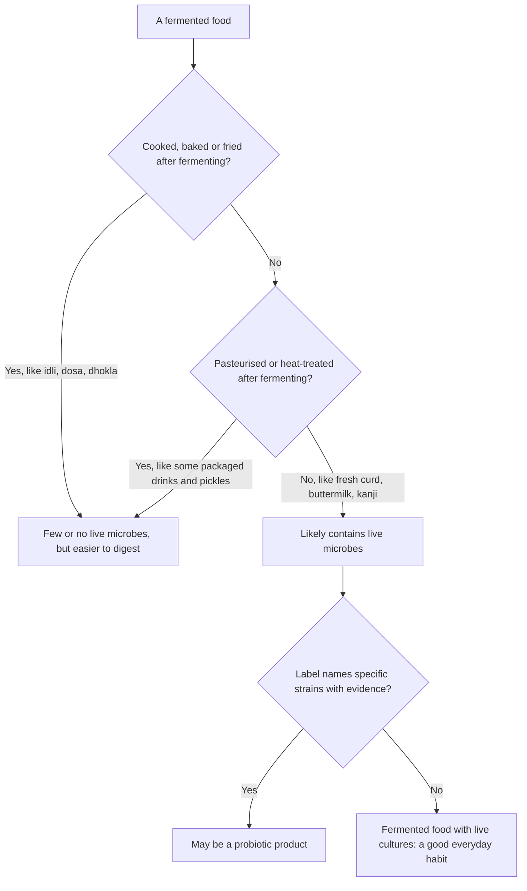

:::answer
Many traditional Indian foods are fermented: dahi (curd), buttermilk, idli and dosa batter, dhokla, appam, kanji, and some pickles. Fermentation can make food easier to digest and, when the food is eaten without cooking afterwards, can deliver live microbes. One well-designed study found that a diet high in fermented foods increased the variety of gut bacteria and lowered several inflammation markers over ten weeks. That's promising, but it doesn't mean fermented foods cure gut disease, and "fermented" doesn't automatically mean "probiotic". Curd and buttermilk are the easiest daily wins; batters are cooked, so their microbes don't survive, though fermentation still changes the food. Make them hygienically, watch the salt in pickles, and see a doctor for gut symptoms that are severe, persistent or come with warning signs.
:::

## First, a few words that get mixed up

**Fermented food**: a food made through the controlled growth of microbes and the changes they make to the food. That is the definition used in an international scientific consensus on fermented foods ([ISAPP, 2021](https://doi.org/10.1038/s41575-020-00390-5)). Curd, idli batter, kanji and many pickles fit it.

**Probiotic**: live microorganisms that, when given in adequate amounts, provide a health benefit to the person ([ISAPP, 2014](https://doi.org/10.1038/nrgastro.2014.66)). To call something a probiotic, you need specific, identified strains with evidence for a benefit. Many fermented foods contain live microbes, but that alone doesn't make them probiotics in the scientific sense.

**Microbiome**: the community of trillions of bacteria, fungi and other microbes living mostly in your large intestine. It helps digest fibre, makes some vitamins and short-chain fatty acids, trains the immune system, and protects against harmful microbes.

Why this matters: when an advertisement says "probiotic", it is making a specific claim. When your grandmother says "dahi is good for the stomach", she is drawing on generations of experience, which science is now testing.

## What the science actually shows

The most talked-about study came from Stanford in 2021. Healthy adults were randomly assigned to ten weeks of either a high-fibre diet or a high-fermented-food diet (yoghurt, kefir, fermented cottage cheese, kombucha, fermented vegetables and similar foods). The fermented-food group showed a steady increase in the diversity of their gut microbes and a decrease in a panel of inflammatory proteins in the blood, including interleukin-6. The high-fibre group did not show the same increase in diversity over that time ([Cell, 2021](https://doi.org/10.1016/j.cell.2021.06.019)).

That is a genuinely interesting finding, and it supports eating fermented foods regularly. Keep it in proportion:

- The study was small (a few dozen people) and short.
- It measured markers, not diseases. It didn't test effects on diseases such as heart attacks, diabetes or gut disorders.
- The foods were mostly Western ones. Indian fermented foods haven't been tested in exactly this way, though curd and buttermilk are close cousins of yoghurt and kefir.

The ISAPP consensus summarises the wider picture: fermented foods may offer benefits beyond basic nutrition, some through live microbes and some through changes the fermentation makes to the food itself, but the evidence varies a lot between foods, and more human studies are needed ([ISAPP, 2021](https://doi.org/10.1038/s41575-020-00390-5)).

[[ad]]

## The Indian fermented foods, one by one

### Dahi (curd) and buttermilk (chaas)
Curd is milk fermented by lactic acid bacteria. Freshly set curd contains large numbers of live bacteria, and buttermilk made from it carries them too. It is also a good source of protein, calcium and, for vegetarians, vitamin B12. The ICMR-NIN dietary guidelines include milk and milk products, such as curd, as part of a balanced Indian diet ([ICMR-NIN, 2024](https://www.nin.res.in/dietaryguidelines/index.html)).

Homemade curd varies from batch to batch; packaged curd and yoghurt vary by brand. A label that names specific probiotic strains with a count is making a stronger claim than one that just says "curd". For most people, a bowl of plain curd or a glass of unsweetened buttermilk daily is an easy, inexpensive habit.

Many people who are told they are "lactose intolerant" tolerate curd better than milk, because the bacteria have already used up some of the lactose.

### Idli, dosa, dhokla, appam batter
These batters are fermented overnight by naturally present bacteria and yeasts, which is what makes them rise and turn slightly sour. Fermentation softens the grains and pulses and can reduce some compounds (like phytates) that block mineral absorption, which may help the body take up iron and zinc.

But the batter is then steamed or cooked on a hot tawa, which kills most of the live microbes. So idli and dosa are best thought of as fermented foods that are easier to digest and nutritionally improved, not as a source of live probiotics. They are still an excellent choice, especially with sambar (protein) and chutney.

### Kanji
Kanji is a traditional north Indian drink made by fermenting black carrots (sometimes beetroot) with mustard seeds, salt and water for a few days. Because it is not cooked after fermenting, it can contain live lactic acid bacteria, and it is a source of plant pigments (anthocyanins) from black carrots. There is very little research on kanji itself, so health claims beyond "a traditional fermented drink that may contain live microbes" go beyond the evidence. It is also salty; enjoy it in small glasses.

### Pickles (achaar)
Some traditional pickles are fermented; many modern ones are preserved mainly with oil, salt and vinegar rather than fermentation. Either way, pickles are usually high in salt, and too much salt raises blood pressure. Think of them as a flavour, a spoonful at a time, not a health food.

### Fermented foods for children and older adults
Plain curd and buttermilk are traditional, well-tolerated foods for most children over the weaning age and for older adults, and they bring protein and calcium along with live cultures. Make sure they're fresh and refrigerated, avoid added sugar for children, and introduce new foods to young children one at a time. Older adults with weak immunity, or anyone who is seriously ill, should stick to freshly made, hygienic preparations and ask their doctor about unpasteurised drinks.

### Other regional foods
India has a wide range of other fermented foods: fermented bamboo shoot and soybean dishes in the north-east, rice-based fermented drinks, fermented fish in some coastal cuisines, and more. These are valuable culinary traditions; scientific evidence on their health effects is still limited.

## How to tell if a fermented food still has live microbes

[[ad]]

## Making fermented foods safely at home

Home fermentation is mostly safe when done with care, but contamination can happen.

- **Clean everything**: wash hands, utensils and containers well; use clean water.
- **Use fresh ingredients** and a good starter culture (for curd, a spoon of fresh curd from a reliable batch).
- **Watch time and temperature**: in Indian summers, curd sets and batters ferment fast. Refrigerate once set or risen to avoid over-fermentation.
- **Trust your senses**: a pleasantly sour smell is normal. Fuzzy mould, pink or black spots, a slimy texture or a foul smell mean throw it away.
- **Store curd and buttermilk in the fridge** and use within a couple of days.
- **Be extra careful** if you are pregnant, very old, have a weakened immune system (for example during chemotherapy or after a transplant), or are feeding a small child: use freshly made, refrigerated food, and ask your doctor about any unpasteurised products.

:::tip Everyday gut-friendly habits
- Have a bowl of plain curd or a glass of unsweetened buttermilk daily if dairy suits you.
- Feed your gut bacteria: fibre from vegetables, dals, whole grains, millets and fruit is their food. Try our [millet swap](/health/millet-swap) tool.
- Add variety: different plants feed different microbes. Aim for many kinds of vegetables, pulses and grains through the week.
- Keep pickles and papad to small amounts because of the salt.
- Go easy on sweetened "probiotic" drinks; many contain a lot of sugar.
- Don't take antibiotics without a prescription; they disturb the microbiome and drive resistance.
- Regular sleep, movement and stress management also affect digestion.
:::

## Fibre: what your gut bacteria actually eat

Fermented foods bring microbes in; fibre feeds the ones already living in you. When gut bacteria break down fibre, they make short-chain fatty acids, which nourish the cells lining the colon and help regulate inflammation and blood sugar. A diet low in fibre starves these bacteria, however much curd you eat.

Traditional Indian meals can be very rich in fibre when they are built the old way: dal or sambar, a sabzi, whole-wheat roti or millet, a salad, and fruit. Modern city diets often drift towards refined flour, white rice in large portions, bakery snacks and few vegetables. Small changes add up:

- Choose whole-wheat atta or mixed-grain atta over maida.
- Swap white rice for millets or brown rice a few times a week.
- Keep the skin on vegetables where you can, and add one extra vegetable to every meal.
- Eat whole fruit rather than juice.
- Keep a pulse (dal, chana, rajma, lobia, moong) in at least one meal a day.
- Add a teaspoon of soaked chia, flax or sabja seeds to curd or a drink now and then.

Increase fibre gradually and drink enough water, because a sudden jump can cause gas and bloating at first.

## Antibiotics, illness and your gut

A course of antibiotics can disrupt the gut microbiome for weeks, which is one reason some people get diarrhoea during or after treatment. That is not a reason to refuse antibiotics when a doctor prescribes them for a bacterial infection; it is a reason never to take them for colds and viral fevers, where they don't help. After a course, eating fermented foods and plenty of fibre supports recovery. If diarrhoea is severe, bloody or continues after the course ends, see your doctor.

## Probiotic supplements: when they might help

Some specific probiotic strains have evidence for specific uses, for example helping reduce diarrhoea linked to antibiotics in some people. But the benefits are strain-specific and condition-specific; one product doesn't fit all. Most healthy people don't need a supplement if they eat a varied diet with fermented foods and fibre. If you are considering one for a gut problem, ask your doctor which product, if any, has evidence for your situation. People who are seriously ill or have weakened immune systems should not take probiotics without medical advice.

## What fermented foods can't do

- They don't cure irritable bowel syndrome, inflammatory bowel disease, acid reflux or ulcers, though some people find certain foods help or worsen symptoms.
- They don't "detox" the liver or the gut.
- They don't replace medical treatment for any condition.
- They don't make an unhealthy overall diet healthy. A spoon of curd doesn't cancel out daily fried snacks and sugary drinks.

Some people with IBS find large amounts of certain foods, including some fermented ones, make bloating worse. If that's you, see what suits your body, and discuss it with your doctor or a dietitian.

:::warning See a doctor promptly if
- You see blood in your stool, or your stool is black and tarry
- You are losing weight without trying
- You have severe or persistent belly pain, or pain that wakes you at night
- Diarrhoea lasts more than a few days, or comes with high fever or signs of dehydration (very little urine, dizziness)
- You have trouble swallowing, or vomit repeatedly
- Your bowel habits change for weeks without a clear reason, especially if you're over 50
- You have unexplained anaemia
- A fermented food at home made several people ill at once
:::

[[ad]]

## Myths about fermented foods and gut health

:::mythfact
| Myth | Fact |
|---|---|
| "Every fermented food is a probiotic." | A probiotic needs specific live strains with proven benefit. Many fermented foods contain live microbes, but that's a different claim. |
| "Idli and dosa are probiotic." | They're fermented, then cooked, so few live microbes survive. They're still easy to digest and a good meal. |
| "Curd causes colds; avoid it in winter." | There's no good evidence that curd causes colds. If it suits you, it can be eaten year-round. |
| "Kanji detoxes the body." | Kanji is a traditional drink that may contain live microbes. There's no evidence it "detoxes" anything. |
| "Pickles are good for the gut, so eat plenty." | Most pickles are high in salt, which raises blood pressure. A small spoon is plenty. |
| "A probiotic capsule fixes any gut problem." | Benefits are specific to particular strains and conditions. Ask your doctor before relying on a supplement. |
:::

## A two-week gut-friendly plan

**Week 1:** Add one serving of plain curd or unsweetened buttermilk daily. Add one extra vegetable to lunch and dinner. Replace one refined-flour meal with a millet or whole-grain version.

**Week 2:** Add a dal or chana dish daily if you don't already. Try making fresh idli or dosa batter at home with good hygiene. Swap one sweet snack for fruit. Notice how your digestion feels; everyone is different.

## Common questions

:::faq
### Is homemade curd better than packaged curd?
Both can contain live cultures. Homemade curd varies from batch to batch; packaged products vary by brand and may list specific strains. Choose plain, unsweetened curd, and make homemade curd with good hygiene.

### Does cooking kill the benefits of fermented batter?
Cooking kills most live microbes, but fermentation has already changed the food, making it easier to digest and potentially improving mineral absorption. So idli and dosa are still a healthy choice, just not a source of live probiotics.

### Should I take a probiotic supplement every day?
Most healthy people don't need one if they eat a varied diet with fermented foods and plenty of fibre. Some specific strains help in specific situations; ask your doctor if you have a particular problem in mind.

### Can people with lactose intolerance eat curd?
Many people who struggle with milk tolerate curd better, because the bacteria break down some of the lactose. Start with small amounts and see how you feel. If symptoms are severe, talk to your doctor.

### How do I know if my homemade fermented food has gone bad?
A pleasant sour smell is normal. Throw it out if you see fuzzy mould, pink or black spots, a slimy texture or a foul smell, or if it has been left out too long in hot weather.
:::

## The bottom line

Fermented foods are a delicious, traditional part of Indian eating, and science increasingly supports including them. Curd and buttermilk are the simplest daily habit; idli, dosa and dhokla are excellent meals even though cooking removes most live microbes; kanji and pickles are best in small amounts. Pair them with plenty of fibre and variety, and see a doctor for warning signs rather than relying on food to fix them.

A healthy gut also loves movement. If you want a routine that supports digestion, energy and weight together, the trainers at Royal Fitness Club in Sector 93, Noida can help you build one.
