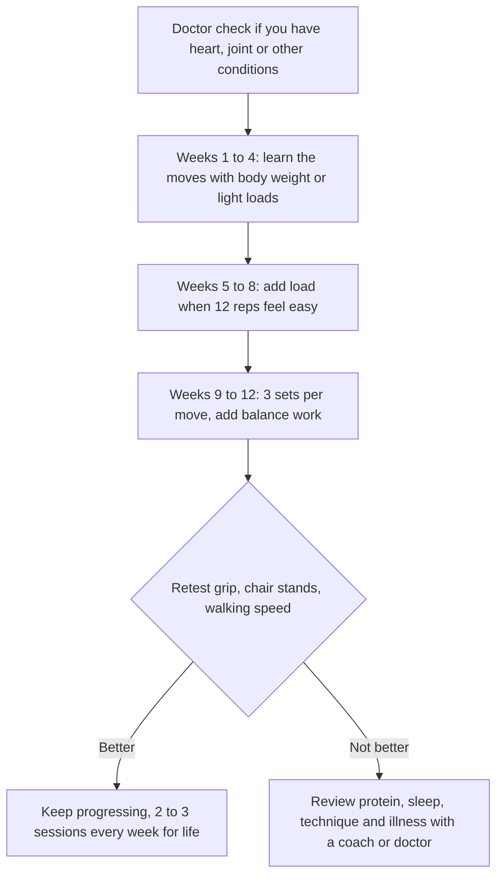

:::answer
From middle age onward, most people slowly lose muscle and, even faster, muscle strength, unless they do something about it. When the loss becomes large enough to affect daily life, it is called sarcopenia, and it raises the risk of falls, fractures, disability and illness. The good news is that muscle responds to training at any age. Two to three sessions a week of progressive strength training, enough protein spread across meals (the typical Indian diet is often light on protein at breakfast and dinner), daily walking, and good sleep are what work. Simple checks like grip strength, chair-stand time and walking speed tell you where you stand.
:::

## Why muscle is the organ of ageing well

Muscle does far more than lift weights. It moves you, holds you upright, protects your joints, absorbs much of the sugar from every meal, stores protein your body draws on during illness, and helps keep your bones strong. When people lose muscle, they don't just get weaker: they find stairs harder, get up from the floor with difficulty, fall more often, recover more slowly from illness or surgery, and handle blood sugar less well.

A striking illustration comes from the international PURE study, which measured grip strength in nearly 140,000 adults across 17 countries, including India. Lower grip strength was associated with higher risk of death from any cause and from heart disease; each 5 kg lower grip was linked with a 16% higher risk of death from any cause over the follow-up period ([Lancet, 2015](https://doi.org/10.1016/S0140-6736(14)62000-6)). Grip strength isn't magic; it is a simple window into overall muscle strength and health.

## What sarcopenia actually means

Sarcopenia is a progressive loss of muscle strength, muscle mass and physical function that comes with age and is made worse by inactivity, poor nutrition, illness and some medicines. The European working group's updated definition puts low muscle strength at the centre: weakness is the first sign doctors look for ([EWGSOP2, 2019](https://doi.org/10.1093/ageing/afy169)).

Because Asian bodies differ in size and composition, the Asian Working Group for Sarcopenia set its own cut-offs in 2019 ([AWGS, 2019](https://pubmed.ncbi.nlm.nih.gov/32033882/)). Under these, low strength means a handgrip below 28 kg for men or below 18 kg for women, and low physical performance means any of: walking slower than 1.0 metre per second over 6 metres, taking 12 seconds or more to stand up from a chair five times without using your arms, or a low score on a short performance test. The group also introduced "possible sarcopenia", when strength or performance is low, so that people can start improving before a full diagnosis with body scans.

You don't need to be old to start losing ground. Inactive office life, long commutes, and diets low in protein mean many Indians reach their 40s and 50s with less muscle than they should have.

[[ad]]

## Check yourself: three simple tests

These are screening checks, not a diagnosis. If you do poorly on them, especially if you are older or have health conditions, talk to your doctor.

### 1. Grip strength
Many gyms, physiotherapy clinics and some doctors have a hand dynamometer. Squeeze as hard as you can, two or three times with each hand, and note the best result. Compare it with the AWGS cut-offs above, and more usefully, track your own number every three months.

### 2. Five chair stands
Sit on a standard dining chair with your arms crossed over your chest. Time how long it takes to stand up fully and sit back down five times, as fast as you safely can. Twelve seconds or more suggests low leg strength and power. Have someone stand near you if your balance is uncertain.

### 3. Walking speed
Mark 6 metres on a flat floor or corridor. Walk it at your usual pace, starting from a few steps before the line so you are already moving, and time it. Slower than 6 seconds (that is, under 1 metre per second) is a sign of low physical performance.

Write your results down. In three months, after following the plan below, test again.

## Protein in Indian diets: the gap at breakfast and dinner

Muscle needs protein to rebuild after training and to resist age-related loss. Older muscles respond less to small amounts of protein, so the dose at each meal matters, not just the daily total. An international expert group on protein for older people (PROT-AGE) recommended that healthy older adults aim for around 1.0 to 1.2 grams of protein per kg of body weight per day, and more for those who are ill or very active, unless a doctor advises otherwise because of kidney disease ([PROT-AGE, 2013](https://doi.org/10.1016/j.jamda.2013.05.021)). The ICMR-NIN guidelines also encourage getting protein from varied foods such as pulses, dairy, eggs, fish and meat rather than from supplements ([ICMR-NIN, 2024](https://www.nin.res.in/dietaryguidelines/index.html)).

The typical Indian vegetarian day looks like this: tea and biscuits or poha for breakfast, a reasonable lunch with dal, roti, rice and sabzi, chai and namkeen in the evening, and a late dinner heavy on roti or rice. Protein is concentrated at lunch, and breakfast and dinner are often light on it. That pattern is common and fixable.

### Easy ways to add protein to each meal

- **Breakfast**: besan or moong dal chilla, paneer or egg bhurji, curd with fruit and nuts, sprouts poha, ragi or oats with milk, two eggs with roti.
- **Lunch**: a thicker dal (more dal, less water), plus curd or buttermilk, plus a chana, rajma, paneer, soya or chicken dish twice or thrice a week.
- **Evening snack**: roasted chana, a glass of milk or buttermilk, sprouts chaat, peanuts, a boiled egg, instead of biscuits and namkeen.
- **Dinner**: dal or sambar plus a paneer, tofu, soya, egg, fish or chicken dish, with fewer rotis and more vegetables.

Protein powders are not necessary for most people who plan meals well. If you consider one, check with your doctor first, especially if you have kidney disease or diabetes. Our [high-protein vegetarian guide](/health/blog/high-protein-vegetarian-india-guide) has full meal plans.

[[ad]]

## The strength plan: 12 weeks, two to three sessions a week

The WHO physical activity guidelines recommend muscle-strengthening activities on two or more days a week for all adults, alongside 150 to 300 minutes of moderate aerobic activity, and for older adults, activities that also train balance on three or more days a week ([WHO, 2020](https://doi.org/10.1136/bjsports-2020-102955)). Here is a simple way to do that.

### The six movements that cover the body

1. **Sit-to-stand (squat to a chair)**: the most important movement for independence. Progress to holding a dumbbell or bag.
2. **Push**: wall push-ups, then push-ups against a table or bench, then knee or full push-ups.
3. **Pull**: resistance band rows, or dumbbell rows with a hand on a bench.
4. **Hinge**: hip bridges on the floor, then dumbbell Romanian deadlifts with a straight back.
5. **Carry**: walk 20 to 30 metres holding a heavy bag or dumbbell in each hand.
6. **Step-ups**: onto a low, stable step, holding a rail at first.

### How to progress safely
- Start with **one or two sets of 10 to 12 repetitions** of each movement, with good form.
- When you can do **12 good repetitions easily**, add a little weight or make the movement harder.
- Aim for the last two or three reps of each set to feel **genuinely hard**, but never painful in the joints.
- **Rest one or two days** between sessions for the same muscles.
- Add **balance practice**: standing on one leg near a wall, heel-to-toe walking, or yoga balances.
- Keep **walking daily**: it's good for the heart, joints and sugar, though on its own it does not build much muscle.

Our [workout builder](/health/workout-builder) can help you plan sessions at home or in the gym.

:::tip Tips that make strength training stick after 40
- Book your sessions like appointments: two or three fixed days and times a week.
- Start lighter than your ego wants. Most injuries come from doing too much too soon.
- Breathe out as you lift and in as you lower; don't hold your breath on effort.
- Eat a protein-rich meal or snack within a few hours after training.
- Sleep seven or more hours. Muscle repair happens largely in sleep.
- Track one number per movement (weight or reps) in a notebook; progress is motivating.
- Train with a friend, spouse or coach. Accountability beats motivation.
:::

## A sample week for a busy 45-year-old

Here is how the guidelines can fit into a real week with work, family and a commute. Adjust days to your routine; the pattern matters more than the exact days.

- **Monday**: strength session, 40 minutes (all six movements, two sets each), plus a 15-minute walk after dinner.
- **Tuesday**: 30-minute brisk walk, ideally in daylight; five minutes of one-leg balance practice while the tea boils.
- **Wednesday**: strength session, 40 minutes, adding a little weight to any movement that felt easy on Monday.
- **Thursday**: active rest: a gentle walk, stretching or yoga.
- **Friday**: strength session, 40 minutes, or a brisk 40-minute walk if the week has been heavy.
- **Saturday**: something you enjoy that keeps you moving for an hour: badminton, cycling, a long walk with family, dancing.
- **Sunday**: rest, a relaxed walk, and plan next week's meals with a protein source at each one.

That adds up to two or three strength sessions, well over 150 minutes of moderate activity, and regular balance work, which is what WHO recommends for older adults. If that feels like too much to start with, begin with two strength sessions and daily walks, and build from there.

## Questions to take to your doctor

- Are there any movements or intensities I should avoid because of my heart, joints, blood pressure or bones?
- How much protein is right for me, given my kidney function and other conditions?
- Should my vitamin D or other levels be checked?
- Could any of my medicines be affecting my muscles or balance?
- Would physiotherapy help me start safely?

## Special situations

### Joint pain and arthritis
Strength training usually helps knee and hip arthritis by supporting the joints. Choose movements and ranges that don't flare your pain, and ask a physiotherapist or doctor for modifications.

### Diabetes, heart disease, high blood pressure
Strength training benefits all of these, but get your doctor's go-ahead first and build up gradually. If you take insulin or sulfonylureas, learn how exercise affects your sugar.

### Osteoporosis
Well-chosen strength and balance training helps bones and reduces fall risk. Avoid heavy twisting and forward-bending movements if you have osteoporosis, and get specific advice from your doctor or physiotherapist.

### After illness or hospital stay
Muscle is lost quickly during bed rest. Start again gently as soon as your doctor allows, with protein-rich meals and short, frequent walks, then add strength work.

### Office workers and the "sitting disease"
If your job keeps you seated for eight or more hours, your muscles get very little signal to stay strong. Stand up and walk for a couple of minutes every half hour or so, take calls standing, use stairs for one or two floors, and do ten chair squats every time you refill your water bottle. These small breaks don't replace training, but they add up across a working week.

### Women after menopause
Falling oestrogen speeds up bone loss and changes body composition. Strength training and adequate protein, calcium and vitamin D (as advised by your doctor) are especially important now.

:::warning Stop and see a doctor promptly if
- You get chest pain, pressure or unusual breathlessness during exercise
- You feel faint or dizzy, or have a racing or irregular heartbeat
- You have sudden, sharp joint pain or a joint that swells after training
- You notice unexplained weight loss, or rapidly worsening weakness
- You fall, especially if you hit your head or can't bear weight afterwards
- You have new numbness, weakness on one side, or trouble speaking (call 112 immediately)
:::

[[ad]]

## Myths about muscle and age

:::mythfact
| Myth | Fact |
|---|---|
| "At my age, weights are dangerous." | Supervised, progressive strength training is safe for most adults and is recommended at every age by WHO. Start light and build up. |
| "Walking is enough." | Walking is great for the heart and sugar but does little to maintain muscle strength. Add strength work two or three times a week. |
| "Vegetarians can't get enough protein." | Dal, curd, paneer, milk, soya, chana and sprouts can cover needs with planning. Spread protein across all meals. |
| "Protein damages healthy kidneys." | Normal amounts from food are fine for healthy kidneys. People with kidney disease need their doctor's advice on protein. |
| "Lifting makes women bulky." | Women build strength and tone without becoming bulky; it takes years of specific training to build large muscles. |
| "It's too late to start at 60." | Muscles respond to training even in very old age. Gains in strength and function are seen at every age. |
:::

## Common questions

:::faq
### How much protein do I need after 40?
Many healthy older adults are advised to aim for roughly 1.0 to 1.2 g of protein per kg of body weight a day, spread across meals. Needs vary with health, activity and kidney function, so check with your doctor or dietitian, especially if you have kidney disease.

### Can I build muscle at home without a gym?
Yes. Chair squats, wall or table push-ups, resistance band rows, hip bridges, step-ups and carrying heavy bags work well. Add load over time with bands, dumbbells or filled water bottles. A gym makes progression easier, but isn't essential.

### How quickly will I see results?
Many people feel stronger within four to eight weeks, because the nervous system learns to use muscle better. Visible muscle and bigger strength gains take months of consistent training and enough protein.

### Do I need supplements like creatine or protein powder?
Most people can meet their needs from food. Some supplements have evidence for specific groups, but they aren't needed by everyone and may not suit people with certain health conditions. Discuss any supplement with your doctor before starting.

### I have knee pain. Should I avoid leg exercises?
Usually not. Stronger thigh and hip muscles often reduce knee pain. Choose pain-free ranges, such as squatting to a higher chair, and ask a physiotherapist for modifications if pain persists.
:::

## The bottom line

Muscle is not vanity; it is independence, balance, blood-sugar control and resilience. You can protect and rebuild it at any age with progressive strength training two or three times a week, protein at every meal, daily walking and good sleep. Test yourself today, and test again in twelve weeks.

If you would like a coach to set up a safe, progressive programme, the trainers at Royal Fitness Club in Sector 93, Noida work with members in their 40s, 50s and 60s every day. Book a free trial session to start.
