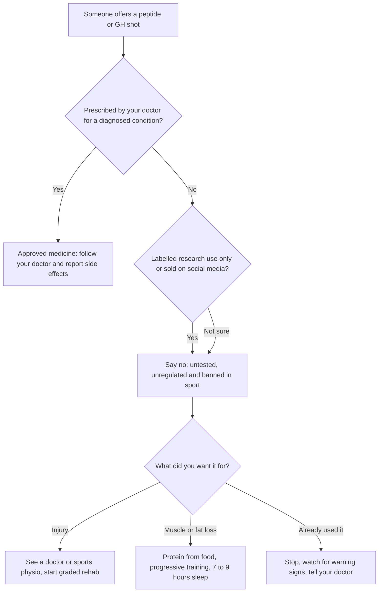

:::answer
"Peptides" is a big word that covers both proven medicines and untested gym products. Insulin, the GLP-1 diabetes and weight-loss injections, and growth hormone prescribed for a real deficiency are approved peptide medicines, made under strict quality control and used under a doctor's care. BPC-157, TB-500 and similar "research peptides" sold online are a different story. Almost all the evidence for them comes from rats and lab dishes, nobody has tested their safety properly in people, the vials are not made to medicine standards, and they are banned in sport at all times. MK-677 is not even a peptide, and in trials it raised blood sugar and increased appetite. If you have an injury, see a sports doctor or physiotherapist. If you want muscle, food, sleep and progressive training still do the work.
:::

## Why everyone at the gym is suddenly talking about peptides

A few years ago the gym gossip in Noida and Gurugram was about steroids and SARMs. Now it is peptides, pushed by reels, podcasts and the senior member who swears a "healing shot" fixed his shoulder. Sellers call them safer than steroids, "natural" because they are made of amino acids, and legal because the label says "for research use only".

None of those claims holds up well. This guide explains what peptides are, which ones are real medicines, and what the research says about the gym ones. We will not tell you how to use any of them, where to get them or how much to take, because no safe amount has been worked out for people.

## What a peptide actually is

A peptide is a short chain of amino acids, the same building blocks that make up protein. Your body makes thousands of peptides as signals: hormones that tell organs what to do. Insulin is a peptide. So are the gut hormone GLP-1 and the hunger hormone ghrelin. Growth hormone is a bigger protein, but it works in a similar signalling way.

Because peptides are signals, a lab-made one can switch processes on or off far from where it was injected. That is why approved peptide medicines go through years of testing, and why an untested one is a gamble.

"Made of amino acids" does not mean "safe". What matters is what the molecule does in your body, how pure it is, and whether anyone has checked.

## Approved peptide medicines vs "research peptides"

It helps to split peptides into two groups.

**Approved peptide medicines.** These have been tested in large human trials, approved by regulators such as India's CDSCO or the US FDA, and are made in licensed factories with checks for purity, sterility and exact content. Examples you may know:

- **Insulin**, used every day by people with diabetes.
- **GLP-1 medicines** such as semaglutide, and the dual-action tirzepatide, used for type 2 diabetes and obesity. We explain these in our guides on [generic semaglutide](/health/blog/generic-semaglutide-india-guide) and [tirzepatide](/health/blog/tirzepatide-mounjaro-india-guide).
- **Growth hormone**, prescribed by an endocrinologist for children and adults with a proven deficiency, after blood tests.

Even these have side effects and need a prescription and a doctor's follow-up.

**"Research peptides".** BPC-157, TB-500 and a long list of others are sold online and through gym contacts with a label like "for research use only, not for human consumption". That label is the seller's legal escape route. It means the product has not been approved as a medicine anywhere for human use. The World Anti-Doping Agency (WADA) places BPC-157 in its "non-approved substances" class, which it defines as substances with no current approval by any government health regulator for human therapeutic use ([WADA Prohibited List, 2026](https://www.wada-ama.org/en/prohibited-list)).

## BPC-157: the "healing peptide"

BPC-157 is a lab-made peptide based on a fragment of a protein found in stomach juice. It is sold as a shot that heals tendons, ligaments, muscle tears and gut problems faster.

### What the research actually shows

The best summary so far is a 2025 systematic review in *HSS Journal*, written by orthopaedic and sports medicine doctors. The authors searched three major medical databases and found 544 records. After screening, 36 studies were relevant. Of those 36, 35 were preclinical, meaning animal or lab-dish studies, and only one was in humans ([HSS Journal, 2025](https://pmc.ncbi.nlm.nih.gov/articles/PMC12313605/)).

That single human study was a look back at the records of 12 patients with knee pain who had received BPC-157 injections. Seven of the 12 said their symptoms improved for more than six months. There was no comparison group, so we can't tell how many would have improved anyway with time, rest or a placebo effect, and the study did not report safety data.

The animal studies are mostly positive: in rats, BPC-157 seemed to reduce inflammation and help tendon, ligament, muscle and bone heal. That is a reason to run proper human trials, not proof that it works or is safe in your shoulder. Plenty of treatments that worked in rats failed in people.

The review's authors were clear on safety. No study checked side effects beyond six weeks, even in animals, and no study assessed safety in humans. They warned clinicians and athletes to be cautious, and pointed out that products sold as "supplements" or "research chemicals" have no verified quality ([HSS Journal, 2025](https://pmc.ncbi.nlm.nih.gov/articles/PMC12313605/)).

### What the US FDA has said, and what changed in 2026

In 2023 the US FDA listed BPC-157 in "Category 2" of substances nominated for pharmacy compounding, the group it said raised significant safety risks ([HSS Journal, 2025](https://pmc.ncbi.nlm.nih.gov/articles/PMC12313605/)). The FDA's concerns were that compounded BPC-157 might trigger immune reactions for some routes of use, and that it is hard to control peptide-related impurities and to characterise the ingredient properly. It also said it had found little or no safety information for the proposed routes ([FDA, 2026](https://www.fda.gov/drugs/human-drug-compounding/certain-bulk-drug-substances-use-compounding-may-present-significant-safety-risks)).

You may see social media posts in 2026 claiming "the FDA has cleared BPC-157". Here is what actually happened:

- **April 2026:** the groups that had nominated BPC-157, TB-500 and ten other peptides withdrew their nominations, so the FDA removed them from Category 2. Lawyers who follow this area pointed out that removal did not make them legal to compound and did not move them to the approved-for-compounding list ([Frier Levitt, 2026](https://www.frierlevitt.com/articles/fda-peptides-do-not-compound-list-update-2026/)).
- **July 2026:** an FDA advisory committee voted 8 to 6, with one abstention, to recommend adding BPC-157 and TB-500 to the list of substances pharmacies may compound. FDA's own scientists had opposed it, saying the available studies were short, small and not enough to establish safety or effectiveness. The vote is a non-binding recommendation, and formal rule-making would still be needed ([AJMC, 2026](https://www.ajmc.com/view/fda-panel-backs-6-peptides-for-compounding)).

So the honest summary in November 2026 is this: BPC-157 is still not an approved medicine in the US, and the FDA's own scientists judged the human evidence too thin. None of this US paperwork applies to India, and none of it touches the vials sold through Instagram and WhatsApp.

## TB-500: a fragment of thymosin beta-4

TB-500 is sold as a recovery and flexibility peptide, often alongside BPC-157. It is based on part of a natural protein called thymosin beta-4, which is involved in cell movement and tissue repair.

The FDA noted it had not identified any human exposure data for this fragment, and flagged a risk of immune reactions linked to clumping of the peptide and impurities ([FDA, 2026](https://www.fda.gov/drugs/human-drug-compounding/certain-bulk-drug-substances-use-compounding-may-present-significant-safety-risks)). In sport, WADA bans thymosin beta-4 and its derivatives, naming TB-500 as an example, under section S2.3 (growth factors), at all times ([WADA, 2026](https://www.wada-ama.org/en/prohibited-list)).

Put simply: there are no good human trials showing TB-500 speeds healing in gym injuries, and no human safety record.

## Growth hormone and "GH boosters"

Real growth hormone is a prescription medicine. A doctor gives it after tests prove a deficiency. In gyms it gets misused for fat loss and "fullness", and a whole range of products claim to "boost" your own GH: injectable peptides that push the pituitary gland, and pills such as MK-677.

### Does extra GH make you stronger?

The research says probably not in any useful way. A 2017 review of growth hormone, IGF-1 and insulin misuse concluded that there is little clinical evidence that GH on its own meaningfully improves performance ([Molecular and Cellular Endocrinology, 2017](https://pmc.ncbi.nlm.nih.gov/articles/PMC5723243/)). Part of the "lean mass" people gain can be water held in the tissues.

### The risks of GH misuse

Doctors know a lot about too much growth hormone from a disease called acromegaly, where a pituitary tumour makes excess GH for years. The same 2017 review says the effects of GH misuse are believed to resemble acromegaly ([Molecular and Cellular Endocrinology, 2017](https://pmc.ncbi.nlm.nih.gov/articles/PMC5723243/)). That can include:

- **Insulin resistance and diabetes**: GH works against insulin, so blood sugar rises
- **High blood pressure** and fluid retention, with puffy hands and feet
- **Joint pain** and carpal tunnel syndrome (tingling and numb fingers from a squeezed wrist nerve)
- **Heart strain**, with heart failure listed among the risks of overuse
- **Acromegaly-like changes** over time, such as a thickening jaw, larger hands and feet, and coarser facial features

The authors note that most reports come from case studies and from people taking several drugs at once, so the full picture is unknown. Nobody is tracking what happens to young men in Indian gyms who inject GH bought without a prescription.

The review also warns that older GH extracted from human cadaver pituitary glands was linked to Creutzfeldt-Jakob disease, a fatal brain illness, and that cadaver-derived GH can still turn up outside regulated markets ([Molecular and Cellular Endocrinology, 2017](https://pmc.ncbi.nlm.nih.gov/articles/PMC5723243/)).

WADA bans growth hormone and its fragments, growth hormone releasing hormones and their analogues, and growth hormone secretagogues and GH-releasing peptides, all under section S2.2, at all times ([WADA, 2026](https://www.wada-ama.org/en/prohibited-list)).

## MK-677 (ibutamoren): the "GH pill" that isn't a peptide

MK-677 is often sold alongside peptides, but chemically it is a small molecule taken by mouth, not a peptide. It copies the hunger hormone ghrelin, and that pushes the pituitary to release more growth hormone. A drug company developed it, and it was never approved as a medicine.

The best-known trial gave it to 65 healthy adults aged 60 to 81 for up to two years, compared with a placebo ([Annals of Internal Medicine, 2008](https://pubmed.ncbi.nlm.nih.gov/18981485/)). What happened:

- GH and IGF-1 levels rose to those seen in young adults.
- Fat-free mass went up by about 1.1 kg compared with a fall of about 0.5 kg on placebo, but **strength and physical function did not improve**.
- Body weight rose by about 2.7 kg, against 0.8 kg on placebo, and fat on the arms and legs increased more.
- **Fasting blood sugar rose** by an average of about 0.3 mmol/L, and insulin sensitivity fell.
- The most common side effect was **increased appetite**, which faded after a few months, plus mild swelling of the legs and muscle pain.

A second trial in 123 older people recovering from hip fracture was stopped early because of a safety signal of congestive heart failure in a small number of patients taking MK-677. The authors concluded it had an unfavourable safety profile in that group ([Archives of Gerontology and Geriatrics, 2011](https://pubmed.ncbi.nlm.nih.gov/21067829/)).

For Indians, the blood sugar finding matters a lot. South Asians develop diabetes at younger ages and lower body weights than many other groups. Taking a pill that raises sugar and appetite, with no medical reason, is a poor trade. WADA lists ibutamoren (MK-677) by name among banned growth hormone secretagogues ([WADA, 2026](https://www.wada-ama.org/en/prohibited-list)).

## "Research use only" vials: what might be inside

Even if a peptide were safe in theory, the product you can actually get is a separate problem. An injection goes straight past your skin and gut, which normally protect you from germs and impurities. Approved injectable medicines are made sterile and tested for bacterial toxins and exact content. "Research" vials come with none of those checks.

Problems that regulators and reviewers have flagged include:

- **Wrong content**: less, more or none of the named peptide, or a different substance altogether
- **Peptide-related impurities**: broken or altered chains that can trigger immune reactions ([FDA, 2026](https://www.fda.gov/drugs/human-drug-compounding/certain-bulk-drug-substances-use-compounding-may-present-significant-safety-risks))
- **Contamination**: the 2025 BPC-157 review notes that products sold as supplements or research chemicals fall outside drug regulation, so their quality and safety are not verified ([HSS Journal, 2025](https://pmc.ncbi.nlm.nih.gov/articles/PMC12313605/))
- **Non-sterile handling**: powders mixed with water in a gym changing room, shared vials and reused needles

The harms from this are practical and immediate: skin abscesses, spreading infection, severe allergic reactions, and blood-borne infections such as hepatitis B, hepatitis C and HIV when needles or vials are shared.

:::tip What to do instead, at our gym or yours
- For an injury, see a doctor or a sports physiotherapist first. A proper diagnosis often changes the plan completely.
- Load the injured area gradually under guidance. Tendons respond to slow, progressive loading over weeks.
- Eat enough protein from food. Our [protein requirement calculator](/health/blog/protein-requirement-calculator-india) gives a starting number for your weight and training.
- Sleep 7 to 9 hours. Recovery from training happens while you rest, not while you inject.
- If you are curious about a supplement with real evidence, read our [creatine guide](/health/blog/creatine-guide-india) before anything injectable.
- If a trainer or gym-mate offers you a vial, say no and tell the gym owner. A good gym does not tolerate it.
:::

## Collagen peptides: the one "peptide" on a supermarket shelf

Collagen peptides are not drugs. They are a food supplement made by breaking down collagen from animal skin, bone or fish scales into smaller pieces, sold as powders and drinks for joints and skin. They are eaten, not injected, and your gut digests them like other protein.

The evidence is modest and mixed:

- **Joints:** a 2024 meta-analysis pooled 35 randomised trials involving 3,165 people with osteoarthritis. Collagen products produced small-to-moderate improvements in pain and function compared with control, and did not increase side effects ([Osteoarthritis and Cartilage, 2024](https://pubmed.ncbi.nlm.nih.gov/38218227/)). That is a real but modest effect, mostly in older people with arthritis, not young lifters with a tendon niggle.
- **Skin:** a 2025 meta-analysis of 23 trials with 1,474 people found improvements in hydration, elasticity and wrinkles when all studies were pooled. But when the authors looked only at studies not funded by companies, or only at high-quality studies, the benefit disappeared. They concluded there is currently no clinical evidence to support collagen for preventing or treating skin ageing ([American Journal of Medicine, 2025](https://pubmed.ncbi.nlm.nih.gov/40324552/)).

Collagen is also low in some essential amino acids, so dal, paneer, curd, eggs, soya, chicken and fish do a better job for muscle. If you have knee arthritis and want to try it, check with your doctor first if you have kidney disease, and buy a product with an FSSAI licence number on the label.

## Myths you will hear in the changing room

:::mythfact
| Myth | Fact |
|---|---|
| "Peptides are natural, so they're safe." | Being made of amino acids says nothing about safety. Insulin is a peptide, and too much can kill. Research peptides have no human safety data. |
| "BPC-157 is proven to heal injuries." | A 2025 review found 35 animal or lab studies and one small human case series with no comparison group. |
| "The FDA approved BPC-157 in 2026." | It did not. An advisory panel recommended it for pharmacy compounding by a narrow vote, against the advice of FDA scientists. It is still not an approved medicine. |
| "Research use only means it's legal and tested." | It means nobody has approved it for human use. Content, purity and sterility are unverified. |
| "MK-677 is a safe GH pill." | In a trial in older adults it raised blood sugar and reduced insulin sensitivity. Another trial was stopped early over heart failure. |
| "Peptides don't show up in dope tests." | WADA bans BPC-157, TB-500, MK-677 and GH-releasing peptides at all times, and NADA India tests against the WADA list. |
| "Collagen peptides build muscle like whey." | Collagen is low in some essential amino acids. It may help arthritis pain a little, but it is a weak muscle-building protein. |
:::

## If you compete, or might one day

If you play any sport at state, national or university level, NADA India tests against the WADA Prohibited List, which it publishes on its website ([NADA India](https://nadaindia.yas.gov.in/)). BPC-157 (S0), TB-500 (S2.3), and GH, its releasing factors and MK-677 (S2.2) are all prohibited in and out of competition ([WADA, 2026](https://www.wada-ama.org/en/prohibited-list)). "I didn't know" and "it was in my supplement" are not defences. A ban can cost you years of your sport, so check the list and ask a sports medicine doctor before you take anything.

## Warning signs after any injection

If you or a friend has already used one of these products, stop and watch for problems. Tell the doctor exactly what you took; it helps them treat you correctly.

:::warning See a doctor urgently or go to hospital if
- The injection site becomes red, hot, swollen, very painful or starts leaking pus
- You develop fever or chills after an injection
- You have swelling of the lips, face or throat, a rash all over, or trouble breathing
- You feel very thirsty, pass a lot of urine, or your blood sugar reading is high
- You have chest pain, breathlessness, or new swelling of your legs
- Your fingers keep going numb or tingly, or your rings and shoes stop fitting
- You shared a needle or vial with anyone (ask about tests for hepatitis B, hepatitis C and HIV)
:::

## Common questions

:::faq
### Is BPC-157 legal in India?
We could not find any approval for BPC-157 as a medicine in India or elsewhere. WADA classes it as a substance with no government approval for human therapeutic use. Selling it as "research use only" does not make it safe or approved for people. If anyone offers it to you as a treatment, treat that as a red flag.

### Can BPC-157 or TB-500 heal my tendon injury faster?
There is no good human evidence that they do. Almost all research is in animals, and the only human study of BPC-157 in a 2025 review was a small record review of 12 knee pain patients with no comparison group. A diagnosis from a doctor and a structured rehab plan from a physiotherapist is the route with evidence behind it.

### Is MK-677 safer than steroids because it's a pill?
Taking something by mouth does not make it safe. In a two-year trial in older adults, MK-677 raised fasting blood sugar, lowered insulin sensitivity and increased appetite, and another trial was stopped early over heart failure. It is not an approved medicine and is banned in sport.

### Are collagen peptides the same as gym peptides?
No. Collagen peptides are a food supplement you swallow, digested like other protein. Studies suggest a small benefit for arthritis pain, while the skin benefit vanished in independent, high-quality studies. Gym peptides like BPC-157 are unapproved drugs that people inject.

### Will peptides show up in a dope test?
They can. WADA bans BPC-157, TB-500, growth hormone, GH-releasing peptides and MK-677 at all times, and NADA India follows the WADA list. Testing methods keep improving, and samples can be stored and retested later.
:::

:::takeaways
- Approved peptide medicines are tested and prescribed. "Research peptides" are not.
- BPC-157 evidence is almost all animal studies, and the 2026 US panel vote was non-binding.
- GH misuse and MK-677 can raise blood sugar. Unregulated vials add infection and impurity risks, and all are banned in sport.
:::

## The bottom line

The peptide craze sells a simple idea: a small shot that heals you faster and builds you bigger without the downsides of steroids. The evidence doesn't support it. The products people actually inject are untested in humans, unregulated in quality and banned in sport, and the "GH boosters" carry real risks to blood sugar and the heart. Approved peptide medicines exist and help many people, but they come with a diagnosis, a prescription and a doctor.

We made a short Hinglish video on this on our YouTube channel, [Royal Fitness TV](https://www.youtube.com/@RoyalFitnessTV?sub_confirmation=1).

If you are carrying an injury or feel stuck in your progress, talk to the trainers at Royal Fitness Club in Sector 93, Noida. We will help you train around it safely and point you to a doctor when you need one.
