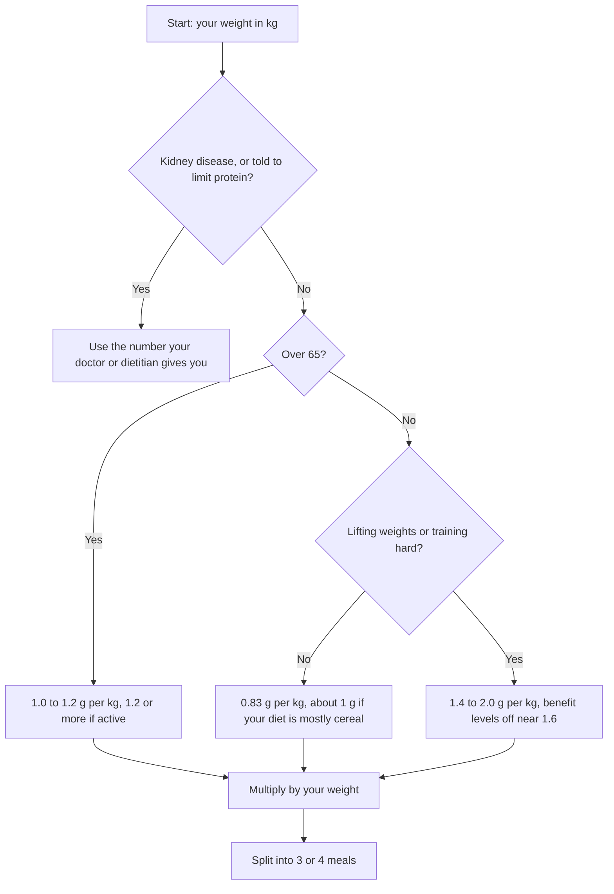

:::answer
For a healthy Indian adult, ICMR-NIN sets the protein allowance at 0.83 g per kg of body weight per day, which is about 54 g for a 65 kg man and 46 g for a 55 kg woman. If you lift weights or train hard, sports nutrition experts suggest 1.4 to 2.0 g per kg, and the research on muscle gain shows the benefit levels off around 1.6 g per kg. Spread it across three or four meals. Higher protein has not harmed kidney function in healthy adults in trials, but if you have kidney disease, diabetes with kidney changes, or any doubt, ask your doctor before raising your intake. Protein powder is optional. Dal, curd, paneer, eggs, soya and chicken can cover most needs.
:::

## Why protein gets so much attention in India

In any Noida gym you will hear two opposite stories. One says you need two scoops of whey a day. The other says protein will damage your kidneys. Neither is quite right.

Protein builds and repairs muscle, makes enzymes and hormones, and helps you feel full. Most Indian diets are built around rice or roti, which do contain protein but not much of it per bite, and the protein quality of cereals alone is lower than that of dal, milk or eggs. That is why ICMR-NIN asks for a better mix of cereals, pulses and milk on the plate, roughly in a 3:1:2.5 ratio, instead of a plate that is mostly cereal ([ICMR-NIN, 2020](https://www.nin.res.in/rdabook/brief_note.pdf)).

So the real questions are simple. How much do you need for your body and your goal? Where will it come from in a normal Indian kitchen? And who needs to be careful?

## What ICMR-NIN actually recommends

In 2020 the ICMR-National Institute of Nutrition revised its nutrient requirements for Indians. For protein, it set two numbers for healthy adults ([ICMR-NIN, 2020](https://www.nin.res.in/rdabook/brief_note.pdf)):

- **Estimated average requirement (EAR): 0.66 g per kg per day.** This is the average need of the population.
- **Recommended dietary allowance (RDA): 0.83 g per kg per day.** This covers almost all healthy adults, and it replaced the older figure of 1 g per kg from 2010.

Using the reference body weights in the same document, that comes to about 54 g a day for a 65 kg man and about 46 g a day for a 55 kg woman. Pregnancy adds about 9.5 g a day in the second trimester and 22 g in the third, and breastfeeding adds about 17 g a day in the first six months.

One footnote matters a lot for Indian homes. For people whose diet is mostly cereal with low-quality protein, the same table says the requirement is about 1 g per kg per day. If your day is chai, two parathas, a plate of rice with thin dal and a few biscuits, you are probably in that group.

These are minimums for health, not targets for building muscle.

## Needs by age, goal and activity

The right number depends on what you are asking your body to do.

### If you are active and lifting weights

The International Society of Sports Nutrition reviewed the research and concluded that 1.4 to 2.0 g of protein per kg per day is enough for most exercising people to build and keep muscle ([ISSN, 2017](https://pmc.ncbi.nlm.nih.gov/articles/PMC5477153/)). It also said whole foods can meet these needs, and supplements are simply a convenient option.

A large 2018 meta-analysis in the British Journal of Sports Medicine pooled 49 trials with 1,863 people who did resistance training. Adding protein increased gains in strength and muscle, but modestly: about 2.5 kg more on a one-rep max and about 0.3 kg more lean mass on average. The benefit levelled off at a total intake of about 1.6 g per kg per day, and the authors noted that the true figure could be as high as about 2.2 g per kg ([Morton et al., BJSM 2018](https://pmc.ncbi.nlm.nih.gov/articles/PMC5867436/)). The effect was larger in people who were already trained and smaller with older age.

So protein helps, but training is what drives muscle gain.

### If you are over 65

Older muscles respond less to the same amount of protein. The PROT-AGE expert group recommends that adults over 65 eat at least 1.0 to 1.2 g per kg per day, at least 1.2 g per kg if they are active or exercising, and 1.2 to 1.5 g per kg for most people with an acute or long-term illness. The same group made an important exception for older people with severe kidney disease (eGFR below 30) who are not on dialysis, who may need to limit protein ([PROT-AGE, 2013](https://pubmed.ncbi.nlm.nih.gov/23867520/)). Our guide on [muscle after 40](/health/blog/muscle-after-40-sarcopenia-india) explains why this matters for falls and independence.

### If you are trying to lose fat

Eating fewer calories makes it easier to lose muscle along with fat. Staying in the active range (1.4 g per kg and up, based on the ISSN figures) while doing strength training helps you keep more muscle. Use your current weight if you are close to a healthy weight. If you have a lot of weight to lose, many dietitians use a goal or adjusted weight instead, so ask yours which number to use.

[[ad]]

## Your simple protein calculator

You don't need an app. You need your weight and one multiplication.

### Worked example 1: a 70 kg man who goes to the gym

- Basic healthy minimum: 70 × 0.83 = 58 g a day.
- Training range from the ISSN: 70 × 1.4 = 98 g, up to 70 × 2.0 = 140 g a day.
- Where the muscle-gain benefit levels off: 70 × 1.6 = 112 g a day.

A sensible target for him is about 100 to 115 g a day. Going far above that mostly adds cost and calories, not muscle.

### Worked example 2: a 58 kg woman who is not training yet

- Basic healthy minimum: 58 × 0.83 = 48 g a day.
- If most of her food is rice and roti with little dal or milk, the cereal-diet footnote suggests about 58 × 1.0 = 58 g a day.

If she starts strength training twice a week, she can move toward 58 × 1.4 = 81 g a day over a few weeks.

### Worked example 3: a 68-year-old, 60 kg, who walks daily

- PROT-AGE range: 60 × 1.0 = 60 g to 60 × 1.2 = 72 g a day, and at least 72 g if he is exercising.

Our [calorie and macro calculator](/health/health-calculators/calorie-calculator) adds calories and carbs to the same idea.

## Protein in common Indian foods

Here is where Indian food labels and Instagram reels often get it wrong. The most reliable numbers come from the Indian Food Composition Tables (IFCT 2017), published by ICMR-NIN from foods sampled across India. Except for eggs, the values are for raw foods, so dal and soya are weighed dry, before cooking ([IFCT 2017](https://nin.res.in/ebooks/IFCT2017.pdf)).

Per 100 g, IFCT 2017 lists:

- Chicken breast, skinless: 21.8 g
- Paneer: 18.9 g
- Boiled egg: 13.4 g
- Soybean (brown, whole, dry): 35.6 g
- Masoor (lentil) dal, dry: 24.4 g
- Groundnut: 23.7 g
- Whole bengal gram (chana), dry: 18.8 g
- Cow's whole milk: 3.3 g
- Whole wheat atta: 10.6 g
- Raw milled rice: 7.9 g

Converted into the amounts people actually eat, a 100 g piece of raw chicken breast gives about 21.8 g of protein, 100 g of paneer about 18.9 g, and 100 g of boiled egg about 13.4 g. Thirty grams of dry soybean gives about 10.7 g, 30 g of dry masoor dal about 7.3 g, 30 g of dry chana about 5.6 g and 30 g of groundnuts about 7.1 g. Two hundred grams of milk gives about 6.5 g, 60 g of atta about 6.3 g, and 60 g of raw rice about 4.8 g. These are our own multiplications of the IFCT values.

A katori of dal helps but won't carry your whole day alone. Cereals still add up: 200 g of atta in a day as rotis gives about 21 g of protein. Soya and paneer are the vegetarian heavy hitters.

A note on soya chunks. Chunks are made from defatted soy flour, which is a different product from the whole soybean in IFCT, so check the label on the pack for its protein per 100 g.

### Veg vs non-veg: can vegetarians build muscle?

Yes. Vegetarians build muscle with the same training principles. The two practical differences are quantity and mixing. Plant proteins tend to come with more carbohydrate and fibre per gram of protein, so you need slightly larger portions. And pairing cereals with pulses (rice with dal, roti with chana, idli with sambar) improves the overall protein quality, which is exactly why ICMR-NIN talks about the cereal-legume-milk mix ([ICMR-NIN, 2020](https://www.nin.res.in/rdabook/brief_note.pdf)). Milk, curd and paneer make the job easier for lacto-vegetarians. Our [high-protein vegetarian guide](/health/blog/high-protein-vegetarian-india-guide) has full day plans.

:::tip Easy ways to add protein to an Indian day
- Breakfast: swap one paratha for a moong dal or besan chilla, or add two boiled eggs or a bowl of curd.
- Lunch: make the dal thicker and the katori bigger, and add a side of sprouts or chana salad.
- Evening: roasted chana, a glass of milk or buttermilk, or a handful of groundnuts instead of biscuits.
- Dinner: paneer or tofu bhurji, soya pulao, fish or chicken curry with less gravy and more pieces.
- Read the label: check protein per 100 g, not per "serving", because serving sizes are often tiny.
:::

## Spreading protein across your meals

Many Indian families eat almost no protein at breakfast, a little at lunch, and most of it at dinner. For muscle, an even spread works better.

The ISSN suggests about 0.25 g of high-quality protein per kg of body weight at a meal, or 20 to 40 g in absolute terms, spaced roughly every three to four hours ([ISSN, 2017](https://pmc.ncbi.nlm.nih.gov/articles/PMC5477153/)). For a 70 kg person, 0.25 × 70 = about 18 g per meal as a floor. This range is a practical per-meal target for muscle building. It is not a limit on how much your body can digest.

Here is a simple day for our 70 kg gym-goer, using the IFCT values above. It adds up to about 100 g:

1. Breakfast, about 20 g: 100 g of boiled egg (13.4 g) and 200 g of milk (6.5 g).
2. Lunch, about 32 g: 30 g of dry masoor dal (7.3 g), rotis from 60 g of atta (6.3 g) and 100 g of paneer (18.9 g).
3. Evening, about 13 g: 30 g of chana (5.6 g) and 30 g of groundnuts (7.1 g).
4. Dinner, about 34 g: 100 g of chicken breast (21.8 g), 30 g of dry dal (7.3 g) and 60 g of rice (4.8 g).

A vegetarian can swap the chicken for 30 g of dry soybean (10.7 g) plus extra paneer or curd. You don't have to be exact. Getting a real portion of protein at three or four meals matters more than counting every gram.

[[ad]]

## The kidney question: healthy kidneys vs kidney disease

This is the most common fear we hear, so here is the evidence plainly.

A 2018 meta-analysis in the Journal of Nutrition pooled 28 trials with 1,358 adults without kidney disease. "High protein" meant at least 1.5 g per kg a day, or at least 20% of calories, or at least 100 g a day. Kidney filtration (GFR) was slightly higher at the end of high-protein diets, which is a normal response to more protein, but the change in kidney function over time did not differ from normal or lower protein diets. The authors concluded that high protein intake did not harm kidney function in healthy adults, while noting that the trials had an unclear risk of selection bias ([Devries et al., J Nutr 2018](https://pubmed.ncbi.nlm.nih.gov/30383278/)). Most of those trials were short, so we can't say much about decades of very high intake.

Chronic kidney disease (CKD) is a different situation. Damaged kidneys may struggle with a high protein load. The KDIGO 2024 guideline summary for patients says protein of about 0.8 g per kg per day or less for people living with CKD, with the diet reviewed by a dietitian ([KDIGO, 2024](https://kdigo.org/wp-content/uploads/2025/01/Key-Takeaways_KDIGO-2024-CKD-Guideline_People-Living-with-CKD.pdf)). Your nephrologist sets your own number based on your stage.

The catch is that CKD is often silent. Many people in India with diabetes or high blood pressure have early kidney changes and don't know it. If you have either condition, a family history of kidney disease, or you are over 60, get a simple creatinine (eGFR) and urine albumin test before you push protein high.

The ICMR-NIN 2024 dietary guidelines also advise against using protein supplements to build body mass and warn that taking large amounts of protein powder for long periods may carry risks, including bone mineral loss and kidney damage ([ThePrint on ICMR-NIN guidelines, 2024](https://theprint.in/india/icmr-calls-for-avoiding-protein-supplements-issues-dietary-guidelines-for-indians/2077477/); [ICMR-NIN, 2024](https://www.nin.res.in/dietaryguidelines/index.html)). Read together with the trial data, the sensible position is this: food-first protein in the active range is reasonable for healthy people, and very high intakes from powders over years are not well studied.

:::warning See a doctor before raising your protein, or soon, if
- You have chronic kidney disease, a kidney transplant, or have been told your creatinine or eGFR is abnormal
- You have diabetes or high blood pressure and have never had a kidney test
- You notice swelling of the feet or face, foamy urine, or much less urine than usual
- You have liver disease, or develop yellow eyes, dark urine or itching after starting a supplement
- You are pregnant, breastfeeding, or under 18 and thinking about protein powders
- You have gout or kidney stones and are planning a big change in diet
- You are losing weight without trying, or eating very little because of illness or low mood
:::

## Protein powder: useful, never mandatory

A protein powder is food in a tub. It can help if you are a vegetarian with a big target, travel a lot, or have a small appetite. It is not required for building muscle, and the ISSN itself says whole foods can meet protein needs ([ISSN, 2017](https://pmc.ncbi.nlm.nih.gov/articles/PMC5477153/)).

### What the Indian market testing found

In 2024, a team of Indian doctors and researchers published the Citizens Protein Project in the journal Medicine. They tested 36 popular protein supplements sold in India. Twenty-five of them (69.4%) had less protein per 100 g than the label claimed. Five (13.9%) had detectable fungal aflatoxins and three (8.3%) had pesticide residues. Some products showed more protein than labelled, and the authors raised the possibility of "amino spiking" with cheaper amino acids, though they did not test for it directly ([Philips et al., Medicine 2024](https://pmc.ncbi.nlm.nih.gov/articles/PMC10994440/)). The paper itself reports one aflatoxin count differently in two places, and it is a single study, but it is a clear warning that the label is not always the truth.

### How protein powders are regulated in India

Protein powders are sold as food, under FSSAI's Nutra Regulations 2022, and not as medicines. A product sold as a health supplement must say "HEALTH SUPPLEMENT" (or dietary or food supplement) and "NOT FOR MEDICINAL USE" on the label, along with the recommended daily usage ([ChemLinked summary of FSSAI rules](https://food.chemlinked.com/foodpedia/india-health-supplement-regulation)). That wording tells you what the product is. It does not prove the protein figure on the front is accurate.

If you use one:

- Buy from the brand's own store or a large authorised retailer, never from loose "imported" tubs sold in gyms or on social media.
- Check the FSSAI licence number and the "health supplement" labelling.
- Prefer a short ingredient list. Avoid "mass gainers" and products with herbal blends or "fat burner" add-ons.
- Look for independent batch testing if the brand offers it.
- Count it as part of your daily total. One scoop does not sit on top of an already high intake.

## Myths you will hear at the gym and at home

:::mythfact
| Myth | Fact |
|---|---|
| "Protein damages your kidneys." | In trials of healthy adults, higher protein did not worsen kidney function. People with kidney disease are different and need a doctor's number. |
| "Vegetarians can't build muscle." | They can. Mix cereals with pulses, use milk, curd, paneer and soya, and train progressively. |
| "More protein means more muscle." | Gains level off around 1.6 g per kg a day. Training drives muscle; extra protein beyond that mostly adds calories. |
| "Protein powder is a must for the gym." | It is optional. Dal, curd, paneer, eggs, soya and chicken can meet most targets. |
| "Your body can only use 30 g at a time." | The 20 to 40 g range is a per-meal target for the muscle-building response, not a hard limit on digestion. |
| "Desi diets already give enough protein." | Many cereal-heavy diets fall short. ICMR-NIN raises the requirement to about 1 g per kg for such diets. |
:::

## Common questions

:::faq
### How much protein do I need per day in India?
For a healthy adult, ICMR-NIN's allowance is 0.83 g per kg of body weight, about 54 g for a 65 kg man and 46 g for a 55 kg woman. If your diet is mostly cereal, aim nearer 1 g per kg. If you lift weights, 1.4 to 2.0 g per kg is the sports nutrition range.

### Is 2 g of protein per kg safe?
For healthy adults with normal kidneys, trials of high-protein diets did not show harm to kidney function, though most were short. Gains in muscle level off around 1.6 g per kg, so going higher rarely helps. If you have diabetes, high blood pressure or kidney problems, check with your doctor first.

### Can I get enough protein without eggs or meat?
Yes. Thick dal, chana, rajma, soya, paneer, curd, milk and groundnuts can cover your needs, especially when you eat cereals and pulses together. You may need larger portions than a non-vegetarian.

### Should I take whey protein to build muscle?
You don't have to. It is a convenient food if you struggle to reach your target. If you use one, buy from authorised sellers, check the FSSAI labelling, and count it within your daily total. Indian testing in 2024 found many products had less protein than labelled.

### Do older people need more protein?
Yes. The PROT-AGE group recommends at least 1.0 to 1.2 g per kg a day for people over 65, and 1.2 g or more if active. Those with severe kidney disease are an exception and need their doctor's advice.
:::

:::takeaways
- ICMR-NIN's allowance for healthy adults is 0.83 g per kg a day, about 1 g per kg on cereal-heavy diets.
- If you lift weights, 1.4 to 2.0 g per kg is the ISSN range, and muscle gains level off around 1.6 g per kg.
- Multiply your weight by the right number, then split it over three or four meals.
- Healthy kidneys handled higher protein in trials; kidney disease needs a doctor's number.
- Protein powder is optional, and Indian testing found many labels overstated the protein.
:::

## The bottom line

Your protein need is a number you can work out in a minute: your weight times the right g per kg for your age and activity. For most healthy Indians, that means more dal, curd, paneer, eggs or soya at breakfast and lunch, not a tub of powder. Get your kidneys checked if you have diabetes, high blood pressure or a family history, and let the training do the real work.

We made a short Hinglish video on these protein myths on our YouTube channel, [Royal Fitness TV](https://www.youtube.com/@RoyalFitnessTV?sub_confirmation=1).

If you want help putting a training plan around your protein, the trainers at Royal Fitness Club in Sector 93, Noida can set you up with a safe beginner programme.
