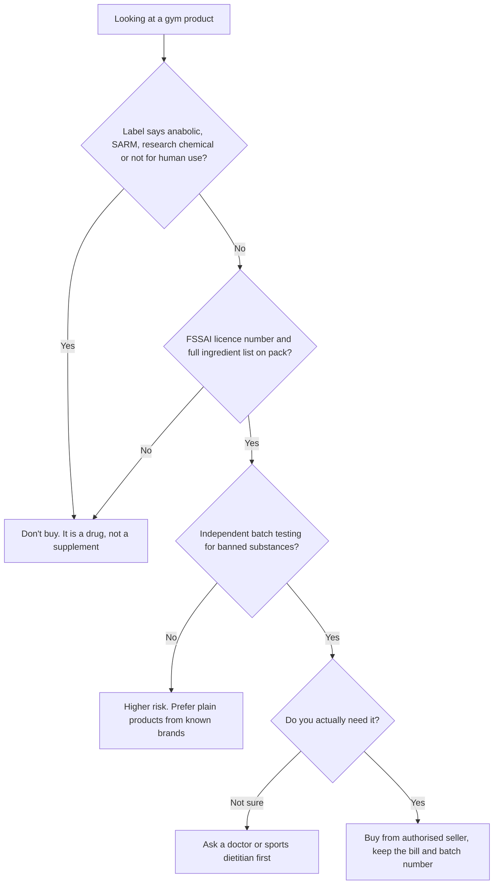

:::answer
SARMs (selective androgen receptor modulators) are experimental drugs, not supplements. No medicines regulator anywhere has approved them for human use, they are banned in sport at all times, and they can shut down your own testosterone, lower good cholesterol and injure the liver. When a US study bought SARMs online and tested them, only about half actually contained a SARM. Separately, ordinary-looking gym supplements have been found spiked with steroids. Your safest choices are fewer products, plain ingredients, a valid FSSAI licence, independent batch testing, and no "anabolic" promises on the label.
:::

You have probably seen the reels. A ripped young man says he went from skinny to shredded "naturally" with a few capsules, and the comments fill up with "bhai, link?". Most of those products are either SARMs or something sold with the same promise. This guide explains what they are and what the evidence says. It also covers why some gym supplements sold as natural have turned out to contain steroids. We won't name sellers, products or doses, and we won't explain how to use any of these drugs.

## What SARMs are

Testosterone works by attaching to "androgen receptors" in your muscles, bones, skin, prostate and brain. SARMs are lab-made chemicals designed to attach to the same receptors, but more in muscle and bone and less elsewhere. Drug companies began developing them for muscle wasting in cancer, frailty in older people and bone loss. That was the hope. In practice, none has passed the trials needed for approval.

The common names you will see are ostarine (also called enobosarm), ligandrol (LGD-4033), RAD-140 (testolone or vosilasarm), andarine, S-23 and YK-11. Sellers often call them "research chemicals" or print "not for human consumption" on the label to dodge rules. The US Food and Drug Administration says these products are unapproved drugs, not dietary supplements, even when marketed as supplements ([FDA, 2025](https://www.fda.gov/drugs/fraudulent-products/certain-bodybuilding-products-put-consumers-risk-heart-attack-stroke-serious-liver-damage-and-more)).

You will also see products sold alongside SARMs that are not SARMs at all, such as ibutamoren (MK-677), cardarine (GW501516) and SR9009. These are also unapproved experimental drugs.

### "Selective" doesn't mean safe

The big selling point is that SARMs give steroid-like muscle "without side effects". The small amount of human research says otherwise.

In a placebo-controlled trial, 76 healthy young men took ligandrol or a placebo for just 21 days. Lean mass went up a little. But total testosterone fell in step with the amount taken, and HDL ("good") cholesterol fell too. Levels came back after stopping in this short, supervised trial ([Basaria et al., Journals of Gerontology 2013](https://pubmed.ncbi.nlm.nih.gov/22459616/)). Gym users often take these drugs for longer, combine several, and have no doctor watching.

The FDA lists the potential harms of SARMs as heart attack or stroke, psychosis and hallucinations, sleep problems, sexual problems, liver injury and acute liver failure, infertility, miscarriage and testicular shrinkage. It also reports life-threatening reactions, including liver injuries that needed hospital care ([FDA, 2025](https://www.fda.gov/drugs/fraudulent-products/certain-bodybuilding-products-put-consumers-risk-heart-attack-stroke-serious-liver-damage-and-more)).

## Why young men fall for them

It helps to be honest about why SARMs sell so well, because the pull is real.

- **They are sold as the "smart" option.** Sellers present SARMs as the clean, modern alternative to "old-school" steroids. The word "selective" sounds scientific and safe.
- **They come as capsules, not injections.** For many people, swallowing a capsule feels far less serious than injecting. That feeling has nothing to do with the actual risk.
- **They are easy to order.** A message on Instagram or WhatsApp and a courier parcel feels as casual as ordering a phone cover.
- **Results are shown, side effects aren't.** You see the before-and-after photo. You don't see the blood report, the low sex drive months later, or the hospital visit for jaundice.
- **Friends vouch for them.** "Bhai, I took it, nothing happened" is the most common sales pitch. Liver and hormone problems often build quietly, so "nothing happened" usually means "nothing I noticed yet".

Teenagers and college students are a particular target. The FDA warns specifically about social media posts aimed at teenagers and young adults that present SARMs as a quick way to improve appearance or performance ([FDA, 2025](https://www.fda.gov/drugs/fraudulent-products/certain-bodybuilding-products-put-consumers-risk-heart-attack-stroke-serious-liver-damage-and-more)). A body that is still developing is the last body that should be exposed to hormone-like drugs. If you are a parent and find capsules with names like ostarine, ligandrol or RAD-140 in your child's room, talk calmly first, then book a doctor's visit together.

Women are sold SARMs too, often with the promise that they "won't cause male features". There is no good human research to support that claim, and the FDA lists miscarriage among the potential harms.

## The liver injury reports

Doctors have been publishing case reports of liver injury in young, healthy men who took SARMs. Two examples:

- A 24-year-old man developed deep jaundice after taking ostarine. His bilirubin (the yellow pigment that causes jaundice) rose to very high levels, he needed repeated liver-support dialysis sessions in hospital, and it took about six months for his bilirubin to return to normal ([Zeitschrift für Gastroenterologie, 2024](https://pubmed.ncbi.nlm.nih.gov/37871633/)).
- A 26-year-old man developed acute jaundice after taking RAD-140. His liver tests returned to normal two months after he stopped ([Journal of Medical Case Reports, 2023](https://pubmed.ncbi.nlm.nih.gov/36978171/)).

A fair warning about this evidence: case reports show that something can happen. They can't tell us how often it happens. Many people take SARMs and never see a doctor, so mild problems likely go unrecorded. What the reports do show is a pattern: young men, a few weeks or months of use, yellow eyes, itching, dark urine, and a hospital stay.

## Half the bottles weren't what the label said

Even if you accept the risks, you often don't know what you're taking.

In 2016, researchers searched the internet for products sold as SARMs, bought 44 of them, and tested them using WADA-approved lab methods. The results were published in *JAMA* ([Van Wagoner et al., JAMA 2017](https://pubmed.ncbi.nlm.nih.gov/29183075/)):

- Only 23 of 44 (52%) contained one or more SARMs
- 17 (39%) contained a different unapproved drug, such as ibutamoren, cardarine or SR9009
- 4 (9%) contained no active drug at all
- 11 (25%) contained substances not listed on the label
- Only 18 (41%) had an amount close to what the label claimed

That study was done in the US, and India has no equivalent published survey of SARMs sold here. Given how loosely these products move through Instagram sellers and courier parcels, we see no reason to expect better quality in India.

## Spiked "natural" supplements: the risk most people miss

You don't need to buy SARMs to end up taking a steroid. Some products sold as protein, mass gainers, "test boosters" or herbal muscle builders have been found to contain drugs that are not on the label.

### What the studies found

- An international study bought 634 non-hormonal supplements (products not sold as hormones or hormone precursors) from 215 suppliers in 13 countries. About 15% (94 products) contained undeclared anabolic steroids or their precursors. In some cases, the amount was enough to cause a positive dope test ([Geyer et al., International Journal of Sports Medicine 2004](https://pubmed.ncbi.nlm.nih.gov/14986195/)). This study is old, and the market has changed, but it is still one of the largest of its kind.
- A review of FDA warnings from 2007 to 2016 found 776 adulterated supplements. Of the 92 sold for muscle building, 82 (about 89%) contained synthetic steroids or steroid-like ingredients ([Tucker et al., JAMA Network Open 2018](https://pubmed.ncbi.nlm.nih.gov/30646238/)). Some products were flagged more than once, and many came back with new hidden ingredients.

### What's happening in India

In April 2026, a tip from NADA India's intelligence unit led to a raid in Najafgarh, Delhi, led by food safety officers with police. Officers seized thousands of tablets and capsules of WADA-prohibited substances, including anabolic steroids and around 1,500 SARM capsules, along with about 45 kg of expired protein and mass gainers stored for sale ([Outlook India, April 2026](https://www.outlookindia.com/sports/others/nada-intelligence-and-investigations-unit-tip-najafgarh-raid-update)). This happened close to NCR gyms, not in some far-off country.

There is still no large, peer-reviewed study of how many supplements sold in India are spiked. Anyone who quotes you an exact Indian percentage is guessing.

## What the rules say

### WADA and NADA India

The WADA Prohibited List for 2026 bans anabolic agents at all times, in and out of competition. SARMs are named under "other anabolic agents", including andarine, enobosarm (ostarine), LGD-4033 (ligandrol), RAD140, S-23 and YK-11 ([WADA, 2026](https://www.wada-ama.org/en/prohibited-list)). NADA India applies this list to Indian athletes.

Sport follows "strict liability". If a banned substance is in your sample, you are responsible, even if it came from a spiked protein powder you bought in good faith. FSSAI's guidance on foods for sportspersons explains this rule and was prepared with NADA ([FSSAI, 2019](https://www.fssai.gov.in/upload/uploadfiles/files/Guidance_Document_Sportsperson_10_07_2019.pdf)). For a state-level player or a kid hoping for a sports quota job, one bad tub can cost years.

### FSSAI

In India, protein powders and sports supplements are regulated as foods by FSSAI, not as medicines. FSSAI's guidance states that its regulations do not allow hormones, steroids or psychotropic ingredients in any food. Products for sportspersons must not contain substances on the WADA list, and the label must carry specific statements and a logo for sportsperson foods. Every licensed food business also gets a unique FSSAI licence number ([FSSAI, 2019](https://www.fssai.gov.in/upload/uploadfiles/files/Guidance_Document_Sportsperson_10_07_2019.pdf)). By that standard, a product that contains a SARM or a steroid is not a legal food supplement in India, whatever the packaging says.

A licence number is a basic check, not a guarantee of purity. It shows the business is registered. It does not mean each batch was tested for hidden drugs.

## How to pick safer supplements

:::tip Smarter supplement habits
- Start with food. Dal, chana, rajma, paneer, curd, eggs, chicken, fish and soya cover most needs. Use our [protein calculator](/health/blog/protein-requirement-calculator-india) to see how much you need.
- Fewer products, fewer risks. Many gym-goers need nothing more than a protein powder and possibly creatine, and plenty need neither. Read our [creatine guide](/health/blog/creatine-guide-india) for the evidence.
- Choose single, plain ingredients ("whey protein", "creatine monohydrate") over "proprietary blends" with secret amounts.
- Check the FSSAI licence number, full ingredient list, batch number and expiry date on the pack.
- Look for independent third-party testing for banned substances, especially if you compete. Check the batch on the tester's own website, not just a logo on the box.
- Avoid any product promising "steroid-like", "anabolic", "test booster" or "dry gains" results. Real food supplements can't legally do that, so the promise is a warning sign.
- Buy from the brand's authorised seller or a reputed store. Avoid loose tubs, imported packs with no Indian label, and Instagram or WhatsApp sellers.
- Keep the bill, the batch number and a sealed sample if you are a tested athlete.
:::

## What to do if you already took something

First, don't panic, and don't take more. Then:

1. **Stop the product** and keep the container, label and bill.
2. **See a doctor** and tell them exactly what you took and for how long. Ask for liver tests, a lipid profile, kidney tests and, if you are a man, hormone tests. These are routine blood tests.
3. **Watch for symptoms** for the next few weeks: yellow eyes, itching, dark urine, pale stools, nausea, belly pain, chest pain, breathlessness or unusual mood changes.
4. **If you are a tested athlete**, speak to your federation's anti-doping contact or NADA India before your next competition. Being honest early is better than a surprise positive test.
5. **Report the product.** FSSAI and your state drug control department handle complaints about unsafe foods and drugs.

Many people feel embarrassed. Doctors see this regularly. The aim is to protect your liver, heart and hormones, not to judge you.

:::warning See a doctor urgently or go to hospital if
- Your eyes or skin turn yellow, or your urine turns dark brown
- You have severe itching with pale stools, nausea or pain under the right ribs
- You have chest pain, a racing or irregular heartbeat, or sudden breathlessness
- One leg becomes swollen, painful and warm
- You have sudden weakness on one side, slurred speech or a severe headache
- You feel confused, see or hear things that aren't there, or feel very low or hopeless
- You are pregnant or trying to conceive and have taken any of these products
:::

## Myths you will hear in the gym

:::mythfact
| Myth | Fact |
|---|---|
| "SARMs are a legal, safer steroid." | SARMs are not approved for human use anywhere and are banned in sport. They also lower your own testosterone and good cholesterol. |
| "Research chemicals are pure, lab-grade stuff." | In one study, only 52% of SARM products contained a SARM, and 9% had no active drug at all. |
| "If it's sold in a shop, it must be checked." | Hidden steroids have been found in ordinary supplements. A licence shows registration, not batch purity. |
| "Natural vs steroid is easy to tell from the label." | Labels can lie. Look for independent batch testing and avoid "anabolic" or "test booster" claims. |
| "Liver problems only happen with injections." | SARMs are taken by mouth, and case reports describe serious liver injury in young men. |
| "A failed dope test from a supplement isn't my fault." | Under strict liability, the athlete is responsible for what's in their sample. |
:::

## Common questions

:::faq
### Are SARMs legal in India?
SARMs are not approved as medicines in India or anywhere else, and FSSAI rules don't allow drug-like hormonal substances in foods or supplements. They are also banned under the WADA list that NADA India follows. Treat any product containing them as an unapproved drug.

### Is ostarine safer than other SARMs?
There is no good evidence that any SARM is safe for gym use. A serious ostarine-linked liver injury needing months to recover has been reported, and SARMs in general suppress natural testosterone.

### Can a normal whey protein make me fail a dope test?
It can happen if the product is contaminated or spiked, though most mainstream proteins are not. If you are tested, choose products with independent batch testing for banned substances and keep the bill and batch number.

### Are "testosterone booster" herbal capsules safe?
Some herbs are studied for mild effects, but evidence for muscle gain is weak. The bigger concern is hidden ingredients in products that promise steroid-like results. If a capsule promises "anabolic" effects, skip it.

### I took SARMs for a few weeks and feel fine. Should I still get tested?
Yes. Liver strain and hormone changes don't always cause symptoms early. A doctor can order liver tests, a lipid profile and hormone tests, and tell you if anything needs follow-up.
:::

## What a drug-free plan looks like

The honest answer to "how do I build muscle fast?" is less exciting than a reel, but it works and it doesn't cost you your health.

1. **Train with progression.** Three or four sessions a week on big movements such as squats, deadlifts or hip hinges, presses, rows and pull-ups. Add a little weight or a few reps over time and write it down. Our [beginner gym guide](/health/blog/beginner-gym-guide-india) lays out a starting plan.
2. **Eat enough protein and enough food.** Spread protein across three or four meals from dal, curd, paneer, eggs, chicken, fish or soya. Many skinny beginners simply don't eat enough total food.
3. **Sleep seven to nine hours.** Muscle is built while you recover, not while you scroll at 2 am.
4. **Give it time.** Measure progress over months, not weeks. Take photos and track your lifts, not just your weight.
5. **Use supplements only to fill gaps.** A protein powder is just convenient food. Creatine has good evidence. Almost everything else is optional.

This route is slower, but every kilo you gain this way is yours to keep, without a blood report you are scared to look at.

## The bottom line

SARMs are experimental drugs sold with a supplement's smile. They suppress your hormones, can injure the liver, are banned in sport, and are often not even what the label says. Spiked "natural" products carry a quieter version of the same risk. Keep your supplement list short and simple, buy tested products from known sellers, build on real food and steady training, and talk to a doctor if you have already taken something.

We made a short Hinglish video on this on our YouTube channel, [Royal Fitness TV](https://www.youtube.com/@RoyalFitnessTV?sub_confirmation=1).

If you want an honest, drug-free plan, the trainers at Royal Fitness Club in Sector 93, Noida can help you build one around real food and steady training.
