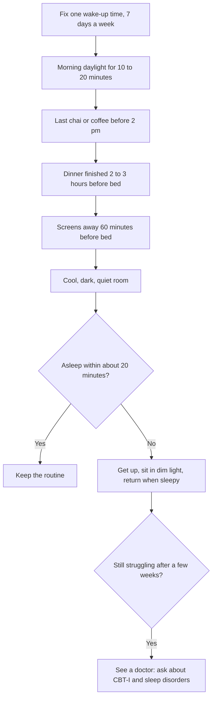

:::answer
Most adults need at least seven hours of sleep a night on a regular basis. In Indian homes, the usual thieves are late dinners, evening chai or coffee, phones in bed, noisy or hot bedrooms, long commutes and night shifts. Moving caffeine earlier, keeping a fixed wake-up time, dimming screens an hour before bed and protecting the bedroom from light, noise and heat fixes a lot. If sleeplessness lasts more than three months, the best-tested treatment is a structured programme called CBT-I, not sleeping pills. And loud snoring with pauses in breathing, choking at night or daytime sleepiness is not "just snoring": it can be sleep apnoea, which needs a doctor.
:::

## How much sleep you actually need

The American Academy of Sleep Medicine and the Sleep Research Society reviewed the evidence and concluded that adults should sleep seven or more hours a night on a regular basis; regularly sleeping less is linked with weight gain, diabetes, high blood pressure, heart disease, depression, impaired immunity, more pain, worse performance and more accidents ([AASM and SRS, 2015](https://aasm.org/seven-or-more-hours-of-sleep-per-night-a-health-necessity/)). Children and teenagers need more.

"I'm fine on five hours" is one of the most common things people say, and one of the least true for most of them. People who are chronically short on sleep get used to feeling tired and stop noticing how impaired they are.

Quality matters as much as quantity. Waking many times, feeling unrefreshed, or needing an alarm and three snoozes every day are signs your sleep isn't doing its job.

## The Indian sleep thieves, one by one

### Chai and coffee later than you think
Caffeine blocks a brain chemical called adenosine that builds sleep pressure through the day. Its effect lasts for hours. In a controlled study, a dose of caffeine taken even six hours before bedtime reduced total sleep by more than an hour, measured objectively, though people often didn't notice it themselves ([JCSM, 2013](https://doi.org/10.5664/jcsm.3170)). That dose was large, roughly what several strong cups would provide, but the lesson holds: the 5 pm chai and the 7 pm cold coffee are working against your sleep at 11 pm.

Caffeine also hides in green tea, cola, energy drinks, chocolate and some pain and cold tablets.

### Phones, laptops and TV in bed
Screens do three things to sleep: the light (especially bluish light) signals "daytime" to your body clock, the content keeps your brain alert, and the habit pushes bedtime later. In a study comparing reading on a light-emitting e-reader with a printed book before bed, the e-reader delayed the release of melatonin, made it take longer to fall asleep, and left people less alert the next morning ([PNAS, 2015](https://doi.org/10.1073/pnas.1418490112)).

Night mode helps a little. Putting the phone down an hour before bed helps much more.

### Late, heavy dinners
Many Indian families eat dinner at 9:30 or 10 pm, often the largest meal of the day, and go to bed soon after. A full stomach and acid reflux when lying down make it harder to fall and stay asleep. Finishing dinner two to three hours before bed, and keeping it lighter, often helps.

### Irregular wake-up times
Sleeping late on Sundays to "catch up" shifts your body clock, so Sunday night becomes a struggle and Monday morning feels like jet lag. A fixed wake-up time, even on weekends, is one of the most powerful sleep habits.

### Hot, bright, noisy bedrooms
Street lights, honking, a fan rattling, a partner's phone, a hot room in summer: all of these break sleep. Cool, dark and quiet is the goal, as far as your home allows.

### Stress and the 2 am mind
Worries about work, money, exams or family often surface the moment the lights go off. That is where wind-down routines and, if needed, professional help come in (see our [mental wellness hub](/health/mental-wellness)).

[[ad]]

## A sleep plan that works in a real Indian home

### Step 1: Anchor your wake-up time
Pick a wake-up time you can keep every day, including weekends, and set your bedtime about seven and a half to eight hours earlier. Your body clock learns from consistency.

### Step 2: Get morning light
Ten to twenty minutes of daylight soon after waking, on a balcony, terrace or a short walk, sets your body clock and makes it easier to feel sleepy at night.

### Step 3: Move caffeine earlier
Try a 2 pm caffeine cut-off for two weeks. Swap evening chai for a caffeine-free option: warm milk with haldi, ajwain or jeera water, or a herbal infusion.

### Step 4: Eat earlier and lighter at night
Aim to finish dinner two to three hours before bed. If that is hard with family routines, make the late meal smaller and have a larger evening snack earlier.

### Step 5: Build a wind-down hour
The last hour is for slowing down: a warm bath, light stretching, slow breathing (try our [yoga timer](/health/yoga-timer)), reading a paper book, or quiet conversation. Phones charge outside the bedroom if possible.

### Step 6: Fix the room
Thick curtains or an eye mask for light, earplugs or a steady fan sound for noise, and a cooler room. Keep the bed for sleep, not for office work.

### Step 7: Don't fight insomnia in bed
If you can't fall asleep within about twenty minutes, get up, sit somewhere dim and do something calm until you feel sleepy, then go back. Lying awake for hours teaches your brain that bed is a place for worrying.

:::tip Small changes that make a big difference
- Set a "screens off" alarm 60 minutes before bed, not just a wake-up alarm.
- Keep a notebook by the bed: write tomorrow's to-do list before lights out so your mind can let go.
- Avoid long afternoon naps; if you nap, keep it under about 30 minutes and before 3 pm.
- Exercise most days, but finish hard workouts a few hours before bed.
- Go easy on alcohol. It may make you drowsy, but it breaks up sleep later in the night and worsens snoring.
- If a partner snores, get it checked rather than just moving rooms; it could be sleep apnoea.
:::

## Night shifts and rotating shifts: a playbook

Millions of Indians work nights: in hospitals, IT and call centres, security, transport, factories, police and delivery. Night work fights your body clock, and the International Agency for Research on Cancer classifies night shift work as "probably carcinogenic to humans", based mainly on its disruption of the body clock ([IARC, 2020](https://publications.iarc.who.int/593)). You can't always change your job, but you can reduce the harm:

- **Protect your day sleep like an appointment.** Blackout curtains, an eye mask, earplugs, phone on silent, and a "sleeping" sign for family and visitors.
- **Keep the same sleep window** on work days, and shift only partly on days off, rather than flipping completely.
- **Wear dark glasses on the way home** in the morning to reduce bright light before you sleep.
- **Use bright light at the start of your shift** to feel alert, and dim it towards the end.
- **Caffeine early in the shift only**, not in the last few hours.
- **Eat a proper meal before the shift** and lighter snacks during it; avoid heavy meals in the small hours.
- **Never drive drowsy.** A short nap before driving, or a cab, is safer than "pushing through".
- **Get regular health checks**: weight, blood pressure, sugar and mood are all affected by long-term shift work.

[[ad]]

## Sleep apnoea: when snoring is a warning

Obstructive sleep apnoea happens when the airway repeatedly collapses during sleep, so breathing stops or becomes very shallow many times an hour. The brain wakes you briefly each time, usually without you knowing, so sleep is broken all night. Untreated, it is linked with high blood pressure, diabetes, heart disease, stroke, low mood and road accidents.

Doctors often use a short questionnaire called STOP-Bang to judge who needs testing. It asks about snoring, tiredness, observed pauses in breathing, high blood pressure, BMI, age, neck size and sex ([Anesthesiology, 2008](https://doi.org/10.1097/ALN.0b013e31816d83e4)). You don't need to score yourself; if several of these apply to you, tell your doctor.

Testing is often done with a home sleep study, and effective treatments exist, including CPAP machines, weight loss, positional therapy and oral devices. Our detailed [snoring and sleep apnoea guide](/health/blog/sleep-apnea-indian-guide) covers testing and treatment step by step.

## Chronic insomnia: why pills aren't the first answer

Insomnia means trouble falling asleep, staying asleep or waking too early, despite having the chance to sleep, with daytime effects. When it happens at least three nights a week for three months or more, doctors call it chronic insomnia.

The American College of Physicians recommends cognitive behavioural therapy for insomnia (CBT-I) as the first treatment for adults with chronic insomnia ([Annals of Internal Medicine, 2016](https://doi.org/10.7326/M15-2175)). CBT-I is a structured, usually six- to eight-week programme that resets your sleep habits and the thoughts that keep you awake. It is available with trained psychologists and, increasingly, through guided digital programmes.

Sleeping pills have a place for some people in the short term, under a doctor's supervision, but they don't fix the cause and can bring dependence, next-day drowsiness and falls in older adults. Don't take someone else's sleeping tablets, don't buy them without a prescription, and don't stop prescribed ones suddenly without asking your doctor. Over-the-counter "sleep aids" and antihistamines also cause next-day grogginess.

## Sleep, weight and your workouts

If you are trying to lose weight or build fitness, sleep is part of the programme, not a break from it. Short sleep tends to increase hunger and cravings the next day, especially for sweet and fried food, and makes it harder to stick to a plan when you are tired. Recovery from training, including muscle repair, happens largely during sleep, so poor sleep often shows up as workouts that feel harder, slower progress and more aches. Many people find that once they fix sleep, the scale and the gym numbers start moving again without any other change.

A practical rule: if you only have time for either an extra 45 minutes of sleep or a 45-minute workout on a given day after a terrible night, sleep is often the better choice. Then train the next day.

## Sleep for women and older adults

Women's sleep often changes with the menstrual cycle, during pregnancy, after childbirth and around menopause, when hot flushes and night sweats can wake you repeatedly. These are worth discussing with a doctor rather than simply enduring; there are options for each stage.

Older adults tend to sleep more lightly and wake earlier, but feeling very sleepy in the day, falling asleep in front of the TV every evening, or long periods awake at night are not just "old age". They can point to sleep apnoea, pain, medicines, frequent urination at night or low mood, all of which can be treated. Sleeping tablets carry extra risks of falls and confusion in older people, which is another reason to see a doctor rather than self-medicate.

## Children and teenagers

Teenagers' body clocks naturally shift later, which collides with early school starts and coaching classes. Phones in bedrooms make it worse. Agree family rules: devices charge outside bedrooms at night, a fixed wake-up time, and morning daylight. Loud snoring in a child, mouth breathing, restless sleep or daytime behaviour problems can be signs of enlarged tonsils or adenoids and deserve a paediatrician's check.

:::warning See a doctor promptly if
- Someone has seen you stop breathing or choke in your sleep, or you wake up gasping
- You feel sleepy while driving, or have dozed off at the wheel
- You fall asleep suddenly during the day in the middle of activities
- Sleeplessness comes with low mood, hopelessness, or thoughts of harming yourself (call Tele-MANAS on 14416, or 112 in an emergency)
- You have leg discomfort at night with an urge to move that keeps you awake
- A child snores loudly most nights, has pauses in breathing, or is very sleepy or hyperactive during the day
- Insomnia has lasted more than three months despite good habits
:::

[[ad]]

## Myths about sleep

:::mythfact
| Myth | Fact |
|---|---|
| "I'm used to five hours; my body has adjusted." | Most adults need seven or more hours. People who are chronically short on sleep underestimate how impaired they are. |
| "Evening chai doesn't affect me; I fall asleep fine." | Caffeine can shorten and lighten your sleep even if you fall asleep easily. Try a 2 pm cut-off for two weeks. |
| "Loud snoring is a sign of deep sleep." | Loud snoring with pauses or gasping can be sleep apnoea, which breaks sleep and harms the heart. |
| "A drink helps me sleep." | Alcohol makes you drowsy but disrupts sleep later in the night and worsens snoring and apnoea. |
| "I'll catch up on sleep at the weekend." | Lie-ins shift your body clock and make Monday harder. A fixed wake-up time works better. |
| "Sleeping pills are the answer to insomnia." | CBT-I is the recommended first treatment for chronic insomnia. Pills are short-term tools under a doctor's care. |
:::

## Common questions

:::faq
### What is the best time to go to bed?
There isn't one perfect clock time for everyone. What matters most is getting seven or more hours and keeping your wake-up time consistent. Work backwards from your wake-up time to set your bedtime.

### Is it bad to drink chai in the evening?
For many people, caffeine in the late afternoon or evening shortens and lightens sleep, even if they fall asleep easily. Try stopping caffeine by early afternoon for two weeks and see how you feel. Caffeine-free options can replace the evening cup.

### Are daytime naps good or bad?
Short naps of up to about 30 minutes, taken before mid-afternoon, can boost alertness without hurting night sleep. Long or late naps can make it harder to sleep at night, especially if you have insomnia.

### Can I fix insomnia without medicines?
Many people can. Good sleep habits help, and for chronic insomnia, CBT-I is the recommended first treatment. A doctor can also look for causes such as depression, anxiety, pain, sleep apnoea or medicines that disturb sleep.

### How do I know if I have sleep apnoea?
Warning signs include loud snoring, pauses in breathing seen by others, waking up choking, morning headaches, daytime sleepiness and high blood pressure. Only a sleep study can confirm it, so talk to your doctor if several apply.
:::

## The bottom line

Good sleep is not a luxury; it is the foundation for weight, sugar, blood pressure, mood and performance. For most Indians, the biggest gains come from a fixed wake-up time, earlier caffeine, an earlier and lighter dinner, phones out of bed, and a darker, cooler room. If sleep stays poor, or if snoring and daytime sleepiness are part of the picture, get help: there are effective treatments.

Regular exercise also helps many people sleep better. If you'd like a routine that fits around shifts or long days, the trainers at Royal Fitness Club in Sector 93, Noida can help you plan one.
