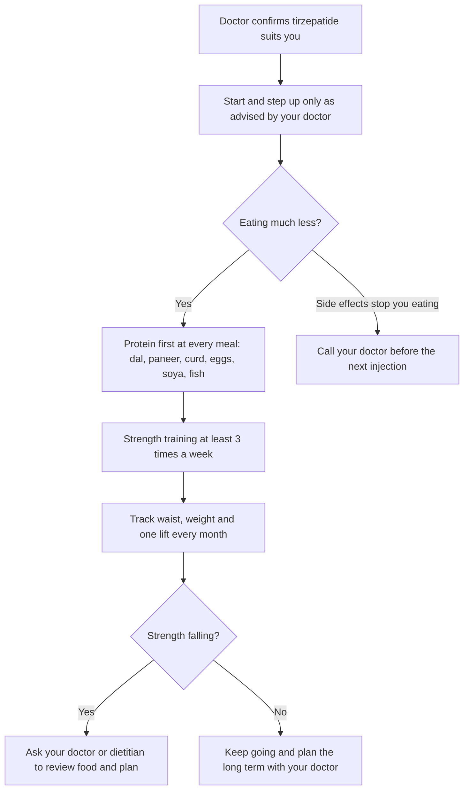

:::answer
Tirzepatide, sold in India as Mounjaro since March 2025, is a weekly prescription injection for type 2 diabetes and for obesity (or overweight with a weight-related illness). In the main obesity trial, people lost about 15% to 21% of their body weight on average over 72 weeks, compared with about 3% on placebo, and in a head-to-head trial it beat semaglutide. Those are big numbers, but they come with conditions: stomach side effects are common, about a quarter of the weight lost in one sub-study was lean mass, and people who stopped regained much of the weight. It is not a wedding shortcut or something to buy from Instagram. If you and your doctor decide it suits you, pair it with protein at every meal and strength training, and only buy it from a licensed pharmacy.
:::

## What tirzepatide is, in plain words

Your gut releases hormones after a meal that tell your brain you are full and help your pancreas release insulin. Two of these are GLP-1 and GIP. Semaglutide (Ozempic, Wegovy) copies GLP-1. Tirzepatide copies both GLP-1 and GIP in one molecule, which is why you will hear it called a "dual agonist" or a "twincretin".

In practice, it does three things. You feel full sooner and think about food less. Your stomach empties more slowly. And when your blood sugar is high, your pancreas releases more insulin. It is given as an injection under the skin once a week.

It is a medicine for long-term conditions, used alongside diet and activity. The US label describes it as an add-on to a reduced-calorie diet and increased physical activity ([FDA label, 2024](https://www.accessdata.fda.gov/drugsatfda_docs/label/2024/217806s013lbl.pdf)).

## Mounjaro in India: what has happened so far

- **March 2025:** Eli Lilly launched Mounjaro in India as a weekly vial, after approval from the Central Drugs Standard Control Organisation (CDSCO) the previous year. It was approved for chronic weight management in adults with obesity, or overweight with a weight-related condition, and for type 2 diabetes alongside diet and exercise ([ThePrint, March 2025](https://theprint.in/health/fat-busting-drug-mounjaro-launched-in-india-heres-how-much-it-will-cost/2557079)).
- **June 2025:** CDSCO approved a pre-filled multi-use pen (KwikPen). The same week, Novo Nordisk launched Wegovy (semaglutide) in India ([ThePrint, June 2025](https://theprint.in/health/in-battle-for-indian-anti-obesity-market-eli-lillys-pre-filled-pen-on-one-side-novo-nordisks-on-other/2671483)).
- **April 2026:** Haryana's drug control authority seized counterfeit "Mounjaro" in Gurugram. Lilly said genuine tirzepatide is sold in India only as Mounjaro and Yurpeak, through authorised distributors and licensed pharmacies ([The Week, April 2026](https://www.theweek.in/news/health/2026/04/30/counterfeit-mounjaro-seizure-in-gurugram-raises-fresh-concerns-over-fake-drugs-market.html)).

### What it cost, as reported

At launch in March 2025, ThePrint reported a monthly cost of about ₹14,000 at the starting strength and about ₹17,500 at the next strength ([ThePrint, March 2025](https://theprint.in/health/fat-busting-drug-mounjaro-launched-in-india-heres-how-much-it-will-cost/2557079)). Prices differ by strength and pack, and they can change, so treat these as a rough guide from that date and ask your pharmacist for the current price.

Semaglutide became much cheaper in India after generic versions launched in March 2026, which we cover in our [generic semaglutide guide](/health/blog/generic-semaglutide-india-guide). Tirzepatide, as of the reports we checked, is sold only under Lilly's two brands. Cheaper semaglutide doesn't mean you should switch on your own. That is a decision for you and your doctor.

[[ad]]

## Who tirzepatide is meant for

There are two main groups:

1. **Adults with type 2 diabetes** whose sugar isn't well controlled.
2. **Adults with obesity, or overweight plus a weight-related illness** such as high blood pressure, prediabetes, sleep apnoea, high cholesterol or fatty liver.

For Indians, a doctor should judge weight with Indian cut-offs, not Western ones. South Asians tend to carry more fat around the belly and develop diabetes at lower body weights. Our [BMI calculator](/health/health-calculators/bmi-calculator) uses Indian cut-offs, and our [obesity page](/health/diseases/obesity) explains why waist size matters too.

A good doctor will also check your HbA1c, blood pressure, kidney and liver tests, your other medicines, and your history of pancreatitis, gallstones, eating disorders and thyroid problems before starting.

### Who should not use it, or needs extra care

The US label lists these points ([FDA label, 2024](https://www.accessdata.fda.gov/drugsatfda_docs/label/2024/217806s013lbl.pdf)):

- **Do not use** if you or a family member has had medullary thyroid cancer, or if you have the MEN2 syndrome. In rats, tirzepatide caused thyroid C-cell tumours; whether it does so in humans is not known.
- **Do not use** if you have had a serious allergic reaction to it.
- **Pregnancy:** it may harm the baby, and it should be stopped when pregnancy is recognised. Talk to your doctor well before planning a pregnancy.
- **Birth control pills:** tirzepatide can make oral contraceptives less reliable. The label advises switching to a non-oral method or adding a barrier method for 4 weeks after starting and after each step-up.
- **Severe stomach disease:** not studied and not recommended.
- **Children and teenagers:** safety and effectiveness for weight have not been established.
- **Diabetic eye disease:** needs monitoring, because rapid sugar changes can affect the retina.

People with a history of anorexia or bulimia, older adults who are already thin or frail, and anyone with past pancreatitis need specialist advice before any appetite-suppressing medicine.

## What the trials actually showed

### SURMOUNT-1: weight loss in people without diabetes

This trial gave 2,539 adults with obesity, or overweight with a related illness, a weekly injection of tirzepatide at one of three strengths, or a placebo, for 72 weeks, along with lifestyle advice. Average weight loss was about 15.0% at the lowest strength, 19.5% at the middle and 20.9% at the highest, compared with 3.1% on placebo ([NEJM, 2022](https://www.nejm.org/doi/full/10.1056/NEJMoa2206038)). Participants started at an average of 104.8 kg, so 20% means roughly 20 kg.

Averages hide a spread. Some people lost much more and some much less. Side effects led 4.3% to 7.1% of people on tirzepatide to stop, against 2.6% on placebo.

### SURPASS-2: type 2 diabetes, versus semaglutide

In 1,879 people with type 2 diabetes, tirzepatide lowered HbA1c by about 2.0 to 2.3 percentage points over 40 weeks, against 1.86 with semaglutide, and people lost more weight on tirzepatide ([NEJM, 2021](https://www.nejm.org/doi/full/10.1056/NEJMoa2107519)). People with diabetes usually lose less weight on these medicines than people without diabetes.

### SURMOUNT-5: head to head with semaglutide for obesity

In 751 adults with obesity but no diabetes, each group received the highest strength of its medicine they could tolerate for 72 weeks. Average weight loss was 20.2% with tirzepatide and 13.7% with semaglutide, and waist size fell by 18.4 cm versus 13.0 cm ([NEJM, 2025](https://www.nejm.org/doi/full/10.1056/NEJMoa2416394)). The trial was open-label (everyone knew which drug they were on) and was funded by Lilly, the maker of tirzepatide.

### SURMOUNT-4: what happens when you stop

This is the trial every patient should know about. Everyone took tirzepatide for 36 weeks and lost an average of 20.9% of their weight. Then half switched to placebo without knowing it. Over the next 52 weeks, people who kept taking tirzepatide lost a further 5.5%, while those switched to placebo regained 14.0% ([JAMA, 2024](https://pmc.ncbi.nlm.nih.gov/articles/PMC10714284/)).

So tirzepatide treats a long-term condition. It does not reset your body. Plan for the long run with your doctor, and build the food and exercise habits that will help you whether you stay on it or come off it.

## Side effects, honestly

The most common side effects are in the stomach, and they show up mostly when the strength is stepped up. In SURPASS-2, nausea affected 17% to 22% of people on tirzepatide, diarrhoea 13% to 16% and vomiting 6% to 10% ([NEJM, 2021](https://www.nejm.org/doi/full/10.1056/NEJMoa2107519)). Constipation, burping, bloating, heartburn and low appetite are also common. Most cases are mild to moderate and settle over weeks.

Less common but serious problems listed on the label include ([FDA label, 2024](https://www.accessdata.fda.gov/drugsatfda_docs/label/2024/217806s013lbl.pdf)):

- **Pancreatitis**: severe upper belly pain, often spreading to the back, with or without vomiting
- **Gallbladder disease**: pain under the right ribs, fever, yellow eyes
- **Acute kidney injury**, usually from dehydration after vomiting or diarrhoea
- **Low blood sugar**, mainly when combined with insulin or sulfonylurea tablets
- **Serious allergic reactions**, including swelling of the face and throat
- **Depression or suicidal thoughts**: the label tells doctors to watch for these
- **Food in the lungs during anaesthesia**: always tell the surgeon or anaesthetist you take it before any procedure

Hair fall can happen with any fast weight loss and is usually temporary.

:::warning See a doctor urgently or go to hospital if
- You have severe or constant pain in the upper belly, with or without vomiting
- You cannot keep fluids down for a day, or you pass very little urine
- Your eyes or skin turn yellow, or you have fever with pain under the right ribs
- You feel shaky, sweaty and confused (possible low sugar), especially if you take insulin or diabetes tablets
- Your face, lips or throat swell, or you have trouble breathing
- You notice a lump in your neck, trouble swallowing or a hoarse voice that won't go away
- You have sudden changes in vision, or thoughts of harming yourself
:::

[[ad]]

## Keeping your muscle: the part that decides how you look and feel

When you eat much less, you lose fat and some muscle too. In a body-composition sub-study of SURMOUNT-1, 160 people had DXA scans. On tirzepatide, fat mass fell by 33.9% and lean mass by 10.9%, against 8.2% and 2.6% on placebo. About a quarter of the weight lost was lean mass ([Diabetes, Obesity and Metabolism, 2025](https://pmc.ncbi.nlm.nih.gov/articles/PMC11965027/)). The authors, several of whom work for Lilly, judged that share to be in line with other weight-loss methods rather than excessive. Still, lean mass is where your strength, balance and resting calorie burn live, so it is worth protecting.

A 2025 joint advisory from four US nutrition and obesity societies said protein alone is unlikely to protect muscle without resistance training. It suggested regular strength training at least 3 times a week, at least 150 minutes of moderate aerobic activity a week, and a protein intake of about 1.2 to 1.6 g per kg of body weight a day during active weight loss ([Obesity Pillars, 2025](https://pmc.ncbi.nlm.nih.gov/articles/PMC12264624/)). Ask your doctor or dietitian what fits you, especially if you have kidney disease. Our [protein requirement calculator](/health/blog/protein-requirement-calculator-india) gives you a starting number.

### Protein on a small appetite

On tirzepatide your appetite may shrink a lot. Eat the protein part of the plate first, before rice or roti fill you up, and spread it over four or five small meals:

- Thick dal, sambar, moong dal or besan chilla
- Curd, hung curd, buttermilk, paneer, tofu
- Eggs, fish, or chicken in a light curry
- Roasted chana, soya chunks in pulao, sprouts chaat
- Milk or unsweetened lassi between meals

### Strength training that works for beginners

You don't need fancy equipment. Squats to a chair, wall or bench push-ups, rows with a band or dumbbells, hip bridges, and carrying a heavy bag are enough to start. Add weight or reps slowly over weeks. Walking is great for your heart and blood sugar, but on its own it does little to protect muscle during big weight loss.

On a bad nausea day, do a lighter session rather than nothing. Dizziness, chest pain or fainting during exercise means stop and see a doctor.

:::tip Habits that make tirzepatide easier
- Eat slowly and stop at "comfortably satisfied". Overeating on this medicine often brings on nausea.
- Keep fried and very oily food rare. Fat slows the stomach even more.
- Sip water through the day, especially in Delhi-NCR summers. Vomiting plus heat can strain the kidneys.
- Keep a simple log: weight, waist, one lift, and side effects. Take it to every appointment.
- Never change the strength, skip ahead or stop on your own. Use it only as advised by your doctor.
:::

## Fakes from social media: a real risk in NCR

High demand and high prices create a market for fakes. In April 2026, Haryana's drug regulator seized counterfeit Mounjaro in Gurugram, close to us in Noida. Lilly said the products were not part of its authorised supply chain and that counterfeit products are not made under approved quality controls. Warning signs it listed include buying from unlicensed sources, tampered or damaged packaging, missing batch numbers or expiry dates, and spelling errors or unfamiliar logos ([The Week, April 2026](https://www.theweek.in/news/health/2026/04/30/counterfeit-mounjaro-seizure-in-gurugram-raises-fresh-concerns-over-fake-drugs-market.html)).

Protect yourself:

- Buy only with a prescription, from a licensed chemist who keeps it in a fridge.
- Don't buy "Mounjaro" or "tirzepatide" from Instagram, WhatsApp groups, gym contacts or online marketplace sellers.
- Don't use loose vials, powders to mix, or "research" tirzepatide. These are not approved medicines.
- Check the box, batch number and expiry. If anything looks off, don't inject it; show it to your pharmacist.

## Myths you will hear

:::mythfact
| Myth | Fact |
|---|---|
| "Mounjaro melts fat, so food and exercise don't matter." | Trials combined it with lifestyle advice. Without protein and strength training, more of what you lose is muscle. |
| "It's stronger than Ozempic, so it's better for everyone." | It led to more weight loss than semaglutide in SURMOUNT-5, but the right choice depends on your health, side effects, heart and kidney risks, and budget. |
| "Take it for three months and the weight stays off." | In SURMOUNT-4, people switched to placebo regained 14% of their weight within a year. |
| "Buying from Instagram is the same medicine, cheaper." | Counterfeit Mounjaro was seized in Gurugram in 2026. Fakes skip quality controls and may contain anything. |
| "A bigger strength works faster, so start high." | Strength is raised slowly to limit side effects. Jumping ahead raises the risk of vomiting, dehydration and pancreatitis. |
| "It's just a weight-loss jab for celebrities." | It is a prescription medicine for type 2 diabetes and obesity, with a label that lists serious risks. |
:::

## Questions to take to your doctor

- Is tirzepatide right for me, given my BMI, waist and other conditions? Would semaglutide or another option suit me better?
- How will we start and step up, and what do I do if I vomit or can't eat?
- Do any of my current medicines need changing, especially for diabetes, blood pressure or birth control?
- Which blood tests do I need, and how often?
- How will we check that I'm keeping muscle?
- What is our long-term plan, and what happens if I stop?

[[ad]]

## Common questions

:::faq
### Is Mounjaro the same as Ozempic?
No. Ozempic and Wegovy contain semaglutide, which copies one gut hormone (GLP-1). Mounjaro contains tirzepatide, which copies two (GLP-1 and GIP). In a head-to-head obesity trial, tirzepatide led to more weight loss, but both are prescription medicines with similar stomach side effects and warnings.

### Can I take Mounjaro without a doctor to lose a few kilos?
No. It is a prescription medicine for type 2 diabetes and obesity, with real risks such as pancreatitis, gallbladder disease and dehydration. For a few kilos, protein-first meals, strength training and sleep are safer and cheaper. Talk to a doctor if you're unsure where you stand.

### Will I lose muscle on tirzepatide?
Some of the weight you lose will be lean mass. In one sub-study it was about a quarter. Eating enough protein and training against resistance at least three times a week helps you keep more of it. Track a lift every month to see whether it's working.

### What happens if I stop Mounjaro?
In SURMOUNT-4, people who switched to placebo after 36 weeks regained 14% of their body weight over the next year, while those who continued kept losing. Plan any stop with your doctor and keep your food and exercise habits going.

### How do I know my Mounjaro pen is genuine?
Buy only with a prescription from a licensed pharmacy that stores it cold. Check for an intact box, batch number, expiry date and correct spelling. Lilly says genuine tirzepatide in India is sold only as Mounjaro and Yurpeak through authorised channels.
:::

## The bottom line

Tirzepatide produced large weight loss in trials, more than semaglutide in a head-to-head study, and it is now available in India. It is also a serious, long-term medicine with common stomach side effects, rare but serious risks, a real chance of muscle loss, and weight regain if you stop. Used with a doctor, protein at every meal and regular strength training, it can change a person's health. Bought from a social media seller or used for a quick before-the-wedding drop, it can disappoint or harm.

We made a short Hinglish video on this on our YouTube channel, [Royal Fitness TV](https://www.youtube.com/@RoyalFitnessTV?sub_confirmation=1).

If you want help with the strength-training side, the trainers at Royal Fitness Club in Sector 93, Noida can build a safe beginner plan that works alongside your doctor's advice.
