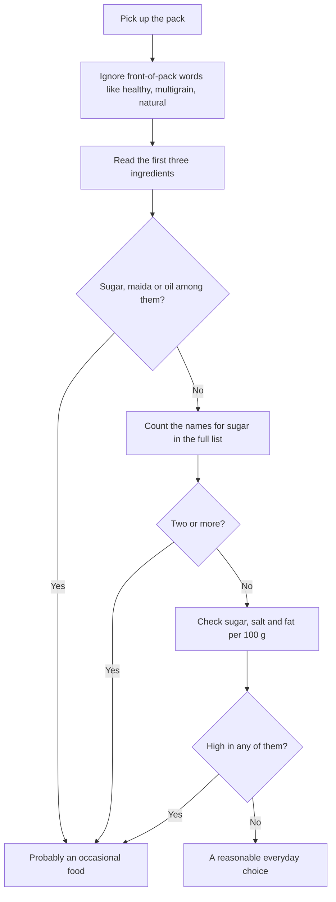

:::answer
Ultra-processed foods are industrial products made mostly from refined ingredients and additives, like most packaged chips, biscuits, sugary drinks, instant noodles, many breakfast cereals and ready-to-eat snacks. A WHO and ICRIER report found that retail sales of these foods in India grew at about 13.37% a year between 2011 and 2021. Large studies link high intake with obesity, type 2 diabetes, heart disease and poorer mental health, and a controlled trial showed people simply eat more calories on an ultra-processed diet. You don't have to give up packaged food entirely. Read the ingredient list (first three items, and how many names for sugar it has), check sugar, salt and fat per 100 g, and swap the daily habits first: drinks, biscuits and namkeen.
:::

## The trend in one number

A 2023 report by the World Health Organization and the Indian Council for Research on International Economic Relations looked at sales of five groups of ultra-processed foods in India: chocolate and sugar confectionery, salty snacks, beverages, ready-made and convenience foods, and breakfast cereals. Their retail sales value grew at a compound annual growth rate of 13.37% from 2011 to 2021 ([WHO–ICRIER, 2023](https://www.icrier.org/pdf/PPT_WHO-report-release_Aug17_2023.pdf)). Growth dipped during the pandemic year and then picked up again.

That growth is visible in any Indian city: more shelf space for packaged snacks and drinks, more quick-commerce deliveries at 11 pm, and more children who know brand names before vegetable names.

## What "ultra-processed" actually means

Not all processing is bad. Scientists commonly use the NOVA system, which sorts foods into four groups:

1. **Unprocessed or minimally processed**: fresh vegetables, fruit, grains, dal, milk, eggs, meat, plain curd, frozen peas.
2. **Processed culinary ingredients**: oil, ghee, salt, sugar, jaggery, used in home cooking.
3. **Processed foods**: simple foods made from groups 1 and 2, like paneer, homemade pickles, bread from a local bakery with few ingredients, canned chana.
4. **Ultra-processed foods**: industrial formulations, usually with five or more ingredients, including things you wouldn't find in a home kitchen, such as flavour enhancers, colours, emulsifiers, hydrogenated fats, maltodextrin, invert syrup or protein isolates.

The key idea is that ultra-processed foods are designed to be cheap, long-lasting, convenient and very easy to overeat. Common Indian examples include packaged chips and namkeen, cream biscuits and cookies, sugary soft drinks and packaged juices, instant noodles, many breakfast cereals, flavoured yoghurt drinks, packaged sweets and chocolates, frozen ready meals, and many "protein" and "diet" snacks.

A home-cooked meal of roti, dal and sabzi with a spoon of ghee is not ultra-processed, even though ghee and atta are processed. That's why the classification helps: it separates traditional cooking from industrial formulations.

[[ad]]

## Why it matters for health

### People eat more without noticing
In a carefully controlled US trial, adults lived in a research unit for four weeks and were given either an ultra-processed or an unprocessed diet for two weeks each, matched for calories, sugar, fat, fibre and salt on offer. On the ultra-processed diet they ate about 500 more calories a day and gained weight; on the unprocessed diet they lost weight ([Cell Metabolism, 2019](https://doi.org/10.1016/j.cmet.2019.05.008)). They didn't report liking one diet more; they just ate faster and more.

### The links with disease
A 2024 umbrella review in the BMJ pulled together 45 meta-analyses covering almost 10 million people. Higher intake of ultra-processed foods was associated with higher risk of 32 health outcomes. The evidence was rated most convincing for death from heart disease, type 2 diabetes, and common mental health problems such as anxiety ([BMJ, 2024](https://doi.org/10.1136/bmj-2023-077310)). These are observational studies, so they show associations rather than proving cause, but the pattern is consistent across many populations.

### Sugar, salt and fat in the same pack
Many ultra-processed foods are high in fat, sugar or salt (often called HFSS foods). The WHO recommends keeping free sugars below 10% of daily energy, and ideally below 5% ([WHO, 2015](https://www.who.int/publications/i/item/9789241549028)). The ICMR-NIN dietary guidelines advise Indians to limit HFSS and ultra-processed foods and to read food labels carefully ([ICMR-NIN, 2024](https://www.nin.res.in/dietaryguidelines/index.html)).

## How to read an Indian food label in 30 seconds

Under FSSAI's labelling regulations, most packaged foods in India must show an ingredient list (in descending order of weight) and nutrition information per 100 g or 100 ml ([FSSAI](https://www.fssai.gov.in/)). Here's how to use them quickly.

### Step 1: Ignore the front
Words like "healthy", "multigrain", "baked not fried", "natural", "no added preservatives", "high protein" or "made with real fruit" are marketing. A "multigrain" biscuit can still be mostly maida and sugar. Turn the pack around.

### Step 2: Read the first three ingredients
Ingredients are listed by weight, largest first. If sugar, refined wheat flour (maida) or vegetable oil is among the first three, the product is built on them.

### Step 3: Count the names for sugar
Sugar hides under many names. Some to look for: sugar, invert sugar or invert syrup, liquid glucose, glucose syrup, dextrose, maltodextrin, fructose, high-fructose corn syrup, corn syrup, honey, jaggery powder, malt extract, fruit juice concentrate. Manufacturers can spread sugar across several names so that no single one appears first. Two or more sugar names is a warning sign.

### Step 4: Check the per-100 g numbers
Compare products per 100 g, not per "serving", because serving sizes on Indian packs are often small and unrealistic. Look at total sugars, sodium and total and saturated fat. India has no official "high" thresholds on packs yet, but the UK's traffic-light scheme is a useful yardstick: for foods, more than 22.5 g total sugars per 100 g is "high" and 5 g or less is "low"; more than 1.5 g salt (about 600 mg sodium) per 100 g is "high"; and more than 17.5 g fat or 5 g saturated fat per 100 g is "high". Lower is better for everyday foods.

### A worked example
Here is an illustrative label, made up for this guide (not any real brand), for a "multigrain digestive" biscuit:

> Ingredients: refined wheat flour (maida), sugar, edible vegetable oil (palm), whole wheat flour (12%), invert syrup, oat flour (3%), milk solids, raising agents, salt, emulsifiers, malt extract, flavours.

Run the check. The first three ingredients are maida, sugar and palm oil. Sugar appears under three names: sugar, invert syrup and malt extract. The "multigrain" whole grains add up to about 15% of the biscuit. Whatever the front of the pack says, this is a sweet, refined snack: fine now and then, not a daily "healthy" choice.

### What about front-of-pack warnings in India?
FSSAI first proposed a front-of-pack labelling system in 2022, and the issue has been before the Supreme Court in a public interest case. As of September 2026, the court had reserved its order on front-of-pack warning labels after questioning FSSAI's proposed timeline. Until clear warnings appear on packs, the ingredient list and nutrition table are your best tools. Our [barcode scanner](/health/barcode-scanner) can help you check products quickly.

[[ad]]

## Swaps that don't feel like punishment

The aim is not perfection. It's to move the everyday habits towards home-made and minimally processed food, and keep ultra-processed foods as occasional treats.

### Drinks first
Sugary drinks are the easiest win: they add sugar without making you feel full. Swap soft drinks, packaged juices, sweetened iced tea and flavoured milk for water, unsweetened buttermilk, nimbu pani with very little sugar or none, coconut water now and then, or plain milk.

### Biscuits and the chai-time snack
Cream biscuits and cookies with chai are a daily habit for millions. Try roasted chana, a handful of peanuts or mixed nuts, makhana roasted at home with a pinch of salt and spices, a fruit, or a homemade besan chilla.

### Namkeen and chips
Swap for roasted makhana, roasted chana, sprouts chaat, puffed rice (murmura) bhel made at home with vegetables, or air-fried vegetable chips.

### Instant noodles and ready meals
Swap for vegetable poha, upma, dalia, khichdi or a quick egg bhurji with roti. Many take 15 minutes. Batch-cook dal and rice on weekends to make weekday dinners easy.

### Breakfast cereals
Many "health" cereals are high in sugar. Swap for oats or dalia cooked with milk and fruit, idli, dosa, paratha with curd, or eggs.

### Packaged sweets and desserts
Keep them for festivals and occasions. On normal days, try fruit with curd, or a small piece of homemade sweet.

:::tip Shopping and kitchen tricks that make it easier
- Shop with a list and eat before you go; hungry shoppers buy more snacks.
- Keep fruit, roasted chana and nuts where you can see them; keep packets out of sight.
- Batch-cook on Sundays: boiled chana, dal, chopped vegetables and dough for the week.
- Read labels for "healthy-looking" products too: protein bars, granola, flavoured yoghurt and "diet" namkeen.
- Don't keep sugary drinks at home; buy them only for occasions.
- For children, involve them in making snacks: bhel, sandwiches and fruit chaat.
:::

## Eating out, office canteens and 11 pm deliveries

A lot of ultra-processed eating doesn't come from the supermarket at all. It comes from quick-commerce apps, office vending machines and late-night food orders.

- **Set an order cut-off time**, for example no snack deliveries after 9 pm, and keep a few healthy staples at home so you don't need to order.
- **At work**, keep roasted chana, nuts or fruit at your desk so the vending machine isn't the only option at 4 pm.
- **When ordering meals**, choose dal, tandoori or grilled dishes, rotis, rice and salads over fried starters, creamy gravies and sugary desserts; ask for less oil and salt.
- **At functions and festivals**, enjoy the food you love, take smaller portions of sweets, and fill half your plate with salad and dal first.

## Children and ultra-processed food

Children are the main target of advertising for chips, sweets, chocolates and sugary drinks, and habits formed early tend to last. Practical steps for families:

- Pack home-made tiffin most days: paratha rolls, poha, idli, sandwiches with vegetables and paneer, fruit.
- Keep packaged snacks for occasional treats, not as a daily reward.
- Offer water and milk rather than soft drinks and packaged juices.
- Talk to children about adverts and labels in a simple way; older children enjoy being "label detectives".
- Ask schools about what is sold in canteens and served at events.

## People with diabetes, high blood pressure or heart disease

For people with these conditions, ultra-processed foods add sugar, salt and unhealthy fats that work against their treatment. Labels matter even more: check sugar for diabetes, sodium for blood pressure, and saturated and trans fat for the heart. "Sugar-free" sweets can still be high in refined flour, fat and calories, and some sweeteners affect people differently. Follow the diet advice of your doctor or dietitian.

:::warning See a doctor promptly if
- You have extreme thirst, frequent urination and weight loss without trying (possible high blood sugar)
- You have chest pain, breathlessness or swelling of the legs
- You feel unable to control eating, eat in secret, or feel deep distress about food or your body
- A child is gaining weight very quickly, or has dark velvety skin on the neck or armpits (a sign of insulin resistance)
- You have severe headaches or a blood pressure reading that is very high
:::

[[ad]]

## Myths about packaged food

:::mythfact
| Myth | Fact |
|---|---|
| "Multigrain or atta biscuits are healthy." | Many are mostly refined flour, sugar and oil with a little whole grain. Read the first three ingredients. |
| "Baked, not fried, means healthy." | Baked snacks can still be high in salt, fat and refined starch. Check per-100 g numbers. |
| "No added sugar means no sugar." | The product can still contain sugars from fruit concentrates, malt or milk solids, and plenty of refined starch. |
| "All processed food is bad." | Plain curd, paneer, frozen vegetables, canned chana and oats are processed but not ultra-processed. They're fine everyday foods. |
| "Packaged juice is as good as fruit." | Juice lacks fibre and often has added sugar. Whole fruit is better. |
| "Diet namkeen won't add weight." | It's still a dense, easy-to-overeat snack. Portion matters, and labels often reveal high salt and fat. |
:::

## A four-week plan to cut back

**Week 1:** Track what you buy and eat from packets for seven days. Don't change anything yet.

**Week 2:** Replace sugary drinks with water, buttermilk or nimbu pani.

**Week 3:** Replace the daily biscuit and namkeen habit with roasted chana, nuts, makhana or fruit.

**Week 4:** Cook two extra home meals a week instead of instant or ready meals. Read the label before anything new goes in the trolley.

## Common questions

:::faq
### Are all packaged foods ultra-processed?
No. Plain curd, paneer, frozen vegetables, oats, plain atta, dals and canned chana are packaged but minimally processed. Ultra-processed foods are industrial formulations with many ingredients and additives, like most chips, biscuits, sugary drinks and instant noodles.

### How much sugar is too much on a label?
As a yardstick, the UK traffic-light scheme calls more than 22.5 g of total sugars per 100 g "high" and 5 g or less "low". The WHO recommends keeping free sugars below 10% of daily energy, ideally below 5%. If sugar or several sugar names appear near the top of the ingredient list, treat the product as occasional.

### Is jaggery or honey healthier than sugar in packaged foods?
They are still added sugars. Jaggery has small amounts of minerals, but in packaged foods it adds sugar just like white sugar does. Count them as sugar when reading labels.

### Do I need to stop eating packaged food completely?
No. The goal is to make home-cooked and minimally processed food the base of your diet, and keep ultra-processed foods as occasional treats rather than daily staples.

### Are "protein" bars and snacks healthy?
Some are reasonable, but many are ultra-processed, with added sugars, sugar alcohols and refined starches. Read the label, and remember that dal, curd, paneer, eggs and chana are protein-rich whole foods.
:::

## The bottom line

India is eating far more ultra-processed food than a decade ago, and the health effects are showing up. You don't need to fear every packet. Learn the 30-second label check, swap the daily habits first (drinks, biscuits, namkeen), cook a few more simple home meals, and keep packaged treats for occasions.

Cutting ultra-processed food works even better with regular exercise. If you want help building a routine, the trainers at Royal Fitness Club in Sector 93, Noida can set one up with you.
