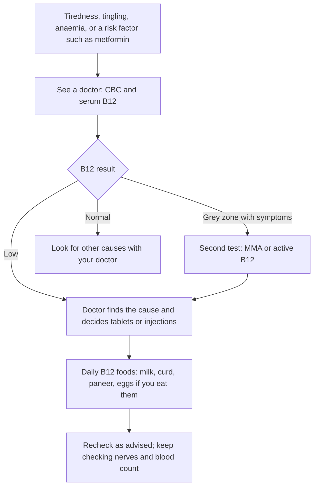

:::answer
Vitamin B12 comes almost only from animal foods: milk, curd, paneer, eggs, fish and meat. That is why it runs low in so many Indian vegetarians, and especially in people who eat little dairy. Low B12 can cause tiredness, breathlessness, pale skin, tingling or numbness in the hands and feet, poor memory and low mood, and it often builds slowly over years. A blood test can check it, but a result in the "borderline" band needs a second look, not a guess. Regular milk and curd, eggs if you eat them, and fortified foods help; supplements and injections should be started on a doctor's advice, after testing, because the right form depends on the cause. People on metformin or acid tablets for years should ask about a B12 check.
:::

## What vitamin B12 does, and why vegetarians are at risk

Vitamin B12 (cobalamin) helps your body make healthy red blood cells, keeps nerves working and is needed to copy DNA when cells divide. Your body stores some B12 in the liver, which is why a deficiency can take years to show after intake drops.

Plants don't make B12. It is made by bacteria and reaches us through animal foods. According to the NIH Office of Dietary Supplements, natural sources are fish, meat, poultry, eggs, milk and milk products, while plant foods contain no reliable B12 unless they are fortified ([NIH ODS](https://ods.od.nih.gov/factsheets/VitaminB12-HealthProfessional/)).

For a lacto-vegetarian Indian, that leaves milk, curd, buttermilk, paneer and cheese as the main natural sources. These do contain B12, but many people don't eat enough of them every day to cover their needs, especially when chai is the main "milk" of the day.

The problem is not only for vegetarians. A study of adults in Pune found metabolic signs of B12 deficiency in about three-quarters of participants, and the authors noted that a vegetarian diet explained only part of it ([AJCN, 2001](https://doi.org/10.1093/ajcn/74.2.233)). So if you eat meat once a week, don't assume you are safe.

## The signs people miss

B12 deficiency is easy to overlook because the early signs are vague and blamed on stress, age or "weakness". Common signs include:

- **Tiredness and low energy** that don't improve with rest
- **Breathlessness on stairs**, a fast heartbeat or feeling faint, from anaemia
- **Pale or slightly yellowish skin**
- **Tingling, pins and needles or numbness** in the hands and feet, often both sides
- **Unsteady walking**, especially in the dark
- **A sore, red, smooth tongue** or mouth ulcers
- **Poor memory, brain fog, irritability or low mood**

The nerve signs matter most. Anaemia from B12 usually improves once the deficiency is treated, but nerve damage that has been left for a long time may not fully recover. That is why tingling feet in a vegetarian, a person with diabetes on metformin, or an older adult should be checked rather than brushed off.

B12 deficiency also causes a particular kind of anaemia, with large red blood cells (macrocytic anaemia). Your CBC report may show this as a raised MCV. In India, though, many people have iron deficiency at the same time, which pulls the MCV down. The two can hide each other, so a "normal" MCV does not rule out low B12.

## Who should get tested

You don't need a B12 test every year just because you are vegetarian and feel fine. But ask your doctor about testing if you:

- Have any of the symptoms above, especially tingling, numbness or unexplained anaemia
- Have taken **metformin** for diabetes or prediabetes for several years. In a large US trial, people on metformin had higher odds of low B12 for each extra year of use, and low B12 was linked with more nerve problems ([JCEM, 2016](https://doi.org/10.1210/jc.2015-3754))
- Have taken **acid-reducing tablets** (PPIs such as omeprazole or pantoprazole, or H2 blockers) for two years or more. A large study linked long-term use of these medicines with B12 deficiency ([JAMA, 2013](https://doi.org/10.1001/jama.2013.280490))
- Are **over 60**, when the stomach absorbs B12 less well
- Have had stomach or bowel surgery, coeliac disease, Crohn's disease or long-term digestive problems
- Are **pregnant, planning pregnancy or breastfeeding** and eat little dairy
- Follow a **vegan** diet without fortified foods

[[ad]]

## How to read your B12 report

Labs in India usually run a "serum vitamin B12" test, which measures total B12 in the blood. It is useful but imperfect, because a share of the B12 in blood is bound to a carrier that cells can't use.

The UK's NICE guideline (2024) gives these bands for total B12, while noting that each lab should use its own validated cut-offs ([NICE NG239](https://www.nice.org.uk/guidance/ng239)):

| Total B12 result | What it usually means |
|---|---|
| Below 180 ng/L (pg/mL) | Deficiency confirmed |
| 180 to 350 ng/L | Indeterminate: could be low, could be fine |
| Above 350 ng/L | Deficiency unlikely |

Notice that the "normal range" printed on many Indian reports starts close to 200, so a result of 220 may be marked normal even though it sits in the uncertain band. If you have symptoms and an indeterminate result, NICE suggests a second test such as methylmalonic acid (MMA), or "active B12" (holotranscobalamin), rather than just repeating the same test. Homocysteine is sometimes used too, but it rises for other reasons, so it is less specific.

A few more things that can confuse the picture:

- **A recent supplement or injection** pushes the number up for a while, even if the underlying problem remains.
- **Pregnancy** naturally lowers total B12; NICE recommends the active B12 test instead during pregnancy.
- **Folic acid** can correct the anaemia of B12 deficiency on the blood report while nerve damage continues, which is one reason not to self-treat "weakness" with random multivitamins and stop there.

Always read the result with a doctor, alongside your CBC, symptoms and medicines.

## A step-by-step plan

### Step 1: Don't self-diagnose from symptoms
Tiredness and tingling have many causes, including thyroid problems, iron deficiency, diabetes and vitamin D deficiency. A doctor and a blood test sort them out.

### Step 2: Get the cause, not just the number
If your B12 is low, your doctor will ask why. Is it diet? Medicines? Poor absorption from the stomach (for example pernicious anaemia, an autoimmune condition)? The answer decides the treatment. People who can't absorb B12 from food often need injections, while diet-related deficiency is usually treated with tablets.

### Step 3: Treat as advised
The form, dose and length of treatment vary a lot from person to person, so take B12 tablets or injections only as advised by your doctor. Don't stop early because you feel better; stores take time to rebuild.

### Step 4: Fix the diet for the long run
Treatment corrects the deficiency, but your diet decides whether it comes back. The next section shows how.

### Step 5: Recheck
Follow the recheck plan your doctor gives you. If you stay on metformin or acid tablets, ask how often to test.

## B12 foods that fit an Indian vegetarian kitchen

The ICMR-NIN *Dietary Guidelines for Indians* (2024) advise including milk and milk products in the daily diet, and note that vegetarians, especially those who eat little dairy, are at risk of low B12 ([ICMR-NIN, 2024](https://www.nin.res.in/dietaryguidelines/pdfjs/locale/DGI24thJune2024fin.pdf)). In practice:

- **Make milk products a daily habit, not an occasional one.** A glass of milk, a bowl of curd or a glass of buttermilk with lunch, and some paneer through the week all add up.
- **Count your real dairy, not chai.** The splash of milk in two cups of chai is a small amount.
- **Eggs**, if you eat them, are a good source, mostly in the yolk.
- **Fish and chicken**, for non-vegetarians, are rich sources, even a few times a week.
- **Fortified foods** such as some breakfast cereals, fortified milk and plant milks can help, especially for vegans. Read the label for "vitamin B12" or "cobalamin". India's "+F" logo marks fortified foods.

What doesn't reliably work: spirulina, mushrooms, seaweed and "fermented foods for B12" are often promoted, but the NIH notes that many of these contain B12 analogues that the body can't use, so they aren't reliable sources ([NIH ODS](https://ods.od.nih.gov/factsheets/VitaminB12-HealthProfessional/)). Idli and dosa batter, curd and pickles are healthy, but not dependable B12 sources apart from the dairy in them.

:::tip Easy ways to get more B12 every day
- Add a bowl of curd or a glass of chaas to lunch, every day, not just in summer.
- Have paneer, curd or eggs at breakfast instead of only poha or toast.
- Choose milk-based drinks such as haldi doodh at night instead of a third cup of chai.
- If you are vegan, pick fortified plant milk or cereal, and talk to a doctor about a supplement.
- Keep your metformin or acid tablets going as prescribed, but ask your doctor about B12 checks.
- Write down your B12 result and date in your phone, so you can compare next time.
:::

## Special groups

### Pregnancy and breastfeeding
B12 matters for the baby's brain and nerves. In the Pune Maternal Nutrition Study, about two-thirds of pregnant women in six villages had low B12, and children whose mothers had low B12 with high folate were the most insulin resistant at age six ([Diabetologia, 2008](https://doi.org/10.1007/s00125-007-0793-y)). If you are vegetarian and pregnant or planning pregnancy, tell your obstetrician about your diet and ask whether you need testing. Don't start or stop supplements on your own during pregnancy.

### Vegan, Jain and fasting-heavy diets
A strict vegan diet has no natural B12 at all, so fortified foods or a supplement, chosen with a doctor, are not optional. Jain diets usually include milk and curd, which helps, but skip eggs, so dairy has to be a daily habit. Many families also fast once or twice a week, or for long stretches during Navratri or Shravan, and the fasting menu is often sabudana, potato and fruit with little dairy. If you fast often, make curd, milk or paneer part of the fasting plate, and mention your fasting pattern when you see a doctor about tiredness.

### Children and teenagers
Children of mothers with low B12, and children on very restricted diets, can run low too. Signs include tiredness, poor growth, delayed milestones in babies and poor concentration in older children. A paediatrician can check.

### Older adults
With age, the stomach makes less acid, and acid is needed to release B12 from food. Many older adults are also on long-term acid tablets or metformin. Unsteady walking, numb feet, memory changes or low mood in an older parent are worth a B12 test before they are put down to age.

### People with diabetes
Metformin is safe, effective and should not be stopped because of this article. The point is simply to check B12 from time to time. Tingling feet in diabetes can come from high sugar (diabetic neuropathy), from low B12, or from both, and the treatment is different. See our [diabetes guide](/health/blog/complete-indian-guide-type-2-diabetes) for the bigger picture.

[[ad]]

## B12, exercise and energy

People who come to the gym often blame tiredness on training or on "low protein". Sometimes the real reason is low B12 or iron. If your energy is poor, workouts feel unusually hard, you get breathless on mild effort, or your feet tingle, get a blood test before buying another supplement. Once the deficiency is treated, many people find their energy and stamina come back.

Protein powders don't fix B12 deficiency unless they are fortified, and fortified amounts vary. Don't take high-dose "energy" injections offered outside a clinic; B12 injections are a medicine, given after a diagnosis.

:::warning See a doctor promptly if
- You have numbness, tingling or burning in the hands or feet that is spreading or getting worse
- Your walking becomes unsteady, or you fall more often
- You get breathless or dizzy on mild effort, or your heart races at rest
- You notice memory loss, confusion or a big change in mood
- You are pregnant or planning pregnancy and eat little dairy
- You have taken metformin or acid tablets for years and have never had a B12 test
- Your child is pale, very tired, not growing well, or a baby is missing milestones
:::

[[ad]]

## Myths about vitamin B12

:::mythfact
| Myth | Fact |
|---|---|
| "I drink chai every day, so I get enough milk." | The milk in a few cups of chai is a small amount. Count real servings of milk, curd, buttermilk and paneer. |
| "Spirulina and mushrooms give vegetarians B12." | Many of these contain forms of B12 the body can't use, so they aren't reliable sources. |
| "My B12 report says normal, so I'm fine." | A result in the 180–350 ng/L band is uncertain. With symptoms, a second test may be needed. |
| "Only vegetarians get B12 deficiency." | Older age, metformin, acid tablets and gut problems cause it in meat-eaters too. |
| "A B12 shot will give me instant energy." | B12 injections treat a diagnosed deficiency. They don't add energy if your B12 is already normal. |
| "Tingling feet in diabetes are always from sugar." | Low B12 can cause the same symptoms, and needs different treatment. |
:::

## Common questions

:::faq
### What is a normal vitamin B12 level?
Labs use slightly different ranges. The UK's NICE guideline treats total B12 below 180 ng/L as deficiency, 180 to 350 ng/L as uncertain, and above 350 ng/L as unlikely to be deficient. Your doctor will read your result with your symptoms and blood count.

### Can vegetarians get enough B12 from food?
Many can, if they eat milk products every day, and eggs if they eat them. People who eat little dairy, vegans, older adults and people on certain medicines often need fortified foods or a supplement, as advised by a doctor.

### Does metformin cause B12 deficiency?
Long-term metformin use is linked with lower B12 levels in some people. That isn't a reason to stop metformin. Ask your doctor about checking B12 from time to time, especially if you have tingling or numbness.

### How long does it take to recover from B12 deficiency?
It depends on how low it was and for how long. Blood counts often start improving within weeks of treatment. Nerve symptoms take longer, and long-standing nerve damage may not fully recover, which is why early testing matters.

### Should I take a B12 supplement without testing?
It's better to test first. A supplement before testing can hide the problem on a later report, and the right form and dose depend on the cause. Take B12 only as advised by your doctor.
:::

## The bottom line

Low B12 is common in India, in vegetarians and meat-eaters alike, and it builds quietly. Daily milk products, eggs or fish if you eat them, and fortified foods protect most people. If you have tingling, unexplained tiredness or anaemia, or you take metformin or acid tablets long term, ask your doctor about a B12 test, and read borderline results carefully. Treat it early, and most people feel the difference.

If you train at Royal Fitness Club in Sector 93, Noida and your energy has dropped, tell your trainer; we'll adjust the plan while you get it checked, and our [vegetarian protein guide](/health/blog/high-protein-vegetarian-india-guide) can help you build meals around curd, paneer and dal.
