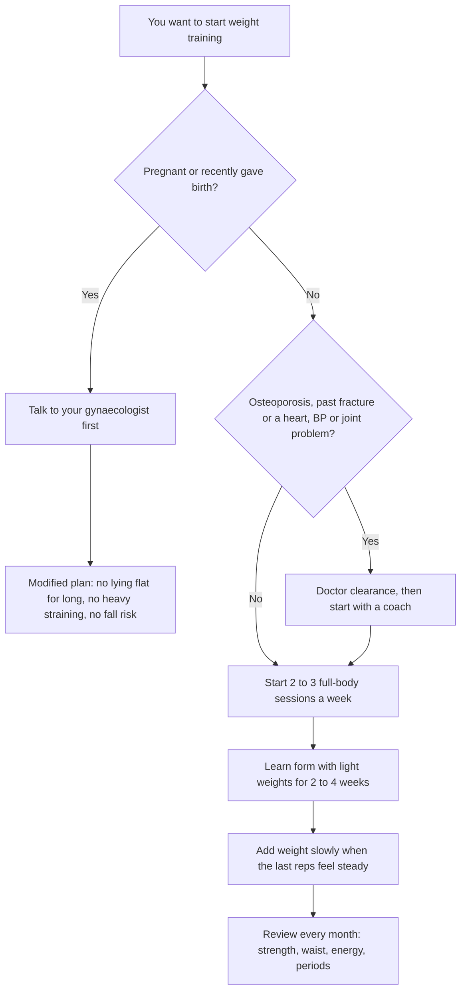

:::answer
Lifting weights will not turn you into a bodybuilder by accident. Women build muscle at a similar relative rate to men on the same programme, but start from a smaller base, so what most women see is firmer shape, better posture and more strength. Strength training also helps bones (important, because low bone density is common in Indian women after menopause), helps with insulin resistance in PCOS, and is recommended during a healthy pregnancy and after childbirth, with some changes. The research on training by menstrual cycle phase is weak, so go by how you feel. Start with two or three full-body sessions a week, learn good form, and add weight slowly.
:::

## Why so many Indian women skip the weights section

Walk into most gyms in Noida or Gurugram at 7 pm and you will see the same pattern. Men around the racks and benches, women on the treadmill, cross-trainer and maybe the yoga mat. When you ask why, the answers repeat: "I don't want to look like a man", "my mother says lifting is bad for the uterus", "I have PCOS, so only cardio", "I'm on my period, I should rest", "I'm pregnant, no weights at all".

Some of these come from family, some from old magazines, and some from trainers who never learned how to coach women. They are worth taking seriously, because they keep a lot of women away from the type of exercise that protects bones, muscles and blood sugar for decades. So let's go through them one at a time, with what the research actually says, and with honest notes where the evidence is thin.

## Myth 1: "Weights will make me bulky"

This is the biggest fear, and the easiest to answer.

A 2020 systematic review and meta-analysis pooled studies where men and women followed the same strength-training programme. For muscle growth (hypertrophy), the pooled data from 10 studies showed no significant difference between the sexes in how much muscle grew relative to where they started. For lower-body strength, gains were again similar. For upper-body strength, women actually improved more in relative terms, probably because many started with less upper-body training ([Journal of Strength and Conditioning Research, 2020](https://doi.org/10.1519/JSC.0000000000003521)).

So why don't women who lift look like men who lift? Because "similar relative growth" on a smaller starting amount of muscle is a smaller absolute change. A woman who builds a few kilos of muscle over a year of serious training usually looks leaner and more toned, especially if she also loses some fat. The "bulky" look you see on stage or on Instagram usually takes years of specialised training, a very specific diet, dehydration and lighting for photos, and in some cases drugs. It does not happen from three sessions a week of squats and rows.

There's another reason women feel "bulky" in the first few weeks: muscles hold a bit more water and glycogen when you start training, and soreness can make them feel puffy. That settles. If your clothes fit tighter on the hips or thighs after a month, check your waist measurement and the scale together before you decide anything. Most of the time, the waist has come down.

### What lifting does change

- **Strength for daily life**: lifting a gas cylinder, carrying a child on your hip, climbing metro stairs with bags
- **Posture**: stronger upper back and glutes help with the rounded-shoulder, sore-lower-back pattern of desk work
- **Body composition**: more muscle and less fat at the same weight, so clothes fit differently
- **Metabolic health**: muscle is the biggest place your body stores blood sugar after meals

[[ad]]

## Bones: the reason to start in your 20s and 30s

Osteoporosis means bones have become thin and fragile enough to break easily. It is silent until a fracture happens, often in the wrist, spine or hip.

In India this is a common problem. A 2022 systematic review of Indian studies in postmenopausal women found a pooled prevalence of osteoporosis of 29% at the lumbar spine and 29% at the femoral neck (the top of the thigh bone), and 6% at the overall hip region. Osteopenia, the stage before osteoporosis, was found in 37% at the lumbar spine ([Journal of Mid-life Health, 2022](https://doi.org/10.4103/jmh.jmh_207_21)). These numbers come from a limited number of studies with different methods, so treat them as a rough picture. The picture is still clear: low bone density is common in Indian women after menopause.

Bone responds to load. Walking helps a little, but bones respond best to forces that are heavier or faster than everyday life. That is where lifting comes in.

### The LIFTMOR trial

For years, doctors were cautious about heavy lifting for women who already had low bone density, worried it would cause fractures. The LIFTMOR trial in Australia tested this directly. It enrolled 101 postmenopausal women, average age 65, who already had low bone mass. Half did 8 months of twice-weekly, 30-minute, closely supervised sessions of heavy resistance and impact training, built up to 5 sets of 5 repetitions at more than 85% of the most they could lift once. The other half did a home programme of light exercise ([Journal of Bone and Mineral Research, 2018](https://doi.org/10.1002/jbmr.3284)).

Results:

- Lumbar spine bone density rose by about 2.9% in the lifting group, and fell by about 1.2% in the light-exercise group
- At the femoral neck, the lifting group gained about 0.3% while the light group lost about 1.9%
- Height, back and leg strength, and balance tests all improved more in the lifting group
- Only one minor side effect was reported in the lifting group: a lower-back spasm that cost two missed sessions

Two honest caveats. First, these women were screened for other health problems and trained under expert supervision, with weights built up gradually over weeks. Second, 8 months is short, and the trial was not large enough to show fewer fractures. It tells us that well-coached heavy lifting is possible and useful for women with low bone density. It does not tell you to load a barbell at home tomorrow. If you already have osteoporosis or a past fracture, ask your doctor first, and train with a coach.

The bigger lesson is for younger women. Bone mass peaks in early adulthood. The more bone you build and keep in your 20s, 30s and 40s, the more you have in the bank when menopause speeds up bone loss. Our [osteoporosis guide](/health/diseases/osteoporosis) covers calcium, vitamin D and testing.

## PCOS and insulin resistance: exercise is part of treatment

PCOS (polycystic ovary syndrome) is the most common hormonal condition in women of reproductive age. The 2023 international PCOS guideline, developed by experts from many countries, puts its prevalence at 10% to 13% worldwide, and notes it may be higher in some Asian populations ([JCEM, 2023](https://doi.org/10.1210/clinem/dgad463)). It can affect periods, skin, hair, weight, mood and fertility. Insulin resistance, where the body needs more insulin than usual to manage blood sugar, plays a part in many women with PCOS, whatever their weight.

What does the guideline say about exercise?

- Healthy eating and physical activity are recommended for **all** women with PCOS, to improve general health, quality of life and body composition, whether or not weight loss is a goal.
- Adults should aim for 150 to 300 minutes of moderate activity a week, or 75 to 150 minutes of vigorous activity, **plus muscle-strengthening activity on 2 non-consecutive days a week**.
- For modest weight loss and to stop weight coming back, the guideline suggests at least 250 minutes a week of moderate activity, or 150 minutes of vigorous activity, again plus strength work on 2 days.
- There's no good evidence that any one type or intensity of exercise works better than another for PCOS. The evidence on this point was rated low certainty. The guideline's advice is to pick something you enjoy and can keep doing.

The guideline also says routine insulin blood tests are not useful in everyday care, so don't chase a "fasting insulin" number from a lab package. Your doctor will usually look at sugar tests, lipids, blood pressure and waist size instead ([JCEM, 2023](https://doi.org/10.1210/clinem/dgad463)).

In practice, the "only cardio for PCOS" advice is out of date. A mix works well: brisk walking or cycling on most days, and two or three strength sessions a week. Muscle is where much of your blood sugar goes after a meal, so building it is a sensible, practical move for insulin resistance. Read more in our [PCOS guide](/health/diseases/pcos).

## Periods: should you train by cycle phase?

You will see a lot of social media advice about "cycle syncing": lift heavy in one phase, only do yoga in another, and so on. It sounds scientific. The evidence behind it is weak.

The largest review so far pooled 78 studies on exercise performance across the menstrual cycle. It found that performance might be **trivially** lower in the early follicular phase (the first days of your period) than at other times. The effect was so small, the studies so mixed, and the quality of evidence so low that the authors said no general guidelines can be made. They advised a personal approach based on how each woman responds ([Sports Medicine, 2020](https://doi.org/10.1007/s40279-020-01319-3)).

A 2023 umbrella review that looked specifically at strength training went further. It concluded that it is premature to say the phase of your cycle meaningfully affects strength on the day, or long-term gains in strength and muscle. It also pointed out that many studies did not even confirm which phase women were in ([Frontiers in Sports and Active Living, 2023](https://doi.org/10.3389/fspor.2023.1054542)).

So what should you do?

- Training during your period is fine if you feel up to it. Many women find exercise eases cramps and mood.
- If you have heavy bleeding, bad cramps or low energy on some days, go lighter or rest. That is listening to your body, and it is sensible.
- Track your cycle and your training for two or three months if you're curious. Some women notice a pattern; many don't.
- Very heavy periods, periods that stop for three months or more, or periods that become irregular after you start training hard are a reason to see a gynaecologist. Missing periods with intense training and low food intake can harm bones.

:::tip Five habits that make lifting easier for women
- Wear a well-fitting sports bra and shoes with a flat, firm sole for squats and deadlifts.
- Breathe out as you push or pull. Holding your breath hard on every rep raises blood pressure and strains the pelvic floor.
- Eat a protein food at every meal: dal, curd, paneer, eggs, chana, soya or chicken. Our [protein calculator](/health/blog/protein-requirement-calculator-india) helps you find your number.
- Write down what you lift. If the same weight feels easy for two sessions in a row, add a small amount.
- Ask the trainer to check your form in the first weeks. A good coach is more useful than any app.
:::

## Pregnancy: what's safe and what to avoid

Many Indian families still treat pregnancy as nine months of rest. Medical guidance has moved on.

The American College of Obstetricians and Gynecologists (ACOG) says that, in the absence of medical or pregnancy complications, physical activity in pregnancy is safe and desirable, and that women who were active before pregnancy, including in vigorous exercise, can usually continue with some changes ([ACOG Committee Opinion 804, 2020](https://www.acog.org/clinical/clinical-guidance/committee-opinion/articles/2020/04/physical-activity-and-exercise-during-pregnancy-and-the-postpartum-period)). The WHO 2020 guidelines say the same: pregnant and postpartum women without contraindications should do at least 150 minutes of moderate aerobic activity a week and **include muscle-strengthening activities**. WHO lists benefits including lower risk of pre-eclampsia, pregnancy-related high blood pressure, gestational diabetes, excess weight gain, delivery complications and postpartum depression, with no increase in the risk of stillbirth or problems with birth weight ([BJSM, 2020](https://doi.org/10.1136/bjsports-2020-102955)).

### Changes to make while pregnant

ACOG's patient guidance gives practical rules ([ACOG, Exercise During Pregnancy](https://www.acog.org/womens-health/faqs/exercise-during-pregnancy)):

- Avoid lying flat on your back for long periods, and avoid standing still for long. Both can drop blood pressure. Do presses on an incline bench, seated, or standing instead.
- Avoid activities with a high risk of falling or being hit in the belly: contact sports, horse riding, gymnastics, off-road cycling.
- Avoid hot yoga, hot Pilates, exercising outdoors on very hot and humid days, and scuba diving.
- Hormones loosen ligaments, so avoid jerky, bouncy movements. Your balance also shifts as the belly grows.
- Drink water before, during and after exercise.

For strength work, this usually means moderate weights you can lift with steady breathing, machines or dumbbells rather than tricky barbell lifts, and no straining to a personal record. If you were already lifting before pregnancy, your gynaecologist may let you keep a fair amount of your routine. If you are new, start light. Some pregnancies come with conditions where exercise must be limited or stopped, such as some placenta problems, risk of early labour or certain heart and lung conditions, which is why the first step is always a conversation with your doctor.

[[ad]]

## After the baby: coming back step by step

ACOG says that after a healthy pregnancy and a normal vaginal delivery, most women can start gentle exercise a few days after birth, or whenever they feel ready. After a caesarean or a complicated delivery, ask your gynaecologist when to begin. A good start is 20 to 30 minutes a day of simple activity, such as walking and gentle exercises for the belly and back, then building towards at least 150 minutes a week of moderate activity plus muscle-strengthening on at least 2 days ([ACOG, Exercise After Pregnancy](https://www.acog.org/womens-health/faqs/exercise-after-pregnancy)).

Some practical points for new mothers:

- **Pelvic floor first.** Kegel exercises help with bladder control, which many women struggle with after delivery. Leaking urine during jumps or heavy lifts is common but not something to ignore; a women's health physiotherapist can help.
- **Belly gap.** Many women have some separation of the tummy muscles after pregnancy. Start with breathing and gentle core work, and ask a physiotherapist before heavy crunches or heavy lifting if you see a ridge or dome along the middle of your belly.
- **Breastfeeding.** Feed or express before a workout for comfort. Drink extra water.
- **Sleep and stress.** Your body is recovering on broken sleep. Short sessions count. Ten minutes of squats, rows and carries while the baby naps is a real workout.

Lifting your baby, the car seat and the pram all day is already strength training. Building that strength on purpose makes the daily load easier on your back.

:::warning See a doctor before or during exercise if
- You are pregnant and notice vaginal bleeding, fluid leaking, regular painful contractions, chest pain, dizziness or fainting, headache, calf pain or swelling, or feel breathless before you even start (stop and call your gynaecologist)
- You get chest pain, a racing or irregular heartbeat, or fainting during any workout
- Your periods stop for three months or more, or become very heavy or painful, after you start training
- You have osteoporosis, a past fracture from a minor fall, or have lost height
- You leak urine, feel heaviness in the vagina, or see a bulge in your belly after childbirth
- A joint stays swollen or painful for more than a few days after training
:::

## A 3-day beginner plan for women

This is a general starting point for healthy adults. It isn't a medical prescription. If any item on the warning list above applies to you, talk to your doctor first.

**How often:** three days a week with a rest day between, for example Monday, Wednesday and Friday.

**Warm-up (8 to 10 minutes):** brisk walk or cycle, then 10 bodyweight squats, 10 hip hinges, arm circles and a few slow lunges.

**Main session:** do each exercise for 2 to 3 sets of 8 to 12 repetitions. Pick a weight where the last two reps feel hard but your form stays clean. Rest about 1 to 2 minutes between sets.

1. **Goblet squat to a bench:** hold a dumbbell at your chest, sit back to touch the bench, stand up
2. **Dumbbell Romanian deadlift:** soft knees, push the hips back, keep the back flat, feel the back of the thighs
3. **Incline push-up:** hands on a bench or bar; lower the height as you get stronger
4. **One-arm dumbbell row:** one hand and knee on a bench, pull the dumbbell to your hip
5. **Glute bridge or hip thrust:** lie with your upper back on a bench or the floor, drive your hips up
6. **Farmer's carry:** a dumbbell in each hand, walk tall for 20 to 30 metres

**Finish:** 5 minutes of easy walking and stretching.

**How to progress:** when you can do all sets at the top of the rep range with good form, add the smallest weight step available the next session. After 8 to 12 weeks, a coach can move you to barbell squats and deadlifts if you want, which load the spine and hips well for bone health.

On the other days, walk. A 30-minute brisk walk on most days covers your aerobic activity and helps recovery. For a fuller introduction to equipment, gym etiquette and form, see our [beginner gym guide](/health/blog/beginner-gym-guide-india).

## Myths you'll hear in the changing room

:::mythfact
| Myth | Fact |
|---|---|
| "Weights will make me bulky like a man." | Women gain muscle at a similar relative rate to men on the same programme, but from a smaller base. Most women look leaner and firmer. |
| "Lifting is bad for the uterus." | No good evidence supports this. Strength training is recommended for women of all ages, including during a healthy pregnancy with changes. |
| "With PCOS you should only do cardio." | The 2023 PCOS guideline recommends strength training on 2 days a week alongside aerobic activity. No single type of exercise has been shown to be best. |
| "Never train during your period." | Research on cycle phase and strength is weak and mixed. Train if you feel fine; go lighter on bad days. |
| "Pregnant women must rest completely." | Without complications, ACOG and WHO recommend regular activity, including strength work, during pregnancy. |
| "Heavy weights break weak bones." | In the LIFTMOR trial, supervised heavy lifting improved spine bone density in women with low bone mass, with one minor side effect. Supervision matters. |
:::

## Common questions

:::faq
### Will I lose my "feminine" shape if I lift?
Most women find the opposite. Strength training builds the glutes, shoulders and back, and helps reduce fat around the waist when combined with good food. The very muscular look you see on stage takes years of specialised work and diet.

### I have PCOS and I'm not overweight. Should I still lift?
Yes. The 2023 international PCOS guideline recommends physical activity, including muscle-strengthening on 2 days a week, for all women with PCOS, whatever their weight. Insulin resistance can be present in lean women too.

### Can I start weight training for the first time during pregnancy?
Many women can start light strength work in pregnancy if their gynaecologist agrees there are no complications. Begin with light weights, short sessions and steady breathing, and avoid lying flat on your back for long or anything with a fall risk.

### How soon after a caesarean can I lift weights?
That depends on your recovery, so ask your gynaecologist. Most women start with walking and gentle core and pelvic floor work, and build up to weights over the following weeks once the doctor clears them.

### Do I need protein powder?
Not necessarily. Most women can meet their protein needs with dal, curd, paneer, milk, eggs, soya, chana, fish or chicken spread through the day. A powder can be convenient if your meals fall short.

### I'm over 50. Is it too late to start?
No. The LIFTMOR women were 65 on average and improved bone density and strength in 8 months. Start with a doctor's check if you have health conditions, and learn under a coach.
:::

:::takeaways
- Women build muscle at a similar relative rate to men, but "bulky" by accident is very unlikely.
- Low bone density is common in Indian women after menopause; strength training is one of the best tools to protect bone.
- For PCOS, the 2023 guideline recommends strength training on 2 days a week alongside aerobic activity.
- Evidence for training by cycle phase is weak; listen to your body.
- During a healthy pregnancy and after birth, regular exercise including strength work is recommended, with sensible changes.
:::

## The bottom line

The weights section belongs to women as much as to men. Lifting gives you strength for daily life, protects your bones before and after menopause, helps with insulin resistance in PCOS, and can be part of a healthy pregnancy and recovery after birth. Start light, learn good form, progress slowly, and check with your doctor if you are pregnant, recently delivered, or have a medical condition.

We made a short Hinglish video on these myths on our YouTube channel, [Royal Fitness TV](https://www.youtube.com/@RoyalFitnessTV?sub_confirmation=1).

If you would like a coach to teach you the basics, the trainers at Royal Fitness Club in Sector 93, Noida can set you up with a safe beginner programme.
