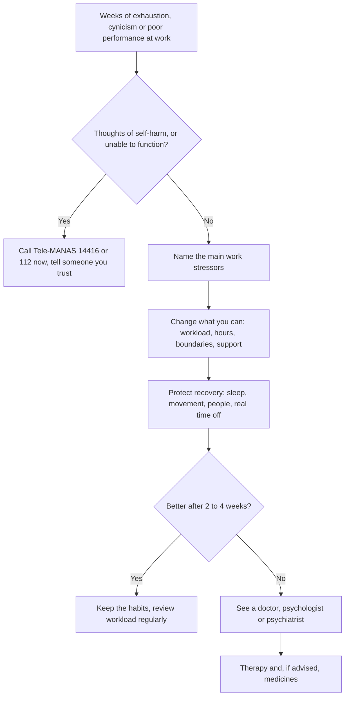

:::answer
Burnout is not a weakness or a lack of "toughness". The World Health Organization describes it as an occupational phenomenon caused by chronic workplace stress that hasn't been successfully managed, with three features: exhaustion, feeling distant or cynical about your job, and reduced effectiveness at work. It overlaps with depression and anxiety, which are common in India and often untreated. What helps is a mix of changes at work (workload, boundaries, support), recovery outside work (sleep, movement, people, time off), and professional help when symptoms persist or affect daily life. If you feel hopeless or think about harming yourself, call Tele-MANAS on 14416 (free, 24×7, in many Indian languages) or 112 in an emergency.
:::

## What burnout is, and what it isn't

In 2019 the WHO included burn-out in the International Classification of Diseases (ICD-11) as an occupational phenomenon, not a medical condition. It defines burn-out as a syndrome resulting from chronic workplace stress that has not been successfully managed, characterised by feelings of energy depletion or exhaustion, increased mental distance from one's job or feelings of negativism or cynicism related to it, and reduced professional efficacy. The WHO is explicit that the term refers to the work context ([WHO, 2019](https://www.who.int/news/item/28-05-2019-burn-out-an-occupational-phenomenon-international-classification-of-diseases)).

That definition is useful for three reasons:

1. It puts the cause where it often belongs: in **how work is designed and managed**, not only in the individual.
2. It separates burnout from **ordinary stress**, which comes and goes with deadlines and settles with rest.
3. It reminds us that burnout is **not the same as depression**, although the two can overlap and one can lead to the other.

### Stress, burnout and depression side by side
- **Stress** often feels like "too much": urgency, racing thoughts, tension. It usually eases when the pressure passes or after a good break.
- **Burnout** often feels like "not enough": drained, detached, "what's the point" about work, and doing the job worse despite trying. A weekend off doesn't fix it.
- **Depression** affects your whole life, not only work: low mood or loss of interest in things you used to enjoy, most of the day, nearly every day, for two weeks or more, often with changes in sleep, appetite, energy, concentration and self-worth, and sometimes thoughts of death.

If your symptoms spill into every part of life, or you have thoughts of harming yourself, treat it as more than burnout and get professional help.

[[ad]]

## How common is this in India?

India's National Mental Health Survey (2015–16), run by NIMHANS, found that nearly 150 million Indians needed mental healthcare, and that the treatment gap, the share of people with a condition who aren't getting treatment, ranged from 28% to 83% across different mental disorders ([NMHS summary](https://mohfw.gov.in/sites/default/files/National%20Mental%20Health%20Survey%2C%202015-16%20-%20Summary%20Report_0.pdf)). In other words, most people who are struggling don't get help.

Burnout itself isn't measured in national surveys, but the pressures behind it are familiar to many Indian workers: long hours and long commutes, always-on WhatsApp groups, job insecurity, targets, caring responsibilities at home, and a culture where admitting you're struggling can feel risky.

## The warning signs

Burnout builds slowly. Watch for patterns over weeks, not one bad day.

**In your body**
- Exhaustion that sleep doesn't fix
- Headaches, stomach upsets, aches, getting ill more often
- Trouble falling or staying asleep, or sleeping much more than usual
- Changes in appetite; relying more on caffeine, sugar, alcohol or tobacco to get through the day

**In your mind and mood**
- Dread before work, especially on Sunday evenings
- Cynicism or irritability about work, colleagues or clients
- Feeling detached, numb or "on autopilot"
- Trouble concentrating, more mistakes, forgetting things
- Feeling that nothing you do makes a difference

**In your behaviour**
- Withdrawing from friends and family
- Procrastinating, then working late to catch up
- Losing interest in exercise and hobbies
- Snapping at people at home

## A step-by-step path out

### Step 1: Name what's driving it
Write down the three things at work that drain you most. Common ones: too much work for the time available, unclear expectations, lack of control over how you work, unfairness, lack of recognition, conflict, values that clash with yours, and no boundary between work and home. Naming them turns a fog into specific problems.

### Step 2: Change what you can at work
- **Talk to your manager** with specifics: "I'm handling X, Y and Z; which should I deprioritise?" works better than "I'm stressed".
- **Clarify expectations**: what does "done" look like, and by when?
- **Set boundaries** on messages after hours where your role allows: mute work groups at night, and say so openly.
- **Use your leave.** Unused leave is not a badge of honour.
- **Ask about support**: some employers offer counselling (an employee assistance programme), flexible hours or workload reviews. The WHO's guidelines on mental health at work recommend that organisations train managers, adjust workloads and support workers' mental health, not just tell individuals to cope ([WHO, 2022](https://www.who.int/publications/i/item/9789240053052)).

### Step 2b: Look at money and home pressures too
Work stress rarely arrives alone. EMIs, family expectations, a long commute or caring for parents can make a manageable job feel impossible. If money worries are part of it, sitting down with a trusted family member or a financial adviser to make a simple plan can lift a surprising amount of pressure. If home responsibilities are unequal, an honest conversation about sharing them is part of recovery, not a separate issue.

### Step 3: Protect your recovery
Recovery isn't laziness; it is what lets you keep working well. Four pillars:

- **Sleep**: a fixed wake-up time, screens away an hour before bed, and caffeine before early afternoon. Our [sleep guide](/health/blog/sleep-guide-indians) has a full plan.
- **Movement**: exercise helps mood. A large 2024 review of trials found that walking or jogging, yoga and strength training all reduced symptoms of depression, with benefits seen across intensities ([BMJ, 2024](https://doi.org/10.1136/bmj-2023-075847)). Even 20–30 minutes on most days helps.
- **People**: time with friends and family who leave you feeling better, not worse. Isolation feeds burnout.
- **Detachment**: activities that fully take your mind off work: a hobby, music, cooking, a game, prayer or meditation, time in nature.

[[ad]]

:::tip Practical habits that protect you at work
- Start the day with your most important task before opening email or WhatsApp.
- Work in focused blocks (for example 45 minutes) with short breaks to stand, stretch and drink water.
- Take a real lunch break, away from the screen, ideally with a short walk.
- Keep a "done" list as well as a to-do list; it counters the feeling that nothing gets finished.
- Agree response-time norms with your team, so not every message is urgent.
- Use the commute to switch off: music, a podcast or simply quiet, not more email.
- Check in with yourself weekly: energy, mood and sleep on a scale of 1 to 10.
:::

## When and where to get professional help

Get help if symptoms last more than two weeks despite changes, if they affect your work, relationships or daily life, if you're relying on alcohol or other substances to cope, or if you feel hopeless. Help doesn't mean you're "mental" or weak; it means you're taking your health seriously, as you would for diabetes or blood pressure.

### Options in India
- **Tele-MANAS**: the government's free, 24×7 tele-mental health service. Call **14416** or **1-800-891-4416**. It was launched in October 2022, offers support in around 20 Indian languages, and can connect you to further care ([Tele-MANAS](https://telemanas.mohfw.gov.in/)).
- **Your family doctor**, who can assess you, check for physical causes (such as thyroid problems, anaemia or vitamin deficiencies that cause fatigue), and refer you.
- **Psychologists and counsellors**, for talking therapies such as cognitive behavioural therapy.
- **Psychiatrists**, who are medical doctors and can diagnose and prescribe medicines when needed.
- **Your workplace's employee assistance programme**, if there is one.

Medicines for depression or anxiety, when prescribed, are not addictive in the way people fear and can be very effective. Never start, stop or change them without your doctor's advice.

:::warning Get help immediately if
- You have thoughts of harming yourself or ending your life: call Tele-MANAS on 14416, or 112, or go to the nearest hospital emergency department, and tell someone you trust right now
- You feel unable to keep yourself safe
- You are unable to get out of bed, eat or look after yourself for days
- You hear voices or see things others don't, or feel extremely suspicious or confused
- You are drinking heavily or using drugs to cope and can't stop
- Someone you know talks about suicide, gives away belongings or says goodbye: stay with them and get help
:::

## Pressures that look different in different jobs

Burnout shows up in every kind of work, but the triggers vary:

- **IT, BPO and other night- or global-shift jobs**: calls across time zones, rotating shifts and late-night deployments erode sleep, which makes everything else harder. Protecting a regular sleep window and real days off matters even more here.
- **Doctors, nurses and other health workers**: heavy patient loads, long shifts, emotional strain and sometimes violence at work. Peer support and protected rest between shifts help, as does using the same mental health services you would recommend to patients.
- **Teachers**: large classes, administrative work and pressure from parents and management. Clear limits on after-hours messages from parents are reasonable.
- **Small business owners and shopkeepers**: no fixed hours, money worries and no one to hand over to. Even one fixed weekly half-day off, and sharing the load with family or staff, helps.
- **Gig and delivery workers**: income tied to speed and ratings, long hours on the road, heat and pollution. Short breaks, hydration and safe riding come first.
- **Students in coaching and exam preparation**: long study days, comparison and fear of failure. Burnout in students is real; sleep, exercise, time with friends and honest talks with parents matter, and Tele-MANAS is open to students too.
- **Homemakers and carers**: caring for children, elderly parents or a sick family member is work, often unpaid and unseen, with no leave. Sharing tasks, short daily breaks and support groups help prevent carer burnout.

## Helping a colleague or family member

You don't need to be an expert to help. If someone seems exhausted, withdrawn or unlike themselves:

1. **Choose a private, calm moment** and say what you've noticed, without judgement: "You've seemed really drained lately. How are you doing?"
2. **Listen more than you speak.** Don't rush to fix or compare with your own experience.
3. **Take it seriously.** Avoid "everyone's stressed" or "just think positive".
4. **Offer practical help**: covering a task, joining them for a walk, helping them find a counsellor or call Tele-MANAS.
5. **Ask directly about suicide if you're worried.** Asking doesn't put the idea in someone's head; it gives them permission to talk. If they're at risk, stay with them and get help immediately.
6. **Look after yourself too.** Supporting someone is demanding.

## For managers: what you can do this week

If you lead a team, your behaviour shapes burnout risk more than any poster.

- **Ask, and listen**: "How's your workload, honestly?" in one-to-ones.
- **Prioritise visibly**: when something new comes in, say what drops off.
- **Model boundaries**: don't send messages at midnight expecting replies; schedule them for morning.
- **Recognise effort** specifically and often.
- **Make leave normal**: encourage people to take it, and don't contact them on it.
- **Know the resources**: share Tele-MANAS and any counselling your organisation offers.

[[ad]]

## Myths about stress and burnout

:::mythfact
| Myth | Fact |
|---|---|
| "Burnout means you're weak or lazy." | Burnout comes from chronic workplace stress that isn't managed. It often hits the most committed people. |
| "A holiday will fix it." | A break helps, but if the causes at work don't change, symptoms usually return within weeks. |
| "It's just stress; everyone has it." | Stress that lasts for months and affects functioning deserves attention, and can lead to depression or anxiety. |
| "Seeing a psychiatrist means you're 'mad'." | Psychiatrists treat common, treatable problems like depression and anxiety, just as other doctors treat diabetes. |
| "Medicines for depression are addictive and change your personality." | Prescribed antidepressants aren't addictive in that way and don't change who you are. Always follow your doctor's advice. |
| "Talking about it at work will end my career." | It can feel risky, but many workplaces now offer confidential support, and early help prevents bigger problems. |
:::

## A two-week reset plan

**Days 1–3:** Write down your top three work stressors and your current sleep, exercise and mood. Tell one trusted person how you're really doing.

**Days 4–7:** Fix one boundary (for example, no work messages after 9 pm). Take a 20-minute walk daily. Set a fixed wake-up time.

**Days 8–10:** Have a specific conversation with your manager about priorities or workload.

**Days 11–14:** Plan one activity a week that fully absorbs you outside work. Review your mood. If you're not improving, book an appointment with a doctor or counsellor, or call Tele-MANAS.

## Common questions

:::faq
### Is burnout a medical diagnosis?
The WHO classifies burn-out as an occupational phenomenon in ICD-11, not a medical condition. It describes a work-related syndrome. Doctors still take it seriously and will check for depression, anxiety or physical problems that can look similar.

### How do I know if it's burnout or depression?
Burnout is tied mainly to work; depression affects your whole life, with low mood or loss of interest most of the day for two weeks or more. They often overlap. If you're unsure, or your symptoms affect daily life, see a doctor or psychologist.

### Can exercise really help with stress and low mood?
Yes. A large review of trials found that walking, jogging, yoga and strength training all reduced depressive symptoms. Exercise also improves sleep and energy. It works best alongside other support, not as a substitute for treatment when it's needed.

### Is Tele-MANAS free and confidential?
Tele-MANAS is a free government tele-mental health service available 24×7 on 14416 or 1-800-891-4416, in many Indian languages. Counsellors can talk you through what you're facing and connect you to further care.

### Should I quit my job?
Sometimes changing jobs is the right choice, but it's a big decision best made when you're not at your lowest. First try changes at work, recovery habits and professional support; then decide with a clearer head.
:::

## The bottom line

Burnout is a signal that the demands on you have outrun your resources for too long. You can push back from both sides: change what you can at work, and protect sleep, movement, people and time off. If things don't improve, or you feel hopeless, reach out: to a doctor, a counsellor, Tele-MANAS on 14416, or someone you trust.

Regular exercise is one of the most reliable stress-busters there is. If you'd like a calm, consistent routine to anchor your week, the trainers at Royal Fitness Club in Sector 93, Noida can help you start, at whatever pace suits you.
