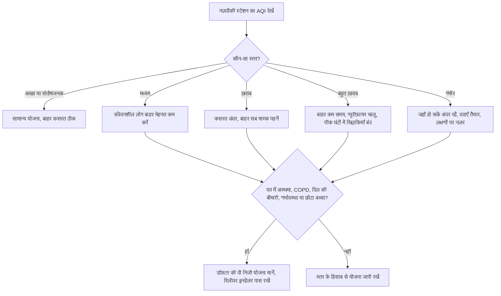

:::answer
वायु प्रदूषण भारत के सबसे बड़े स्वास्थ्य ख़तरों में से है: ग्लोबल बर्डन ऑफ़ डिज़ीज़ के एक विश्लेषण ने 2019 में भारत में लगभग 16.7 लाख मौतों को वायु प्रदूषण से जोड़ा, जो उस साल की सभी मौतों का लगभग 17.8% था। PM2.5 नाम के बेहद महीन कण फेफड़ों की गहराई तक और ख़ून तक पहुँचते हैं और सिर्फ़ साँस ही नहीं, दिल, दिमाग़ और गर्भावस्था पर भी असर डालते हैं। आप अपना जोखिम काफ़ी घटा सकते हैं: हर सुबह AQI देखें, "ख़राब" या उससे बुरे दिन कसरत घर के अंदर या साफ़ घंटों में करें, बुरे दिनों में बाहर अच्छी तरह फ़िट N95 या FFP2 मास्क पहनें, घर की हवा साफ़ रखें (अगरबत्ती और मच्छर कॉइल नहीं, हो सके तो बेडरूम में HEPA प्यूरीफ़ायर), और बच्चों, बुज़ुर्ग माता-पिता और अस्थमा, COPD या दिल के मरीज़ों के लिए लिखी हुई योजना रखें।
:::

## समस्या कितनी बड़ी है

द लैंसेट प्लैनेटरी हेल्थ में छपे इंडिया स्टेट-लेवल डिज़ीज़ बर्डन इनिशिएटिव के अध्ययन के अनुसार 2019 में भारत में 16.7 लाख मौतें वायु प्रदूषण से जुड़ी थीं, यानी देश की सभी मौतों का लगभग 17.8% ([Lancet Planetary Health, 2021](https://pubmed.ncbi.nlm.nih.gov/33357500/))। इनमें बड़ा हिस्सा बाहर के कण-प्रदूषण का था, और बाक़ी घर में ठोस ईंधन जलाने से होने वाले प्रदूषण का। इसी विश्लेषण में दिखा कि 1990 के बाद से घरेलू प्रदूषण से मौत की दर काफ़ी घटी, जबकि बाहर के कण-प्रदूषण से बढ़ी।

एक परिवार के लिए इसका मतलब सीधा है: उत्तर भारत की सर्दियों के कई दिनों में बाहर साँस लेना ही सेहत का जोखिम है, और कुछ दिनों में घर के अंदर भी।

## प्रदूषण शरीर के अंदर क्या करता है

सबसे बड़ा खलनायक PM2.5 है: 2.5 माइक्रोमीटर से छोटे कण, जो इंसानी बाल से लगभग तीस गुना पतले होते हैं। ये गाड़ियों के धुएँ, निर्माण की धूल, कचरा और पराली जलाने, उद्योग, कोयले और घरेलू ईंधन से आते हैं।

इतने छोटे होने की वजह से ये नाक और गले को पार करके फेफड़ों की गहराई तक जाते हैं, और कुछ ख़ून में पहुँच जाते हैं। वहाँ ये ख़ून की नलियों और अंगों में सूजन पैदा करते हैं। इसीलिए प्रदूषण सिर्फ़ खाँसी, अस्थमा के दौरे और COPD से ही नहीं, हार्ट अटैक, स्ट्रोक, फेफड़ों के कैंसर, गर्भावस्था की समस्याओं और बच्चों के फेफड़ों के विकास से भी जुड़ा है।

विश्व स्वास्थ्य संगठन की 2021 की गाइडलाइन PM2.5 के लिए सालाना औसत 5 माइक्रोग्राम प्रति घन मीटर और 24 घंटे का औसत 15 सुझाती है ([WHO, 2021](https://www.who.int/publications/i/item/9789240034228))। कोई ऐसा स्तर पता नहीं जो पूरी तरह हानिरहित हो, इसलिए जोखिम थोड़ा भी घटाना फ़ायदेमंद है।

[[ad]]

## AQI को सही तरह से कैसे पढ़ें

केंद्रीय प्रदूषण नियंत्रण बोर्ड (CPCB) का राष्ट्रीय वायु गुणवत्ता सूचकांक कई प्रदूषकों को 0 से 500 के एक नंबर और छह रंगों वाले स्तरों में बदलता है ([CPCB](https://cpcb.nic.in/)):

| AQI | स्तर | CPCB के अनुसार असर |
|---|---|---|
| 0–50 | अच्छा | बहुत कम असर |
| 51–100 | संतोषजनक | संवेदनशील लोगों को साँस में हल्की परेशानी |
| 101–200 | मध्यम | फेफड़ों और दिल के मरीज़ों, बच्चों और बुज़ुर्गों को साँस में परेशानी |
| 201–300 | ख़राब | लंबे समय तक रहने पर ज़्यादातर लोगों को साँस में परेशानी |
| 301–400 | बहुत ख़राब | लंबे समय तक रहने पर साँस की बीमारी |
| 401–500 | गंभीर | स्वस्थ लोगों पर भी असर, बीमारों पर गंभीर असर |

तीन काम की बातें: शहर के औसत की जगह अपने नज़दीकी स्टेशन का AQI देखें; दिन भर का रुझान देखें, क्योंकि सर्दियों में रात और सुबह-सुबह ठंडी, रुकी हवा में प्रदूषण अक्सर सबसे ज़्यादा होता है और दोपहर तक कुछ कम हो सकता है; और अपना "ट्रिगर" स्तर तय करें। स्वस्थ वयस्क के लिए "ख़राब" योजना बदलने का स्तर हो सकता है, पर अस्थमा वाले बच्चे या दिल के मरीज़ माता-पिता के लिए "मध्यम" ही काफ़ी है।

दिल्ली-NCR में वायु गुणवत्ता प्रबंधन आयोग का ग्रेडेड रिस्पॉन्स एक्शन प्लान AQI बढ़ने पर निर्माण, कुछ गाड़ियों आदि पर पाबंदियाँ लगाता है ([CAQM](https://caqm.nic.in/))। वे शहर के स्तर के उपाय हैं; यह गाइड इस बारे में है कि आप घर पर क्या कर सकते हैं।

## परिवार का AQI एक्शन प्लान

इसे लिखकर फ़्रिज पर चिपका दें। धुंध भरी सुबह जल्दबाज़ी में फ़ैसला लेने से पहले से बनी योजना मानना कहीं आसान है।

**किन्हें ज़्यादा सख़्त योजना चाहिए:** बच्चे (तेज़ साँस लेते हैं और फेफड़े अभी बन रहे हैं), बुज़ुर्ग, गर्भवती महिलाएँ, अस्थमा, COPD, दिल की बीमारी, डायबिटीज़ या पहले स्ट्रोक वाले लोग, और बाहर काम करने वाले जैसे ट्रैफ़िक पुलिस, डिलीवरी राइडर, निर्माण मज़दूर और रेहड़ी वाले। इनके लिए डॉक्टर से लिखी योजना लें: कौन-से लक्षण देखें, रिलीवर इनहेलर कब लें, और मदद कब लें।

[[ad]]

## मास्क: कौन-से काम करते हैं और कैसे पहनें

कपड़े के मास्क और ढीले सर्जिकल मास्क PM2.5 के ख़िलाफ़ बहुत कम मदद करते हैं, क्योंकि कण बहुत छोटे हैं और किनारों से हवा अंदर आ जाती है। बुरे दिनों में बाहर काम आते हैं N95 (अमेरिकी मानक) या FFP2 (यूरोपीय मानक) रेस्पिरेटर, जो सही फ़िट होने पर कम से कम 95% (N95) या लगभग 94% (FFP2) महीन कण रोकने के लिए बने हैं।

ब्रांड से ज़्यादा फ़िट मायने रखता है: नाक के आसपास और ठुड्डी के नीचे पूरी तरह सील हो। चश्मा धुंधला हो रहा है तो ऊपर से हवा निकल रही है, नाक की धातु की पट्टी को अच्छे से दबाएँ। गीला, गंदा या फटा होने पर या साँस लेना मुश्किल लगे तो बदल दें। छोटे बच्चों (ख़ासकर शिशुओं) पर टाइट मास्क ठीक से फ़िट नहीं होते और असुरक्षित हो सकते हैं, और दिल या फेफड़ों की गंभीर बीमारी वाले पहले डॉक्टर से पूछें।

## घर की हवा: जहाँ हमारे ज़्यादातर घंटे बीतते हैं

**अंदर के स्रोत हटाएँ:** अगरबत्ती, धूप और मच्छर कॉइल धुआँ और महीन कण छोड़ते हैं; मच्छरों के लिए बिजली वाले विकल्प लें और अगरबत्ती कम समय, हवादार जगह पर जलाएँ। तेज़ आँच पर तलने और तड़के से कण निकलते हैं, इसलिए हर बार चिमनी या एग्ज़ॉस्ट चलाएँ और तलते समय रसोई का दरवाज़ा बंद रखें। घर में कभी धूम्रपान न हो। लकड़ी, उपले, कोयला या केरोसिन की जगह LPG या बिजली से खाना पकाना कहीं साफ़ है। सूखी झाड़ू की बजाय पोंछा ज़्यादा लगाएँ।

**आने वाली हवा छानें:** कमरे के आकार के हिसाब से HEPA प्यूरीफ़ायर (CADR देखें) बंद कमरे में PM2.5 काफ़ी घटा सकता है; प्रदूषण के दिनों में लगातार चलाएँ और उस कमरे के दरवाज़े-खिड़कियाँ बंद रखें। सबसे पहले बेडरूम, क्योंकि ज़िंदगी का एक-तिहाई हिस्सा सोने में जाता है। फ़िल्टर कंपनी के बताए समय पर बदलें। जब बाहर हवा बेहतर हो, अक्सर सर्दियों की दोपहर में, थोड़ी देर के लिए घर हवादार करें। घर के पौधे अच्छे लगते हैं, पर घर में रखे जा सकने वाले पौधे हवा को कोई ख़ास साफ़ नहीं करते।

:::tip प्रदूषण के मौसम के कम ख़र्च वाले टिप्स
- मौसम की तरह AQI देखना भी सुबह की आदत बनाएँ।
- N95 या FFP2 मास्क दरवाज़े के पास, गाड़ी में और ऑफ़िस बैग में रखें।
- सुबह-सुबह और देर रात के पीक में खिड़कियाँ बंद रखें; दोपहर में AQI कम हो तो थोड़ी देर हवा आने दें।
- कार में धुंध वाले दिनों में खिड़कियाँ बंद और AC रीसर्कुलेट पर रखें।
- दोपहिया या ऑटो में सफ़र करते हैं तो अच्छी फ़िटिंग वाला मास्क सबसे ज़्यादा फ़र्क़ डालता है।
- पत्ते, कचरा या पटाखे न जलाएँ; आपका अपना परिवार उसे सबसे पहले साँस में लेता है।
- कोई खाना या पेय प्रदूषण को "डिटॉक्स" नहीं करता; अच्छा खाना शरीर को सहारा देता है, पर बचाव जोखिम घटाने से ही होता है।
:::

## कसरत और प्रदूषण: कब, कहाँ और कितनी

कसरत में साँस तेज़ और गहरी होती है, इसलिए हर मिनट ज़्यादा हवा और ज़्यादा प्रदूषक अंदर जाते हैं। इसका मतलब कसरत छोड़ना नहीं है, क्योंकि निष्क्रियता भी नुकसान करती है। मतलब है समझदारी से समय और जगह चुनना। अच्छे से मध्यम दिनों में स्वस्थ वयस्कों के लिए बाहर कसरत आमतौर पर ठीक है; सड़क किनारे की बजाय पार्क चुनें। ख़राब दिनों में ज़ोरदार कसरत अंदर करें; सैर ठीक है, मुख्य सड़क पर 10 किमी की तेज़ दौड़ नहीं। बहुत ख़राब या गंभीर दिनों में कसरत अंदर, हो सके तो साफ़ हवा वाली जगह पर, और मध्यम रफ़्तार से। किसी भी AQI पर ट्रैफ़िक के बग़ल में कसरत न करें। सीने में जकड़न, सीटी जैसी साँस, असामान्य रूप से साँस फूलना या धड़कन तेज़ हो तो रुक जाएँ। अस्थमा वालों को डॉक्टर कसरत से पहले रिलीवर इनहेलर की सलाह दे सकते हैं; अपनी योजना मानें।

प्रदूषण की वजह से अपनी दवाएँ ख़ुद कभी न बदलें। सर्दियों में लक्षण बढ़ें तो यह डॉक्टर को दिखाने की वजह है, ख़ुद डोज़ बढ़ाने की नहीं।

:::warning तुरंत डॉक्टर के पास या अस्पताल जाएँ अगर
- आपको या बच्चे को आराम में भी साँस फूले, या तेज़ साँस के साथ पसलियाँ अंदर खिंचें
- होंठ या उँगलियों के सिरे नीले या स्लेटी दिखें
- रिलीवर इनहेलर काम न करे, या सामान्य से बहुत ज़्यादा बार लेना पड़े
- सीने में दर्द, दबाव या तेज़ धड़कन हो, ख़ासकर दिल के मरीज़ हों तो
- बच्चा असामान्य रूप से सुस्त हो, पूरे वाक्य न बोल पाए या दूध न पी पाए
- बुज़ुर्ग अचानक उलझन में हों या बहुत कमज़ोर हो जाएँ
- खाँसी में ख़ून आए
:::

[[ad]]

## मिथक और सच

:::mythfact
| मिथक | सच |
|---|---|
| "कपड़े का मास्क या रुमाल काफ़ी है।" | कपड़े और ढीले मास्क ज़्यादातर महीन कण अंदर जाने देते हैं। बाहर अच्छी फ़िटिंग वाला N95 या FFP2 कहीं बेहतर है। |
| "घर के अंदर हम सुरक्षित हैं।" | बाहर का PM2.5 अंदर आता है, और अगरबत्ती, कॉइल, खाना पकाने का धुआँ और धूम्रपान उसे और बढ़ाते हैं। अंदर की हवा भी साफ़ करें। |
| "सुबह की सैर हमेशा सबसे सेहतमंद।" | उत्तर भारत की सर्दियों में सुबह-सुबह प्रदूषण सबसे ज़्यादा हो सकता है। AQI देखकर समय बदलें। |
| "पौधे घर की हवा साफ़ कर देंगे।" | घर में रखे जा सकने वाले पौधे हवा को कोई ख़ास साफ़ नहीं करते। सही आकार का HEPA प्यूरीफ़ायर करता है। |
| "गुड़ या ख़ास ड्रिंक प्रदूषण डिटॉक्स करते हैं।" | कोई खाना या पेय साँस में गए कणों को बाहर नहीं निकालता। बचाव जोखिम घटाने से होता है। |
:::

## अक्सर पूछे जाने वाले सवाल

:::faq
### बाहर कसरत के लिए कौन-सा AQI सुरक्षित है?
स्वस्थ वयस्कों के लिए अच्छे और संतोषजनक दिन आमतौर पर ठीक हैं, और मध्यम दिनों में छोटी या हल्की कसरत आमतौर पर ठीक रहती है। AQI ख़राब या उससे बुरा हो तो ज़ोरदार कसरत अंदर करें। अस्थमा, दिल की बीमारी वाले लोग और बच्चे ज़्यादा सावधानी रखें और डॉक्टर की सलाह मानें।

### क्या N95 मास्क सच में PM2.5 रोकते हैं?
हाँ, अगर अच्छी तरह फ़िट हों। N95 और FFP2 ज़्यादातर महीन कण रोकने के लिए बने हैं। नाक और ठुड्डी के पास से रिसाव सुरक्षा बहुत घटा देता है, इसलिए फ़िट उतना ही ज़रूरी है जितना मास्क।

### क्या एयर प्यूरीफ़ायर पैसे के लायक़ है?
कमरे के आकार का HEPA प्यूरीफ़ायर, दरवाज़े-खिड़कियाँ बंद रखने पर, अंदर का PM2.5 काफ़ी घटा सकता है। ख़र्च उठा सकें तो बेडरूम से शुरुआत सबसे फ़ायदेमंद है।

### क्या गर्भावस्था में प्रदूषण नुकसान करता है?
वायु प्रदूषण को गर्भावस्था की समस्याओं से जोड़ा गया है, जिनमें बच्चे की बढ़त पर असर भी शामिल है। गर्भवती महिलाएँ जहाँ हो सके जोखिम घटाएँ, अंदर साफ़ हवा रखें, बुरे दिनों में बाहर अच्छा मास्क पहनें, और चिंता हो तो डॉक्टर से बात करें।

### क्या गंभीर AQI वाले दिन बच्चों को स्कूल भेजें?
यह स्कूल और सरकार की एडवाइज़री पर निर्भर है, जो सबसे बुरे दिनों में अक्सर स्कूल बंद या ऑनलाइन कर देती है। घर पर बच्चों को साफ़ हवा वाले कमरे में रखें, बाहर खेलना कम करें, और साँस के लक्षणों पर नज़र रखें, ख़ासकर अस्थमा हो तो।
:::

## आख़िरी बात

शहर की हवा आप अकेले ठीक नहीं कर सकते, पर अपने परिवार का जोखिम काफ़ी घटा सकते हैं। AQI देखें, बुरे दिनों में योजना बदलें, बाहर अच्छा मास्क पहनें, जहाँ सोते हैं वहाँ की हवा साफ़ रखें, घर का धुआँ हटाएँ, और सबसे ज़्यादा जोखिम वाले लोगों को सबसे पहले बचाएँ।

बाहर हवा ख़राब हो तो ट्रेनिंग रुकनी ज़रूरी नहीं। सेक्टर 93, नोएडा का रॉयल फ़िटनेस क्लब एक इनडोर जगह है जहाँ आप धुंध के मौसम में भी अपनी दिनचर्या जारी रख सकते हैं; देखने के लिए एक फ़्री ट्रायल सेशन बुक करें।
