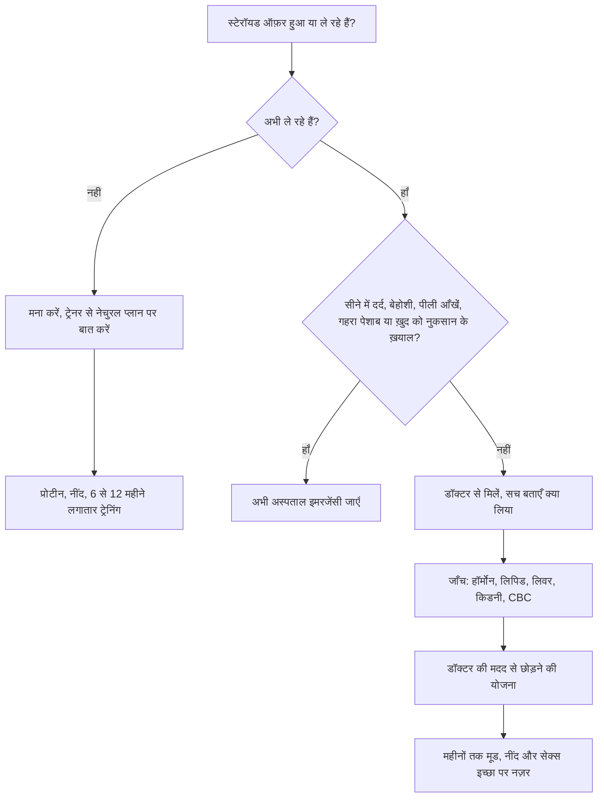

:::answer
एनाबॉलिक स्टेरॉयड टेस्टोस्टेरॉन हॉर्मोन के लैब में बने रूप हैं। डॉक्टर टेस्टोस्टेरॉन सिर्फ़ उन गिने-चुने पुरुषों को देते हैं जिनमें जाँच से हॉर्मोन की असली कमी साबित हो। जिम में बिना डॉक्टर के मसल के लिए लेने पर ये दिल की पंप करने की ताक़त घटा सकते हैं, नसों में प्लाक जल्दी बढ़ा सकते हैं, अंडकोष (टेस्टिकल) सिकोड़ सकते हैं, छोड़ने के बाद सालों तक अपना टेस्टोस्टेरॉन कम रख सकते हैं, और मूड बदल सकते हैं। ऊपर से नक़ली और मिलावटी माल का ख़तरा अलग। अगर आप इस्तेमाल कर चुके हैं, तो सबसे सुरक्षित क़दम है डॉक्टर से खुलकर बात करना। छोड़ना मुमकिन है, और मदद मिलती है।
:::

यह लेख जिम जाने वाले उस नौजवान के लिए है जिसे किसी दोस्त, ट्रेनर या इंस्टाग्राम सेलर ने "बस एक छोटा कोर्स" ऑफ़र किया है। यह माँ-बाप, पार्टनर और उन लोगों के लिए भी है जो पहले ही इस्तेमाल कर चुके हैं। हम स्टेरॉयड लेने का तरीक़ा, डोज़ या कहाँ से मिलेगा, यह नहीं बताएँगे। हम बताएँगे कि रिसर्च असल में क्या कहती है, ताकि आप सही जानकारी के साथ फ़ैसला करें।

## एनाबॉलिक स्टेरॉयड क्या हैं, और इनकी सही जगह कहाँ है

"एनाबॉलिक" का मतलब है शरीर के टिशू, जैसे मसल, बनाना। "एंड्रोजेनिक" का मतलब है मर्दाना लक्षण, जैसे शरीर के बाल और भारी आवाज़। ये दोनों असर साथ-साथ आते हैं, एक को दूसरे से अलग नहीं किया जा सकता।

ये प्रेडनिसोलोन जैसे कॉर्टिकोस्टेरॉयड से अलग हैं, जो डॉक्टर अस्थमा, गठिया या एलर्जी में देते हैं। घरों में उन्हें भी "स्टेरॉयड" कहा जाता है, इसलिए उलझन होती है। यह लेख सिर्फ़ मसल बनाने वाले स्टेरॉयड के बारे में है।

टेस्टोस्टेरॉन का असली मेडिकल इस्तेमाल है हाइपोगोनाडिज़्म, यानी जब शरीर ख़ुद पर्याप्त टेस्टोस्टेरॉन न बनाए। एंडोक्राइन सोसाइटी की गाइडलाइन कहती है कि यह पहचान तभी हो जब कमी के लक्षण हों और सुबह ख़ाली पेट की जाँच दोहराने पर भी टेस्टोस्टेरॉन साफ़ तौर पर कम आए ([Bhasin et al., JCEM 2018](https://pubmed.ncbi.nlm.nih.gov/29562364/))। जो पुरुष जल्दी बच्चा प्लान कर रहे हैं, उनमें गाइडलाइन टेस्टोस्टेरॉन शुरू न करने की सलाह देती है। इलाज का मक़सद लेवल को सामान्य तक लाना होता है, और नियमित ख़ून की जाँच होती है।

जिम वाला इस्तेमाल बिल्कुल अलग है। लोग शरीर के बनाए से कहीं ज़्यादा मात्रा लेते हैं, कई दवाएँ मिलाते हैं, और जाँच कोई नहीं करवाता। एंडोक्राइन सोसाइटी के वैज्ञानिक बयान के अनुसार ज़्यादातर इस्तेमाल करने वाले बड़े खिलाड़ी नहीं, आम जिम जाने वाले लोग हैं, और बहुत से लोग ग़लती से इन्हें सुरक्षित मानते हैं ([Pope et al., Endocrine Reviews 2014](https://pubmed.ncbi.nlm.nih.gov/24423981/))।

दुनिया भर के अध्ययनों के एक विश्लेषण में अनुमान लगा कि लगभग 6.4% पुरुषों और 1.6% महिलाओं ने कभी न कभी एनाबॉलिक स्टेरॉयड लिए हैं ([Sagoe et al., 2014](https://pubmed.ncbi.nlm.nih.gov/24582699/))। भारत के जिम जाने वालों पर ऐसा कोई अच्छा राष्ट्रीय सर्वे अभी नहीं है। पर कार्रवाई बढ़ रही है: अक्टूबर 2025 में तेलंगाना के ड्रग रेगुलेटर ने हैदराबाद के 20 जिमों की जाँच की, क्योंकि ख़बर थी कि जिम सदस्यों को स्टेरॉयड और दिल को उत्तेजित करने वाले इंजेक्शन बेच रहे थे ([Medical Dialogues, 2025](https://medicaldialogues.in/amp/news/industry/pharma/telangana-issues-advisory-to-retail-wholesale-medical-shops-amid-prescription-medicines-misuse-in-gyms-157521))।

## दिल: वह नुकसान जो आईने में नहीं दिखता

*Circulation* जर्नल में छपे एक अध्ययन में 86 अनुभवी वेटलिफ़्टरों की, जिन्होंने कुल मिलाकर कम से कम दो साल स्टेरॉयड लिए थे, तुलना 54 ऐसे वेटलिफ़्टरों से की गई जिन्होंने कभी नहीं लिए ([Baggish et al., Circulation 2017](https://pubmed.ncbi.nlm.nih.gov/28533317/)):

- **पंपिंग कमज़ोर।** दिल हर धड़कन में कितना ख़ून बाहर फेंकता है (इजेक्शन फ़्रैक्शन), वह स्टेरॉयड लेने वालों में औसतन 52% और न लेने वालों में 63% था। अभी ले रहे लोगों में 49% और छोड़ चुके लोगों में 58%।
- **आराम में भी दिक़्क़त।** धड़कनों के बीच दिल ठीक से ढीला नहीं हो रहा था।
- **नसों में ज़्यादा प्लाक।** दिल को ख़ून देने वाली नसों में प्लाक ज़्यादा था, और जितने ज़्यादा साल इस्तेमाल, उतना ज़्यादा प्लाक।

इनमें से कई लोग बाहर से मज़बूत और फ़िट दिखते थे। स्कैन कुछ और कह रहे थे। NHS हार्ट अटैक, स्ट्रोक, हाई BP, हाई कोलेस्ट्रॉल और ख़ून के थक्कों को भी स्टेरॉयड के ज्ञात असर में गिनता है ([NHS](https://www.nhs.uk/conditions/anabolic-steroid-misuse/))।

डेनमार्क के एक अध्ययन में फ़िटनेस सेंटरों की डोप जाँच में पकड़े गए 545 पुरुषों की तुलना उसी उम्र के 5,450 पुरुषों से की गई। स्टेरॉयड वालों में मौत की दर लगभग तीन गुना थी, और वे अस्पताल भी दोगुने से ज़्यादा बार गए ([Horwitz et al., 2019](https://pubmed.ncbi.nlm.nih.gov/30460728/))। ऐसा अध्ययन यह साबित नहीं करता कि हर अतिरिक्त मौत सिर्फ़ स्टेरॉयड से हुई, पर यह दिल वाले नतीजों से मेल खाता है।

## लिवर और किडनी

मुँह से ली जाने वाली स्टेरॉयड गोलियाँ इस तरह बदली जाती हैं कि लिवर उन्हें तुरंत न तोड़ पाए। यही बदलाव लिवर पर भारी पड़ता है। एंडोक्राइन सोसाइटी पित्त रुकने (जिससे पीलिया होता है) और कभी-कभी लिवर ट्यूमर जैसे नुकसान गिनाती है ([Pope et al., 2014](https://pubmed.ncbi.nlm.nih.gov/24423981/))। NHS लिवर और किडनी के नुकसान या फ़ेल होने का ज़िक्र करता है। ऊपर से बहुत ज़्यादा प्रोटीन, प्री-वर्कआउट और दर्द की गोलियाँ साथ में लेने से बोझ और बढ़ता है।

## हॉर्मोन और फ़र्टिलिटी: जिस पर नौजवान बाद में पछताते हैं

आपका दिमाग़ और अंडकोष मिलकर टेस्टोस्टेरॉन का लेवल संभालते हैं। बाहर से ज़्यादा हॉर्मोन डालने पर दिमाग़ को लगता है कि बहुत है, और वह अपना सिग्नल बंद कर देता है। अंडकोष को निर्देश नहीं मिलता, वे सिकुड़ने लगते हैं और स्पर्म बनना घट जाता है।

NHS स्पर्म कम होना, बाँझपन, अंडकोष सिकुड़ना, इरेक्शन की दिक़्क़त, बाल झड़ना और पुरुषों में छाती का उभार गिनाता है। डेनमार्क वाले अध्ययन में मुहाँसे, छाती का उभार (गाइनेकोमैस्टिया) और इरेक्शन की दिक़्क़त, हर एक 10% से ज़्यादा इस्तेमाल करने वालों में मिली ([Horwitz et al., 2019](https://pubmed.ncbi.nlm.nih.gov/30460728/))।

### छोड़ने के बाद क्या होता है

बहुत से लोग मानते हैं कि कुछ हफ़्तों में सब ठीक हो जाता है। हर किसी के साथ ऐसा नहीं होता। डेनमार्क के एक और अध्ययन में 33 पुराने इस्तेमाल करने वालों को, औसतन ढाई साल बाद, जाँचा गया। उनका मीडियन टेस्टोस्टेरॉन 14.4 nmol/L था, जबकि कभी न लेने वालों में 18.8। लगभग 27% पुराने यूज़र सामान्य की निचली सीमा से नीचे थे, जबकि न लेने वालों में कोई नहीं। पुराने यूज़र में 40% ने कम सेक्स इच्छा, 27% ने इरेक्शन की दिक़्क़त और 24% ने डिप्रेशन के लक्षण बताए ([Rasmussen et al., PLoS One 2016](https://pubmed.ncbi.nlm.nih.gov/27532478/))।

थकान, उदासी और कमज़ोरी की यही हालत बहुत लोगों को दोबारा शुरू करने पर मजबूर करती है। यह जाल है, और डॉक्टर इससे निकलने में मदद कर सकते हैं।

## त्वचा, बाल और दिखावट

पीठ, छाती और कंधों पर तेज़ मुहाँसे और निशान; जिनके परिवार में गंजापन है उनके बाल जल्दी झड़ना; पुरुषों में छाती का उभार जो कभी-कभी स्थायी हो जाता है और सर्जरी तक जाता है; तेज़ी से मसल बढ़ने से स्ट्रेच मार्क; और पानी रुकने से चेहरा फूला-फूला।

## दिमाग़: मूड, ग़ुस्सा और लत

NHS ग़ुस्सा, मूड का बार-बार बदलना, शक (पैरानॉया), मेनिक व्यवहार और कुछ मामलों में भ्रम या ऐसी चीज़ें दिखना-सुनना जो हैं नहीं, गिनाता है ([NHS](https://www.nhs.uk/conditions/anabolic-steroid-misuse/))। हर कोई ग़ुस्सैल नहीं होता, लोगों में फ़र्क़ बहुत है, और "रॉयड रेज" पर रिसर्च मिली-जुली है। पर आसपास के लोग अक्सर बदलाव पहले देख लेते हैं: छोटी बात पर भड़कना, जलन, जोखिम वाले फ़ैसले, ख़राब नींद।

स्टेरॉयड की लत भी लग सकती है: तलब, उतने ही असर के लिए ज़्यादा की ज़रूरत, और साइड इफ़ेक्ट के बावजूद जारी रखना। कुछ पुरुषों को लगता है कि वे कभी "काफ़ी बड़े" नहीं हैं। अचानक छोड़ने पर उदासी, थकान, नींद न आना, भूख और सेक्स इच्छा कम होना और बदन दर्द हो सकता है। छोड़ने के बाद का डिप्रेशन असली है। ख़ुद को नुकसान पहुँचाने के ख़याल आएँ तो इसे इमरजेंसी मानें। हमारे [मानसिक सेहत पेज](/health/mental-wellness) पर मदद के रास्ते हैं।

## महिलाएँ और स्टेरॉयड

NHS चेहरे और शरीर पर ज़्यादा बाल, भारी आवाज़, क्लिटोरिस का बढ़ना, ब्रेस्ट छोटे होना, पीरियड की गड़बड़ी, बाल झड़ना और तेज़ मुहाँसे गिनाता है। भारी आवाज़ और क्लिटोरिस के बदलाव छोड़ने के बाद भी शायद वापस न हों। गर्भावस्था में स्टेरॉयड ख़तरनाक हैं।

## इंजेक्शन का ख़तरा और नक़ली माल

**इन्फ़ेक्शन।** सुई या शीशी शेयर करने से हेपेटाइटिस B, हेपेटाइटिस C और HIV फैल सकते हैं, और इंजेक्शन से नसें ख़राब होकर घाव या फोड़े बन सकते हैं ([NHS](https://www.nhs.uk/conditions/anabolic-steroid-misuse/))। अगर आपने कभी इंजेक्शन लिया है, तो डॉक्टर से इन तीनों की जाँच करवाएँ। ये आसान ख़ून की जाँचें हैं।

**नक़ली माल।** 2022 की एक समीक्षा में 19 अध्ययनों के ब्लैक मार्केट स्टेरॉयड सैंपल की लैब जाँच जोड़ी गई। औसतन लगभग 36% नक़ली निकले (ग़लत दवा, कोई दवा नहीं, या कुछ और मिला हुआ), और 37% और घटिया क्वालिटी के थे ([Magnolini et al., 2022](https://pubmed.ncbi.nlm.nih.gov/35842594/))। यानी बहुत से लोगों को पता ही नहीं कि वे शरीर में क्या डाल रहे हैं।

## डोप टेस्ट, NADA और भारत का क़ानून

अगर आप किसी फ़ेडरेशन के तहत खेलते हैं, तो आपका टेस्ट हो सकता है। WADA की प्रतिबंधित सूची में एनाबॉलिक एजेंट हर समय, मुक़ाबले के अंदर और बाहर, बैन हैं। WADA की 2024 टेस्टिंग रिपोर्ट में भारत के 7,113 टेस्ट में से 260 पॉज़िटिव आए, यानी 3.6%, जो बड़ी संख्या में टेस्ट करने वाले देशों में सबसे ज़्यादा था। पिछले साल यह 3.8% था ([Outlook India, दिसंबर 2025](https://www.outlookindia.com/sports/others/india-highest-doping-positivity-rate-wada-2024-testing-report))।

भारत में टेस्टोस्टेरॉन और दूसरे एनाबॉलिक स्टेरॉयड ड्रग्स एंड कॉस्मेटिक्स एक्ट, 1940 और उसके नियमों के तहत पर्चे वाली दवाएँ हैं। केमिस्ट इन्हें सिर्फ़ रजिस्टर्ड डॉक्टर के पर्चे पर बेच सकते हैं और रिकॉर्ड रखना होता है। तेलंगाना के ड्रग रेगुलेटर ने 2025 में कहा कि बॉडीबिल्डिंग के लिए इन्हें बेचना नियमों का उल्लंघन है, और लाइसेंस रद्द करने व मुक़दमे की चेतावनी दी ([Medical Dialogues, 2025](https://medicaldialogues.in/amp/news/industry/pharma/telangana-issues-advisory-to-retail-wholesale-medical-shops-amid-prescription-medicines-misuse-in-gyms-157521))। इसे आम जानकारी मानें, क़ानूनी सलाह नहीं।

:::tip डॉक्टर से खुलकर कैसे बात करें
- सीधे कहें: "मैंने जिम के लिए स्टेरॉयड लिए हैं।" डॉक्टर यह जितना आप सोचते हैं उससे ज़्यादा सुनते हैं।
- शीशी, स्ट्रिप या लेबल की फ़ोटो ले जाएँ, भले नक़ली होने का शक हो। लिखें कि लगभग कितने समय लिया और आख़िरी बार कब।
- बाक़ी सब भी बताएँ: प्री-वर्कआउट, फ़ैट बर्नर, दर्द की गोली, सेलर से ली कोई भी चीज़।
- बुनियादी जाँचें माँगें: BP, लिपिड प्रोफ़ाइल, लिवर और किडनी टेस्ट, CBC (हीमोग्लोबिन, हीमैटोक्रिट) और हॉर्मोन टेस्ट।
- भविष्य में बच्चे चाहते हैं तो फ़र्टिलिटी पर जल्दी बात करें।
- मूड, नींद और सेक्स इच्छा के बारे में बताएँ। ये मेडिकल लक्षण हैं, कमज़ोरी नहीं।
- छोड़ने के लिए एंडोक्राइनोलॉजिस्ट (हॉर्मोन विशेषज्ञ) अक्सर सही डॉक्टर हैं; लंबे इस्तेमाल के बाद कार्डियोलॉजिस्ट से दिल की जाँच करवाएँ।
:::

## स्टेरॉयड सुरक्षित तरीक़े से छोड़ना

छोड़ना सही लक्ष्य है, पर अकेले न करें। डॉक्टर हॉर्मोन, दिल और लिवर पर नज़र रख सकते हैं और उदासी या कम टेस्टोस्टेरॉन के लक्षणों का सही इलाज कर सकते हैं। फ़ोरम या ट्रेनर के "पोस्ट-साइकिल" प्लान न अपनाएँ; इनमें बिना निगरानी और पर्चे वाली दवाएँ होती हैं। कुछ महीने मुश्किल हो सकते हैं: ताक़त और साइज़ थोड़ा घटेगा, मूड गिर सकता है। ट्रेनिंग जारी रखें, ठीक खाएँ, सात से नौ घंटे सोएँ, और डॉक्टर के संपर्क में रहें। जो लोग दोबारा शुरू करने का दबाव डालें, उनसे कुछ समय दूरी रखें।

:::warning तुरंत डॉक्टर के पास या अस्पताल जाएँ अगर
- सीने में दर्द, दबाव या जकड़न हो, ख़ासकर ट्रेनिंग के दौरान
- बेहोशी आए या आने जैसी लगे, या दिल बहुत तेज़ या रुक-रुक कर धड़के
- आँखें या त्वचा पीली हों, पेशाब गहरा हो, या दाईं पसलियों के नीचे दर्द हो
- एक पैर सूजकर दर्द और गर्मी के साथ लाल हो, या अचानक साँस फूले
- अचानक तेज़ सिरदर्द, एक तरफ़ कमज़ोरी या बोलने में दिक़्क़त हो
- इंजेक्शन की जगह गर्म, लाल, सूजी हो या मवाद निकले, या बुख़ार आए
- बहुत उदासी, नाउम्मीदी या ख़ुद को या किसी और को नुकसान पहुँचाने के ख़याल आएँ
:::

## जिम में सुनी जाने वाली बातें और सच

:::mythfact
| मिथक | सच |
|---|---|
| "जवानी में छोटा कोर्स सेफ़ है।" | स्वस्थ दिखने वाले अनुभवी यूज़र में भी दिल की पंपिंग कमज़ोर और नसों में प्लाक ज़्यादा मिला, और ज़्यादा साल मतलब ज़्यादा प्लाक। |
| "अपना टेस्टोस्टेरॉन कुछ हफ़्तों में लौट आता है।" | एक अध्ययन में लगभग 27% पुराने यूज़र में छोड़ने के औसतन ढाई साल बाद भी टेस्टोस्टेरॉन कम था। |
| "इंस्टाग्राम का हर बड़ा बंदा नेचुरल है।" | बहुत से नहीं हैं। फ़ोटो से पता नहीं चलता, और उनसे तुलना जोखिम की ओर ले जाती है। |
| "जिम वाला माल फ़ार्मेसी जैसा असली है।" | लैब जाँच में ब्लैक मार्केट के लगभग 36% स्टेरॉयड नक़ली और 37% और घटिया निकले। |
| "सिर्फ़ इंजेक्शन ख़तरनाक हैं, गोली हल्की है।" | गोलियाँ लिवर पर ख़ास तौर पर भारी हैं। दोनों रूप दिल, हॉर्मोन और मूड पर असर डालते हैं। |
| "नेचुरल बनाम स्टेरॉयड बस साइज़ की बात है।" | बात आपके दिल, फ़र्टिलिटी, मूड और आगे की सेहत की है, सिर्फ़ आईने की नहीं। |
:::

## नेचुरल ट्रेनिंग से क्या हो सकता है

ट्रेनिंग के शुरुआती सालों में नेचुरल तरक़्क़ी आमतौर पर सबसे तेज़ होती है, और उसी समय बहुत से लोग बेसब्री में स्टेरॉयड की ओर जाते हैं। सही प्रोग्राम, दाल, पनीर, अंडे, चिकन या सोया से पर्याप्त प्रोटीन, सात से नौ घंटे की नींद और धैर्य से पहले साल में अच्छी तरक़्क़ी मुमकिन है।

## अक्सर पूछे जाने वाले सवाल

:::faq
### क्या डॉक्टर वाला टेस्टोस्टेरॉन और जिम वाले स्टेरॉयड एक ही हैं?
हॉर्मोन एक ही तरह का है, पर मक़सद और मात्रा अलग। डॉक्टर बार-बार जाँच से कमी पक्की करके, सामान्य लेवल तक लाने के लिए और निगरानी के साथ देते हैं। जिम में लेवल सामान्य से बहुत ऊपर बिना निगरानी के जाता है, ज़्यादातर नुकसान वहीं से होता है।

### मैंने कुछ हफ़्ते लिए थे, क्या मुझे नुकसान हो गया?
ज़रूरी नहीं। बहुत से कम समय वाले यूज़र अच्छी तरह ठीक हो जाते हैं। पर बिना जाँच के पता नहीं चलेगा। डॉक्टर को सच बताएँ और दिल, लिवर, लिपिड और हॉर्मोन की बुनियादी जाँच करवाएँ।

### क्या अंडकोष फिर सामान्य हो जाएँगे?
छोड़ने के बाद बहुत से पुरुषों में कुछ सुधार होता है, पर महीनों लग सकते हैं, और एक अध्ययन में लगभग एक-चौथाई पुराने यूज़र में सालों बाद भी टेस्टोस्टेरॉन कम था। डॉक्टर हॉर्मोन और स्पर्म की जाँच से सही स्थिति बता सकते हैं।

### क्या SARMs सुरक्षित और क़ानूनी विकल्प हैं?
नहीं। SARMs प्रयोग वाली दवाएँ हैं जिन्हें इंसानों के लिए मंज़ूरी नहीं मिली, ये भी अपना टेस्टोस्टेरॉन दबाती हैं, और लिवर को नुकसान के मामले सामने आए हैं। हमारा [SARMs वाला लेख](/health/blog/sarms-spiked-gym-supplements-india) पढ़ें।

### मेरा दोस्त स्टेरॉयड लेता है और चिड़चिड़ा व उदास रहने लगा है, क्या करूँ?
जब वह शांत हो तब आराम से बात करें, जो देखा वह बताएँ, और डॉक्टर के पास जाने को कहें। भाषण न दें। अगर वह ख़ुद को या किसी और को नुकसान की बात करे, तो तुरंत मदद लें और उसे अकेला न छोड़ें।
:::

## आख़िरी बात

एनाबॉलिक स्टेरॉयड जल्दी मसल बना सकते हैं, पर दिल कमज़ोर कर सकते हैं, अपने हॉर्मोन बंद कर सकते हैं, लिवर को नुकसान पहुँचा सकते हैं और मन बदल सकते हैं, अक्सर बिना चेतावनी के। नक़ली माल ख़तरा और बढ़ाता है। मन ललचाए, तो पहले एक साल और नेचुरल ट्रेनिंग करें। इस्तेमाल कर चुके हैं, तो डॉक्टर से मिलें और पूरा सच बताएँ।

हमने इस पर अपने YouTube चैनल [Royal Fitness TV](https://www.youtube.com/@RoyalFitnessTV?sub_confirmation=1) पर एक छोटा हिंग्लिश वीडियो भी बनाया है।

सेक्टर 93, नोएडा के रॉयल फ़िटनेस क्लब के ट्रेनर सिर्फ़ नेचुरल ट्रेनिंग सिखाते हैं और बिना दवा के काम करने वाला प्लान बनाने में ख़ुशी से मदद करेंगे।
