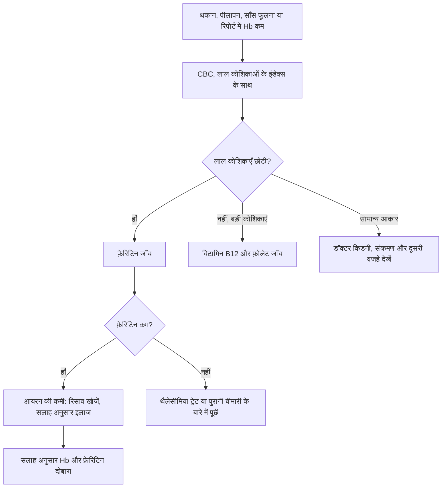

:::answer
भारत में एनीमिया बहुत आम है: NFHS-5 (2019–21) में 15–49 साल की 57% महिलाएँ और 6–59 महीने के 67.1% बच्चे एनीमिक पाए गए। आयरन की गोली तब बहुत अच्छा काम करती है जब कमी सच में आयरन की हो, गोली सही तरीक़े से ली जाए, और आयरन जिस रास्ते से निकल रहा है वह रास्ता बंद किया जाए। गोली "फ़ेल" तब होती है जब इनमें से कोई एक बात छूट जाए: कमी असल में B12, फ़ोलेट, थैलेसीमिया ट्रेट या किसी पुरानी बीमारी से हो; गोली चाय या कैल्शियम के साथ ली जाए; Hb ठीक दिखते ही गोली बंद कर दी जाए; या भारी पीरियड, बवासीर, पेट के कीड़े या अल्सर से ख़ून निकलता रहे। सही जाँच और कुछ आदतें बदलकर ज़्यादातर मामले सुलझ जाते हैं।
:::

## समस्या कितनी बड़ी है

पाँचवें राष्ट्रीय परिवार स्वास्थ्य सर्वे के मुताबिक़ भारत में 6–59 महीने के 67.1% बच्चे, 15–19 साल की 59.1% लड़कियाँ, 15–49 साल की 57.0% महिलाएँ और 15–49 साल के 25.0% पुरुष एनीमिक थे ([NFHS-5](http://rchiips.org/nfhs/NFHS-5_FCTS/India.pdf))। ये आँकड़े पिछले सर्वे से ज़्यादा थे। इसीलिए सरकार "एनीमिया मुक्त भारत" कार्यक्रम चलाती है, जिसमें आयरन-फ़ोलिक एसिड की गोलियाँ, पेट के कीड़ों की दवा, जाँच, इलाज, फ़ोर्टिफ़ाइड खाना और जागरूकता छह आयु वर्गों तक पहुँचाई जाती है ([एनीमिया मुक्त भारत](https://anemiamuktbharat.info/))।

तो अगर आपकी, आपकी माँ, पत्नी या बेटी की रिपोर्ट में "Hb कम" लिखा है, तो आप अकेले नहीं हैं। पर "Hb कम" निदान की शुरुआत है, अंत नहीं।

## एनीमिया होता क्या है

ख़ून में हीमोग्लोबिन कम होना एनीमिया है। हीमोग्लोबिन लाल रक्त कोशिकाओं का वह प्रोटीन है जिसमें आयरन होता है और जो पूरे शरीर तक ऑक्सीजन ले जाता है। यह कम हो तो थकान, सीढ़ियाँ चढ़ते साँस फूलना, सिरदर्द, ध्यान न लगना, त्वचा और नाख़ून पीले दिखना, बाल झड़ना, हाथ-पैर ठंडे रहना और कभी-कभी दिल तेज़ धड़कना जैसी तकलीफ़ें होती हैं। बच्चों में भूख कम लगना, धीमी बढ़त और पढ़ाई में ध्यान न लगना दिख सकता है। गर्भावस्था में एनीमिया माँ और बच्चे दोनों के लिए ख़तरा बढ़ाता है।

विश्व स्वास्थ्य संगठन की 2024 की गाइडलाइन उम्र, लिंग और गर्भावस्था के हिसाब से तय करती है कि कितने हीमोग्लोबिन से नीचे एनीमिया माना जाए ([WHO, 2024](https://www.who.int/publications/i/item/9789240088542))। आपकी रिपोर्ट को डॉक्टर आपके लिए सही पैमाने से पढ़ेंगे।

[[ad]]

## सात वजहें जिनसे आयरन की गोली "काम नहीं करती"

**1. कमी आयरन की है ही नहीं (या सिर्फ़ आयरन की नहीं)।** विटामिन B12 की कमी (जो दूध, दही, पनीर, अंडा, मछली या मांस कम खाने वालों और लंबे समय से मेटफ़ॉर्मिन या एसिडिटी की दवा लेने वालों में आम है), फ़ोलेट की कमी, थैलेसीमिया ट्रेट (एक वंशानुगत स्थिति जो साधारण ब्लड रिपोर्ट में आयरन की कमी जैसी ही दिखती है), और किडनी, संक्रमण या गठिया जैसी पुरानी बीमारियों से होने वाला एनीमिया आयरन से ठीक नहीं होता। बिना कमी के अतिरिक्त आयरन लेना नुकसान भी कर सकता है।

**2. गोली चाय, कॉफ़ी, दूध या कैल्शियम के साथ।** चाय और कॉफ़ी के पॉलीफ़ेनॉल पौधों से मिलने वाले आयरन और गोली के आयरन के अवशोषण को बहुत घटा देते हैं; एक पुराने अध्ययन में खाने के साथ चाय पीने से आयरन का अवशोषण काफ़ी कम हो गया ([British Journal of Nutrition, 1999](https://doi.org/10.1017/S0007114599000537))। कैल्शियम और कई एंटासिड भी रुकावट डालते हैं। सुबह की चाय के साथ आयरन की गोली लेना बहुत आम ग़लती है।

**3. Hb ठीक दिखते ही बंद कर देना।** सही इलाज से Hb कुछ हफ़्तों में बढ़ने लगता है, पर शरीर का आयरन भंडार (फ़ेरिटिन) भरने में कहीं ज़्यादा समय लगता है। जल्दी छोड़ने पर कुछ महीनों में Hb फिर गिर जाता है। कितने समय तक लेनी है, डॉक्टर बताएँगे।

**4. ख़ून निकलता ही रहे।** भारी पीरियड (हर घंटे-दो घंटे पैड भीगना, थक्के, सात दिन से लंबे पीरियड), ख़ून वाली बवासीर, दर्द की गोलियों से पेट का अल्सर, और बार-बार रक्तदान, ये सब ऐसे रिसाव हैं जिनके रहते गोली कभी पूरी नहीं पड़ती। बड़े पुरुषों और बुज़ुर्गों में बिना वजह आयरन की कमी हो तो आँतों से धीरे ख़ून निकलने की जाँच ज़रूरी है।

**5. पेट के कीड़े।** ख़ासकर बच्चों में हुकवर्म जैसे कीड़े आयरन खा जाते हैं। इसीलिए एनीमिया मुक्त भारत में स्वास्थ्यकर्मी या डॉक्टर की सलाह से समय-समय पर कीड़ों की दवा शामिल है।

**6. आँतें आयरन सोख ही नहीं पा रहीं।** सीलिएक बीमारी, लंबे समय तक एसिडिटी की दवाएँ, पेट के कुछ संक्रमण या पेट की सर्जरी अवशोषण घटाते हैं।

**7. साइड इफ़ेक्ट से गोली छूट जाना।** जी मिचलाना, पेट दर्द और क़ब्ज़ आम हैं, और लोग चुपचाप गोली बंद कर देते हैं। डॉक्टर अक्सर आयरन का प्रकार, समय या अंतराल बदल सकते हैं। एक अध्ययन में कम आयरन भंडार वाली युवा महिलाओं में रोज़ की बजाय एक दिन छोड़कर आयरन देने से अवशोषण का अनुपात बढ़ा, क्योंकि एक डोज़ के बाद लगभग एक दिन तक हेप्सिडिन नाम का हॉर्मोन अवशोषण रोकता है ([Lancet Haematology, 2017](https://doi.org/10.1016/S2352-3026(17)30182-5))। इस आधार पर ख़ुद से तरीक़ा न बदलें, डॉक्टर से पूछें।

[[ad]]

## जाँचें जो अंदाज़ेबाज़ी ख़त्म करती हैं

शुरुआती जाँचें, जिन्हें डॉक्टर आपके हिसाब से तय करेंगे: पूरी ब्लड काउंट (CBC) और लाल कोशिकाओं के इंडेक्स (MCV, MCH, RDW); आयरन भंडार के लिए सीरम फ़ेरिटिन (WHO के अनुसार संक्रमण या सूजन में फ़ेरिटिन बढ़कर असली कमी छिपा सकता है, [WHO, 2020](https://www.who.int/publications/i/item/9789240000124)); शाकाहारियों और झुनझुनी वालों के लिए B12 और फ़ोलेट; शक हो तो थैलेसीमिया के लिए HPLC जाँच, ख़ासकर शादी या गर्भ से पहले; और रिसाव का शक हो तो मल की जाँच या स्त्री रोग विशेषज्ञ से मिलना।

## खाने से आयरन कैसे बढ़ाएँ

असली कमी सिर्फ़ खाने से जल्दी कम ही ठीक होती है, पर रोकथाम और इलाज के बाद भंडार भरा रखने में खाना बहुत मायने रखता है। मांस, मछली और अंडे का आयरन अच्छी तरह सोखा जाता है। दाल, राजमा, चना, हरी पत्तेदार सब्ज़ियाँ, रागी-बाजरा और गुड़ के आयरन का अवशोषण कम होता है, पर इसे बढ़ाया जा सकता है: उसी खाने में नींबू, आँवला, अमरूद, संतरा या टमाटर जोड़ें; इडली, डोसा, ढोकला और अंकुरित मूंग जैसे ख़मीर उठे या अंकुरित खाने खाएँ; चाय-कॉफ़ी खाने से कम से कम एक घंटा दूर रखें; और कभी-कभी लोहे की कढ़ाई में खट्टी सब्ज़ी पकाएँ। शाकाहारियों के लिए B12 का भरोसेमंद स्रोत दूध, दही, पनीर और छाछ है।

:::tip काम के टिप्स
- आयरन की गोली पानी या नींबू पानी के साथ लें, चाय, कॉफ़ी या दूध के साथ नहीं, जब तक डॉक्टर कुछ और न कहें।
- फ़ोन में अलार्म लगाएँ; छूटी डोज़ गोली फ़ेल होने की चुपचाप वजह है।
- आयरन से काला मल आना आम है। पर चिपचिपा, तारकोल जैसा काला मल, चक्कर या पेट दर्द के साथ हो तो जाँच कराएँ।
- दो महीने के पीरियड लिखकर रखें: कितने दिन, रोज़ कितने पैड, थक्के। यह डॉक्टर के लिए बहुत काम का है।
- इलाज के बाद Hb और फ़ेरिटिन तब दोबारा कराएँ जब डॉक्टर कहें, "फिर से थकान होने पर" नहीं।
:::

## ख़ास हालात

**गर्भावस्था:** इस समय आयरन की ज़रूरत बहुत बढ़ जाती है। प्रसव पूर्व आयरन-फ़ोलिक एसिड की गोलियाँ डॉक्टर या ANM की सलाह के अनुसार ठीक-ठीक लें और हर जाँच पर जाएँ।

**किशोर लड़कियाँ:** पीरियड शुरू होते हैं, शरीर तेज़ी से बढ़ता है और खाने में आयरन कम होता है। NFHS-5 में 15–19 साल की आधी से ज़्यादा लड़कियाँ एनीमिक थीं। स्कूलों में साप्ताहिक आयरन-फ़ोलिक एसिड और कीड़ों की दवा इन्हीं के लिए है।

**छोटे बच्चे:** छह महीने के बाद आयरन वाला ऊपरी आहार, सलाह के अनुसार कीड़ों की दवा, और आँगनवाड़ी या बच्चों के डॉक्टर से दी गई दवा दिमाग़ के विकास के लिए अहम है। बड़ों की गोलियाँ बच्चों को कभी न दें, और गोलियाँ बच्चों की पहुँच से दूर रखें, क्योंकि आयरन का ओवरडोज़ बच्चों के लिए ख़तरनाक है।

:::warning तुरंत डॉक्टर के पास या अस्पताल जाएँ अगर
- आराम करते हुए भी साँस फूले, सीने में दर्द हो या बेहोशी जैसा लगे
- दिल बहुत तेज़ धड़के या आप गिर पड़ें
- ख़ून की उल्टी हो, या मल काला-चिपचिपा हो या उसमें ख़ून दिखे
- कई घंटों तक हर घंटे पैड भीग जाए या बड़े थक्के निकलें
- गर्भावस्था में बहुत कमज़ोरी, साँस फूलना या चक्कर आए
- किसी बच्चे ने बड़ों की आयरन की गोलियाँ निगल ली हों (यह इमरजेंसी है)
- इलाज के बावजूद Hb गिरता जाए
:::

[[ad]]

## मिथक और सच

:::mythfact
| मिथक | सच |
|---|---|
| "Hb कम मतलब बस आयरन ज़्यादा खाओ।" | Hb कम होने की वजह B12, फ़ोलेट, थैलेसीमिया ट्रेट या पुरानी बीमारी भी हो सकती है। पहले जाँच, फिर इलाज। |
| "गुड़ और पालक से ठीक हो जाएगा।" | ये कमी रोकने में मदद करते हैं, पर असली कमी अकेले इनसे कम ही ठीक होती है। विटामिन C के बिना पौधों का आयरन कम सोखा जाता है। |
| "पेट ख़राब न हो इसलिए गोली चाय के साथ लो।" | चाय आयरन का अवशोषण बहुत घटाती है। पेट की तकलीफ़ के लिए डॉक्टर से दूसरे उपाय पूछें। |
| "हमारे घर में सबको भारी पीरियड होते हैं, यह आम है।" | भारी पीरियड एनीमिया की आम और इलाज योग्य वजह है। डॉक्टर को दिखाएँ। |
| "ज़्यादा आयरन हमेशा बेहतर।" | बिना कमी के ज़्यादा आयरन नुकसानदायक है और बच्चों के लिए ख़तरनाक। सिर्फ़ उतना लें जितना लिखा गया है। |
:::

## अक्सर पूछे जाने वाले सवाल

:::faq
### आयरन लेने के बाद अच्छा कब महसूस होगा?
सही इलाज से बहुत से लोगों को कुछ हफ़्तों में ताक़त लौटती लगती है और Hb उसके बाद के हफ़्तों में बढ़ता है। भंडार भरने में और समय लगता है। कितने दिन लेनी है और कब दोबारा जाँच हो, डॉक्टर तय करेंगे।

### क्या सिर्फ़ खाने से एनीमिया ठीक हो सकता है?
हल्की कमी कभी-कभी बेहतर खाने से सुधर जाती है, पर मध्यम या गंभीर एनीमिया में आमतौर पर डॉक्टर का इलाज चाहिए। खाना रोकथाम और इलाज के बाद ठीक बने रहने में बहुत काम आता है।

### आयरन की गोली से मल काला क्यों होता है?
यह आम और हानिरहित असर है। पर तारकोल जैसा चिपचिपा काला मल चक्कर, कमज़ोरी या पेट दर्द के साथ हो तो यह ख़ून निकलने का संकेत हो सकता है, तुरंत डॉक्टर को दिखाएँ।

### क्या पूरे परिवार की जाँच होनी चाहिए?
किसी एक को थैलेसीमिया ट्रेट हो तो क़रीबी रिश्तेदारों में भी हो सकता है, और शादी व गर्भ से पहले यह जानना ज़रूरी है। आयरन की कमी में बाक़ियों की जाँच लक्षणों और खान-पान पर निर्भर है; डॉक्टर से पूछें।

### एनीमिया में कसरत करना सुरक्षित है?
हल्की सैर आमतौर पर ठीक है और मदद करती है। Hb बहुत कम होने पर भारी कसरत से साँस फूलना या बेहोशी हो सकती है। रफ़्तार कब बढ़ानी है, डॉक्टर से पूछें, और चक्कर या सीने में दर्द हो तो रुक जाएँ।
:::

## आख़िरी बात

भारत में एनीमिया आम है, पर इसका इलाज भी बहुत हद तक संभव है। सही जाँच, असली वजह का इलाज, दवा सही तरीक़े से और पूरे समय तक, और रिसाव को बंद करना: ये चार क़दम ज़्यादातर लोगों में "आयरन से फ़ायदा नहीं हुआ" को पूरी तरह ठीक होने में बदल देते हैं।

अगर कमज़ोरी की वजह से कसरत छूट गई है, तो सेक्टर 93, नोएडा के रॉयल फ़िटनेस क्लब के ट्रेनर डॉक्टर की सलाह के अनुसार एक हल्का प्रोग्राम बना सकते हैं जो आपकी ताक़त लौटने के साथ धीरे-धीरे बढ़े।
