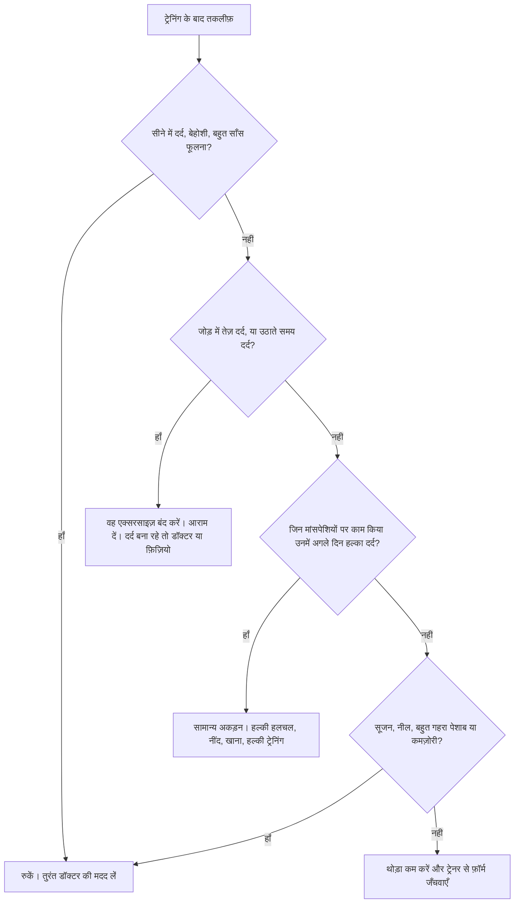

:::answer
पहले महीने में हफ़्ते में दो या तीन दिन पूरे शरीर की ट्रेनिंग करें, और हर सेशन के बीच एक-दो दिन आराम दें। छह से आठ बुनियादी एक्सरसाइज़ चुनें, हर एक के एक से तीन सेट, 8 से 12 रेप्स, ऐसे वज़न से जिसे आप कंट्रोल कर सकें। आख़िरी सेट आसान लगने लगे तभी थोड़ा वज़न बढ़ाएँ। पहले वार्म-अप, फिर फ़ॉर्म, उसके बाद वज़न। शुरू के हफ़्तों में मांसपेशियों में अकड़न आम है, पर तेज़ दर्द, जोड़ों का दर्द या सीने की तकलीफ़ पर रुक जाएँ। WHO के 150 से 300 मिनट हफ़्ते के लक्ष्य के लिए तेज़ चलना या साइकिल जोड़ें, कम से कम सात घंटे सोएँ, और हर खाने में प्रोटीन लें। दिल की बीमारी, हाई BP, चक्कर या कोई पुरानी बीमारी हो तो पहले डॉक्टर से पूछें।
:::

## पहला महीना सबसे अहम क्यों है

ज़्यादातर लोग जिम इसलिए नहीं छोड़ते कि प्लान ख़राब था। वे इसलिए छोड़ते हैं कि पहले दो हफ़्ते बहुत दर्द हुआ, किसी और का भारी रूटीन कॉपी कर लिया, या किसी ने नहीं बताया कि सामान्य अकड़न कैसी होती है। पहला महीना आदत बनाने और सही तरीक़ा सीखने का है। भारी वज़न बाद में।

ज़रूरत भी असली है। WHO के अनुमान से 2022 में दुनिया के 31% वयस्क, यानी लगभग 1.8 अरब लोग, पर्याप्त सक्रिय नहीं थे ([WHO, 2024](https://www.who.int/news-room/fact-sheets/detail/physical-activity))।

## दिशानिर्देश असल में क्या कहते हैं

WHO के 2020 के दिशानिर्देश कहते हैं कि सभी वयस्क हफ़्ते में 150 से 300 मिनट मध्यम एरोबिक गतिविधि करें, या 75 से 150 मिनट तेज़ गतिविधि, या दोनों का मेल। इसके ऊपर हफ़्ते में 2 या ज़्यादा दिन ऐसी कसरत जो सभी बड़ी मांसपेशियों पर मध्यम या ज़्यादा ज़ोर डाले। बुज़ुर्गों को हफ़्ते में 3 या ज़्यादा दिन संतुलन और ताक़त की कसरत भी करनी चाहिए ([WHO दिशानिर्देश, BJSM 2020](https://pmc.ncbi.nlm.nih.gov/articles/PMC7719906/))।

शुरुआत करने वालों के लिए अमेरिकन कॉलेज ऑफ़ स्पोर्ट्स मेडिसिन (ACSM) का 2009 का पोज़ीशन स्टैंड कहता है: ऐसा वज़न जिसे 8 से 12 बार उठा सकें, हफ़्ते में 2 से 3 दिन, और जब लक्ष्य से एक-दो रेप ज़्यादा होने लगें तो वज़न 2 से 10% बढ़ाएँ ([ACSM, 2009](https://pubmed.ncbi.nlm.nih.gov/19204579/))।

2026 में ACSM ने 137 सिस्टमैटिक रिव्यू और 30,000 से ज़्यादा लोगों के आँकड़ों से यह सलाह अपडेट की। मुख्य बात: लगभग किसी भी तरह की वेट ट्रेनिंग कुछ न करने के मुक़ाबले ताक़त, मांसपेशी, पावर और रोज़मर्रा के काम की क्षमता बढ़ाती है। ताक़त ज़्यादा बढ़ी भारी वज़न (वन-रेप मैक्स का 80% या ज़्यादा), पूरी रेंज, 2 से 3 सेट और हफ़्ते में कम से कम 2 सेशन से। मांसपेशियाँ ज़्यादा बढ़ीं हर मसल ग्रुप के हफ़्ते में 10 या ज़्यादा सेट से। फ़ेल्योर तक ट्रेनिंग, मशीन बनाम फ़्री वेट और पेचीदा प्लान से नतीजे लगातार नहीं बदले ([ACSM, 2026](https://doi.org/10.1249/MSS.0000000000003897))।

## शुरू करने से पहले: क्या डॉक्टर की मंज़ूरी चाहिए?

PAR-Q+ फ़ॉर्म ख़ुद कहता है कि ज़्यादातर लोगों के लिए शारीरिक गतिविधि बहुत सुरक्षित है। फिर भी एक छोटी जाँच काम की है। PAR-Q+ में सात हाँ-ना वाले सवाल हैं: क्या डॉक्टर ने कभी दिल की बीमारी या हाई BP बताया, क्या आराम में, रोज़ के काम में या कसरत में सीने में दर्द होता है, क्या पिछले 12 महीनों में चक्कर से संतुलन बिगड़ा या बेहोश हुए, क्या कोई और पुरानी बीमारी है, क्या उसके लिए डॉक्टर की दवा चल रही है, क्या हड्डी, जोड़ या मांसपेशी की कोई तकलीफ़ कसरत से बढ़ सकती है, और क्या डॉक्टर ने सिर्फ़ निगरानी में कसरत करने को कहा है।

सातों का जवाब "ना" हो तो धीरे-धीरे शुरू कर सकते हैं। किसी का भी जवाब "हाँ" हो तो आगे के सवाल या किसी स्वास्थ्य विशेषज्ञ से सलाह ज़रूरी है ([Bredin et al., 2013](https://pmc.ncbi.nlm.nih.gov/articles/PMC3596208/))। फ़ॉर्म का मौजूदा संस्करण यह भी कहता है कि 45 से ऊपर के लोग जो कड़ी कसरत के आदी नहीं, वे बहुत तेज़ कसरत से पहले किसी योग्य ट्रेनर से सलाह लें।

40 से ऊपर हैं, परिवार में कम उम्र में दिल की बीमारी है, सिगरेट पीते हैं, या कभी जाँच नहीं हुई, तो पहले BP, शुगर और कोलेस्ट्रॉल जँचवा लें। चेतावनी के लक्षणों के लिए हमारा [40 से कम उम्र में हार्ट अटैक](/health/blog/heart-attack-under-40-india) लेख देखें।

## जिम और ट्रेनर कैसे चुनें

सबसे महँगा जिम ज़रूरी नहीं। ऐसा जिम चुनें जहाँ थके हुए मंगलवार को भी पहुँच सकें। देखें:

- घर या ऑफ़िस से कम दूरी और आपके हिसाब से टाइमिंग
- डम्बल, स्क्वॉट रैक या लेग प्रेस, केबल मशीन, बेंच और कुछ कार्डियो मशीनें
- ऐसे ट्रेनर जो प्लान देने से पहले सेहत और चोट के बारे में पूछें
- साफ़ फ़र्श, पंखे या AC, पीने का पानी और फ़र्स्ट-एड
- ऐसा माहौल जहाँ नए लोगों का मज़ाक न बने

[[ad]]

## वार्म-अप और सही फ़ॉर्म

### आसान वार्म-अप

वज़न उठाने से पहले कुछ मिनट शरीर गरम करें। तेज़ चलना या साइकिल, जब तक साँस थोड़ी तेज़ न हो। फिर हाथ और कूल्हे घुमाना, आरामदायक गहराई तक बिना वज़न के स्क्वॉट और लंज। आख़िर में पहली एक्सरसाइज़ का एक हल्का सेट। ठंडे शरीर से सीधे भारी वज़न कभी नहीं।

### फ़ॉर्म की बुनियादी बातें

- **वज़न को कंट्रोल करें।** झटका देना पड़े तो वज़न ज़्यादा है।
- **पूरी रेंज, जितनी कंट्रोल में रहे।** 2026 के ACSM रिव्यू में पूरी रेंज से ताक़त ज़्यादा बढ़ी। गहराई हफ़्तों में बढ़ाएँ।
- **पेट कसें।** साँस लें, पेट ऐसे टाइट करें जैसे कोई धक्का देने वाला हो, और कमर सीधी रखें।
- **घुटने पंजों की सीध में।** स्क्वॉट और लंज में घुटने अंदर की ओर मुड़ना सबसे आम ग़लती है।
- **साँस न रोकें।** धकेलते या खींचते समय साँस छोड़ें, ख़ासकर हाई BP हो तो।
- **एक-दो रेप बचाकर रखें।** फ़ेल्योर तक जाना ज़रूरी नहीं।

## आपका 4 हफ़्ते का फ़ुल-बॉडी प्लान

हफ़्ते में तीन दिन, बीच में एक दिन आराम, जैसे सोमवार, बुधवार, शुक्रवार। वर्कआउट A और B बारी-बारी करें। तीन दिन ज़्यादा लगें तो दो दिन भी WHO का न्यूनतम पूरा करते हैं।

### वर्कआउट A

1. गॉब्लेट स्क्वॉट (छाती पर एक डम्बल पकड़कर) या लेग प्रेस
2. डम्बल बेंच प्रेस, या ज़रूरत हो तो बेंच पर पुश-अप
3. सीटेड केबल रो
4. डम्बल रोमानियन डेडलिफ़्ट (कूल्हे से झुकना)
5. बैठकर डम्बल शोल्डर प्रेस
6. प्लैंक, जब तक फ़ॉर्म सही रहे

### वर्कआउट B

1. लेग प्रेस या नीचे बॉक्स पर स्टेप-अप
2. लैट पुलडाउन
3. इनक्लाइन डम्बल प्रेस या मशीन चेस्ट प्रेस
4. ग्लूट ब्रिज या हिप थ्रस्ट
5. एक हाथ से डम्बल रो
6. डेड बग या बर्ड डॉग

सेट्स के बीच लगभग एक से दो मिनट आराम, जो ACSM 2009 की सलाह से मेल खाता है ([ACSM, 2009](https://pubmed.ncbi.nlm.nih.gov/19204579/))।

### हफ़्ता दर हफ़्ता

1. **हफ़्ता 1, तरीक़ा सीखें।** हर एक्सरसाइज़ के 2 सेट, 10 से 12 रेप, हल्के वज़न से। सेट ख़त्म होने पर लगे कि तीन-चार रेप और हो सकते थे।
2. **हफ़्ता 2, आदत बनाएँ।** अब भी 2 सेट, 10 से 12 रेप। दूसरा सेट आसान लगे तो अगला डम्बल लें।
3. **हफ़्ता 3, सेट बढ़ाएँ।** मुख्य चार एक्सरसाइज़ के 3 सेट, 8 से 12 रेप, बाक़ी के 2 सेट।
4. **हफ़्ता 4, वज़न बढ़ाएँ।** 3 सेट, 8 से 12 रेप। आख़िरी सेट में लक्ष्य से दो रेप ज़्यादा हो जाएँ तो वज़न थोड़ा बढ़ाएँ, ACSM के 2 से 10% के हिसाब से।

### कार्डियो कहाँ आए

वेट के बाद या आराम वाले दिन तेज़ चलना, साइकिल या क्रॉस-ट्रेनर। 10 से 20 मिनट से शुरू करके WHO के 150 से 300 मिनट हफ़्ते की ओर बढ़ें। पाँच दिन 30 मिनट तेज़ चलना 150 मिनट बन जाता है।

## प्रोग्रेसिव ओवरलोड, आसान भाषा में

शरीर उसी के हिसाब से ढलता है जो आप उससे माँगते हैं। वज़न आसान लगने लगे तो बदलाव रुक जाता है। इसलिए धीरे-धीरे थोड़ा ज़्यादा माँगें: थोड़ा वज़न बढ़ाएँ, एक-दो रेप बढ़ाएँ, एक सेट जोड़ें, या नीचे लाने वाला हिस्सा धीमा करें। एक बार में एक ही चीज़ बदलें, और वज़न-रेप डायरी या फ़ोन में लिखें।

[[ad]]

## अकड़न बनाम दर्द: फ़र्क़ कैसे पहचानें

नई या कड़ी कसरत के बाद, कसरत के दौरान नहीं बल्कि बाद में, मांसपेशियों में जो हल्का दर्द आता है उसे DOMS कहते हैं। यह नई गतिविधि शुरू करने पर सबसे आम है, और नीचे लाने वाला हिस्सा (स्क्वॉट में नीचे जाना, डम्बल नीचे लाना) इसे सबसे ज़्यादा करता है। एक स्पोर्ट्स मेडिसिन रिव्यू के मुताबिक़ हल्की कसरत से दर्द कुछ देर के लिए कम होता है, बहुत अकड़न के बाद एक-दो दिन हल्की ट्रेनिंग करनी चाहिए, और नई एक्सरसाइज़ एक-दो हफ़्तों में धीरे-धीरे जोड़नी चाहिए ([Cheung et al., 2003](https://pubmed.ncbi.nlm.nih.gov/12617692/))। इसीलिए हमारा प्लान हल्के से शुरू होता है।

सामान्य अकड़न मांसपेशी में हल्का दर्द है जो हिलने-डुलने से बेहतर होता है और कुछ दिनों में चला जाता है। ध्यान देने वाला दर्द तेज़ होता है, जोड़ में होता है, उठाते समय शुरू होता है, लंगड़ाने लगते हैं या सूजन आती है। कड़ी कसरत के बाद कोला जैसा गहरा पेशाब, तेज़ मांसपेशी दर्द और कमज़ोरी गंभीर मांसपेशी टूटने (रैब्डोमायोलिसिस) का संकेत हो सकता है और उसी दिन डॉक्टर को दिखाना चाहिए।

:::warning डॉक्टर के पास या अस्पताल जाएँ अगर
- कसरत के दौरान या बाद में सीने में दर्द, दबाव या जकड़न हो
- बेहोशी हो, बेहोशी जैसा लगे, या दिल की धड़कन तेज़ या अनियमित होकर न सँभले
- मेहनत के मुक़ाबले साँस बहुत ज़्यादा फूले
- पेशाब कोला जैसा गहरा हो, साथ में तेज़ मांसपेशी दर्द या कमज़ोरी
- कोई जोड़ सूज जाए, अटक जाए, जवाब दे दे, या चोट के समय "पॉप" की आवाज़ आई हो
- कमर का दर्द पैर में उतरे, साथ में सुन्नपन, झनझनाहट या कमज़ोरी
- कोई दर्द एक हफ़्ते से ज़्यादा रहे या बढ़ता जाए
:::

## खाना, आराम और नींद

मांसपेशियाँ सेशन के बीच बढ़ती हैं। ISSN कसरत करने वाले ज़्यादातर लोगों के लिए रोज़ 1.4 से 2.0 ग्राम प्रोटीन प्रति किलो वज़न, खानों में बाँटकर, सुझाता है, और कहता है कि यह साधारण खाने से पूरा हो सकता है ([ISSN, 2017](https://pmc.ncbi.nlm.nih.gov/articles/PMC5477153/))। दाल, दही, पनीर, अंडा, सोया, चिकन, मछली, सब गिनती में आते हैं। अपना आँकड़ा निकालने के लिए हमारी [प्रोटीन गाइड](/health/blog/protein-requirement-calculator-india) देखें। पहले महीने में प्रोटीन पाउडर ज़रूरी नहीं, और भूखे रहकर कड़ी ट्रेनिंग भी न करें।

ACSM शुरुआती लोगों के लिए हफ़्ते में 2 से 3 दिन की ट्रेनिंग कहता है। पहले महीने में रोज़ जिम जाने से रफ़्तार नहीं बढ़ती। आराम के दिन टहलें, स्ट्रेचिंग करें या बैडमिंटन खेलें।

अमेरिकन एकेडमी ऑफ़ स्लीप मेडिसिन और स्लीप रिसर्च सोसाइटी के मुताबिक़ वयस्कों को नियमित रूप से रात में 7 या ज़्यादा घंटे सोना चाहिए ([AASM और SRS, 2015](https://pmc.ncbi.nlm.nih.gov/articles/PMC4434546/))। सुबह 5:30 की ट्रेनिंग है तो जल्दी सोएँ, नींद न काटें।

:::tip पहला महीना आसान बनाने की छोटी आदतें
- जिम के दिन कैलेंडर में मीटिंग की तरह लिखें। एक दिन छूटना ठीक है, लगातार दो छूटें तो आदत टूटती है।
- रात को ही बैग तैयार रखें: जूते, तौलिया, पानी की बोतल, छोटा ताला।
- ऑफ़िस के बाद ट्रेनिंग हो तो एक-दो घंटे पहले केला या दही जैसा हल्का नाश्ता।
- पानी साथ रखें, दिल्ली-NCR की गर्मी में और ज़्यादा।
- एक्सरसाइज़, वज़न और रेप की डायरी रखें।
- तरक़्क़ी ताक़त और कपड़ों की फ़िटिंग से नापें, रोज़ के वज़न से नहीं।
:::

## जिम के तौर-तरीक़े जो कोई नहीं बताता

- बेंच और मशीन इस्तेमाल के बाद पोंछें, छोटा तौलिया साथ रखें।
- डम्बल और प्लेट वापस अपनी जगह रखें। फ़र्श पर पड़ा वज़न ठोकर का ख़तरा है।
- दूसरे इंतज़ार कर रहे हों तो मशीन पर बैठकर फ़ोन न चलाएँ, बारी-बारी इस्तेमाल का ऑफ़र दें।
- बिना इजाज़त किसी का वीडियो न बनाएँ।
- सलाह तभी दें जब कोई माँगे, और ख़ुद सलाह ट्रेनर से लें।
- साफ़ जूते पहनें और डियोडरेंट लगाएँ।

## पहले महीने में सुनी जाने वाली जिम की अफ़वाहें

:::mythfact
| अफ़वाह | सच |
|---|---|
| "स्क्वॉट से घुटने ख़राब होते हैं।" | बायोमैकेनिक्स के रिव्यू के मुताबिक़ निगरानी में सही तकनीक सीखकर और धीरे-धीरे वज़न बढ़ाकर किए गए गहरे स्क्वॉट से स्वस्थ घुटनों में चोट का ख़तरा नहीं बढ़ता। भारी हाफ़ स्क्वॉट जोड़ों पर ज़्यादा भार डाल सकते हैं। |
| "कार्डियो से मसल चली जाती है।" | 43 अध्ययनों के 2022 के विश्लेषण में एरोबिक ट्रेनिंग जोड़ने से मसल का बढ़ना और अधिकतम ताक़त कम नहीं हुई। सिर्फ़ विस्फोटक ताक़त थोड़ी घटी, ख़ासकर दोनों एक ही सेशन में करने पर। |
| "दर्द नहीं तो फ़ायदा नहीं।" | हल्की अकड़न आम है। तेज़ या जोड़ का दर्द चेतावनी है। अच्छे नतीजों के लिए फ़ेल्योर तक जाना ज़रूरी नहीं। |
| "मशीन बेकार हैं, सिर्फ़ फ़्री वेट काम करते हैं।" | 2026 के ACSM रिव्यू में उपकरण के प्रकार से नतीजे लगातार नहीं बदले। जो सुरक्षित तरीक़े से कर सकें, वही करें। |
| "जल्दी नतीजे के लिए रोज़ ट्रेनिंग करो।" | शुरुआती लोगों के लिए हफ़्ते में 2 से 3 दिन अच्छे हैं। मसल आराम में बढ़ती है। |
| "शुरुआत के लिए सप्लीमेंट ज़रूरी हैं।" | खाना, नींद और लगातार ट्रेनिंग असली काम करते हैं। प्रोटीन पाउडर ज़रूरी नहीं। |
:::

स्क्वॉट और कार्डियो वाली बातें दो रिव्यू से हैं: गहरे स्क्वॉट पर ([Hartmann et al., 2013](https://pubmed.ncbi.nlm.nih.gov/23821469/)) और कार्डियो-वेट साथ करने पर ([Schumann et al., 2022](https://pubmed.ncbi.nlm.nih.gov/34757594/))। पहले से घुटने में दर्द, गठिया या पुरानी चोट हो तो जँचवाएँ और उतनी ही गहराई तक जाएँ जहाँ दर्द न हो।

## अक्सर पूछे जाने वाले सवाल

:::faq
### शुरुआत में हफ़्ते में कितने दिन जिम जाएँ?
ACSM शुरुआती लोगों के लिए हफ़्ते में 2 से 3 दिन फ़ुल-बॉडी ट्रेनिंग कहता है, बीच में आराम के साथ। बाक़ी दिन WHO के लक्ष्य के लिए टहलें या साइकिल चलाएँ।

### पहली ट्रेनिंग के बाद बहुत अकड़न होना सामान्य है?
शुरू में अगले दिन कुछ अकड़न आम है, ख़ासकर स्क्वॉट और लंज के बाद। हल्की हलचल से कम होती है। तेज़ दर्द, जोड़ का दर्द, सूजन या बहुत गहरा पेशाब सामान्य नहीं।

### पहले कार्डियो करें या वेट?
ताक़त या मसल मुख्य लक्ष्य है तो पहले वेट, जब शरीर ताज़ा हो। कार्डियो मसल नहीं रोकता, पर एक ही सेशन में दोनों करने से विस्फोटक ताक़त थोड़ी कम हो सकती है।

### क्या जिम से पहले डॉक्टर की मंज़ूरी चाहिए?
ज़्यादातर स्वस्थ लोग धीरे-धीरे शुरू कर सकते हैं। दिल की बीमारी, हाई BP, सीने में दर्द, चक्कर, पुरानी बीमारी या जोड़ की तकलीफ़ हो तो PAR-Q+ के सवाल देखें और पहले डॉक्टर से पूछें।

### नतीजे कब दिखेंगे?
बहुत से लोग पहले कुछ हफ़्तों में ही ख़ुद को ज़्यादा ताक़तवर महसूस करते हैं। दिखने वाला बदलाव ज़्यादा समय लेता है। महीनों की निरंतरता किसी एक हफ़्ते से ज़्यादा मायने रखती है।
:::

:::takeaways
- WHO: हफ़्ते में 150 से 300 मिनट मध्यम गतिविधि, साथ में 2 या ज़्यादा दिन ताक़त की कसरत।
- शुरुआत में हफ़्ते में 2 से 3 फ़ुल-बॉडी सेशन, 8 से 12 रेप, वज़न छोटे क़दमों में।
- पहले फ़ॉर्म सीखें, हर बार वार्म-अप करें, एक-दो रेप बचाकर रखें।
- शुरू में अकड़न आम है; तेज़, जोड़ या सीने का दर्द रुकने का संकेत है।
- 7 घंटे से ज़्यादा नींद, हर खाने में प्रोटीन, सप्लीमेंट ज़रूरी नहीं।
:::

## आख़िरी बात

जिम का पहला महीना सीखने का है, कुछ साबित करने का नहीं। हफ़्ते में दो-तीन बार पूरे शरीर की ट्रेनिंग, अहं से कम वज़न से शुरुआत, छोटे क़दमों में बढ़ोतरी, बाक़ी दिन टहलना और अच्छी नींद। घुटनों और कार्डियो की अफ़वाहों को छोड़ें, पर असली चेतावनी के संकेतों पर डॉक्टर को दिखाएँ।

जिम की इन अफ़वाहों पर हमने अपने YouTube चैनल [Royal Fitness TV](https://www.youtube.com/@RoyalFitnessTV?sub_confirmation=1) पर एक छोटा हिंग्लिश वीडियो भी बनाया है।

अगर आप चाहते हैं कि कोई आपका फ़ॉर्म देखे और यह प्लान आपके साथ शुरू करे, तो नोएडा सेक्टर 93 के रॉयल फ़िटनेस क्लब के ट्रेनर रोज़ नए लोगों के साथ काम करते हैं।
