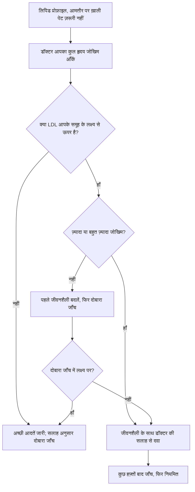

:::answer
लिपिड प्रोफ़ाइल ख़ून में मौजूद चर्बी को नापता है: कुल कोलेस्ट्रॉल, LDL ("ख़राब") कोलेस्ट्रॉल, HDL ("अच्छा") कोलेस्ट्रॉल और ट्राइग्लिसराइड, साथ में कुछ गणना वाले नंबर। LDL वह मुख्य नंबर है जिसका डॉक्टर इलाज करते हैं, और सही लक्ष्य रिपोर्ट पर छपी "नॉर्मल रेंज" से नहीं, आपके दिल के कुल जोखिम से तय होता है: जोखिम जितना ज़्यादा, LDL उतना कम होना चाहिए। भारतीयों में अक्सर ज़्यादा ट्राइग्लिसराइड और कम HDL का पैटर्न दिखता है, जो पेट की चर्बी, मैदा-चावल जैसे रिफ़ाइंड कार्ब, चीनी और कम चलने-फिरने से जुड़ा है। खाना, कसरत और वज़न घटाना बहुत मदद करते हैं, ख़ासकर ट्राइग्लिसराइड में, पर ज़्यादा जोखिम वालों को अक्सर डॉक्टर की तय की हुई दवा भी चाहिए। ज़्यादातर लोगों को इस टेस्ट के लिए ख़ाली पेट रहने की ज़रूरत नहीं।
:::

## भारतीयों के लिए यह रिपोर्ट क्यों अहम है

भारत में हार्ट अटैक अक्सर कई पश्चिमी देशों से पहले की उम्र में होते हैं, और ख़ून की असामान्य चर्बी इसकी सबसे बड़ी वजहों में से एक है। राष्ट्रीय ICMR-INDIAB अध्ययन में लगभग 81% भारतीय वयस्कों में कम से कम एक लिपिड नंबर असामान्य मिला ([ICMR-INDIAB-17, 2023](https://doi.org/10.1016/S2213-8587(23)00119-5))। इसलिए लिपिड प्रोफ़ाइल वयस्कों के लिए सबसे उपयोगी और सस्ते टेस्ट में से एक है।

दिक़्क़त यह है कि ज़्यादातर लोग रिपोर्ट में सिर्फ़ लाल या बोल्ड नंबर देखते हैं। रिपोर्ट के सारे नंबर "रेंज में" होकर भी डायबिटीज़ वाले या पहले हार्ट अटैक झेल चुके व्यक्ति के लिए बहुत ज़्यादा हो सकते हैं।

## हर नंबर का मतलब

**LDL कोलेस्ट्रॉल:** यह कोलेस्ट्रॉल को धमनियों की दीवार तक ले जाता है, जहाँ सालों में प्लाक बनता है। हर बड़ी गाइडलाइन में यही इलाज का मुख्य लक्ष्य है ([ESC/EAS, 2019](https://doi.org/10.1093/eurheartj/ehz455))। कई लैब LDL को एक फ़ॉर्मूले से निकालती हैं; ट्राइग्लिसराइड लगभग 400 mg/dL से ऊपर हों तो यह फ़ॉर्मूला भरोसेमंद नहीं रहता और "डायरेक्ट LDL" टेस्ट बेहतर है।

**HDL कोलेस्ट्रॉल:** यह कोलेस्ट्रॉल को धमनियों से दूर ले जाने में मदद करता है। कम HDL (आमतौर पर पुरुषों में 40 और महिलाओं में 50 mg/dL से कम) चेतावनी है, जो अक्सर पेट की चर्बी, ज़्यादा ट्राइग्लिसराइड और इंसुलिन रेज़िस्टेंस के साथ आता है। गोलियों से HDL बढ़ाने से हार्ट अटैक कम होना साबित नहीं हुआ, इसलिए ज़ोर उन आदतों पर है जो इसे स्वाभाविक रूप से बढ़ाती हैं, और LDL घटाने पर।

**ट्राइग्लिसराइड:** यह वह चर्बी है जिसे शरीर जमा करता और ऊर्जा के लिए जलाता है। ख़ाली पेट 150 mg/dL से कम आमतौर पर ठीक माना जाता है। यह ज़्यादा कैलोरी, चीनी और मीठे पेय, ज़्यादा मात्रा में सफ़ेद चावल, मैदा और मिठाई, शराब, बेक़ाबू डायबिटीज़ और कम थायरॉइड से बढ़ता है। लगभग 500 mg/dL या उससे ज़्यादा पर पैंक्रियाटाइटिस का ख़तरा बढ़ता है, जिसमें तुरंत डॉक्टर चाहिए।

**कुल कोलेस्ट्रॉल:** अकेले यह भ्रम पैदा कर सकता है; ज़्यादा HDL के साथ ज़्यादा कुल, ज़्यादा LDL के साथ ज़्यादा कुल से बहुत अलग है।

**नॉन-HDL कोलेस्ट्रॉल:** कुल कोलेस्ट्रॉल में से HDL घटाकर। यह धमनियाँ बंद कर सकने वाले सारे कणों का जोड़ है और ट्राइग्लिसराइड ज़्यादा हों तब बहुत काम का है। इसका लक्ष्य आमतौर पर आपके LDL लक्ष्य से 30 mg/dL ज़्यादा होता है।

**Lp(a):** यह रूटीन प्रोफ़ाइल में नहीं होता। यह ज़्यादातर जीन से तय होता है, खाने से ज़्यादा नहीं बदलता, और ज़्यादा हो तो दिल का जोखिम बढ़ाता है। ESC/EAS गाइडलाइन हर वयस्क में जीवन में कम से कम एक बार इसे नापने का सुझाव देती है ([ESC/EAS, 2019](https://doi.org/10.1093/eurheartj/ehz455))। परिवार में कम उम्र में दिल की बीमारी हो तो ज़रूर पूछें।

[[ad]]

## भारतीय पैटर्न: ज़्यादा ट्राइग्लिसराइड, कम HDL

कई भारतीय रिपोर्टों में LDL बहुत ज़्यादा नहीं दिखता। इसकी बजाय ट्राइग्लिसराइड 150 से 300 के बीच, HDL 30 के आसपास और LDL "बॉर्डरलाइन" दिखता है। यह पैटर्न अक्सर बड़ी कमर, फ़ैटी लिवर, प्रीडायबिटीज़ या डायबिटीज़ और हाई BP के साथ आता है। यह ख़तरनाक इसलिए है क्योंकि इसे अनदेखा करना आसान है। अच्छी बात यह कि यह पैटर्न जीवनशैली बदलने पर अच्छा जवाब देता है: चीनी, मीठे पेय, रिफ़ाइंड कार्ब और शराब घटाने और चलना-फिरना बढ़ाने पर ट्राइग्लिसराइड अक्सर कुछ हफ़्तों में काफ़ी गिर जाते हैं।

## LDL का लक्ष्य आपके जोखिम पर निर्भर है

ESC/EAS गाइडलाइन कुल हृदय जोखिम के हिसाब से LDL लक्ष्य तय करती है ([ESC/EAS, 2019](https://doi.org/10.1093/eurheartj/ehz455))। लिपिड एसोसिएशन ऑफ़ इंडिया ने भी इसी सोच से लक्ष्य सुझाए हैं, और कुछ बहुत ज़्यादा जोखिम वाले समूहों में और सख़्त, क्योंकि भारतीयों में दिल की बीमारी जल्दी और तेज़ होती है ([LAI, 2016](https://doi.org/10.4103/2250-3528.186492))।

| जोखिम समूह (डॉक्टर तय करेंगे) | उदाहरण | LDL लक्ष्य (ESC/EAS 2019) |
|---|---|---|
| बहुत ज़्यादा | पहले हार्ट अटैक, स्ट्रोक या स्टेंट; अंगों पर असर वाली डायबिटीज़; गंभीर किडनी रोग | 55 mg/dL से कम और कम से कम 50% गिरावट |
| ज़्यादा | 10 साल से ज़्यादा पुरानी डायबिटीज़; पारिवारिक हाई कोलेस्ट्रॉल जैसा एक बहुत बड़ा जोखिम | 70 mg/dL से कम और कम से कम 50% गिरावट |
| मध्यम | 10 साल से कम की डायबिटीज़ वाले युवा, बिना दूसरे जोखिम | 100 mg/dL से कम |
| कम | युवा, डायबिटीज़ नहीं, कुल जोखिम कम | 116 mg/dL से कम |

इसीलिए 110 LDL वाले दो लोगों को बिल्कुल अलग सलाह मिल सकती है। एक स्वस्थ 28 साल के युवा के लिए यह ठीक हो सकता है; पिछले साल हार्ट अटैक झेल चुके व्यक्ति के लिए बहुत ज़्यादा।

## टेस्ट से पहले: ख़ाली पेट और समय

आमतौर पर ख़ाली पेट रहने की ज़रूरत नहीं। एक यूरोपीय विशेषज्ञ सहमति ने कहा कि ज़्यादातर लोगों के लिए बिना ख़ाली पेट का सैंपल ठीक है; ख़ाली पेट तब, जब बिना ख़ाली पेट ट्राइग्लिसराइड लगभग 400 mg/dL से ज़्यादा हों ([EAS और EFLM, 2016](https://doi.org/10.1093/eurheartj/ehw152))। कुछ भारतीय लैब अब भी 10–12 घंटे ख़ाली पेट माँगती हैं; ऐसे में पानी पिएँ और जब तक न कहा जाए, अपनी दवाएँ लेते रहें। टेस्ट से पहली रात बहुत भारी, तला खाना या शराब न लें, बुख़ार या बीमारी के दौरान टेस्ट न कराएँ, और तुलना के लिए हो सके तो एक ही लैब चुनें।

## रिपोर्ट पर क्या करें

**खाना क्या कर सकता है:** खाने में बदलाव से LDL थोड़ा और ट्राइग्लिसराइड काफ़ी गिर सकते हैं। ICMR-NIN गाइडलाइन चीनी, रिफ़ाइंड अनाज, तले और अल्ट्रा-प्रोसेस्ड खाने और सैचुरेटेड फ़ैट को सीमित करने और साबुत अनाज, दालें, सब्ज़ियाँ, फल और मेवे बढ़ाने की सलाह देती है ([ICMR-NIN, 2024](https://www.nin.res.in/dietaryguidelines/pdfjs/locale/DGI24thJune2024fin.pdf))। भारतीय रसोई में इसका मतलब: कम मिठाई, मीठी चाय, कोल्ड ड्रिंक और पैकेट जूस; चावल-रोटी थोड़ी कम और उनकी जगह दाल, चना, राजमा, सब्ज़ी और सलाद; कम वनस्पति, घी, मक्खन और समोसा-पकौड़ा-नमकीन; ज़्यादा फ़ाइबर जैसे ओट्स, जौ, मेथी दाना और साबुत दालें; नमकीन की जगह मुट्ठी भर बादाम या अख़रोट; और शराब बहुत कम या बिल्कुल नहीं।

**कसरत क्या करती है:** नियमित कसरत ट्राइग्लिसराइड घटाती है, HDL थोड़ा बढ़ाती है और पेट की चर्बी कम करती है। हफ़्ते में कम से कम 150 मिनट तेज़ चलना या साइकिल, और हफ़्ते में दो-तीन दिन स्ट्रेंथ ट्रेनिंग का लक्ष्य रखें।

**दवा क्या करती है:** ज़्यादा या बहुत ज़्यादा जोखिम वालों में, या पारिवारिक हाई कोलेस्ट्रॉल में, सिर्फ़ खाने से LDL लक्ष्य तक कम ही पहुँचता है। स्टैटिन इसके लिए सबसे ज़्यादा परखी गई दवाएँ हैं और हार्ट अटैक व स्ट्रोक का जोखिम घटाती हैं। कौन सी दवा, कितनी और कब दोबारा जाँच, यह डॉक्टर तय करेंगे; दवा सिर्फ़ सलाह अनुसार लें और अगली रिपोर्ट अच्छी आने पर अपने मन से बंद न करें। दवा पर अच्छी रिपोर्ट का मतलब अक्सर यही है कि दवा काम कर रही है।

:::tip नंबर बदलने वाली आदतें
- पहले मीठे पेय और मिठाई कम करें; कुछ हफ़्तों बाद ट्राइग्लिसराइड दोबारा देखें।
- थाली का आधा हिस्सा सब्ज़ी और दाल से भरें, फिर चावल या रोटी।
- दिन के दो सबसे बड़े खानों के बाद 10–15 मिनट टहलें।
- हफ़्ते में दो-तीन बार वज़न या बॉडीवेट ट्रेनिंग करें।
- हर महीने कमर नापें; यह अक्सर तराज़ू से पहले घटती है।
- हर रिपोर्ट की फ़ोटो फ़ोन के एक फ़ोल्डर में रखें, ताकि बदलाव आसानी से दिखे।
:::

[[ad]]

## ख़ास हालात

**बहुत ज़्यादा LDL वाले युवा:** किसी युवा में LDL 190 mg/dL या ज़्यादा हो, ख़ासकर माता-पिता या भाई-बहन को कम उम्र में हार्ट अटैक हुआ हो, तो यह पारिवारिक हाइपरकोलेस्ट्रॉलेमिया हो सकता है, एक जेनेटिक स्थिति। इसमें डॉक्टर की जाँच और अक्सर कम उम्र से इलाज चाहिए, और परिवार के दूसरे लोगों, बच्चों समेत, की जाँच भी।

**डायबिटीज़:** अकेली डायबिटीज़ ही ज़्यादातर लोगों को ज़्यादा या बहुत ज़्यादा जोखिम में रख देती है, तो LDL लक्ष्य सख़्त होते हैं। शुगर ठीक करने से ट्राइग्लिसराइड भी सुधरते हैं।

**फ़ैटी लिवर और थायरॉइड:** फ़ैटी लिवर और ज़्यादा ट्राइग्लिसराइड अक्सर साथ चलते हैं और एक जैसे बदलावों से सुधरते हैं। कम थायरॉइड LDL बढ़ा सकता है, इसलिए बिना वजह कोलेस्ट्रॉल बढ़े तो डॉक्टर थायरॉइड देख सकते हैं।

**गर्भावस्था:** गर्भावस्था में लिपिड स्वाभाविक रूप से बढ़ते हैं, इसलिए तब की रिपोर्ट को सामान्य लक्ष्यों से नहीं मिलाया जाता।

:::warning जल्दी डॉक्टर को दिखाएँ अगर
- ट्राइग्लिसराइड लगभग 500 mg/dL या ज़्यादा हैं, ख़ासकर पेट दर्द के साथ
- LDL 190 mg/dL या ज़्यादा है, या माता-पिता या भाई-बहन को कम उम्र में हार्ट अटैक हुआ (पुरुषों में 55 और महिलाओं में 65 से पहले)
- मेहनत पर सीने में दर्द, दबाव या साँस फूलना हो, भले रिपोर्ट "नॉर्मल" हो
- आँखों के आसपास या हाथ-एड़ी की नसों पर पीले उभार दिखें
- डायबिटीज़, किडनी रोग या पहले हार्ट अटैक के बावजूद इस साल लिपिड टेस्ट नहीं हुआ
- कोलेस्ट्रॉल की दवा शुरू करने के बाद मांसपेशियों में दर्द या गहरे रंग का पेशाब हो (दवा अपने आप बंद न करें, डॉक्टर को फ़ोन करें)
:::

[[ad]]

## मिथक और सच

:::mythfact
| मिथक | सच |
|---|---|
| "रिपोर्ट में कुछ लाल नहीं, तो दिल सुरक्षित है।" | लैब रेंज आम आबादी के लिए है। आपका LDL लक्ष्य आपके जोखिम पर है और बहुत कम हो सकता है। |
| "मैं दुबला हूँ, तो कोलेस्ट्रॉल ठीक होगा।" | जीन, खाना और पेट की चर्बी मायने रखते हैं। दुबले लोगों में भी LDL या Lp(a) ज़्यादा हो सकता है। |
| "सिर्फ़ घी-तेल से कोलेस्ट्रॉल बढ़ता है।" | चीनी, रिफ़ाइंड कार्ब और शराब ट्राइग्लिसराइड बढ़ाते हैं, जो भारतीयों में बहुत आम है। |
| "नंबर नॉर्मल हो गए, अब गोली बंद।" | नंबर अक्सर दवा की वजह से ठीक दिखते हैं। बंद करने पर फिर बढ़ जाते हैं। पहले डॉक्टर से पूछें। |
| "टेस्ट से पहले 12 घंटे भूखा रहना ज़रूरी है।" | ज़्यादातर लोगों को ज़रूरत नहीं। पहले ट्राइग्लिसराइड बहुत ज़्यादा थे तो डॉक्टर कह सकते हैं। |
| "ज़्यादा HDL, ज़्यादा LDL को बेअसर कर देता है।" | HDL, LDL को रद्द नहीं करता। LDL ही मुख्य लक्ष्य है। |
:::

## अक्सर पूछे जाने वाले सवाल

:::faq
### नॉर्मल LDL कितना होना चाहिए?
सबके लिए एक नंबर नहीं है। गाइडलाइन जोखिम के हिसाब से लक्ष्य रखती है: कम जोखिम में 116 mg/dL से कम, मध्यम में 100 से कम, ज़्यादा में 70 से कम और बहुत ज़्यादा में 55 से कम। आपका समूह डॉक्टर तय करेंगे।

### क्या लिपिड प्रोफ़ाइल के लिए ख़ाली पेट रहना ज़रूरी है?
आमतौर पर नहीं। यूरोपीय विशेषज्ञों ने पाया कि ज़्यादातर लोगों के लिए बिना ख़ाली पेट का सैंपल ठीक है। पहले ट्राइग्लिसराइड बहुत ज़्यादा थे तो डॉक्टर ख़ाली पेट टेस्ट कह सकते हैं। अपनी लैब के निर्देश मानें।

### क्या सिर्फ़ खाने से कोलेस्ट्रॉल घट सकता है?
खाना और कसरत LDL थोड़ा और ट्राइग्लिसराइड काफ़ी घटा सकते हैं। ज़्यादा जोखिम वालों या जेनेटिक रूप से ज़्यादा LDL वालों को आमतौर पर डॉक्टर की सलाह से दवा भी चाहिए।

### लिपिड प्रोफ़ाइल कितनी बार कराएँ?
यह जोखिम और इलाज पर निर्भर है। दवा शुरू करने या बदलने के बाद डॉक्टर अक्सर कुछ हफ़्तों से तीन महीने में दोबारा जाँच कराते हैं, फिर नियमित। सामान्य रिपोर्ट वाले स्वस्थ लोग कम बार, डॉक्टर की सलाह से।

### ज़्यादा ट्राइग्लिसराइड और कम HDL का क्या मतलब है?
यह भारतीयों में आम पैटर्न है जो पेट की चर्बी, इंसुलिन रेज़िस्टेंस, चीनी, रिफ़ाइंड कार्ब, शराब और कम चलने-फिरने से जुड़ा है। LDL बॉर्डरलाइन दिखे तब भी यह दिल का जोखिम बढ़ाता है, और जीवनशैली बदलने से अक्सर अच्छा सुधरता है।
:::

## आख़िरी बात

लिपिड प्रोफ़ाइल को लाल निशानों से नहीं, पूरी तस्वीर से पढ़ें। LDL मुख्य लक्ष्य है और आपका लक्ष्य आपके जोखिम पर निर्भर है। भारतीयों में ज़्यादा ट्राइग्लिसराइड और कम HDL आम है, जो कम चीनी और रिफ़ाइंड कार्ब, ज़्यादा चलने-फिरने और कम कमर से अच्छा सुधरता है। जोखिम ज़्यादा है तो दवा अक्सर योजना का हिस्सा है, डॉक्टर के साथ चलें। और परिवार में कम उम्र में दिल की बीमारी है, तो एक बार Lp(a) के बारे में पूछें।

ट्राइग्लिसराइड और HDL के लिए नियमित कसरत सबसे अच्छे औज़ारों में से है। सेक्टर 93, नोएडा के रॉयल फ़िटनेस क्लब के ट्रेनर आपके काम के घंटों के हिसाब से ऐसा रूटीन बना सकते हैं जिसे आप निभा सकें।
