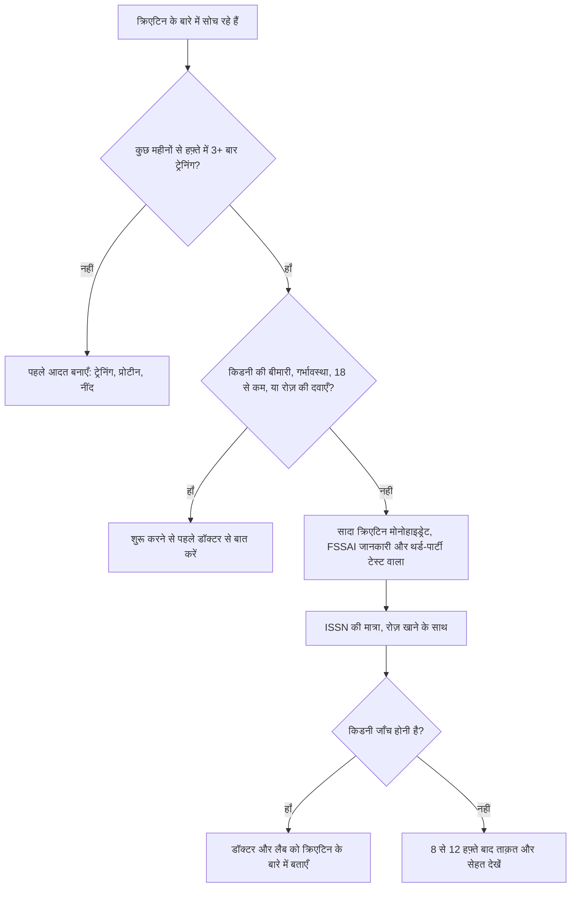

:::answer
क्रिएटिन खेल की दुनिया के सबसे ज़्यादा जाँचे-परखे सप्लीमेंट में से एक है। यह छोटी और भारी मेहनत में (जैसे भारी सेट या स्प्रिंट) एक-दो रेप ज़्यादा निकालने में मदद करता है, और हफ़्तों की ट्रेनिंग में यही फ़र्क़ ताक़त और मांसपेशियों में दिखता है। स्वस्थ लोगों में, रिसर्च वाली मात्रा पर, कंट्रोल्ड स्टडी में किडनी को नुकसान नहीं दिखा। बाल झड़ने का डर एक छोटी स्टडी से आया, जिसमें बाल नहीं, सिर्फ़ एक हॉर्मोन नापा गया था। शुरू में 1 से 2 किलो वज़न बढ़ सकता है, जो ज़्यादातर मांसपेशियों के अंदर का पानी है। शाकाहारियों की मांसपेशियों में क्रिएटिन पहले से कम होता है, इसलिए उन्हें फ़र्क़ ज़्यादा दिख सकता है। किडनी की बीमारी हो, गर्भावस्था हो, या उम्र 18 से कम हो, तो शुरू करने से पहले डॉक्टर से बात करें।
:::

## क्रिएटिन असल में है क्या

क्रिएटिन कोई दवा या हॉर्मोन नहीं है। हमारा शरीर इसे तीन अमीनो एसिड (आर्जिनिन, ग्लाइसिन और मेथियोनीन) से ख़ुद बनाता है, ज़्यादातर लिवर और किडनी में। इसका लगभग 95% हिस्सा मांसपेशियों में रहता है ([ISSN पोज़ीशन स्टैंड, 2017](https://doi.org/10.1186/s12970-017-0173-z))।

भारी स्क्वैट या तेज़ दौड़ में मांसपेशी की फ़ौरन मिलने वाली ऊर्जा (ATP) कुछ सेकंड में ख़त्म होने लगती है। मांसपेशी में जमा फ़ॉस्फ़ोक्रिएटिन इसे जल्दी भर देता है। यानी क्रिएटिन ज़्यादा जमा हो तो आप भारी मेहनत थोड़ी देर और खींच पाते हैं।

रोज़ की ज़रूरत का लगभग आधा हिस्सा खाने से आता है और बाक़ी शरीर बनाता है। मांस और मछली मुख्य स्रोत हैं: लगभग 450 ग्राम कच्चे बीफ़ या सैल्मन में लगभग 1 से 2 ग्राम क्रिएटिन होता है ([ISSN, 2017](https://doi.org/10.1186/s12970-017-0173-z))। दूध, दही, पनीर में बहुत कम होता है, और पौधों से मिलने वाले खाने में लगभग नहीं। इसीलिए भारत में शाकाहारी वाला सवाल अहम है।

## रिसर्च के हिसाब से क्रिएटिन क्या करता है

इंटरनेशनल सोसाइटी ऑफ़ स्पोर्ट्स न्यूट्रिशन (ISSN) ने सैकड़ों स्टडी देखकर कहा कि ट्रेनिंग के दौरान भारी मेहनत की क्षमता और लीन मास बढ़ाने के लिए क्रिएटिन मोनोहाइड्रेट सबसे असरदार न्यूट्रिशन सप्लीमेंट है। लोडिंग के बाद भारी या बार-बार की जाने वाली मेहनत में प्रदर्शन आमतौर पर 10 से 20% बेहतर होता है ([ISSN, 2017](https://doi.org/10.1186/s12970-017-0173-z))।

आसान भाषा में:

- उसी वज़न पर एक-दो रेप ज़्यादा, जो महीनों में ताक़त बढ़ाते हैं
- बार-बार की स्प्रिंट वाले खेलों (फ़ुटबॉल, कबड्डी, क्रिकेट फ़ील्डिंग) में थोड़ा बेहतर प्रदर्शन
- स्ट्रेंथ ट्रेनिंग के साथ, अकेली ट्रेनिंग से ज़्यादा मांसपेशी

अगर आप ट्रेनिंग नहीं करते तो क्रिएटिन कुछ ख़ास नहीं करेगा, और यह चर्बी नहीं घटाता।

[[ad]]

## कितना लें: ISSN क्या कहता है

हम सिर्फ़ वही मात्रा बता रहे हैं जो वैज्ञानिक पोज़ीशन पेपर में लिखी है। यह स्वस्थ वयस्कों के लिए है।

2021 के रिव्यू के मुताबिक़ सुझाई गई मात्रा **रोज़ 3 से 5 ग्राम, या शरीर के वज़न के हिसाब से लगभग 0.1 ग्राम प्रति किलो** है ([Antonio और साथी, JISSN 2021](https://doi.org/10.1186/s12970-021-00412-w))।

2017 के पोज़ीशन स्टैंड में दो तरीक़े बताए गए हैं ([ISSN, 2017](https://doi.org/10.1186/s12970-017-0173-z)):

1. **तेज़ "लोडिंग":** 5 से 7 दिन तक लगभग 5 ग्राम दिन में चार बार (लगभग 0.3 ग्राम प्रति किलो रोज़), फिर रोज़ 3 से 5 ग्राम।
2. **धीमा तरीक़ा:** 28 दिन तक रोज़ 3 ग्राम। इसमें स्टोर धीरे भरते हैं, पर शुरुआती पानी का वज़न और पेट की गड़बड़ी कम होती है।

2021 का रिव्यू कहता है कि लोडिंग ज़रूरी नहीं; कम से कम चार हफ़्ते रोज़ 3 से 5 ग्राम से भी मांसपेशियाँ लगभग उतनी ही भर जाती हैं। समय से ज़्यादा ज़रूरी है रोज़ लेना। ज़्यादा लेने से ज़्यादा ताक़त नहीं आती।

## किडनी का सवाल

सबसे आम डर यही है, अक्सर माता-पिता या जीवनसाथी की तरफ़ से। 2021 के रिव्यू ने इस डर की दो जड़ें बताईं ([Antonio और साथी, 2021](https://doi.org/10.1186/s12970-021-00412-w)):

- **क्रिएटिन और क्रिएटिनिन में उलझन।** शरीर क्रिएटिन को तोड़कर क्रिएटिनिन बनाता है, और डॉक्टर ख़ून में क्रिएटिनिन से किडनी का काम (eGFR) आँकते हैं। क्रिएटिन लेने या ज़्यादा मांस खाने से क्रिएटिनिन थोड़ा बढ़ सकता है, बिना किडनी को नुकसान के।
- **1998 की एक केस रिपोर्ट,** एक ऐसे युवक की जिसे आठ साल से किडनी की बीमारी थी और जो किडनी पर असर डालने वाली दवा ले रहा था।

उसके बाद कंट्रोल्ड ट्रायल हुए। रिव्यू का निष्कर्ष: स्वस्थ लोगों में सुझाई गई मात्रा पर क्रिएटिन से किडनी को नुकसान नहीं होता। 2017 के पोज़ीशन स्टैंड में अमेरिकी कॉलेज फ़ुटबॉल खिलाड़ियों की एक स्टडी है जिसमें 21 महीने क्रिएटिन लेने वालों और न लेने वालों के किडनी, लिवर, ख़ून और पेशाब की जाँच में कोई बड़ा फ़र्क़ नहीं मिला।

ध्यान दें: यह रिसर्च स्वस्थ लोगों पर है। और किडनी की जाँच से पहले डॉक्टर और लैब को बताएँ कि आप क्रिएटिन लेते हैं, ताकि रिपोर्ट ग़लत न पढ़ी जाए। हमारी [क्रिएटिनिन जाँच गाइड](/health/lab-tests/creatinine) इसे समझाती है।

## बाल झड़ना और DHT: एक स्टडी, जिसने बाल नापे ही नहीं

"क्रिएटिन से गंजापन" वाली बात लगभग पूरी तरह 2009 की एक स्टडी से आई। दक्षिण अफ़्रीका में 20 कॉलेज रग्बी खिलाड़ियों को तीन हफ़्ते क्रिएटिन या प्लेसीबो दिया गया ([van der Merwe और साथी, 2009](https://pubmed.ncbi.nlm.nih.gov/19741313/))। टेस्टोस्टेरोन नहीं बदला, पर DHT (टेस्टोस्टेरोन से बनने वाला ज़्यादा ताक़तवर हॉर्मोन) लोडिंग के बाद 56% बढ़ा और बाद में भी शुरुआत से 40% ऊपर रहा। DHT और टेस्टोस्टेरोन का अनुपात 36% बढ़ा, फिर 22% ऊपर रहा।

यह स्टडी गंजेपन का सबूत क्यों नहीं है ([Antonio और साथी, 2021](https://doi.org/10.1186/s12970-021-00412-w)):

- **बाल नापे ही नहीं गए,** सिर्फ़ ख़ून के हॉर्मोन।
- **स्तर सामान्य सीमा में ही रहे।** प्रतिशत बड़ा दिखा क्योंकि शुरुआती आँकड़े छोटे थे।
- **शुरुआत में ही क्रिएटिन वाले ग्रुप का DHT 23% कम था।**
- **स्टडी छोटी और कम समय की थी,** और बाद की स्टडी में DHT बढ़ने की बात दोहराई नहीं गई। किसी भी इंसानी स्टडी में बाल झड़ना रिपोर्ट नहीं हुआ।

परिवार में गंजापन बहुत हो और आप चिंतित हों, तो शुरू करने से पहले डर्मेटोलॉजिस्ट से बात करना ठीक है। पर सबूत यह नहीं दिखाते कि क्रिएटिन से बाल झड़ते हैं।

:::mythfact
| मिथक | सच |
|---|---|
| "क्रिएटिन स्टेरॉयड है।" | क्रिएटिन शरीर ख़ुद बनाता है और मांस-मछली में मिलता है। स्टेरॉयड सिंथेटिक हॉर्मोन दवाएँ हैं, जिनकी बनावट और क़ानूनी स्थिति अलग है। |
| "क्रिएटिन किडनी ख़राब करता है।" | स्वस्थ लोगों में सुझाई मात्रा पर कंट्रोल्ड स्टडी में किडनी को नुकसान नहीं दिखा। यह क्रिएटिनिन थोड़ा बढ़ा सकता है, जिससे रिपोर्ट उलझ सकती है। |
| "क्रिएटिन से गंजापन होता है।" | 2009 की एक छोटी स्टडी में एक हॉर्मोन बढ़ा, बाल नहीं नापे गए। बाद की स्टडी में यह साबित नहीं हुआ। |
| "व्हे प्रोटीन स्टेरॉयड है।" | व्हे दूध का प्रोटीन है। भारत के 36 प्रोटीन पाउडर की लैब जाँच में किसी में सिंथेटिक स्टेरॉयड नहीं मिला, हालाँकि कई में लेबल से कम प्रोटीन था। |
| "बढ़ा वज़न चर्बी है।" | शुरुआती 1 से 2 किलो ज़्यादातर मांसपेशियों के अंदर का पानी है। |
| "खेल में क्रिएटिन बैन है।" | क्रिएटिन WADA की प्रतिबंधित सूची में नहीं है। असली ख़तरा मिलावटी प्रोडक्ट है। |
:::

## पानी का वज़न

क्रिएटिन मांसपेशियों की कोशिकाओं में थोड़ा पानी खींचता है। 2021 के रिव्यू के अनुसार सबसे आम असर शुरुआती दिनों में पानी रुकना है, और 5 से 7 दिन की लोडिंग (लगभग 20 ग्राम रोज़) से आमतौर पर 1 से 3 किलो वज़न बढ़ता है, ज़्यादातर पानी ([Antonio और साथी, 2021](https://doi.org/10.1186/s12970-021-00412-w))। लंबी स्टडी में शरीर के कुल पानी में स्थायी बदलाव नहीं दिखा। ISSN के मुताबिक़ क्रिएटिन से डिहाइड्रेशन, क्रैम्प या पेट की परेशानी बढ़ने का सबूत नहीं है। फिर भी नोएडा की गर्मी में दिन भर पानी पीते रहें।

[[ad]]

## शाकाहारियों को ज़्यादा फ़र्क़ क्यों दिख सकता है

ISSN के मुताबिक़ शाकाहारियों की मांसपेशियों में क्रिएटिन लगभग 90 से 110 mmol प्रति किलो (सूखी मांसपेशी) होता है, जबकि मिला-जुला खाना खाने वाले 70 किलो के व्यक्ति में औसत लगभग 120 होता है। ज़्यादातर लोगों में ऊपरी सीमा लगभग 160 है ([ISSN, 2017](https://doi.org/10.1186/s12970-017-0173-z))। शुरुआत कम होने से शाकाहारियों में बढ़त ज़्यादा हो सकती है।

ज़्यादातर क्रिएटिन मोनोहाइड्रेट फ़ैक्ट्री में बनता है, जानवरों से नहीं। पर कैप्सूल में जिलेटिन हो सकता है, इसलिए पाउडर बेहतर है। साथ में पूरा प्रोटीन (दाल, चना, राजमा, सोया, पनीर, दही) और विटामिन B12 का ध्यान रखें। हमारी [B12 गाइड](/health/blog/vitamin-b12-vegetarian-india) देखें।

## बड़ी उम्र में: वज़न उठाने के साथ ही असर

40 के बाद मांसपेशियाँ और ताक़त धीरे-धीरे घटती हैं (सार्कोपीनिया)। 2021 का रिव्यू बताता है कि स्ट्रेंथ ट्रेनिंग के साथ क्रिएटिन बड़ी उम्र के लोगों में ताक़त, मांसपेशी और रोज़ के कामकाज को बेहतर करता है। पर एक स्टडी में मेनोपॉज़ के बाद की महिलाओं ने बिना कसरत दो साल रोज़ 3 ग्राम लिया और लीन मास नहीं बढ़ा ([Antonio और साथी, 2021](https://doi.org/10.1186/s12970-021-00412-w))। यानी असली फ़ायदा कसरत के साथ है। बड़ी उम्र में दवाएँ और किडनी की दिक़्क़त ज़्यादा होती है, इसलिए पहले डॉक्टर से पूछें।

## किसे पहले डॉक्टर से पूछना चाहिए

- **किडनी की बीमारी या पहले की ख़राब किडनी रिपोर्ट।** सुरक्षा की रिसर्च ज़्यादातर स्वस्थ लोगों पर हुई है।
- **गर्भावस्था और स्तनपान।** इस पर रिसर्च अभी शुरुआती है। अपनी गायनेकोलॉजिस्ट से पूछें।
- **18 से कम उम्र।** सीमित सबूत बताते हैं कि किशोरों में यह सुरक्षित लगता है, पर और रिसर्च चाहिए। किशोर के लिए खाना, नींद और अच्छी कोचिंग कहीं ज़्यादा ज़रूरी है।
- **रोज़ की दवाएँ,** ख़ासकर वे जो किडनी पर असर डालती हैं।
- **कोई भी लंबी बीमारी** जिसका इलाज स्पेशलिस्ट कर रहे हों।

:::warning जल्दी डॉक्टर को दिखाएँ अगर
- पेशाब बहुत कम हो जाए, या पैरों या चेहरे पर सूजन आए
- बहुत भारी वर्कआउट और मांसपेशियों में दर्द के बाद पेशाब कोला जैसा गहरा हो जाए
- जाँच में क्रिएटिनिन या eGFR बदला हो और डॉक्टर को क्रिएटिन के बारे में पता न हो
- कोई सप्लीमेंट शुरू करने के बाद तेज़ पेट दर्द, उल्टी या दस्त हो
- कसरत में सीने में दर्द, चक्कर या बेहोशी, या धड़कन बहुत तेज़ हो (ट्रेनिंग रोकें और जाँच कराएँ)
:::

## भारत में प्रोडक्ट कैसे चुनें

असली ख़तरा डिब्बे में मिली या ग़ायब चीज़ों का है। सिटिज़न्स प्रोटीन प्रोजेक्ट ने भारत में बिकने वाले 36 प्रोटीन सप्लीमेंट जाँचे, और 25 (69.4%) में लेबल से कम प्रोटीन मिला; कुछ में एफ़्लाटॉक्सिन, कीटनाशक या भारी धातुएँ भी थीं ([Medicine, 2024](https://pmc.ncbi.nlm.nih.gov/articles/PMC10994440/))। यह प्रोटीन पर थी, क्रिएटिन पर नहीं, पर कई कंपनियाँ दोनों बेचती हैं। यूरोप में 33 क्रिएटिन सैंपल की जाँच में लगभग 15% में डाइहाइड्रोट्रायज़ीन नाम की अशुद्धि पाई गई ([Food Chemistry, 2011](https://doi.org/10.1016/j.foodchem.2010.12.028))।

1. **सादा क्रिएटिन मोनोहाइड्रेट।** लगभग पूरी रिसर्च इसी पर है। ISSN के अनुसार दूसरे रूप (एथिल एस्टर, बफ़र्ड, नाइट्रेट) बेहतर होने के दावे बेबुनियाद हैं।
2. **सिर्फ़ एक सामग्री।** स्टिमुलेंट, जड़ी-बूटी या "टेस्टोस्टेरोन बूस्टर" वाले ब्लेंड से बचें।
3. **पैक पर FSSAI की जानकारी।** 2016 के नियमों के अनुसार लेबल पर "Health Supplement" और "Not for medicinal use", मात्रा, ज्ञात साइड इफ़ेक्ट की चेतावनी और बच्चों से दूर रखने की बात होनी चाहिए ([NutraIngredients, 2016](https://www.nutraingredients.com/Article/2016/12/07/India-s-new-functional-food-and-supplements-rules-The-key-requirements-every-firm-needs-to-know/))। FSSAI लाइसेंस नंबर और निर्माता का पता देखें।
4. **थर्ड-पार्टी टेस्टिंग।** स्वतंत्र लैब की बैच रिपोर्ट या स्पोर्ट-टेस्टिंग सर्टिफ़िकेट।
5. **भरोसेमंद विक्रेता।** सोशल मीडिया पर बहुत सस्ते "इम्पोर्टेड" डिब्बे से बचें।

**टेस्टेड खिलाड़ियों के लिए:** क्रिएटिन WADA की 2026 प्रतिबंधित सूची में नहीं है ([WADA, 2026](https://www.wada-ama.org/en/prohibited-list))। पर NADA इंडिया WADA के नियम मानता है, और सैंपल में जो भी मिले उसकी ज़िम्मेदारी आपकी है। मिलावटी प्रोडक्ट करियर बिगाड़ सकता है, इसलिए बिल और बैच नंबर रखें।

:::tip क्रिएटिन को आसान और सुरक्षित रखें
- पहले ट्रेनिंग। दो-तीन महीने नियमित कसरत के बाद ही सोचें।
- एक सादा मोनोहाइड्रेट पाउडर, रोज़ खाने के साथ। समय की चिंता छोड़ें।
- शुरू के हफ़्तों में तराज़ू थोड़ा ऊपर जाएगा। कमर और उठाया वज़न देखें।
- किडनी जाँच से पहले डॉक्टर और लैब को बताएँ।
- बुनियाद पहले: हर खाने में प्रोटीन, शाकाहारी हों तो B12, और सात घंटे से ज़्यादा नींद।
:::

## क्रिएटिन, व्हे और स्टेरॉयड: तीन अलग चीज़ें

"जिम वाले स्टेरॉयड दे रहे हैं" यह बात हम अक्सर सुनते हैं। क्रिएटिन शरीर ख़ुद बनाता है। व्हे दूध का प्रोटीन है, पनीर बनाने के बाद बचे पानी वाला हिस्सा; सिटिज़न्स प्रोटीन प्रोजेक्ट को 36 में से किसी प्रोडक्ट में सिंथेटिक स्टेरॉयड या हॉर्मोन नहीं मिला ([Medicine, 2024](https://pmc.ncbi.nlm.nih.gov/articles/PMC10994440/))। स्टेरॉयड सिंथेटिक हॉर्मोन दवाएँ हैं और नियंत्रित दवाओं में आती हैं ([Antonio और साथी, 2021](https://doi.org/10.1186/s12970-021-00412-w))। उनके नुकसान हमारी [स्टेरॉयड पोस्ट](/health/blog/anabolic-steroids-side-effects-india) में हैं। असली ख़तरा चुपके से मिलावट वाला सप्लीमेंट है।

[[ad]]

## आम सवाल

:::faq
### क्या रोज़ क्रिएटिन लेना सुरक्षित है?
स्वस्थ वयस्कों में ISSN के अनुसार कम और लंबे समय तक, बताई गई मात्रा पर, यह सुरक्षित और अच्छी तरह सहन होने वाला पाया गया। किडनी की बीमारी, गर्भावस्था या रोज़ की दवाओं में पहले डॉक्टर से पूछें।

### क्या लोडिंग ज़रूरी है?
नहीं। कम से कम चार हफ़्ते रोज़ 3 से 5 ग्राम से भी मांसपेशियाँ लगभग उतनी ही भर जाती हैं। लोडिंग बस जल्दी पहुँचाती है, साथ में ज़्यादा पानी का वज़न।

### क्या क्रिएटिन से मोटापा आता है?
नहीं। 2021 के रिव्यू में शामिल स्टडी में चर्बी नहीं बढ़ी। शुरुआती वज़न पानी है। कमर बढ़े तो खाने पर ध्यान दें।

### क्या महिलाएँ क्रिएटिन ले सकती हैं?
हाँ। ज़्यादातर स्टडी पुरुषों पर हुईं, पर महिलाओं में भी फ़ायदे दिखे, ख़ासकर स्ट्रेंथ ट्रेनिंग के साथ। गर्भावस्था या स्तनपान में पहले डॉक्टर से पूछें।

### ब्लड टेस्ट से पहले क्रिएटिन बंद करें?
डॉक्टर और लैब को बताएँ, ख़ासकर क्रिएटिनिन या eGFR जाँच से पहले। डॉक्टर दोबारा जाँच से पहले कुछ समय रोकने को कह सकते हैं।
:::

## आख़िरी बात

ट्रेनिंग करने वाले स्वस्थ वयस्कों के लिए क्रिएटिन सबसे भरोसेमंद सप्लीमेंट में से है। मेहनत के बिना यह मांसपेशी नहीं बनाता, रिसर्च वाली मात्रा पर स्वस्थ किडनी को नुकसान नहीं दिखा, और गंजेपन की कहानी बहुत कमज़ोर सबूत पर टिकी है। सादा, जाँचा हुआ प्रोडक्ट लें, पोज़ीशन पेपर की मात्रा मानें, और कोई बीमारी हो तो डॉक्टर को साथ रखें। हमने सप्लीमेंट के मिथकों पर, क्रिएटिन और व्हे समेत, एक छोटा हिंग्लिश वीडियो अपने YouTube चैनल [Royal Fitness TV](https://www.youtube.com/@RoyalFitnessTV?sub_confirmation=1) पर बनाया है।

अगर आप ऐसा ट्रेनिंग प्लान चाहते हैं जिसमें क्रिएटिन का फ़ायदा मिले, तो सेक्टर 93, नोएडा के रॉयल फ़िटनेस क्लब के ट्रेनर आपकी मदद कर सकते हैं।
