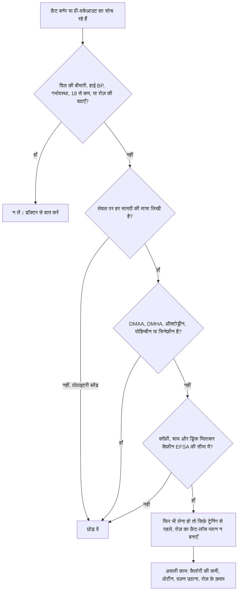

:::answer
ज़्यादातर फ़ैट बर्नर और प्री-वर्कआउट असल में स्टिमुलेंट होते हैं: मुख्य रूप से कैफ़ीन, कभी-कभी बिटर ऑरेंज (सिनेफ़्रीन), योहिम्बीन, और सबसे बुरे मामलों में DMAA जैसी बैन दवाएँ। कैफ़ीन से ट्रेनिंग थोड़ी बेहतर हो सकती है, पर चर्बी पर इसका असर बहुत कम है। यूरोप की फ़ूड सेफ़्टी एजेंसी (EFSA) स्वस्थ वयस्कों के लिए एक बार में 200 mg तक और दिन भर में 400 mg तक को सुरक्षित मानती है; प्री-वर्कआउट के साथ कॉफ़ी और एनर्जी ड्रिंक लेने से यह सीमा पार हो सकती है। अमेरिका के आँकड़ों में सप्लीमेंट से लिवर ख़राब होने के मामले बढ़े हैं, और भारत की लैब जाँचों में कई प्रोडक्ट लेबल से मेल नहीं खाते। चर्बी घटती है लगातार कैलोरी की कमी, पूरे प्रोटीन, वज़न उठाने और दिन भर ज़्यादा चलने-फिरने से। जिम में सीने में दर्द, चक्कर या धड़कन बहुत तेज़ हो, तो रुकें और जाँच कराएँ।
:::

## डिब्बे के अंदर क्या है

"श्रेड", "थर्मो" या "प्री" वाले ज़्यादातर प्रोडक्ट के पीछे ये चीज़ें मिलेंगी:

- **कैफ़ीन,** कई बार "नैचुरल" नामों में छिपा: ग्रीन कॉफ़ी, ग्वाराना, ग्रीन टी एक्सट्रैक्ट
- **सिनेफ़्रीन,** बिटर ऑरेंज से
- **योहिम्बीन** या योहिम्बे की छाल का एक्सट्रैक्ट
- **ग्रीन टी एक्सट्रैक्ट, गार्सीनिया कैम्बोजिया** जैसे "मेटाबॉलिज़्म बूस्टर"
- **"प्रोप्राइटरी ब्लेंड",** जिसमें सामग्री के नाम तो हैं पर मात्रा नहीं

आख़िरी वाली सबसे बड़ी दिक़्क़त है। मात्रा न लिखी हो तो आपको पता ही नहीं कि कितना स्टिमुलेंट निगल रहे हैं, और कुछ प्रोडक्ट में ऐसी दवाएँ होती हैं जो लेबल पर हैं ही नहीं।

## कैफ़ीन: मुख्य सामग्री और उसकी सीमा

कैफ़ीन से भारी सेशन थोड़ा आसान लग सकता है। पर इससे ज़्यादा चर्बी घटने की उम्मीद न रखें।

असली सवाल है: कितना? EFSA की 2015 की वैज्ञानिक राय के अनुसार स्वस्थ वयस्कों के लिए ([EFSA, 2015](https://www.efsa.europa.eu/en/topics/topic/caffeine)):

- **एक बार में 200 mg तक** (लगभग 3 mg प्रति किलो वज़न) सभी स्रोतों से मिलाकर, सुरक्षा की चिंता नहीं।
- **दिन भर में 400 mg तक** (लगभग 5.7 mg प्रति किलो), गर्भावस्था को छोड़कर।
- **गर्भवती और स्तनपान कराने वाली महिलाएँ:** दिन में 200 mg तक।
- **बच्चे और किशोर:** लगभग 3 mg प्रति किलो वज़न रोज़।
- **कसरत से पहले:** भारी कसरत से दो घंटे के अंदर एक बार 200 mg, सामान्य माहौल में, चिंता की बात नहीं। पर गर्भवती महिलाओं या अधेड़ और बुज़ुर्ग लोगों पर ऐसी कोई स्टडी नहीं है।
- **नींद:** सोने से पहले 100 mg भी कुछ लोगों की नींद बिगाड़ सकता है।

EFSA के अनुसार एक एस्प्रेसो (60 ml) में लगभग 80 mg, फ़िल्टर कॉफ़ी के कप (200 ml) में लगभग 90 mg, काली चाय के कप (220 ml) में लगभग 50 mg, कोला के कैन (355 ml) में लगभग 40 mg, और 250 ml एनर्जी ड्रिंक में लगभग 80 mg कैफ़ीन होता है। हमारी चाय में कैफ़ीन इस पर निर्भर है कि कितनी कड़क बनी है।

सुबह दो कप कड़क कॉफ़ी, दोपहर में एक कैन, शाम 6 बजे प्री-वर्कआउट का स्कूप, और ऊपर से एक "फ़ैट बर्नर" कैप्सूल। लेबल पर लिखा कैफ़ीन जोड़ें, तो एक बार में 200 mg या दिन में 400 mg पार होना बहुत आसान है। जिस लेबल पर कैफ़ीन की मात्रा न लिखी हो, वह न लें।

### भारत में FSSAI के नियम

FSSAI कैफ़ीन वाले पेय में कैफ़ीन 145 से 300 mg प्रति लीटर तक सीमित करता है। लेबल पर "दिन में 500 ml से ज़्यादा न पिएँ" और "बच्चों, गर्भवती या स्तनपान कराने वाली महिलाओं और कैफ़ीन के प्रति संवेदनशील लोगों के लिए अनुशंसित नहीं" लिखना ज़रूरी है। 2026 में FSSAI ने कंपनियों से "एनर्जी ड्रिंक" नाम हटाने को कहा, 29 सितंबर 2026 तक की मोहलत दी, और ऊर्जा बढ़ाने के दावों की इजाज़त नहीं दी ([BeverageDaily, 2026](https://www.beveragedaily.com/Article/2026/08/27/not-enough-time-india-gives-90-day-deadline-to-re-label-energy-drinks/))।

हिसाब: 300 mg प्रति लीटर की ऊपरी सीमा पर 500 ml में 150 mg कैफ़ीन होगा। इसके साथ प्री-वर्कआउट का स्कूप लें तो EFSA की 200 mg की एक बार वाली सीमा शायद पार हो जाएगी। क्रिकेट प्रैक्टिस से पहले कैन पीने वाले किशोरों के लिए ही यह चेतावनी है।

[[ad]]

## बैन स्टिमुलेंट: DMAA, DMHA और उनके भाई-बंधु

**DMAA** (1,3-डाइमिथाइलएमाइलएमीन, जिसे मिथाइलहेक्सानेमीन भी कहते हैं) एक सिंथेटिक स्टिमुलेंट है जो प्री-वर्कआउट और फ़ैट बर्नर में मिला। अमेरिकी FDA ने इसे सप्लीमेंट से बैन किया और चेतावनी दी कि इससे हाई BP से लेकर हार्ट अटैक तक का ख़तरा हो सकता है ([Clinical Toxicology, 2018](https://pubmed.ncbi.nlm.nih.gov/29115866/))।

DMAA हटने के बाद मिलते-जुलते स्टिमुलेंट आ गए। 2018 की एक लैब स्टडी में "DMHA" जैसे धुंधले लेबल वाले छह अमेरिकी ब्रांड जाँचे गए, और उनमें ऑक्टोड्रीन (DMHA), 1,4-DMAA, और बैन 1,3-DMAA व 1,3-DMBA मिले। ऑक्टोड्रीन की मात्रा यूरोप की पुरानी दवाओं की सबसे बड़ी मात्रा से दोगुने से ज़्यादा थी, और 1,4-DMAA इंसानों के लिए कभी मंज़ूर ही नहीं हुआ।

खिलाड़ियों के लिए: WADA ने मिथाइलहेक्सानेमीन (DMAA) और ऑक्टोड्रीन को प्रतियोगिता में प्रतिबंधित स्टिमुलेंट की सूची में रखा है। कैफ़ीन और सिनेफ़्रीन बैन नहीं, बल्कि निगरानी सूची में हैं ([WADA, 2026](https://www.wada-ama.org/en/prohibited-list))। NADA इंडिया WADA की सूची मानता है, इसलिए मिलावटी प्री-वर्कआउट करियर भी ख़त्म कर सकता है।

लेबल पर ये नाम दिखें तो डिब्बा रख दें: DMAA, 1,3-dimethylamylamine, methylhexaneamine, DMHA, octodrine, 2-aminoisoheptane, DMBA, और स्टिमुलेंट के तौर पर लिखा "Aconitum" एक्सट्रैक्ट।

## सिनेफ़्रीन (बिटर ऑरेंज)

2022 की एक सिस्टमैटिक रिव्यू और मेटा-एनालिसिस (18 स्टडी) में लंबे इस्तेमाल पर सिनेफ़्रीन से ऊपर वाला BP औसतन लगभग 6.37 mmHg और नीचे वाला लगभग 4.33 mmHg बढ़ा। वज़न में कोई ख़ास कमी नहीं आई, और शरीर की बनावट नहीं बदली। लेखकों का निष्कर्ष: सिनेफ़्रीन BP और धड़कन बढ़ाता है, और वज़न घटाने में मदद का कोई सबूत नहीं ([Nutrients, 2022](https://doi.org/10.3390/nu14194019))। EFSA ने भी कैफ़ीन और सिनेफ़्रीन के मेल को अलग से जाँचा, क्योंकि वज़न घटाने वाले कई प्रोडक्ट दोनों को साथ रखते हैं।

## योहिम्बीन

योहिम्बीन एक अफ़्रीकी पेड़ की छाल से आता है और "ज़िद्दी चर्बी" के नाम पर बिकता है। इसके एक्सट्रैक्ट कई देशों में बैन हैं। 2016 की एक स्टडी में अमेरिका के 49 ब्रांड जाँचे गए ([Drug Testing and Analysis, 2016](https://pubmed.ncbi.nlm.nih.gov/26391406/)): किसी में योहिम्बीन मिला ही नहीं, तो किसी में दवा जितनी मात्रा। सिर्फ़ 11 ब्रांड (22%) ने मात्रा लिखी थी, और उनमें से ज़्यादातर ग़लत थीं, असल मात्रा लेबल की 23% से 147% तक। नौ (18%) ने साइड इफ़ेक्ट के बारे में कुछ नहीं लिखा।

## लिवर: चुपचाप होने वाला नुकसान

अमेरिका का ड्रग-इंड्यूस्ड लिवर इंजरी नेटवर्क (DILIN) दवाओं और सप्लीमेंट से लिवर को हुए नुकसान के मरीज़ों पर नज़र रखता है। 2014 की रिपोर्ट में हर्बल और डाइटरी सप्लीमेंट से होने वाले लिवर नुकसान का हिस्सा स्टडी के दौरान 7% से बढ़कर 20% हो गया ([Hepatology, 2014](https://pmc.ncbi.nlm.nih.gov/articles/PMC4293199/))। 839 मरीज़ों में से 130 (15.5%) का नुकसान सप्लीमेंट से था: 45 बॉडीबिल्डिंग प्रोडक्ट से, 85 दूसरे सप्लीमेंट से। बॉडीबिल्डिंग सप्लीमेंट से युवकों में लंबा पीलिया हुआ (मीडियन 91 दिन)। दूसरे सप्लीमेंट वाले मामलों में मौत या लिवर ट्रांसप्लांट दवाओं के मुक़ाबले ज़्यादा हुए (13% बनाम 3%)।

भारत में सिटिज़न्स प्रोटीन प्रोजेक्ट ने 36 लोकप्रिय प्रोटीन सप्लीमेंट जाँचे और 25 (69.4%) में लेबल से कम प्रोटीन मिला। कुछ में ऐसे हर्बल एक्सट्रैक्ट थे जिन्हें लेखकों ने लिवर के लिए नुकसानदेह बताया, ख़ासकर ग्रीन टी एक्सट्रैक्ट और गार्सीनिया कैम्बोजिया, जो फ़ैट बर्नर की आम सामग्री हैं ([Medicine, 2024](https://pmc.ncbi.nlm.nih.gov/articles/PMC10994440/))।

लिवर की दिक़्क़त के संकेत: आँखें या त्वचा पीली, गहरा पेशाब, हल्के रंग का मल, खुजली, भूख न लगना, दाईं पसलियों के नीचे दर्द। प्रोडक्ट बंद करें और डॉक्टर को दिखाएँ।

[[ad]]

## क्या फ़ैट बर्नर काम करते हैं?

ईमानदार जवाब: मुश्किल से, और सबूत कमज़ोर हैं। 2021 में Obesity जर्नल की एक सिस्टमैटिक रिव्यू ने 14 तरह के वज़न घटाने वाले सप्लीमेंट और वैकल्पिक इलाजों के 315 रैंडमाइज़्ड ट्रायल देखे ([Obesity, 2021](https://pmc.ncbi.nlm.nih.gov/articles/PMC8231729/))। सिर्फ़ 52 (16.5%) अच्छी क्वालिटी के थे, और उनमें से सिर्फ़ 16 (31%) में वज़न में असली फ़र्क़ दिखा, 0.3 से 4.93 किलो तक।

:::mythfact
| मिथक | सच |
|---|---|
| "फ़ैट बर्नर पेट की चर्बी पिघला देते हैं।" | कोई सप्लीमेंट एक जगह की चर्बी नहीं हटाता। अच्छी क्वालिटी के ज़्यादातर ट्रायल में असर नहीं दिखा। |
| "हर्बल है तो सुरक्षित है।" | ग्रीन टी एक्सट्रैक्ट और गार्सीनिया लिवर नुकसान की रिसर्च में आते हैं। अमेरिका में सप्लीमेंट से लिवर नुकसान का हिस्सा बढ़ा। |
| "ज़्यादा कैफ़ीन, ज़्यादा फ़ैट बर्न।" | EFSA की सीमा से ऊपर मिलता है तेज़ धड़कन, घबराहट और ख़राब नींद। |
| "बिटर ऑरेंज हल्का और सुरक्षित है।" | 2022 के मेटा-एनालिसिस में इससे BP बढ़ा, वज़न घटने का सबूत नहीं मिला। |
| "ऑनलाइन बिक रहा है तो मंज़ूर होगा।" | भारत की लैब जाँचों में कई सप्लीमेंट लेबल से मेल नहीं खाते। ब्लेंड में बैन स्टिमुलेंट छिप सकते हैं। |
| "वर्कआउट से पहले एनर्जी ड्रिंक ठीक है।" | FSSAI लेबल कहता है बच्चों, गर्भवती और कैफ़ीन-संवेदनशील लोगों के लिए नहीं। प्री-वर्कआउट के साथ कैफ़ीन सीमा पार कर सकता है। |
:::

## चर्बी असल में कैसे घटती है

ISSN के पोज़ीशन स्टैंड के अनुसार चर्बी घटाने वाली डाइट की नींव लगातार कैलोरी की कमी है ([ISSN, 2017](https://doi.org/10.1186/s12970-017-0174-y))। लो-फ़ैट से लो-कार्ब तक कई तरीक़े लगभग बराबर काम करते हैं, धीरे वज़न घटाने से दुबले लोगों में मांसपेशी बेहतर बचती है, और ज़्यादा प्रोटीन डाइट के दौरान मांसपेशी बचाने में मदद करता है।

1. **ऐसी कैलोरी की कमी जो निभ सके।** चावल-रोटी थोड़ी कम, तला-भुना कम, चाय में चीनी कम, मिठाई और जूस कम। अपना [BMI](/health/health-calculators/bmi-calculator) और कमर देखें, ज़रूरत हो तो डाइटीशियन से मिलें।
2. **हर खाने में प्रोटीन।** दाल, चना, राजमा, सोया, पनीर, दही, अंडे, चिकन, मछली। हमारी [प्रोटीन गाइड](/health/blog/protein-requirement-calculator-india) देखें।
3. **हफ़्ते में दो से चार बार वज़न उठाएँ,** ताकि चर्बी घटे और मांसपेशी बचे।
4. **जिम के बाहर ज़्यादा चलें-फिरें (NEAT)।** चलना, खड़े रहना, सीढ़ियाँ, घर का काम। सोसाइटी में सीढ़ियाँ लें, बाज़ार पैदल जाएँ, फ़ोन पर बात करते हुए टहलें।
5. **नींद और धैर्य।** सात घंटे से ज़्यादा सोएँ। तराज़ू पानी, नमक और पीरियड्स से ऊपर-नीचे होता है।

[[ad]]

## जिम में दिल के ख़तरे के संकेत

कसरत लंबे समय में दिल की रक्षा करती है। पर स्टिमुलेंट, गर्म जिम और भारी सेट का मेल हल्के में न लें, ख़ासकर 35 के बाद, परिवार में जल्दी हार्ट अटैक का इतिहास हो, या आप सिगरेट पीते हों। हमारी [जिम में दिल की सुरक्षा](/health/blog/gym-heart-safety-chest-pain) और [40 से कम उम्र में हार्ट अटैक](/health/blog/heart-attack-under-40-india) वाली पोस्ट देखें।

:::warning तुरंत ट्रेनिंग रोकें और मदद लें अगर
- सीने में दर्द, दबाव, जकड़न या भारीपन, ख़ासकर अगर बाँह, जबड़े, गर्दन या पीठ तक जाए
- मेहनत के हिसाब से बहुत ज़्यादा, अचानक साँस फूलना
- कसरत के दौरान या ठीक बाद बेहोशी, लगभग बेहोशी या अचानक चक्कर
- तेज़, धक-धक या बेतरतीब धड़कन जो आराम से न थमे
- इनके साथ ठंडा पसीना, उल्टी जैसा लगना या अजीब कमज़ोरी
- अचानक तेज़ सिरदर्द, उलझन, एक तरफ़ कमज़ोरी या बोलने में दिक़्क़त (स्ट्रोक हो सकता है)
- सप्लीमेंट के बाद आँखें पीली, गहरा पेशाब या दाईं पसलियों के नीचे दर्द
:::

सीने में दर्द या बेहोशी पर एम्बुलेंस (112) बुलाएँ। ख़ुद गाड़ी चलाकर न जाएँ, और "चलकर ठीक हो जाएगा" न सोचें। सप्लीमेंट का डिब्बा साथ ले जाएँ ताकि डॉक्टर लेबल देख सकें।

:::tip फिर भी प्री-वर्कआउट लेना हो तो
- हाई BP, दिल, थायरॉइड, घबराहट की दिक़्क़त हो या रोज़ दवाएँ लेते हों, तो पहले डॉक्टर से पूछें।
- ऐसा प्रोडक्ट चुनें जिसमें हर सामग्री की मात्रा लिखी हो।
- सभी स्रोतों से कैफ़ीन जोड़ें: एक बार में 200 mg और दिन में 400 mg से ज़्यादा नहीं।
- DMAA, DMHA, ऑक्टोड्रीन, योहिम्बीन और सिनेफ़्रीन से पूरी तरह दूर रहें।
- सोने से कई घंटे पहले स्टिमुलेंट न लें।
- प्री-वर्कआउट के साथ एनर्जी ड्रिंक, शराब या फ़ैट बर्नर कैप्सूल कभी नहीं।
- 18 से कम उम्र? प्री-वर्कआउट और एनर्जी ड्रिंक छोड़ें।
:::

## आम सवाल

:::faq
### जिम से पहले ब्लैक कॉफ़ी ठीक है?
ज़्यादातर स्वस्थ वयस्कों के लिए एक कप ठीक है और थोड़ी मदद कर सकता है। कुल कैफ़ीन EFSA की सीमा में रखें, और धड़कन तेज़ हो, BP बढ़े या नींद ख़राब हो तो छोड़ दें।

### क्या फ़ैट बर्नर से लिवर ख़राब हो सकता है?
कुछ से हो सकता है। अमेरिका के आँकड़ों में सप्लीमेंट से लिवर नुकसान का हिस्सा बढ़ा, और ग्रीन टी एक्सट्रैक्ट व गार्सीनिया जैसी चीज़ें इस रिसर्च में आती हैं। आँखें पीली हों या पेशाब गहरा हो तो डॉक्टर को दिखाएँ।

### क्या किशोरों के लिए प्री-वर्कआउट ठीक है?
नहीं। FSSAI लेबल कहता है बच्चों के लिए अनुशंसित नहीं, और EFSA की किशोरों वाली सीमा वज़न के हिसाब से है, इसलिए बड़ों का एक स्कूप आसानी से ज़्यादा हो जाता है।

### अगर DMAA वाला सप्लीमेंट ले लिया हो?
बंद करें। सीने में दर्द, तेज़ सिरदर्द, तेज़ धड़कन या चक्कर हो तो इमरजेंसी में जाएँ। ठीक लग रहा हो तो भी डॉक्टर को बताएँ और BP जँचवाएँ।

### क्या चर्बी घटाने के लिए कोई सप्लीमेंट ज़रूरी है?
नहीं। कैलोरी की कमी, हर खाने में प्रोटीन, वज़न उठाना और रोज़ ज़्यादा क़दम काम करते हैं।
:::

## आख़िरी बात

डिब्बा तेज़ी से चर्बी घटाने का वादा करता है। रिसर्च दिखाती है कि असर बहुत कम है, दिल और लिवर को असली ख़तरा है, और बाज़ार में लेबल पर भरोसा मुश्किल है। ट्रेनिंग से पहले कैफ़ीन लें तो सुरक्षित सीमा में, और छिपे ब्लेंड या बैन स्टिमुलेंट वाली चीज़ों से दूर रहें। हमने फ़ैट बर्नर समेत सप्लीमेंट के मिथकों पर एक छोटा हिंग्लिश वीडियो अपने YouTube चैनल [Royal Fitness TV](https://www.youtube.com/@RoyalFitnessTV?sub_confirmation=1) पर बनाया है।

खाने, ताक़त और रोज़ की चहलक़दमी पर टिका फ़ैट-लॉस प्लान चाहिए, तो सेक्टर 93, नोएडा के रॉयल फ़िटनेस क्लब के ट्रेनर आपके साथ बना सकते हैं।
