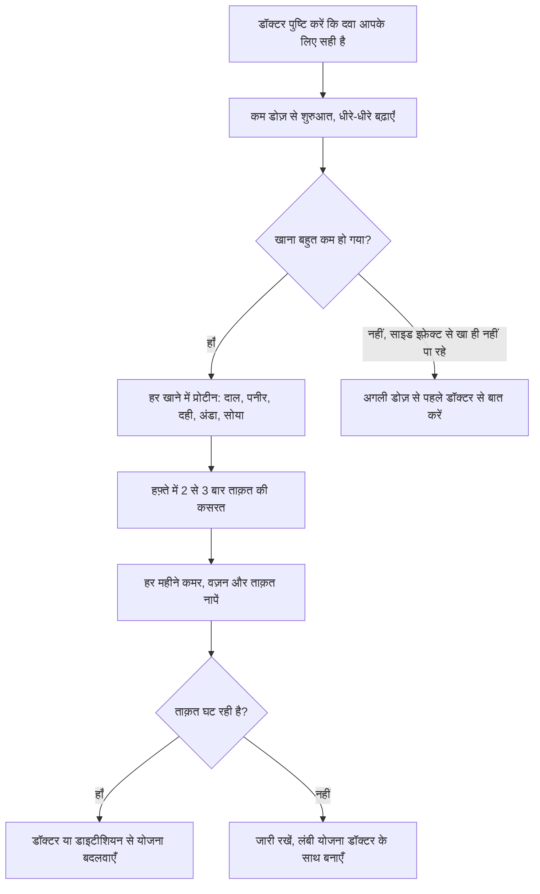

:::answer
सेमाग्लूटाइड वही दवा है जो Ozempic, Wegovy और Rybelsus में होती है। मार्च 2026 में इसका मुख्य पेटेंट ख़त्म होने के बाद भारतीय कंपनियों ने इसके सस्ते जेनेरिक उतारे। लेकिन सस्ता होने से यह हर किसी की दवा नहीं बन गई। यह डॉक्टर के पर्चे पर मिलने वाली दवा है: टाइप 2 डायबिटीज़ के लिए, या मोटापे (या वज़न से जुड़ी बीमारी के साथ ज़्यादा वज़न) के लिए। रिसर्च में इससे वज़न काफ़ी घटा, पर घटे वज़न का एक हिस्सा मांसपेशियाँ भी थीं, और दवा छोड़ने पर ज़्यादातर लोगों का वज़न लौट आया। अगर डॉक्टर इसे आपके लिए सही मानें, तो हर खाने में प्रोटीन और हफ़्ते में दो-तीन बार ताक़त की कसरत को इसके साथ ज़रूरी हिस्सा मानें।
:::

## 2026 में असल में क्या बदला

सेमाग्लूटाइड हमारी आँतों के एक हॉर्मोन GLP-1 की नक़ल करता है। यह दिमाग़ को "पेट भर गया" का संकेत देता है, पेट को धीरे ख़ाली करता है, और शुगर बढ़ने पर इंसुलिन निकलने में मदद करता है। यह हफ़्ते में एक बार लगने वाले इंजेक्शन के रूप में आता है, और रोज़ खाने वाली गोली भी है।

2026 से पहले भारत में इसे सिर्फ़ मूल कंपनी बेचती थी और महीने का ख़र्च आम परिवार की पहुँच से बाहर था। मार्च 2026 की ख़बरों के मुताबिक़ मूल ब्रांड की क़ीमत डोज़ के हिसाब से लगभग ₹8,800 से ₹10,000 महीना थी, जबकि जेनेरिक इंजेक्शन उससे काफ़ी कम क़ीमत पर उतरे ([CNBC](https://www.cnbc.com/2026/03/23/novo-nordisk-cheap-weight-loss-drugs-india-generic-ozempic-wegovy-semaglutide.html))। मई 2026 में एक जेनेरिक गोली भी आई, जिसकी शुरुआती क़ीमत ₹99 प्रति गोली बताई गई ([Business Today](https://www.businesstoday.in/industry/pharma/story/dr-reddys-launches-oral-semaglutide-tablets-at-rs99-per-pill-in-india-532551-2026-05-20))।

दो बातें याद रखें। पहली: क़ीमतें ब्रांड, डोज़ और पैक के हिसाब से अलग हैं और महीने-दर-महीने बदल रही हैं, इसलिए हमारी बताई क़ीमत को भी मोटा अंदाज़ा ही मानें और केमिस्ट से पूछें। दूसरी: दवा सस्ती होने से यह तय होता है कि कौन ख़रीद सकता है, यह नहीं कि किसे लेनी चाहिए।

[[ad]]

## यह दवा असल में किसके लिए है

दो तरह के लोगों के लिए: एक, टाइप 2 डायबिटीज़ वाले वे लोग जिनकी शुगर मौजूदा इलाज से ठीक से काबू में नहीं है। दो, मोटापे वाले लोग, या वे जिनका वज़न ज़्यादा है और साथ में वज़न से जुड़ी कोई बीमारी है, जैसे हाई BP, प्रीडायबिटीज़, स्लीप एप्निया या फ़ैटी लिवर।

हम भारतीयों के लिए "मोटापा" का पैमाना थोड़ा अलग है। हमारे पेट के आसपास चर्बी ज़्यादा जमती है, और कम वज़न पर ही डायबिटीज़ और दिल की बीमारी का ख़तरा बढ़ जाता है। इसीलिए भारतीय विशेषज्ञों की सहमति में BMI 23 या ज़्यादा को "ओवरवेट" और 25 या ज़्यादा को "मोटापा" माना गया है, और कमर का नाप भी अहम संकेत है ([JAPI, 2009](https://pubmed.ncbi.nlm.nih.gov/19582986/))। अपना BMI हमारे [BMI कैलकुलेटर](/health/health-calculators/bmi-calculator) पर देखें, और डायबिटीज़ का ख़तरा [IDRS टूल](/health/india-risk) से जाँचें।

फ़ैसला सिर्फ़ BMI से नहीं होता। डॉक्टर आमतौर पर ये भी देखते हैं:

- HbA1c, BP, कोलेस्ट्रॉल और लिवर की जाँच
- आपने पहले खाने और कसरत की कोई योजना आज़माई या नहीं, और कहाँ दिक़्क़त आई
- आप कौन-सी दवाएँ ले रहे हैं, क्योंकि कुछ के साथ शुगर बहुत गिर सकती है
- पैंक्रियाटाइटिस, पथरी, किडनी की बीमारी या खाने से जुड़ी मानसिक दिक़्क़तों का इतिहास
- गर्भावस्था, स्तनपान, या गर्भ की योजना
- परिवार में थायरॉइड के एक दुर्लभ कैंसर (मेडुलरी थायरॉइड कैंसर) या MEN2 का इतिहास

### किन्हें यह नहीं लेनी चाहिए, या बहुत सावधानी चाहिए

गर्भावस्था और स्तनपान में यह दवा नहीं दी जाती, और गर्भ की योजना हो तो डॉक्टर इसे पहले ही बंद करने की सलाह देते हैं। मेडुलरी थायरॉइड कैंसर या MEN2 का निजी या पारिवारिक इतिहास हो तो इसे न लेने को कहा जाता है। पहले पैंक्रियाटाइटिस हुआ हो, पेट की गंभीर तकलीफ़ हो, या डायबिटीज़ से आँखों पर असर हो, तो विशेषज्ञ की राय ज़रूरी है। किशोरों, दुबले बुज़ुर्गों और खाने से जुड़ी बीमारी (एनोरेक्सिया, बुलीमिया) वाले लोगों में भूख दबाना नुकसान कर सकता है।

## रिसर्च ने क्या दिखाया, बिना बढ़ा-चढ़ाकर

सबसे बड़े ट्रायल STEP 1 में बिना डायबिटीज़ वाले मोटापे के मरीज़ों को 68 हफ़्ते तक हर हफ़्ते 2.4 mg का इंजेक्शन और जीवनशैली की सलाह दी गई। उनका वज़न औसतन लगभग 14.9% घटा, जबकि प्लेसिबो वालों का लगभग 2.4% ([NEJM, 2021](https://www.nejm.org/doi/full/10.1056/NEJMoa2032183))। 90 किलो के व्यक्ति के लिए यह औसतन क़रीब 13 किलो है।

औसत के पीछे बड़ा फ़र्क़ छिपा है: किसी का बहुत ज़्यादा घटा, किसी का बहुत कम। डायबिटीज़ वालों का वज़न आमतौर पर कम घटता है।

SELECT नाम के ट्रायल में उन लोगों को लिया गया जिन्हें पहले से दिल की बीमारी थी, वज़न ज़्यादा था, पर डायबिटीज़ नहीं। लगभग तीन साल में हार्ट अटैक, स्ट्रोक या दिल से मौत जैसी बड़ी घटनाएँ सेमाग्लूटाइड वालों में लगभग 20% कम रहीं ([NEJM, 2023](https://www.nejm.org/doi/full/10.1056/NEJMoa2307563))। ध्यान दें, यह फ़ायदा दिल के मरीज़ों में दिखा है; हर किसी के लिए यह मान लेना ठीक नहीं।

### पोस्टर पर न दिखने वाली बात: दवा छोड़ने पर क्या होता है

STEP 1 के आगे के अध्ययन में लोगों ने दवा और सलाह दोनों बंद कीं और एक साल तक उन पर नज़र रखी गई। उन्होंने घटे हुए वज़न का लगभग दो-तिहाई वापस पा लिया, और BP व शुगर के सुधार भी ज़्यादातर लौट गए ([Diabetes, Obesity and Metabolism, 2022](https://dom-pubs.onlinelibrary.wiley.com/doi/10.1111/dom.14725))। मतलब यह दवा एक लंबी चलने वाली स्थिति का इलाज करती है, शरीर को हमेशा के लिए "रीसेट" नहीं करती। बजट बनाते समय यह बात सबसे ज़रूरी है।

[[ad]]

## मांसपेशियाँ बचाना: सबसे अहम हिस्सा

जब आप बहुत कम खाते हैं तो चर्बी के साथ कुछ मांसपेशियाँ भी घटती हैं, अगर शरीर को उन्हें बचाने की वजह न मिले। मांसपेशियाँ घटने से कमज़ोरी आती है, आराम के समय कैलोरी कम जलती है, और वज़न लौटने का ख़तरा बढ़ता है।

### प्रोटीन: कहाँ से और कैसे

ICMR-NIN के दिशानिर्देश कहते हैं कि प्रोटीन ज़्यादातर रोज़ के खाने से आए, पाउडर से नहीं ([ICMR-NIN, 2024](https://www.nin.res.in/dietaryguidelines/index.html))। जब भूख कम हो, तो थाली का प्रोटीन वाला हिस्सा पहले खाएँ, ताकि चावल या रोटी से पेट पहले न भर जाए।

पेट पर हल्के, आसानी से मिलने वाले विकल्प:

- गाढ़ी दाल, सांभर, मूंग दाल या बेसन का चीला
- दही, हंग कर्ड, छाछ, पनीर, टोफ़ू
- उबला अंडा, कम तेल की भुर्जी, मछली, नरम करी में चिकन
- भुना चना, पुलाव में सोया चंक्स, अंकुरित दाल की चाट
- बिना चीनी का दूध या थोड़ी लस्सी

छोटे-छोटे चार-पाँच बार खाएँ, दो भारी खानों से बेहतर रहता है।

### ताक़त की कसरत: इसके बिना बात नहीं बनेगी

मांसपेशी तभी बचती है जब उससे वज़न के ख़िलाफ़ काम लिया जाए। ज़्यादातर नए लोगों के लिए हफ़्ते में दो-तीन बार 30 से 45 मिनट काफ़ी है: कुर्सी तक स्क्वैट, दीवार या बेंच पर पुश-अप, रेज़िस्टेंस बैंड या डम्बल से रो, हिप ब्रिज, और भारी थैला उठाकर चलना। हफ़्तों में धीरे-धीरे वज़न बढ़ाएँ। सैर सेहत के लिए बढ़िया है, पर बड़ी मात्रा में वज़न घटाते समय अकेली सैर मांसपेशियाँ नहीं बचा पाती।

:::tip काम के टिप्स
- धीरे खाएँ और "आराम से भर गया" पर रुक जाएँ। इस दवा पर पेट भरने का संकेत देर से आता है, और ज़्यादा खाने से उल्टी जैसा लगता है।
- तला-भुना और बहुत तेल वाला खाना कभी-कभार ही रखें, क्योंकि चिकनाई पेट को और धीमा कर देती है।
- दिन भर घूँट-घूँट पानी पीते रहें, ख़ासकर गर्मियों में।
- एक छोटी डायरी रखें: वज़न, कमर, किसी एक कसरत में उठाया वज़न, और साइड इफ़ेक्ट। हर बार डॉक्टर को दिखाएँ।
- दवा सिर्फ़ लाइसेंस वाली दुकान से, पर्चे के साथ और ठंडी रखी हुई ही ख़रीदें। सोशल मीडिया पर बिकने वाले "सेमाग्लूटाइड" या बिना लेबल की शीशियाँ कभी न लें।
:::

## साइड इफ़ेक्ट, सीधी बात

सबसे आम तकलीफ़ें पेट की हैं: जी मिचलाना, उल्टी, दस्त, क़ब्ज़, डकार, पेट फूलना और भूख कम लगना। ये अक्सर डोज़ बढ़ाते समय आती हैं और कुछ हफ़्तों में कम हो जाती हैं, इसीलिए डॉक्टर कम डोज़ से शुरू करके धीरे बढ़ाते हैं।

कम पर गंभीर समस्याएँ: पैंक्रियाटाइटिस (पेट के ऊपरी हिस्से में तेज़ दर्द जो पीठ तक जाए), पित्ताशय की दिक़्क़त, बार-बार उल्टी-दस्त से पानी की कमी और किडनी पर ज़ोर, इंसुलिन या कुछ डायबिटीज़ गोलियों के साथ शुगर बहुत गिरना, और कुछ लोगों में आँखों की डायबिटिक बीमारी का बिगड़ना।

:::warning तुरंत डॉक्टर के पास या अस्पताल जाएँ अगर
- पेट के ऊपरी हिस्से में तेज़ या लगातार दर्द हो, उल्टी के साथ या बिना
- एक दिन तक पानी भी न टिके, या पेशाब बहुत कम आए
- आँखें या त्वचा पीली हो जाएँ, या दाईं पसलियों के नीचे दर्द के साथ बुख़ार हो
- काँपना, पसीना और घबराहट हो (शुगर गिरने का संकेत), ख़ासकर इंसुलिन या डायबिटीज़ की गोली लेते हैं तो
- गले में गाँठ, निगलने में दिक़्क़त या लंबे समय तक आवाज़ बैठी रहे
- अचानक नज़र में बदलाव हो
- ख़ुद को नुकसान पहुँचाने के ख़याल आएँ
:::

[[ad]]

## परिवार में सुनी जाने वाली बातें और सच

:::mythfact
| मिथक | सच |
|---|---|
| "यह चर्बी पिघला देती है, खाना-कसरत की ज़रूरत नहीं।" | ट्रायल में दवा के साथ जीवनशैली की सलाह भी थी। प्रोटीन और कसरत के बिना ज़्यादा मांसपेशी घटती है। |
| "जेनेरिक मतलब घटिया।" | जेनेरिक को भी गुणवत्ता के मानक पूरे करने होते हैं। असली ख़तरा नक़ली माल, ग़लत तरीके से रखी दवा और बिना लाइसेंस वाले विक्रेता हैं। |
| "तीन महीने ले लो, हमेशा के लिए ठीक।" | ज़्यादातर लोगों का वज़न दवा छोड़ने के एक साल में काफ़ी हद तक लौट आया। लंबी योजना डॉक्टर के साथ बनाएँ। |
| "डोज़ जल्दी बढ़ाओ, असर जल्दी होगा।" | डोज़ धीरे इसलिए बढ़ती है ताकि साइड इफ़ेक्ट कम हों। जल्दबाज़ी से उल्टी, पानी की कमी और पैंक्रियाटाइटिस का ख़तरा बढ़ता है। |
| "आयुर्वेदिक चूर्ण भी यही करता है।" | किसी हर्बल उत्पाद ने ट्रायल में ऐसा असर नहीं दिखाया। ऑनलाइन बिकने वाले कुछ उत्पादों में छिपी अंग्रेज़ी दवाएँ मिली हैं। |
:::

## असली महीने का ख़र्च कैसे जोड़ें

सिर्फ़ पेन की क़ीमत पूरी तस्वीर नहीं है। हर महीने के बजट में जोड़ें: दवा (ब्रांड और डोज़ के हिसाब से), डॉक्टर की फ़ीस (डोज़ तय होने तक अक्सर हर महीने), ख़ून की जाँचें (HbA1c, किडनी, लिवर, लिपिड), थोड़ा ज़्यादा प्रोटीन वाला खाना, और जिम, ट्रेनर या घर पर बैंड और डम्बल। समझदारी इसी में है कि कम से कम एक साल का बजट सोचें, एक महीने का नहीं। अगर लंबे समय तक ख़र्च न उठा पाएँ, तो डॉक्टर से जीवनशैली की योजना, पुरानी सस्ती डायबिटीज़ दवाओं, या तय अवधि के कोर्स और उसके बाद की योजना पर बात करें।

अपनी डोज़ ख़ुद कभी न बदलें, ब्रांड ख़ुद न बदलें, और दवा अपने आप बंद न करें। जो भी बदलाव हो, डॉक्टर की सलाह से हो।

## अक्सर पूछे जाने वाले सवाल

:::faq
### क्या जेनेरिक सेमाग्लूटाइड मूल ब्रांड जितना ही अच्छा है?
मंज़ूरशुदा जेनेरिक में वही दवा होनी चाहिए और उसे गुणवत्ता के मानक पूरे करने होते हैं। फ़र्क़ अक्सर पेन, पैक और क़ीमत में होता है। बड़ा ख़तरा नक़ली दवा और ठंडी न रखी गई दवा का है, इसलिए पर्चे के साथ लाइसेंस वाली दुकान से ही लें।

### सिर्फ़ 5 किलो घटाना है, क्या बिना डॉक्टर के ले सकते हैं?
नहीं। यह डायबिटीज़ और मोटापे के लिए पर्चे वाली दवा है और इसके असली साइड इफ़ेक्ट हैं। थोड़े वज़न के लिए प्रोटीन वाला खाना, ताक़त की कसरत और अच्छी नींद ज़्यादा सुरक्षित और सस्ते हैं।

### क्या इससे मांसपेशियाँ घटेंगी?
घटे वज़न का कुछ हिस्सा मांसपेशी हो सकता है, ख़ासकर अगर प्रोटीन बहुत कम हो और कसरत न हो। हर खाने में प्रोटीन और हफ़्ते में दो-तीन बार वज़न वाली कसरत से ज़्यादा मांसपेशी बचती है।

### इंजेक्शन छोड़ने पर क्या होगा?
ट्रायल में ज़्यादातर लोगों का वज़न एक साल में काफ़ी लौट आया और BP-शुगर के सुधार भी कम हुए। दवा बंद करने की योजना डॉक्टर के साथ बनाएँ और खान-पान और कसरत की आदतें जारी रखें।

### गोली बेहतर है या इंजेक्शन?
दोनों में सेमाग्लूटाइड है। गोली रोज़ सख़्त नियमों (ख़ाली पेट, थोड़ा पानी, समय) के साथ ली जाती है, इंजेक्शन हफ़्ते में एक बार। आपके लिए क्या सही है, यह आपकी बीमारी, दिनचर्या और बजट देखकर डॉक्टर के साथ तय करें।
:::

## आख़िरी बात

सस्ता सेमाग्लूटाइड उन बहुत से भारतीयों के लिए अच्छी ख़बर है जिन्हें डायबिटीज़ या मोटापा है और जो पहले इसे नहीं ख़रीद पाते थे। पर यह गंभीर दवा है, कोई सप्लीमेंट नहीं। डॉक्टर की देखरेख, हर खाने में प्रोटीन और नियमित ताक़त की कसरत के साथ यह असरदार हो सकती है। अकेले, ग़लत जगह से ख़रीदकर, या अचानक छोड़कर लेने पर यह निराश या नुकसान कर सकती है।

ताक़त की कसरत वाली योजना में मदद चाहिए तो सेक्टर 93, नोएडा के रॉयल फ़िटनेस क्लब के ट्रेनर आपके डॉक्टर की सलाह के साथ एक सुरक्षित शुरुआती प्रोग्राम बना सकते हैं।
