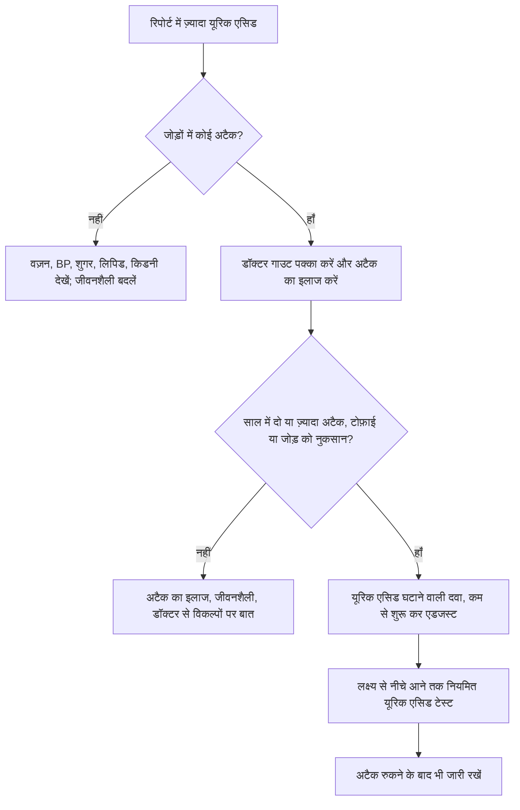

:::answer
यूरिक एसिड शरीर का एक सामान्य अपशिष्ट है। ब्लड रिपोर्ट में इसका ज़्यादा आना आम है, और ज़्यादातर लोगों को इससे कभी गाउट नहीं होता। गाउट तब होता है जब यूरिक एसिड किसी जोड़ में क्रिस्टल बना लेता है, जिससे अचानक तेज़ दर्द और सूजन होती है, अक्सर पैर के अँगूठे में। अटैक आमतौर पर शराब (ख़ासकर बीयर), मीठे पेय, मांस या सी-फ़ूड की भारी दावत, पानी की कमी, क्रैश डाइट और कुछ दवाओं से होते हैं। दाल, पनीर और टमाटर को अक्सर दोष दिया जाता है, पर शोध में पौधों के प्यूरीन से गाउट का जोखिम उस तरह बढ़ता नहीं दिखा जैसे मांस और सी-फ़ूड से। बार-बार अटैक वालों को अक्सर लंबे समय तक यूरिक एसिड घटाने वाली दवा चाहिए, जो डॉक्टर शुरू और एडजस्ट करते हैं। बिना लक्षण के सिर्फ़ ज़्यादा नंबर का आमतौर पर दवा से इलाज नहीं होता।
:::

## यूरिक एसिड और गाउट एक चीज़ नहीं

शरीर प्यूरीन तोड़ते समय यूरिक एसिड बनाता है। ज़्यादातर प्यूरीन हमारी अपनी कोशिकाओं से आते हैं और कम हिस्सा खाने से। किडनी यूरिक एसिड को पेशाब में निकालती है।

जब ख़ून में यूरिक एसिड लगभग 6.8 mg/dL से ऊपर जाता है, तो यह सुई जैसे क्रिस्टल बना सकता है, ख़ासकर अँगूठे जैसे ठंडे जोड़ों में। पर हर ज़्यादा लेवल वाले में क्रिस्टल नहीं बनते, और जिनमें बनते हैं उनमें से भी कई को कभी लक्षण नहीं होते। तो दो अलग हालात हैं:

- **बिना लक्षण के ज़्यादा यूरिक एसिड।** बहुत आम, अक्सर रूटीन हेल्थ चेकअप में मिलता है। अमेरिकन कॉलेज ऑफ़ रूमेटोलॉजी (ACR) की 2020 गाइडलाइन ज़्यादातर ऐसे लोगों में यूरिक एसिड घटाने वाली दवा शुरू न करने की सलाह देती है ([ACR, 2020](https://doi.org/10.1002/acr.24180))। फिर भी यह एक संकेत है: ज़्यादा यूरिक एसिड अक्सर पेट की चर्बी, हाई BP, फ़ैटी लिवर, ज़्यादा ट्राइग्लिसराइड और किडनी की दिक़्क़तों के साथ चलता है।
- **गाउट।** जोड़ में क्रिस्टल से दर्द और सूजन के अटैक, और सालों तक बिना इलाज के क्रिस्टल की गाँठें (टोफ़ाई) और जोड़ों को नुकसान। इसमें डॉक्टर और आमतौर पर लंबी योजना चाहिए।

## गाउट का अटैक कैसा होता है

आम गाउट अटैक अचानक शुरू होता है, अक्सर रात या सुबह-सुबह; एक जोड़ पकड़ता है, ज़्यादातर अँगूठा, पर टख़ना, पैर, घुटना, कलाई या उँगलियाँ भी; कुछ घंटों में इतना दर्द कि चादर छूना भी चुभे; जोड़ लाल, सूजा, गर्म और चमकदार; और एक-दो हफ़्ते में अपने आप शांत हो जाता है, फिर महीनों बाद लौट सकता है।

ज़्यादा यूरिक एसिड के साथ हर दर्द वाला जोड़ गाउट नहीं होता। जोड़ का इन्फ़ेक्शन, दूसरी क्रिस्टल बीमारी, चोट और दूसरे गठिया भी ऐसे दिख सकते हैं। डॉक्टर जोड़ का पानी निकालकर क्रिस्टल देख सकते हैं, जो सबसे पक्का तरीक़ा है। अटैक के दौरान ख़ून का यूरिक एसिड सामान्य भी आ सकता है, तो उस समय का सामान्य नतीजा गाउट को रद्द नहीं करता।

[[ad]]

## अटैक असल में किससे होते हैं

- **शराब, ख़ासकर बीयर और स्पिरिट**, और एक साथ ज़्यादा पीना
- **मीठे पेय।** 46,000 से ज़्यादा पुरुषों पर 12 साल के अध्ययन में रोज़ दो या ज़्यादा मीठे सॉफ़्ट ड्रिंक पीने वालों में गाउट का जोखिम कम पीने वालों से साफ़ ज़्यादा था; डाइट ड्रिंक का कोई संबंध नहीं दिखा ([BMJ, 2008](https://doi.org/10.1136/bmj.39449.819271.BE))। चीनी मिले पैकेट जूस भी शायद ऐसा ही करते हैं।
- **मटन, कलेजी जैसे अंग और सी-फ़ूड की भारी दावत**, शादियों, पार्टियों और त्योहारों पर
- **पानी की कमी**: गर्मी, घंटों पानी न पीना, जिम में भारी पसीना, बुख़ार या दस्त
- **क्रैश डाइट और लंबे उपवास**, जो कुछ समय के लिए यूरिक एसिड बढ़ाते हैं
- **कुछ दवाएँ**, जैसे BP की कुछ पेशाब वाली दवाएँ (डाइयूरेटिक) और कम डोज़ की एस्पिरिन। लिखी हुई दवा अपने आप बंद न करें; डॉक्टर से विकल्प पूछें।
- **यूरिक एसिड घटाने वाली दवा शुरू करना**, क्योंकि गिरता लेवल क्रिस्टल ढीले कर सकता है; डॉक्टर इस दौर में बचाव का इलाज देते हैं।

## खाने के मिथक: दाल, टमाटर और पनीर

गाउट वाले बहुत से भारतीयों से कहा जाता है कि सारी दाल, राजमा, चना, पनीर, पालक, मशरूम और टमाटर छोड़ दें। सबूत इतनी बड़ी पाबंदी का साथ नहीं देते। 47,000 से ज़्यादा पुरुषों पर 12 साल के एक बड़े अध्ययन में ज़्यादा मांस और सी-फ़ूड गाउट से जुड़े थे, पर **प्यूरीन वाली सब्ज़ियाँ और कुल प्रोटीन ज़्यादा जोखिम से नहीं जुड़े**, और **दूध-दही कम जोखिम से जुड़े थे** ([NEJM, 2004](https://doi.org/10.1056/NEJMoa035700))। दाल और सब्ज़ियाँ सेहतमंद भारतीय खाने का केंद्र हैं, और ICMR-NIN गाइडलाइन इन्हें दिल और मेटाबॉलिक सेहत के लिए सुझाती है ([ICMR-NIN, 2024](https://www.nin.res.in/dietaryguidelines/pdfjs/locale/DGI24thJune2024fin.pdf))।

कुछ लोगों को लगता है कि कोई ख़ास चीज़, जैसे टमाटर, उनके अटैक लाती है। अगर यह बार-बार होता है तो उसे कम करना ठीक है। पर सारी दाल और सब्ज़ियाँ हटाने से खाना अक्सर बिगड़ता है और असली वजहें, यानी शराब, चीनी, ज़्यादा वज़न और पानी की कमी, जस की तस रहती हैं।

ACR गाइडलाइन शराब, प्यूरीन और हाई-फ़्रक्टोज़ चीनी सीमित करने और ज़्यादा वज़न हो तो घटाने की सलाह देती है, पर यह भी कहती है कि बार-बार गाउट वालों में अकेले ये बदलाव यूरिक एसिड को लक्ष्य तक कम ही ला पाते हैं ([ACR, 2020](https://doi.org/10.1002/acr.24180))। यही गाइडलाइन गाउट के लिए विटामिन C की गोलियाँ न लेने की सलाह देती है।

**गाउट के अनुकूल एक भारतीय दिन (सिर्फ़ उदाहरण, नुस्ख़ा नहीं):** सुबह पहले पानी, फिर कम चीनी की चाय; नाश्ते में सब्ज़ी पोहा, उपमा, बेसन चीला या ओट्स के साथ कम फ़ैट दही; बीच में अमरूद, संतरा या पपीता जैसा फल, पैकेट जूस नहीं; दोपहर में दाल या राजमा, ढेर सब्ज़ी, सलाद, ठीक मात्रा में रोटी या चावल और कोल्ड ड्रिंक की जगह छाछ; शाम को भुना चना या मुट्ठी भर मेवे; रात में पनीर, टोफ़ू या अंडा, या मांसाहारियों के लिए थोड़ा चिकन या मछली, सब्ज़ी के साथ। दिन भर इतना पानी कि पेशाब हल्का पीला रहे।

## लंबा इलाज

**अटैक का इलाज:** आमतौर पर सूजन घटाने वाली दवाओं, कोल्चिसीन या स्टेरॉयड से, आपकी किडनी, पेट और डायबिटीज़ की हालत देखकर। कौन सी और कितनी, डॉक्टर तय करेंगे। घर पर जोड़ को आराम दें, ऊपर रखें, कपड़े में लपेटा ठंडा पैक थोड़ी-थोड़ी देर लगाएँ और पानी पिएँ।

**लंबे समय तक यूरिक एसिड घटाना:** ACR और EULAR दोनों गाइडलाइन बार-बार अटैक, टोफ़ाई या जोड़ों को नुकसान वालों के लिए लंबी दवा और "ट्रीट टू टारगेट" तरीक़ा सुझाती हैं: डोज़ धीरे-धीरे बढ़ाई जाती है जब तक ख़ून का लेवल 6 mg/dL से नीचे न आ जाए, और गंभीर बीमारी में और नीचे ([ACR, 2020](https://doi.org/10.1002/acr.24180); [EULAR, 2016](https://doi.org/10.1136/annrheumdis-2016-209707))। ध्यान रखें: पहले कुछ महीनों में अटैक बढ़ भी सकते हैं, इसका मतलब यह नहीं कि दवा काम नहीं कर रही; अटैक के दौरान दवा बंद न करें जब तक डॉक्टर न कहें; यह आमतौर पर लंबे समय की दवा है; और दवा पर कोई नया रैश हो तो तुरंत डॉक्टर को बताएँ। लैब रिपोर्ट देखकर केमिस्ट से यूरिक एसिड की गोली न ख़रीदें; डोज़ डॉक्टर ही तय करें।

:::tip रोज़ की आदतें जो मदद करती हैं
- पानी पास रखें और दिन भर पिएँ; गर्मी और जिम वाले दिन ज़्यादा।
- मीठे पेय, पैकेट जूस और मीठी लस्सी कम करें।
- शराब कम रखें, बीयर और एक साथ ज़्यादा पीने से बचें।
- शादी-पार्टी में मटन, कलेजी और सी-फ़ूड कम, दाल-सब्ज़ी-सलाद ज़्यादा लें।
- वज़न धीरे-धीरे घटाएँ, क्रैश डाइट या लंबे उपवास से नहीं।
- कम फ़ैट वाला दूध और दही चुनें; ये कम गाउट जोखिम से जुड़े हैं।
:::

[[ad]]

## गाउट, किडनी और दिल

गाउट शायद ही कभी "सिर्फ़ जोड़ों की बीमारी" होता है। यूरिक एसिड किडनी में पथरी बना सकता है, और पुराना गाउट किडनी रोग से जुड़ा है। गाउट के साथ अक्सर हाई BP, डायबिटीज़, ज़्यादा ट्राइग्लिसराइड, फ़ैटी लिवर और दिल की बीमारी भी होती है। डॉक्टर के पास जाएँ तो पिछली रिपोर्टें साथ ले जाएँ: यूरिक एसिड, क्रिएटिनिन या eGFR, HbA1c, लिपिड प्रोफ़ाइल, BP रीडिंग और सारी दवाओं-सप्लीमेंट की सूची। हाई BP भी है तो पूछें कि आपकी BP दवा गाउट वाले के लिए सबसे सही है या नहीं।

**महिलाएँ और बुज़ुर्ग:** गाउट पुरुषों में ज़्यादा है, पर मेनोपॉज़ के बाद महिलाओं में जोखिम बढ़ता है। बुज़ुर्गों में गाउट कई जोड़ों में एक साथ या धीरे शुरू हो सकता है, अक्सर डाइयूरेटिक लेने वालों में, और उनकी किडनी व दवाओं की वजह से इलाज में ज़्यादा सावधानी चाहिए।

**कसरत:** अटैक के बीच नियमित कसरत वज़न, BP, शुगर और ट्राइग्लिसराइड सुधारती है। अटैक में जोड़ को आराम दें, दर्द में ज़ोर न लगाएँ; शांत होने पर चलना, साइकिल, तैराकी और हल्की स्ट्रेंथ ट्रेनिंग से वापसी करें; ट्रेनिंग से पहले, दौरान और बाद पानी पिएँ; और "वेट कटिंग" के लिए पानी की कमी या बहुत सख़्त डाइट से बचें।

:::warning जल्दी डॉक्टर को दिखाएँ अगर
- कोई जोड़ अचानक गर्म, लाल, सूजा और बहुत दर्दनाक हो, ख़ासकर बुख़ार या कँपकँपी के साथ (यह इन्फ़ेक्शन हो सकता है, जो इमरजेंसी है)
- गाउट जैसा यह आपका पहला अटैक है
- साल में दो या ज़्यादा अटैक हैं, या जोड़ों के पास या कान पर गाँठें हैं
- पेशाब में ख़ून, कमर या बग़ल में तेज़ एकतरफ़ा दर्द, या पथरी निकले
- यूरिक एसिड की दवा शुरू करने के बाद नया रैश, मुँह में छाले या बुख़ार हो
- किडनी, दिल की बीमारी या डायबिटीज़ है और पता नहीं कौन सी दर्द की दवा सुरक्षित है
:::

## मिथक और सच

:::mythfact
| मिथक | सच |
|---|---|
| "रिपोर्ट में यूरिक एसिड ज़्यादा है, मतलब गाउट है।" | ज़्यादा यूरिक एसिड वाले ज़्यादातर लोगों को गाउट नहीं होता। गाउट मतलब क्रिस्टल से जोड़ों के अटैक। |
| "दाल, पनीर और टमाटर से गाउट होता है, सब छोड़ दो।" | शोध में प्यूरीन वाली सब्ज़ियाँ ज़्यादा गाउट से नहीं जुड़ीं; दूध-दही कम से जुड़े। शराब, मीठे पेय और मांस ज़्यादा मायने रखते हैं। |
| "अटैक में यूरिक एसिड नॉर्मल है, तो गाउट नहीं।" | अटैक के दौरान लेवल गिर सकता है। उस समय का सामान्य नतीजा गाउट रद्द नहीं करता। |
| "दर्द रुक गया, अब दवा बंद।" | लंबी दवा क्रिस्टल दोबारा बनने से रोकती है। बंद करने पर अटैक अक्सर लौटते हैं। |
| "सिर्फ़ खाने से गाउट क़ाबू में आ जाएगा।" | खाना मदद करता है, पर बार-बार अटैक वालों को आमतौर पर लक्ष्य तक पहुँचने के लिए दवा चाहिए। |
| "विटामिन C की गोली से यूरिक एसिड का इलाज हो जाता है।" | ACR गाइडलाइन गाउट के लिए विटामिन C सप्लीमेंट न लेने की सलाह देती है। |
:::

## अक्सर पूछे जाने वाले सवाल

:::faq
### यूरिक एसिड का नॉर्मल लेवल क्या है?
लैब अक्सर पुरुषों में लगभग 7 mg/dL तक और महिलाओं में थोड़ा कम की रेंज देती हैं। गाउट के इलाज में गाइडलाइन 6 mg/dL से नीचे का लक्ष्य रखती हैं। बिना लक्षण के ज़्यादा नंबर का आमतौर पर दवा से इलाज नहीं होता, पर यह वज़न, BP, शुगर और किडनी देखने की वजह है।

### क्या ज़्यादा यूरिक एसिड में दाल खा सकते हैं?
ज़्यादातर लोग खा सकते हैं। एक बड़े अध्ययन में प्यूरीन वाली सब्ज़ियाँ ज़्यादा गाउट से नहीं जुड़ीं, जबकि मांस और सी-फ़ूड जुड़े। कोई ख़ास दाल या सब्ज़ी अटैक लाती लगे, तो सिर्फ़ उसे कम करें।

### गाउट में कौन से पेय नुकसानदायक हैं?
शराब, ख़ासकर बीयर और स्पिरिट, और चीनी वाले पेय मुख्य हैं। चीनी मिले पैकेट जूस भी कम करें। पानी सबसे अच्छा है; कम फ़ैट वाला दूध ठीक है।

### यूरिक एसिड की दवा कितने समय लेनी होगी?
आमतौर पर लंबे समय तक। गाइडलाइन यूरिक एसिड 6 mg/dL से नीचे रखने का लक्ष्य रखती हैं ताकि क्रिस्टल घुलें और दोबारा न बनें। डोज़ डॉक्टर तय करते हैं और ब्लड टेस्ट से जाँचते हैं। अपने आप बंद न करें।

### क्या कसरत से गाउट बढ़ता है?
अटैक के बीच नियमित कसरत मदद करती है, क्योंकि यह वज़न, BP और शुगर सुधारती है। अटैक में आराम करें, पानी पूरा पिएँ, और ट्रेनिंग के आसपास पानी की कमी और क्रैश डाइट से बचें।
:::

## आख़िरी बात

ज़्यादा यूरिक एसिड की रिपोर्ट वज़न, BP, शुगर, लिपिड और किडनी देखने का इशारा है, घबराने या दाल छोड़ने का नहीं। गाउट अलग है: इसमें डॉक्टर चाहिए, अटैक का सही इलाज चाहिए, और बार-बार अटैक में आमतौर पर लक्ष्य तक एडजस्ट की गई लंबी दवा। साथ में सबसे काम की आदतें सीधी हैं: दिन भर पानी, कम शराब, मीठे पेय नहीं, मांस और सी-फ़ूड संयम से, और ज़रूरत हो तो धीरे-धीरे वज़न घटाना।

अगर आप गाउट के साथ अपने काम के हिसाब से ट्रेनिंग प्लान चाहते हैं, तो सेक्टर 93, नोएडा के रॉयल फ़िटनेस क्लब के ट्रेनर धीरे शुरू करके आगे बढ़ने में मदद कर सकते हैं।
