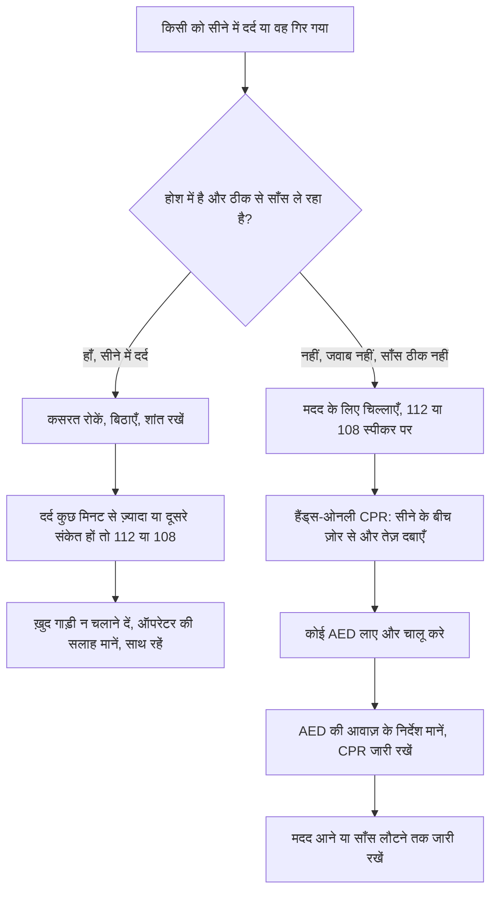

:::answer
वर्कआउट के दौरान या बाद में सीने में दबाव, जकड़न या दर्द को तब तक दिल की समस्या मानें जब तक डॉक्टर कुछ और न कहें। कसरत रोकें, बैठ जाएँ, और अगर दर्द कुछ मिनट से ज़्यादा रहे या साथ में साँस फूलना, पसीना, उलटी जैसा मन, या बाँह, जबड़े, पीठ या पेट के ऊपरी हिस्से में दर्द हो, तो 112 (या एम्बुलेंस के लिए 108) पर फ़ोन करें। कसरत के दौरान कार्डियक अरेस्ट दुर्लभ है, और नियमित कसरत करने वालों में हर सेशन का ख़तरा कम होता है। पर जब ऐसा होता है, तो तुरंत हैंड्स-ओनली CPR और AED से जान बचने की संभावना सबसे ज़्यादा बढ़ती है। सबसे सुरक्षित आदतें आसान हैं: अच्छा वार्म-अप, धीरे-धीरे बढ़ना, गर्मी में पानी, स्टेरॉयड से दूरी, ज़्यादा कैफ़ीन वाले प्री-वर्कआउट से सावधानी, और सीने के दर्द में कभी ट्रेनिंग न करना।
:::

## "भाई, गैस है, ENO ले ले"

भारतीय जिम में यह बात सबने सुनी है। कोई सेट के बीच रुकता है, सीना मलता है, कहता है जकड़न है। दोस्त कहता है एसिडिटी होगी, सोडा या एंटासिड ले ले, पाँच मिनट आराम कर और अगला सेट लगा।

कभी-कभी सच में एसिडिटी या सीने की मांसपेशी में खिंचाव होता है। मुश्किल यह है कि महसूस करके फ़र्क़ पता नहीं चलता, और ग़लत अंदाज़े की क़ीमत बहुत बड़ी है। दिल का दर्द अक्सर फ़िल्मों जैसा तेज़ और नाटकीय नहीं होता। यह दबाव, भारीपन, जलन या भरापन जैसा लग सकता है, और पेट के ऊपरी हिस्से में भी हो सकता है। इसीलिए इतने लोग इसे गैस समझ लेते हैं।

## हार्ट अटैक और कार्डियक अरेस्ट: दो अलग इमरजेंसी

- **हार्ट अटैक** में कोई नस बंद हो जाती है और दिल की मांसपेशी के एक हिस्से तक ख़ून नहीं पहुँचता। इंसान आमतौर पर होश में होता है और बात कर रहा होता है, अक्सर सीने में तकलीफ़ के साथ। यह ख़ून के बहाव की समस्या है ([American Heart Association](https://www.heart.org/en/health-topics/cardiac-arrest/about-cardiac-arrest))।
- **कार्डियक अरेस्ट** में दिल का बिजली वाला सिस्टम गड़बड़ा जाता है और दिल ठीक से पंप करना बंद कर देता है। इंसान गिर जाता है, जवाब नहीं देता, और ठीक से साँस नहीं लेता। CPR और डिफ़िब्रिलेटर के बिना कुछ ही मिनटों में मौत हो सकती है ([American Heart Association](https://www.heart.org/en/health-topics/cardiac-arrest/about-cardiac-arrest))।

हार्ट अटैक से कार्डियक अरेस्ट हो सकता है। पर किसी जवान इंसान को बिना बंद नस के भी, जन्म से चली आ रही दिल की मांसपेशी या धड़कन की बीमारी से, कार्डियक अरेस्ट हो सकता है।

### हार्ट अटैक के संकेत

अमेरिकन हार्ट एसोसिएशन ये संकेत बताता है ([AHA](https://www.heart.org/en/health-topics/heart-attack/warning-signs-of-a-heart-attack)):

- **सीने में तकलीफ़**, आमतौर पर बीच में, जो कुछ मिनट से ज़्यादा रहे, या जाकर फिर लौटे। दबाव, भिंचाव, भरापन या दर्द जैसा।
- **ऊपरी शरीर के दूसरे हिस्सों में तकलीफ़**: एक या दोनों बाँहें, पीठ, गर्दन, जबड़ा या पेट।
- **साँस फूलना**, सीने के दर्द के साथ या बिना।
- **दूसरे संकेत**: ठंडा पसीना, उलटी जैसा मन, तेज़ या अनियमित धड़कन, असामान्य थकान, या सिर हल्का लगना।

AHA के मुताबिक़ महिलाओं में भी सबसे आम लक्षण सीने का दर्द है, पर उनमें साँस फूलना, उलटी, पेट ख़राब लगना, कंधे, पीठ या बाँह में दर्द, घबराहट और असामान्य थकान जैसे लक्षण ज़्यादा हो सकते हैं। "पेट ख़राब" वाला यही पैटर्न महिलाओं के हार्ट अटैक को एसिडिटी समझ लेने की बड़ी वजह है। AHA की सलाह साफ़ है: पक्का न हो, तब भी जाँच करवाएँ। हर मिनट क़ीमती है।

[[ad]]

## कसरत में दिल की घटनाएँ कितनी आम हैं?

सच यह है: दुर्लभ, पर असली।

अमेरिका में 2000 से 2010 तक मैराथन और हाफ़-मैराथन के 1.09 करोड़ (10.9 million) धावकों पर हुई स्टडी में 59 कार्डियक अरेस्ट हुए, यानी हर 1 लाख में लगभग 0.54। पुरुषों में दर (1 लाख में 0.90) महिलाओं (1 लाख में 0.16) से ज़्यादा थी। 59 में से 42 (71%) की मौत हुई। सबसे आम कारण थे हाइपरट्रॉफ़िक कार्डियोमायोपैथी (दिल की मांसपेशी का जन्मजात मोटा होना) और दिल की नसों की बीमारी। जिन्हें आसपास के लोगों ने CPR दिया, उनके बचने की संभावना ज़्यादा थी ([NEJM, 2012](https://doi.org/10.1056/NEJMoa1106468))।

फ़्रांस की एक राष्ट्रीय स्टडी में 10 से 75 साल के आम लोगों में खेल से जुड़ी अचानक मौत हर 10 लाख लोगों में साल भर में लगभग 4.6 बार मिली, और लेखकों के मुताबिक़ असली आँकड़ा ज़्यादा हो सकता है। 90% से ज़्यादा मामले शौक़िया खेल में हुए, प्रोफ़ेशनल खिलाड़ियों में नहीं। औसत उम्र 46 थी और 95% पुरुष थे ([Circulation, 2011](https://doi.org/10.1161/CIRCULATIONAHA.110.008979))।

### फिर भी नियमित कसरत क्यों बचाती है

अमेरिका के 21,481 पुरुष डॉक्टरों पर लंबी स्टडी में पाया गया कि तेज़ कसरत के दौरान और उसके 30 मिनट बाद तक अचानक कार्डियक मौत का ख़तरा बाक़ी समय से लगभग 17 गुना था। सुनने में डरावना है, पर असली ख़तरा बहुत कम था: तेज़ कसरत के लगभग 15.1 लाख (1.51 million) सेशन में 1 मौत। और जो लोग ज़्यादा नियमित तेज़ कसरत करते थे, उनमें हर सेशन में ख़तरे की बढ़त कम थी ([NEJM, 2000](https://doi.org/10.1056/NEJM200011093431902))।

सीधी भाषा में: ख़तरनाक पैटर्न वह "वीकेंड वॉरियर" है जो पूरे हफ़्ते कुछ नहीं करता और फिर एकदम पूरा ज़ोर लगाता है। अमेरिकन कॉलेज ऑफ़ स्पोर्ट्स मेडिसिन के विशेषज्ञों ने भी कहा कि ज़्यादातर लोगों के लिए कसरत सुरक्षित है, फ़िटनेस बढ़ने के साथ कसरत का ख़तरा घटता है, और कसरत से जुड़ी दिल की घटनाओं से पहले अक्सर चेतावनी के संकेत आते हैं ([ACSM, 2015](https://doi.org/10.1249/MSS.0000000000000664))। वही संकेत आपका मौक़ा हैं।

## जवान भारतीय और दिल की बीमारी

"सिर्फ़ 32 का था, इतना फ़िट था" यह बात NCR में बहुत सुनाई देती है। बड़ी अंतरराष्ट्रीय INTERHEART स्टडी में पहले हार्ट अटैक की औसत उम्र दक्षिण एशियाई देशों में 53.0 साल थी और बाक़ी देशों में 58.8 साल। इसकी बड़ी वजह कम उम्र में ही आम रिस्क फ़ैक्टर्स का ज़्यादा होना था। बिना दिल की बीमारी वाले दक्षिण एशियाई लोगों में सिर्फ़ 6.1% नियमित मध्यम या तेज़ कसरत करते थे, बाक़ी देशों में 21.6% ([JAMA, 2007](https://doi.org/10.1001/jama.297.3.286))।

तो कसरत जारी रखें, और साथ में अपना ख़तरा जानें: तंबाकू, ज़्यादा LDL, डायबिटीज़ या प्रीडायबिटीज़, हाई BP, पेट की चर्बी, कम नींद और तनाव, और कभी-कभी lipoprotein(a) जैसी ख़ानदानी समस्या। इन पर और ज़रूरी टेस्ट पर हमारी गाइड पढ़ें: [40 से कम उम्र में हार्ट अटैक](/health/blog/heart-attack-under-40-india)।

## जिम की वे आदतें जो दिल पर भारी पड़ती हैं

**ज़्यादा कैफ़ीन वाले प्री-वर्कआउट और फ़ैट बर्नर।** कई पाउडर में बहुत ज़्यादा कैफ़ीन और दूसरे स्टिमुलेंट होते हैं, और ऑनलाइन या खुले में बिकने वाले कुछ प्रोडक्ट सब कुछ लेबल पर नहीं लिखते। इनसे धड़कन और BP बढ़ता है। प्री-वर्कआउट के बाद धड़कन तेज़ हो, सीने में तकलीफ़ या चक्कर आए, तो बंद करें और डॉक्टर को बताएँ। विस्तार से: [फ़ैट बर्नर और प्री-वर्कआउट के ख़तरे](/health/blog/fat-burners-pre-workout-risks-india)।

**एनाबॉलिक स्टेरॉयड।** 34 से 54 साल के अनुभवी वेटलिफ़्टरों की स्टडी में 86 लंबे समय से स्टेरॉयड लेने वालों की तुलना 54 न लेने वालों से हुई। लेने वालों के दिल की पंपिंग कमज़ोर थी (औसत इजेक्शन फ़्रैक्शन 52% बनाम 63%), और दिल की नसों में प्लाक ज़्यादा था; जितना लंबा इस्तेमाल, उतना ज़्यादा प्लाक ([Circulation, 2017](https://doi.org/10.1161/CIRCULATIONAHA.116.026945))। देखें: [स्टेरॉयड के साइड इफ़ेक्ट](/health/blog/anabolic-steroids-side-effects-india) और [सप्लीमेंट में छिपे SARMs](/health/blog/sarms-spiked-gym-supplements-india)। दिखावे के लिए इनका कोई सुरक्षित तरीक़ा नहीं है।

**"नो पेन, नो गेन"।** सेट के आख़िरी रेप्स में मांसपेशी में जलन सामान्य है। सीने में दर्द, दबाव, अचानक साँस फूलना, बेहोशी या तेज़ अनियमित धड़कन सामान्य नहीं हैं।

**गर्मी और पानी की कमी।** NCR की गर्मी, कमज़ोर AC वाले भीड़ भरे जिम और लंबे सेशन में पसीना, इनसे पानी की कमी होती है और दिल को ज़्यादा मेहनत करनी पड़ती है। पानी पीते रहें, बहुत गर्म दिनों में हल्का करें, और चक्कर या उलझन लगे तो रुक जाएँ।

## हैंड्स-ओनली CPR: पहले कुछ मिनट में क्या करें

AHA के मुताबिक़ CPR से कार्डियक अरेस्ट में बचने की संभावना दो से तीन गुना हो सकती है ([AHA News, 2018](https://www.heart.org/en/news/2018/07/12/cpr-is-key-to-survival-of-sudden-cardiac-arrest))। फ़्रांस की स्टडी में खेल से जुड़े ज़्यादातर अरेस्ट (93%) किसी के सामने हुए, फिर भी सिर्फ़ 30.7% मामलों में आसपास के लोगों ने CPR शुरू किया, और सिर्फ़ 15.7% लोग अस्पताल से ज़िंदा घर लौटे। आसपास वालों का CPR और जल्दी डिफ़िब्रिलेटर, दोनों से बचने की संभावना लगभग 3.7 गुना ज़्यादा जुड़ी थी ([Circulation, 2011](https://doi.org/10.1161/CIRCULATIONAHA.110.008979))।

किसी वयस्क या किशोर के गिरने पर, AHA की हैंड्स-ओनली CPR सलाह के आधार पर ([AHA News, 2018](https://www.heart.org/en/news/2018/07/12/cpr-is-key-to-survival-of-sudden-cardiac-arrest)):

1. **जवाब जाँचें।** कंधे थपथपाएँ, ज़ोर से पुकारें। जवाब न दे और ठीक से साँस न ले (हाँफना साँस नहीं है), तो कार्डियक अरेस्ट मानें।
2. **मदद बुलाएँ।** 112 (या एम्बुलेंस के लिए 108) स्पीकर पर लगाएँ, और किसी को AED लाने भेजें।
3. **ज़ोर से और तेज़ दबाएँ।** एक हथेली की एड़ी सीने के बीच में, दूसरा हाथ ऊपर। कोहनियाँ सीधी, कंधे हाथों के ऊपर, और शरीर के वज़न से कम से कम 2 इंच (लगभग 5 सेमी) नीचे दबाएँ।
4. **रफ़्तार रखें।** मिनट में 100 से 120 बार। "Stayin' Alive" गाने की ताल सही रफ़्तार है। हर बार सीने को पूरा ऊपर आने दें।
5. **AED आते ही इस्तेमाल करें।** चालू करें और आवाज़ के निर्देश मानें। दो लोग हों तो एक दबाता रहे, दूसरा AED लगाए।
6. **रुकें नहीं।** प्रशिक्षित मदद आने या साँस लौटने तक जारी रखें। थकें तो हर दो-एक मिनट में किसी और से बदल लें।

कार्डियक अरेस्ट वाले इंसान के लिए कोशिश करके आप हालत बदतर नहीं कर सकते। अस्पतालों और फ़र्स्ट-एड संस्थाओं के छोटे CPR कोर्स से हिम्मत आती है; एक दोपहर लगाना बनता है।

**होश में हो पर सीने में दर्द हो:** कसरत रुकवाएँ, बिठाएँ, 112 या 108 पर फ़ोन करें। उसे ख़ुद गाड़ी चलाकर अस्पताल न जाने दें। अपनी मर्ज़ी से कोई दवा न दें; इमरजेंसी ऑपरेटर या डॉक्टर जो कहें वही करें।

:::warning इनमें से कुछ भी हो तो ट्रेनिंग रोकें और डॉक्टरी मदद लें
- कसरत के दौरान या बाद में सीने में दर्द, दबाव, जकड़न या जलन, ख़ासकर कुछ मिनट से ज़्यादा या बार-बार
- दर्द बाँह, जबड़े, गर्दन, पीठ या पेट के ऊपरी हिस्से तक फैले
- मेहनत के हिसाब से बहुत ज़्यादा साँस फूलना
- कसरत में बेहोशी, बेहोशी जैसा लगना या अचानक चक्कर
- तेज़, धक-धक या अनियमित धड़कन जो आराम से ठीक न हो
- ऊपर की किसी बात के साथ ठंडा पसीना, उलटी जैसा मन या असामान्य थकान
- परिवार में किसी की 50 से पहले अचानक मौत, या दिल की कोई ज्ञात बीमारी, और भारी ट्रेनिंग से पहले जाँच नहीं हुई
:::

## जाँच: किसे शुरू करने से पहले डॉक्टर को दिखाना चाहिए

ज़्यादातर स्वस्थ लोग बिना डॉक्टर के कसरत शुरू कर सकते हैं। ACSM का तरीक़ा तीन बातें देखता है: अभी आप कितने सक्रिय हैं, कोई लक्षण या दिल, मेटाबॉलिक या किडनी की ज्ञात बीमारी है या नहीं, और आप कितनी तेज़ ट्रेनिंग करना चाहते हैं ([ACSM, 2015](https://doi.org/10.1249/MSS.0000000000000664))। ख़ुद के लिए आसान औज़ार है **PAR-Q+**, एक मुफ़्त प्रश्नावली जो दुनिया भर में कसरत शुरू करने से पहले इस्तेमाल होती है; कोई जवाब चिंता दिखाए तो यह आगे के सवालों और ज़रूरत पड़ने पर डॉक्टर तक ले जाती है ([PAR-Q+ Collaboration](https://eparmedx.com/))।

पहले डॉक्टर को दिखाएँ अगर:

- आराम में या कसरत में सीने में दर्द, बेहोशी, धड़कन या असामान्य साँस फूलना हुआ हो
- डायबिटीज़, हाई BP, हाई कोलेस्ट्रॉल, किडनी या दिल की ज्ञात बीमारी हो
- परिवार में किसी को जवानी में हार्ट अटैक या अचानक मौत हुई हो
- आपने स्टेरॉयड या तेज़ स्टिमुलेंट वाले प्रोडक्ट लिए हों

ECG, इको, TMT या कोई और टेस्ट चाहिए या नहीं, यह डॉक्टर आपकी हिस्ट्री और जाँच से तय करेंगे। नॉर्मल टेस्ट बाद में आए नए लक्षणों को नज़रअंदाज़ करने की इजाज़त नहीं है।

:::tip दिल के लिए सुरक्षित वर्कआउट की आदतें
- भारी लिफ़्ट या तेज़ कार्डियो से पहले 5 से 10 मिनट वार्म-अप, और अंत में एकदम रुकने की जगह धीरे ठंडा होना।
- तीव्रता हफ़्तों में बढ़ाएँ। महीनों बाद लौटे हैं तो पुराने वज़न से हल्का शुरू करें।
- सेशन में पानी पीते रहें, और गर्म-उमस वाले दिन हल्का करें।
- ज़ोर लगाते समय साँस छोड़ें। भारी लिफ़्ट पर लंबी साँस रोकने से BP बहुत ऊपर जाता है।
- बुख़ार या तेज़ वायरल में जिम न जाएँ, और धीरे-धीरे लौटें।
- अपने जिम का AED और फ़र्स्ट-एड बॉक्स कहाँ है, जानें, और 112 व 108 फ़ोन में सेव रखें।
:::

## हर जिम में क्या होना चाहिए

- आसानी से पहुँचने वाला, नियमित जाँचा गया **AED**, जिसे स्टाफ़ चलाना जानता हो
- **CPR में प्रशिक्षित स्टाफ़**, समय-समय पर रिफ़्रेशर के साथ
- **इमरजेंसी प्लान**: कौन फ़ोन करेगा, कौन CPR शुरू करेगा, कौन AED लाएगा, कौन गेट पर एम्बुलेंस से मिलेगा
- नए सदस्यों के लिए PAR-Q+ जैसी **हेल्थ प्रश्नावली**
- अच्छा हवादार माहौल और **पीने का पानी**
- ऐसे **ट्रेनर** जो सीने के दर्द, चक्कर या बेहोशी में भी "एक और रेप" न कहें

## जिम फ़्लोर पर सुने जाने वाले मिथक

:::mythfact
| मिथक | सच |
|---|---|
| "वर्कआउट में सीने का दर्द बस गैस है।" | दिल का दर्द दबाव, जलन या भरेपन जैसा और पेट के ऊपर भी हो सकता है। रुकें, और जल्दी ठीक न हो या दूसरे संकेत हों तो जाँच करवाएँ। |
| "फ़िट जवानों को हार्ट अटैक नहीं होता।" | दक्षिण एशियाई लोगों को पहला हार्ट अटैक औसतन कम उम्र में होता है, और ख़ानदानी दिल की बीमारी फ़िट लोगों को भी हो सकती है। |
| "नो पेन, नो गेन।" | मांसपेशी की जलन सामान्य है। सीने का दर्द, बेहोशी, अचानक साँस फूलना या अनियमित धड़कन रुकने के संकेत हैं। |
| "कसरत से हार्ट अटैक होता है, तो न करना सुरक्षित है।" | तेज़ कसरत में ख़तरा थोड़ी देर बढ़ता है, पर हर सेशन का असली ख़तरा बहुत कम है, और नियमित कसरत करने वालों में बढ़त कम होती है। |
| "CPR सिर्फ़ डॉक्टरों का काम है।" | हैंड्स-ओनली CPR कोई भी कर सकता है। सीने पर ज़ोर से और तेज़ दबाने से बचने की संभावना दो-तीन गुना हो सकती है। |
| "जितना तगड़ा प्री-वर्कआउट, उतना अच्छा वर्कआउट।" | ज़्यादा स्टिमुलेंट वाले प्रोडक्ट धड़कन और BP बढ़ाते हैं और धड़कन की गड़बड़ी कर सकते हैं। |
:::

## आम सवाल

:::faq
### कैसे पता चले कि सीने का दर्द दिल का है या मांसपेशी का?
अक्सर ख़ुद पता नहीं चलता। मेहनत से बढ़ने वाला, दबाव या भारीपन जैसा, बाँह, जबड़े या पीठ तक फैलने वाला, या साँस फूलने और पसीने के साथ दर्द तुरंत डॉक्टरी जाँच माँगता है। जो दर्द सिर्फ़ एक जगह दबाने या किसी ख़ास हरकत पर हो, वह मांसपेशी का ज़्यादा लगता है, पर शक हो तो जाँच करवाएँ।

### हार्ट अटैक लगे तो क्या कोई गोली ले लूँ?
अपनी मर्ज़ी से कोई दवा न लें। 112 या 108 पर फ़ोन करें, लक्षण बताएँ, और ऑपरेटर या डॉक्टर की बात मानें। दिल की कुछ दवाएँ कुछ लोगों के लिए नुक़सानदेह होती हैं।

### क्या जिम जॉइन करने से पहले TMT या ECG ज़रूरी है?
ज़्यादातर स्वस्थ लोगों के लिए नहीं। लक्षण, दिल, किडनी या मेटाबॉलिक बीमारी, या परिवार में जल्दी दिल की बीमारी या अचानक मौत हो, तो पहले डॉक्टर को दिखाएँ। कौन-सा टेस्ट चाहिए, डॉक्टर तय करेंगे।

### अगर इंसान को कार्डियक अरेस्ट न हुआ हो और मैं CPR कर दूँ तो?
अगर वह जवाब नहीं दे रहा और ठीक से साँस नहीं ले रहा, तो CPR शुरू करें। कार्डियक अरेस्ट में CPR में देरी का नुक़सान कहीं ज़्यादा है। AED तभी झटका देता है जब उसे ऐसी धड़कन मिले जिसमें झटके की ज़रूरत हो।

### स्वस्थ हूँ तो क्या प्री-वर्कआउट ठीक है?
कई स्वस्थ लोग मध्यम कैफ़ीन बिना दिक़्क़त लेते हैं, पर कुछ प्रोडक्ट में बहुत ज़्यादा स्टिमुलेंट या बिना बताए तत्व होते हैं। धड़कन, सीने में तकलीफ़ या चक्कर हो तो बंद करें। दिल की बीमारी या हाई BP हो तो पहले डॉक्टर से पूछें।
:::

## आख़िरी बात

कसरत दिल के लिए सबसे अच्छी चीज़ों में से है, और जिम में दिल की घटनाएँ दुर्लभ हैं। ख़तरा तब आता है जब चेतावनी के संकेत अनदेखे हों, कोई शून्य से सीधे पूरा ज़ोर लगाए, स्टेरॉयड और स्टिमुलेंट वाले प्रोडक्ट लिए जाएँ, और कमरे में किसी को CPR न आता हो। संकेत पहचानें, सीने के दर्द में कभी ट्रेनिंग न करें, धीरे-धीरे बढ़ें, और हैंड्स-ओनली CPR सीखें।

दिल के पाँच मिथकों पर हमने अपने YouTube चैनल [Royal Fitness TV](https://www.youtube.com/@RoyalFitnessTV?sub_confirmation=1) पर एक छोटा हिंग्लिश वीडियो बनाया है।

सेक्टर 93, नोएडा के रॉयल फ़िटनेस क्लब में हमारे ट्रेनर सही वार्म-अप और आपकी सेहत के हिसाब से प्लान के साथ सुरक्षित तरीक़े से ट्रेनिंग बढ़ाने में मदद कर सकते हैं।
