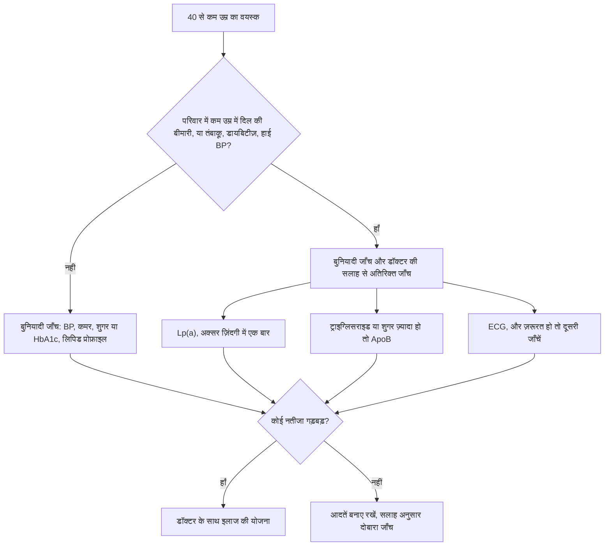

:::answer
भारतीयों को, दूसरे दक्षिण एशियाई लोगों की तरह, पहला हार्ट अटैक दुनिया के कई हिस्सों के मुक़ाबले कई साल पहले होता है। युवाओं में आम वजहें हैं: सिगरेट या चबाने वाला तंबाकू, ऊँचा LDL कोलेस्ट्रॉल, डायबिटीज़ या प्रीडायबिटीज़, हाई BP, पेट की चर्बी, कम नींद और तनाव, और कभी-कभी साथ में वंशानुगत समस्या जैसे ऊँचा Lp(a) या पारिवारिक हाई कोलेस्ट्रॉल। साधारण लिपिड प्रोफ़ाइल इनमें से कुछ चीज़ें पकड़ नहीं पाती। अगर परिवार में कम उम्र में हार्ट अटैक हुए हैं, तो डॉक्टर से Lp(a) (अक्सर ज़िंदगी में एक बार) और ApoB के बारे में पूछें। आप ज़ोरदार ट्रेनिंग जारी रख सकते हैं, पर चेतावनी के संकेत पहचानें, धीरे-धीरे बढ़ें, स्टेरॉयड और ज़्यादा स्टिमुलेंट वाले प्री-वर्कआउट से दूर रहें, और सीने के दर्द को कभी "झेल" कर कसरत न करें।
:::

## "इतनी कम उम्र में हार्ट अटैक नहीं होता" यहाँ सच नहीं

INTERHEART नाम के बड़े अंतरराष्ट्रीय अध्ययन में 52 देशों के पहले हार्ट अटैक वाले लोगों की तुलना हुई। दक्षिण एशियाई लोगों को पहला हार्ट अटैक औसतन लगभग 53 साल में हुआ, जबकि दूसरे देशों के लोगों में लगभग 59 साल में, और यह फ़र्क़ ज़्यादातर कम उम्र में ही आम ख़तरों के ज़्यादा होने से समझाया जा सका ([JAMA, 2007](https://doi.org/10.1001/jama.297.3.286))।

इस औसत के पीछे वह सच है जो हर भारतीय कार्डियोलॉजिस्ट को परेशान करता है: तीस और कभी-कभी बीस की उम्र के पुरुष और महिलाएँ हार्ट अटैक लेकर अस्पताल पहुँचते हैं। लगभग सबमें कम से कम एक पहचानने लायक़ ख़तरा होता है, जो "तुम तो जवान हो" कहकर कभी जाँचा ही नहीं गया।

## युवा भारतीय में आम वजहें

**तंबाकू, किसी भी रूप में।** सिगरेट, बीड़ी, हुक्का और गुटखा-खैनी जैसा चबाने वाला तंबाकू, सब धमनियों को नुकसान पहुँचाते हैं और ख़ून के थक्के बनने की संभावना बढ़ाते हैं। भारत के दूसरे ग्लोबल एडल्ट टोबैको सर्वे (2016–17) में 28.6% वयस्क किसी न किसी रूप में तंबाकू इस्तेमाल करते थे। छोड़ने से ख़तरा जल्दी घटने लगता है।

**बिना जाँचा LDL।** LDL यानी "बुरा" कोलेस्ट्रॉल किशोरावस्था से ही धमनियों में चुपचाप प्लाक जमाता है। बहुत से युवाओं ने कभी लिपिड प्रोफ़ाइल कराई ही नहीं, और जिन्होंने कराई है उन्हें अपना LDL नंबर पता नहीं।

**डायबिटीज़, प्रीडायबिटीज़ और पेट की चर्बी।** भारतीयों में कम वज़न पर ही इंसुलिन रेज़िस्टेंस हो जाता है, और पेट की चर्बी सिर्फ़ वज़न से बड़ा संकेत है। सामान्य BMI पर भी बड़ी कमर और कम मांसपेशी वाला "थिन-फ़ैट" शरीर आम है।

**हाई BP, नींद, तनाव और शराब।** युवाओं में BP अक्सर कोई नापता ही नहीं। कम नींद, स्लीप एप्निया, लगातार तनाव और ज़्यादा शराब BP, शुगर और वज़न सबको ग़लत दिशा में ले जाते हैं।

[[ad]]

## वंशानुगत हिस्सा: पारिवारिक इतिहास, Lp(a) और पारिवारिक हाई कोलेस्ट्रॉल

**कौन-सा पारिवारिक इतिहास मायने रखता है।** डॉक्टर इसे आमतौर पर "कम उम्र का" तब कहते हैं जब पिता, भाई या बेटे को 55 से पहले, या माँ, बहन या बेटी को 65 से पहले दिल की बीमारी हुई हो। ऐसा हो तो अच्छा महसूस करने के बावजूद आपका ख़तरा ज़्यादा है।

**Lp(a): वह नंबर जो ज़्यादातर लोग कभी नहीं जाँचते।** लिपोप्रोटीन(a) LDL जैसा एक कण है जिसका स्तर ज़्यादातर जीन तय करते हैं; खाना और कसरत इसे लगभग नहीं बदलते। ऊँचा Lp(a) हार्ट अटैक और दिल के एक वाल्व के सिकुड़ने का ख़तरा बढ़ाता है। यूरोपियन एथेरोस्क्लेरोसिस सोसाइटी की सहमति कहती है कि हर वयस्क में ज़िंदगी में कम से कम एक बार Lp(a) नापा जाए ([European Heart Journal, 2022](https://doi.org/10.1093/eurheartj/ehac361))। इंडियन हार्ट जर्नल की एक समीक्षा भी भारतीय मरीज़ों के लिए, ख़ासकर कम उम्र में दिल की बीमारी वाले परिवारों के लिए, यही बात कहती है ([Indian Heart Journal, 2024](https://doi.org/10.1016/j.ihj.2023.12.010))। ऊँचा Lp(a) घबराने की वजह नहीं, बाक़ी सब ख़तरों (LDL, BP, शुगर, तंबाकू, वज़न) पर और सख़्त होने की वजह है।

**ApoB: नुकसान करने वाले कणों की गिनती।** ApoB हर LDL जैसे कण पर एक प्रोटीन है, इसलिए यह धमनियों में घुस सकने वाले कणों की गिनती जैसा है। यूरोपियन गाइडलाइन के मुताबिक़ ज़्यादा ट्राइग्लिसराइड, डायबिटीज़ या मोटापे में ApoB, LDL से ज़्यादा सटीक संकेत हो सकता है ([ESC/EAS, 2019](https://doi.org/10.1093/eurheartj/ehz455))। ज़्यादा ट्राइग्लिसराइड और कम HDL भारतीयों का आम पैटर्न है।

**पारिवारिक हाई कोलेस्ट्रॉल।** कुछ परिवारों में ऐसा जीन होता है जिससे जन्म से ही LDL बहुत ऊँचा रहता है। दुबले, सक्रिय युवा में बहुत ऊँचा LDL, आँखों के पास या एड़ी के टेंडन पर पीली गाँठें, या कई रिश्तेदारों में कम उम्र के हार्ट अटैक इसके संकेत हैं। इसमें विशेषज्ञ की देखरेख चाहिए और रिश्तेदारों की भी जाँच होनी चाहिए।

## कौन-सी जाँचों के बारे में पूछें

महँगे "फ़ुल बॉडी" पैकेज उस डॉक्टर की जगह नहीं ले सकते जो आपके इतिहास को ध्यान में रखकर नतीजे पढ़े।

## दिल को जोखिम में डाले बिना ज़ोरदार ट्रेनिंग

कसरत दिल के लिए सबसे अच्छी चीज़ों में से है। मक़सद जिम से डराना नहीं, ऐसे ट्रेन करना है जो किसी छिपे ख़तरे के साथ भी सुरक्षित रहे।

**ज़ोरदार प्रोग्राम से पहले डॉक्टर से मिलें अगर:** कसरत में सीने में दर्द या दबाव हो, कसरत के दौरान बेहोशी या बेहोशी जैसा लगे, बिना वजह साँस फूले, धड़कन बेतरतीब लगे, परिवार में कम उम्र में अचानक मौत हुई हो, दिल की कोई बीमारी पता हो, या कई ख़तरे (तंबाकू, डायबिटीज़, हाई BP, ऊँचा LDL) एक साथ हों।

**ट्रेनिंग के दौरान:** 5–10 मिनट वॉर्म-अप और धीरे-धीरे कूल-डाउन; हफ़्तों में धीरे-धीरे वज़न और रफ़्तार बढ़ाएँ; भारी वज़न पर लंबे समय तक साँस न रोकें; गर्मियों और बंद जिम में पानी पीते रहें; बुख़ार में या वायरल के तुरंत बाद ज़ोरदार कसरत न करें।

**पूरी तरह बचें:** एनाबॉलिक स्टेरॉयड और दूसरी परफ़ॉर्मेंस दवाएँ (ये BP बढ़ाती हैं, कोलेस्ट्रॉल बिगाड़ती हैं और युवाओं में हार्ट अटैक से जुड़ी हैं); ज़्यादा स्टिमुलेंट वाले प्री-वर्कआउट, ख़ासकर एनर्जी ड्रिंक या कई कप कॉफ़ी के साथ; फ़ोटो के लिए क्रैश डाइट और पानी की भारी कमी; और "नो पेन, नो गेन" कहकर चेतावनी के लक्षणों में कसरत जारी रखना।

:::tip युवाओं के लिए दिल के काम के टिप्स
- अपने चार नंबर जानें: BP, कमर, HbA1c और LDL। फ़ोन में लिखकर रखें।
- किसी भी रूप में तंबाकू लेते हैं तो छोड़ने की तारीख़ तय करें और मदद लें।
- 7 घंटे या उससे ज़्यादा नींद लें। तेज़ ख़र्राटे और दिन में नींद हो तो स्लीप एप्निया की जाँच कराएँ।
- थाली दाल, सब्ज़ी, साबुत अनाज, दही और मेवों पर बनाएँ; तला-भुना, मिठाई और मीठे पेय कभी-कभार।
- हफ़्ते में दो-तीन बार ताक़त की कसरत और रोज़ सैर, दोनों दिल की रक्षा करते हैं।
- हाथों से CPR सीखें। 15 मिनट लगते हैं और जिम में किसी दोस्त की जान बच सकती है।
:::

## युवा महिलाएँ: वह ख़तरा जिसे अनदेखा किया जाता है

दिल की बीमारी को "मर्दों की बीमारी" समझा जाता है, इसलिए युवा महिलाओं के लक्षण अक्सर एसिडिटी, घबराहट या थकान कहकर टाल दिए जाते हैं। डायबिटीज़ महिलाओं की प्राकृतिक सुरक्षा का बड़ा हिस्सा छीन लेती है; गर्भावस्था में हाई BP (प्री-एक्लेम्पसिया) या गर्भकालीन डायबिटीज़ आगे चलकर दिल की बीमारी के शुरुआती संकेत माने जाते हैं; PCOS के साथ अक्सर इंसुलिन रेज़िस्टेंस और ज़्यादा ट्राइग्लिसराइड आते हैं; और जल्दी मेनोपॉज़ ख़तरा आगे ले आता है। महिलाओं में "शांत" लक्षण ज़्यादा होते हैं: साँस फूलना, पसीना, जी मिचलाना, पीठ या जबड़े में दर्द, या अचानक बहुत थकान।

## चेतावनी के संकेत, शांत वाले भी

हार्ट अटैक फ़िल्मों जैसा नहीं दिखता। सीने में दबाव, जकड़न, भारीपन जो कुछ मिनट से ज़्यादा रहे या आता-जाता रहे; दर्द जो बाँह, कंधे, गर्दन, जबड़े, पीठ या पेट के ऊपरी हिस्से तक जाए; साँस फूलना, पसीना, जी मिचलाना या अचानक थकान; और "गैस" या "एसिडिटी" जो ठीक न हो और साथ में पसीना या साँस फूले।

:::warning 112 या 108 पर कॉल करें और तुरंत अस्पताल जाएँ अगर
- सीने में दर्द, दबाव या बेचैनी कुछ मिनट से ज़्यादा रहे, ख़ासकर पसीना, जी मिचलाने या साँस फूलने के साथ
- कसरत में सीने में तकलीफ़ हो और आराम से जल्दी ठीक न हो
- कोई गिर पड़े और ठीक से साँस न ले रहा हो: मदद बुलाएँ और तुरंत हाथों से CPR शुरू करें
- कसरत के दौरान बेहोश हो जाएँ
- अचानक बहुत तेज़ साँस फूले, या चक्कर के साथ धड़कन बेतरतीब हो

ख़ुद गाड़ी चलाकर अस्पताल न जाएँ, "शायद ठीक हो जाए" का इंतज़ार न करें, और किसी और की दवा न लें।
:::

**हाथों से CPR, चार लाइनों में:** कोई वयस्क गिर पड़े और ठीक से साँस न ले, तो मदद और एंबुलेंस बुलाएँ; हथेली का निचला हिस्सा सीने के बीच में रखें, दूसरा हाथ ऊपर; ज़ोर से और तेज़, लगभग 100 से 120 बार प्रति मिनट दबाएँ, हर बार सीना ऊपर आने दें; और मदद आने या साँस लौटने तक रुकें नहीं। AED (डिफ़िब्रिलेटर) हो तो चालू करें और उसके निर्देश मानें ([AHA, 2020](https://doi.org/10.1161/CIR.0000000000000916))।

[[ad]]

## युवाओं के मिथक

:::mythfact
| मिथक | सच |
|---|---|
| "मैं 40 से कम हूँ और फ़िट हूँ, दिल ठीक है।" | दक्षिण एशियाई लोगों को हार्ट अटैक कम उम्र में होता है, और फ़िटनेस तंबाकू, ऊँचे LDL, ऊँचे Lp(a) या पारिवारिक इतिहास को मिटा नहीं देती। |
| "मेरा कोलेस्ट्रॉल नॉर्मल है, मैं सुरक्षित हूँ।" | नॉर्मल टोटल कोलेस्ट्रॉल के पीछे ऊँचा LDL, ट्राइग्लिसराइड या Lp(a) छिपा हो सकता है। अलग-अलग नंबर जानें। |
| "Lp(a) खाने से ठीक हो जाता है।" | Lp(a) ज़्यादातर जीन से तय होता है। खाना इसे लगभग नहीं बदलता, पर बाक़ी ख़तरों को सँभालना और ज़रूरी हो जाता है। |
| "चबाने वाला तंबाकू सिगरेट से सुरक्षित है।" | यह भी दिल को नुकसान पहुँचाता है और मुँह का कैंसर करता है। तंबाकू का कोई रूप सुरक्षित नहीं। |
| "जिम में सीने का दर्द बस खिंची हुई मांसपेशी है।" | कभी-कभी होता है, पर कसरत में सीने का दबाव चेतावनी का संकेत है। रुकें, आराम करें, जाँच कराएँ। |
:::

## अक्सर पूछे जाने वाले सवाल

:::faq
### क्या हर युवा को Lp(a) जाँच करानी चाहिए?
यूरोपियन विशेषज्ञ हर वयस्क में ज़िंदगी में कम से कम एक बार Lp(a) नापने की सलाह देते हैं। सबसे ज़्यादा फ़ायदेमंद तब है जब परिवार में कम उम्र में दिल की बीमारी हो, LDL बहुत ऊँचा हो, या आपको ख़ुद कम उम्र में दिल की बीमारी हुई हो। कब जाँच करानी है, डॉक्टर से पूछें।

### LDL और ApoB में क्या फ़र्क़ है?
LDL कोलेस्ट्रॉल बताता है कि LDL कणों में कितना कोलेस्ट्रॉल है; ApoB ख़ुद कणों को गिनता है। ज़्यादा ट्राइग्लिसराइड, डायबिटीज़ या मोटापे में ApoB ख़तरे की साफ़ तस्वीर दे सकता है।

### पिता को कम उम्र में हार्ट अटैक हुआ था, क्या मैं भारी वज़न उठा सकता हूँ?
आमतौर पर हाँ, पहले डॉक्टर की जाँच और धीरे-धीरे बढ़ने वाले प्रोग्राम के साथ। ताक़त की कसरत दिल के लिए अच्छी है। चेतावनी के संकेत पहचानें, स्टेरॉयड और स्टिमुलेंट वाले सप्लीमेंट से बचें, और सीने में दर्द या चक्कर हो तो रुक जाएँ।

### क्या बिना सीने के दर्द के हार्ट अटैक हो सकता है?
हाँ। कुछ लोगों में, ख़ासकर महिलाओं और डायबिटीज़ वालों में, साँस फूलना, पसीना, जी मिचलाना, पीठ या जबड़े में दर्द या अचानक थकान होती है। शक हो तो तुरंत जाँच कराएँ।

### सालों से सिगरेट पी रहा हूँ, क्या अब छोड़ने से फ़ायदा होगा?
हाँ। छोड़ने के कुछ समय बाद से ही दिल को फ़ायदा होने लगता है और आने वाले सालों में ख़तरा घटता जाता है। कभी देर नहीं होती, और डॉक्टर या क्विटलाइन की मदद से कामयाबी ज़्यादा मिलती है।
:::

## आख़िरी बात

40 से पहले हार्ट अटैक बदक़िस्मती नहीं है। आमतौर पर इसके पीछे ऐसे ख़तरे होते हैं जो सालों से मौजूद, नापे जा सकने वाले और इलाज योग्य थे। अपने नंबर जानें, पारिवारिक इतिहास को गंभीरता से लें, ज़रूरत हो तो Lp(a) और ApoB के बारे में पूछें, तंबाकू छोड़ें, और ऐसे ट्रेन करें जो दिल को मज़बूत बनाए, उसकी परीक्षा न ले।

सेक्टर 93, नोएडा के रॉयल फ़िटनेस क्लब में हमारे ट्रेनर धीरे-धीरे शुरू होने वाले, सही वॉर्म-अप वाले प्रोग्राम बनाते हैं और किसी को चेतावनी के लक्षणों में कसरत जारी रखने को नहीं कहते। शुरुआत के लिए एक फ़्री ट्रायल सेशन लें।
