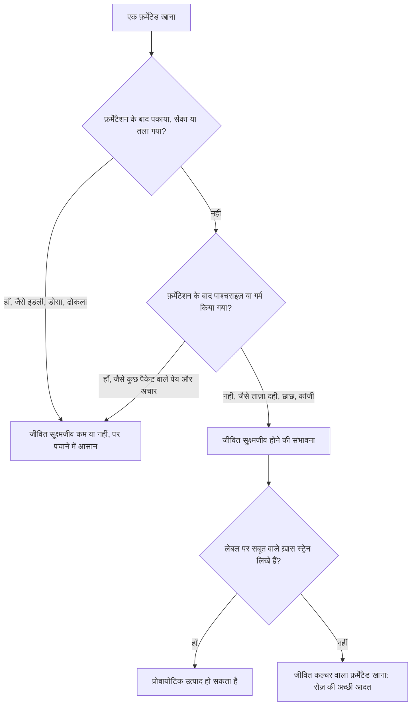

:::answer
बहुत से पारंपरिक भारतीय खाने ख़मीर उठाकर (फ़र्मेंट करके) बनते हैं: दही, छाछ, इडली-डोसा का घोल, ढोकला, अप्पम, कांजी और कुछ अचार। फ़र्मेंटेशन खाने को पचाने में आसान बना सकता है, और जब खाना बाद में पकाया न जाए तो जीवित सूक्ष्मजीव भी दे सकता है। एक अच्छे अध्ययन में ख़मीर वाले खाने से भरपूर आहार से दस हफ़्तों में आँतों के बैक्टीरिया की विविधता बढ़ी और सूजन के कई संकेत घटे। यह उम्मीद जगाता है, पर इसका मतलब यह नहीं कि ख़मीर वाला खाना पेट की बीमारी ठीक कर देता है, और हर "फ़र्मेंटेड" चीज़ "प्रोबायोटिक" नहीं होती। दही और छाछ रोज़ की सबसे आसान आदत हैं; इडली-डोसा पकाए जाते हैं, इसलिए उनके सूक्ष्मजीव नहीं बचते, हालाँकि फ़र्मेंटेशन खाने को बदल चुका होता है। इन्हें साफ़-सफ़ाई से बनाएँ, अचार में नमक का ध्यान रखें, और गंभीर, लंबी या चेतावनी वाली पेट की तकलीफ़ में डॉक्टर को दिखाएँ।
:::

## पहले कुछ शब्द जो अक्सर मिल जाते हैं

**फ़र्मेंटेड खाना:** ऐसा खाना जो सूक्ष्मजीवों के नियंत्रित रूप से बढ़ने और उनके किए बदलावों से बनता है; अंतरराष्ट्रीय वैज्ञानिक सहमति यही परिभाषा देती है ([ISAPP, 2021](https://doi.org/10.1038/s41575-020-00390-5))। दही, इडली का घोल, कांजी और कई अचार इसमें आते हैं।

**प्रोबायोटिक:** जीवित सूक्ष्मजीव जो पर्याप्त मात्रा में लेने पर सेहत को फ़ायदा देते हैं ([ISAPP, 2014](https://doi.org/10.1038/nrgastro.2014.66))। किसी चीज़ को प्रोबायोटिक कहने के लिए पहचाने हुए ख़ास स्ट्रेन और उनके फ़ायदे के सबूत चाहिए। बहुत से फ़र्मेंटेड खानों में जीवित सूक्ष्मजीव होते हैं, पर सिर्फ़ इससे वे वैज्ञानिक अर्थ में प्रोबायोटिक नहीं बन जाते।

**माइक्रोबायोम:** ज़्यादातर बड़ी आँत में रहने वाले खरबों बैक्टीरिया, फ़ंगस और दूसरे सूक्ष्मजीवों का समुदाय, जो फ़ाइबर पचाने, कुछ विटामिन बनाने, इम्यून सिस्टम को सिखाने और नुकसानदायक कीटाणुओं से बचाने में मदद करता है।

जब कोई विज्ञापन "प्रोबायोटिक" कहता है तो वह एक ख़ास दावा कर रहा है। जब दादी कहती हैं "दही पेट के लिए अच्छा है", तो वह पीढ़ियों के अनुभव की बात है, जिसे अब विज्ञान परख रहा है।

## विज्ञान असल में क्या कहता है

2021 में स्टैनफ़र्ड के एक अध्ययन में स्वस्थ वयस्कों को दस हफ़्ते तक या तो ज़्यादा फ़ाइबर वाला या ज़्यादा फ़र्मेंटेड खाने वाला आहार दिया गया। फ़र्मेंटेड खाने वाले समूह में आँतों के सूक्ष्मजीवों की विविधता लगातार बढ़ी और ख़ून में सूजन वाले कई प्रोटीन घटे, जिनमें इंटरल्यूकिन-6 भी था; ज़्यादा फ़ाइबर वाले समूह में उस अवधि में विविधता उसी तरह नहीं बढ़ी ([Cell, 2021](https://doi.org/10.1016/j.cell.2021.06.019))।

यह दिलचस्प है, पर इसे अनुपात में रखें: अध्ययन छोटा (कुछ दर्जन लोग) और कम समय का था; इसमें संकेत नापे गए, बीमारियाँ नहीं; और खाने ज़्यादातर पश्चिमी थे (योगर्ट, केफ़िर आदि), हालाँकि दही और छाछ उनके क़रीबी रिश्तेदार हैं। ISAPP की सहमति कहती है कि फ़र्मेंटेड खाने बुनियादी पोषण से आगे फ़ायदे दे सकते हैं, कुछ जीवित सूक्ष्मजीवों से और कुछ खाने में हुए बदलावों से, पर सबूत अलग-अलग खानों में बहुत अलग हैं।

[[ad]]

## भारतीय फ़र्मेंटेड खाने, एक-एक करके

**दही और छाछ:** दही लैक्टिक एसिड बैक्टीरिया से जमा दूध है। ताज़ा जमे दही में बहुत से जीवित बैक्टीरिया होते हैं और उससे बनी छाछ में भी। यह प्रोटीन, कैल्शियम और शाकाहारियों के लिए विटामिन B12 का अच्छा स्रोत है, और ICMR-NIN के दिशानिर्देश संतुलित भारतीय आहार में दूध और दूध से बनी चीज़ें शामिल करते हैं ([ICMR-NIN, 2024](https://www.nin.res.in/dietaryguidelines/index.html))। घर का दही हर बार थोड़ा अलग होता है; पैकेट वाला ब्रांड के हिसाब से। जिन्हें दूध से दिक़्क़त होती है, उनमें से कई दही बेहतर पचा लेते हैं, क्योंकि बैक्टीरिया लैक्टोज़ का कुछ हिस्सा पहले ही इस्तेमाल कर चुके होते हैं।

**इडली, डोसा, ढोकला, अप्पम का घोल:** रात भर प्राकृतिक बैक्टीरिया और यीस्ट से ख़मीर उठता है, जिससे घोल फूलता और हल्का खट्टा होता है। फ़र्मेंटेशन अनाज और दाल को नरम करता है और फ़ाइटेट जैसे कुछ तत्व घटा सकता है जो खनिजों के अवशोषण में रुकावट डालते हैं। पर फिर घोल भाप में या गर्म तवे पर पकता है, जिससे ज़्यादातर जीवित सूक्ष्मजीव मर जाते हैं। इसलिए इडली-डोसा को आसानी से पचने वाला, पोषण में बेहतर फ़र्मेंटेड खाना मानें, प्रोबायोटिक का स्रोत नहीं। सांभर और चटनी के साथ ये फिर भी बेहतरीन हैं।

**कांजी:** काली गाजर (कभी चुकंदर) को राई, नमक और पानी के साथ कुछ दिन फ़र्मेंट करके बनने वाला उत्तर भारत का पारंपरिक पेय। बाद में पकाया नहीं जाता, इसलिए इसमें जीवित लैक्टिक एसिड बैक्टीरिया हो सकते हैं, और काली गाजर के रंग वाले तत्व भी। कांजी पर ख़ुद बहुत कम शोध है, इसलिए "जीवित सूक्ष्मजीव वाला पारंपरिक पेय" से आगे के दावे सबूतों से आगे हैं। इसमें नमक भी होता है, छोटे गिलास में लें।

**अचार:** कुछ पारंपरिक अचार फ़र्मेंट होते हैं; कई आधुनिक अचार ज़्यादातर तेल, नमक और सिरके से रखे जाते हैं। दोनों में आमतौर पर नमक बहुत होता है, जो BP बढ़ाता है। अचार को स्वाद मानें, एक चम्मच, सेहत का खाना नहीं।

**बच्चे और बुज़ुर्ग:** सादा दही और छाछ ज़्यादातर बच्चों (ऊपरी आहार की उम्र के बाद) और बुज़ुर्गों के लिए पारंपरिक और आसानी से पचने वाले हैं। ताज़ा और फ़्रिज में रखा हो, बच्चों के लिए चीनी न मिलाएँ, और छोटे बच्चों को नई चीज़ एक-एक करके दें।

## कैसे पता करें कि फ़र्मेंटेड खाने में जीवित सूक्ष्मजीव बचे हैं

## घर पर सुरक्षित फ़र्मेंटेशन

हाथ, बर्तन और डिब्बे अच्छी तरह साफ़ रखें और साफ़ पानी लें; ताज़ी सामग्री और भरोसेमंद जामन (पिछले अच्छे दही का एक चम्मच) इस्तेमाल करें; गर्मियों में दही जल्दी जमता है और घोल जल्दी उठता है, इसलिए तैयार होते ही फ़्रिज में रखें; हल्की खट्टी महक सामान्य है, पर रुई जैसी फफूँद, गुलाबी या काले धब्बे, चिपचिपापन या बदबू हो तो फेंक दें; दही-छाछ फ़्रिज में रखें और एक-दो दिन में इस्तेमाल करें। गर्भवती, बहुत बुज़ुर्ग, कमज़ोर इम्युनिटी वाले (जैसे कीमोथेरेपी या ट्रांसप्लांट के बाद) लोग और छोटे बच्चे ताज़ा, फ़्रिज में रखा खाना लें, और बिना पाश्चराइज़ किए उत्पादों के बारे में डॉक्टर से पूछें।

[[ad]]

## फ़ाइबर: आँतों के बैक्टीरिया का असली खाना

फ़र्मेंटेड खाना सूक्ष्मजीव अंदर लाता है; फ़ाइबर उन्हें खिलाता है जो पहले से आपके अंदर रहते हैं। फ़ाइबर पचाते हुए बैक्टीरिया शॉर्ट-चेन फ़ैटी एसिड बनाते हैं जो बड़ी आँत की कोशिकाओं को पोषण देते हैं और सूजन व शुगर को नियंत्रित करने में मदद करते हैं। कम फ़ाइबर वाला खाना इन बैक्टीरिया को भूखा रखता है, चाहे आप कितना भी दही खाएँ।

मैदे की जगह साबुत गेहूँ या मिक्स आटा; हफ़्ते में कुछ बार सफ़ेद चावल की जगह मिलेट या ब्राउन राइस (हमारा [मिलेट स्वैप](/health/millet-swap) टूल देखें); हर खाने में एक सब्ज़ी ज़्यादा; जूस की जगह साबुत फल; रोज़ कम से कम एक खाने में दाल, चना, राजमा या मूंग; और कभी-कभी दही में भीगे चिया, अलसी या सब्जा के बीज। फ़ाइबर धीरे-धीरे बढ़ाएँ और पानी पीते रहें, वरना शुरुआत में गैस और पेट फूलना हो सकता है।

**एंटीबायोटिक और पेट:** एंटीबायोटिक का कोर्स हफ़्तों तक माइक्रोबायोम बिगाड़ सकता है, इसीलिए कुछ लोगों को इलाज के दौरान या बाद में दस्त होते हैं। बैक्टीरियल संक्रमण में डॉक्टर लिखें तो एंटीबायोटिक लेने से मना करने की यह वजह नहीं; वजह यह है कि ज़ुकाम और वायरल बुख़ार में इन्हें कभी न लें, जहाँ ये काम नहीं करतीं। कोर्स के बाद फ़र्मेंटेड खाना और फ़ाइबर रिकवरी में मदद करते हैं।

:::tip पेट के लिए रोज़ की अच्छी आदतें
- दूध-दही सूट करता हो तो रोज़ एक कटोरी सादा दही या एक गिलास बिना चीनी की छाछ लें।
- विविधता रखें: अलग-अलग पौधे अलग-अलग सूक्ष्मजीवों को खिलाते हैं।
- अचार और पापड़ नमक की वजह से थोड़े ही लें।
- मीठे "प्रोबायोटिक" पेय कम लें; कई में बहुत चीनी होती है।
- बिना पर्चे के एंटीबायोटिक कभी न लें।
- नियमित नींद, कसरत और तनाव पर क़ाबू भी पाचन पर असर डालते हैं।
:::

## प्रोबायोटिक सप्लीमेंट और फ़र्मेंटेड खाने की सीमाएँ

कुछ ख़ास प्रोबायोटिक स्ट्रेन के ख़ास उपयोगों के सबूत हैं, जैसे कुछ लोगों में एंटीबायोटिक से जुड़े दस्त घटाना, पर फ़ायदा स्ट्रेन और बीमारी के हिसाब से अलग है। ज़्यादातर स्वस्थ लोगों को विविध आहार, फ़र्मेंटेड खाने और फ़ाइबर के साथ सप्लीमेंट की ज़रूरत नहीं। किसी पेट की समस्या के लिए सोच रहे हैं तो डॉक्टर से पूछें कि आपके लिए कोई उत्पाद सबूत रखता है या नहीं; गंभीर रूप से बीमार या कमज़ोर इम्युनिटी वाले बिना डॉक्टरी सलाह के प्रोबायोटिक न लें।

फ़र्मेंटेड खाना IBS, IBD, एसिड रिफ़्लक्स या अल्सर का इलाज नहीं है, लिवर या आँतों को "डिटॉक्स" नहीं करता, किसी बीमारी के इलाज की जगह नहीं लेता, और ख़राब आहार को अच्छा नहीं बनाता: एक चम्मच दही रोज़ के तले नाश्ते और मीठे पेय को रद्द नहीं करता। IBS वाले कुछ लोगों में कुछ खाने ज़्यादा मात्रा में पेट फूलना बढ़ाते हैं; अपने शरीर के हिसाब से देखें और डॉक्टर या डाइटीशियन से बात करें।

:::warning जल्दी डॉक्टर को दिखाएँ अगर
- मल में ख़ून दिखे, या मल काला और तारकोल जैसा हो
- बिना कोशिश के वज़न घट रहा हो
- पेट में तेज़ या लगातार दर्द हो, या दर्द से रात में नींद खुले
- दस्त कुछ दिनों से ज़्यादा रहें, या तेज़ बुख़ार या पानी की कमी (बहुत कम पेशाब, चक्कर) के साथ हों
- निगलने में दिक़्क़त हो या बार-बार उल्टी हो
- हफ़्तों तक बिना वजह मल की आदत बदली रहे, ख़ासकर 50 के बाद
- बिना वजह ख़ून की कमी हो
- घर के किसी फ़र्मेंटेड खाने से एक साथ कई लोग बीमार हो जाएँ
:::

[[ad]]

## मिथक और सच

:::mythfact
| मिथक | सच |
|---|---|
| "हर फ़र्मेंटेड खाना प्रोबायोटिक है।" | प्रोबायोटिक के लिए साबित फ़ायदे वाले ख़ास जीवित स्ट्रेन चाहिए। कई फ़र्मेंटेड खानों में जीवित सूक्ष्मजीव होते हैं, पर यह अलग दावा है। |
| "इडली-डोसा प्रोबायोटिक हैं।" | ये फ़र्मेंट होकर पकते हैं, इसलिए जीवित सूक्ष्मजीव कम बचते हैं। फिर भी आसानी से पचने वाला अच्छा खाना हैं। |
| "दही से ज़ुकाम होता है, सर्दी में न खाएँ।" | दही से ज़ुकाम होने का अच्छा सबूत नहीं है। सूट करे तो साल भर खा सकते हैं। |
| "कांजी शरीर को डिटॉक्स करती है।" | कांजी जीवित सूक्ष्मजीव वाला पारंपरिक पेय हो सकता है। किसी "डिटॉक्स" का सबूत नहीं। |
| "अचार पेट के लिए अच्छा है, ख़ूब खाओ।" | ज़्यादातर अचार में नमक बहुत होता है, जो BP बढ़ाता है। एक छोटा चम्मच काफ़ी है। |
| "एक प्रोबायोटिक कैप्सूल हर पेट की समस्या ठीक करता है।" | फ़ायदा ख़ास स्ट्रेन और ख़ास बीमारी तक सीमित है। सप्लीमेंट पर भरोसे से पहले डॉक्टर से पूछें। |
:::

## अक्सर पूछे जाने वाले सवाल

:::faq
### घर का दही बेहतर है या पैकेट वाला?
दोनों में जीवित कल्चर हो सकते हैं। घर का दही हर बार अलग होता है; पैकेट वाला ब्रांड के हिसाब से, और कुछ पर ख़ास स्ट्रेन लिखे होते हैं। सादा, बिना चीनी का दही चुनें और घर पर साफ़-सफ़ाई से जमाएँ।

### क्या पकाने से फ़र्मेंटेड घोल का फ़ायदा ख़त्म हो जाता है?
पकाने से ज़्यादातर जीवित सूक्ष्मजीव मरते हैं, पर फ़र्मेंटेशन खाने को पहले ही बदल चुका होता है, जिससे वह पचाने में आसान होता है और खनिजों का अवशोषण बेहतर हो सकता है। इसलिए इडली-डोसा अब भी सेहतमंद हैं।

### क्या रोज़ प्रोबायोटिक सप्लीमेंट लेना चाहिए?
ज़्यादातर स्वस्थ लोगों को नहीं, अगर वे फ़र्मेंटेड खाने और भरपूर फ़ाइबर के साथ विविध आहार लेते हैं। कुछ ख़ास स्ट्रेन ख़ास हालात में मदद करते हैं; कोई ख़ास समस्या हो तो डॉक्टर से पूछें।

### क्या लैक्टोज़ इनटॉलरेंस वाले दही खा सकते हैं?
दूध से दिक़्क़त वाले कई लोग दही बेहतर पचा लेते हैं, क्योंकि बैक्टीरिया लैक्टोज़ का कुछ हिस्सा तोड़ देते हैं। थोड़ी मात्रा से शुरू करें। लक्षण गंभीर हों तो डॉक्टर से बात करें।

### कैसे पता चले कि घर का फ़र्मेंटेड खाना ख़राब हो गया?
हल्की खट्टी महक सामान्य है। फफूँद, गुलाबी या काले धब्बे, चिपचिपापन, बदबू हो, या गर्मी में बहुत देर बाहर रहा हो, तो फेंक दें।
:::

## आख़िरी बात

फ़र्मेंटेड खाने भारतीय रसोई का स्वादिष्ट, पारंपरिक हिस्सा हैं, और विज्ञान भी इन्हें शामिल करने का समर्थन करता है। दही और छाछ रोज़ की सबसे आसान आदत हैं; इडली, डोसा और ढोकला बेहतरीन खाने हैं, भले ही पकाने से जीवित सूक्ष्मजीव कम हो जाते हैं; कांजी और अचार थोड़ी मात्रा में। इनके साथ भरपूर फ़ाइबर और विविधता रखें, और चेतावनी के संकेतों पर खाने के भरोसे रहने की बजाय डॉक्टर को दिखाएँ।

स्वस्थ पेट को चलना-फिरना भी पसंद है। पाचन, ऊर्जा और वज़न के लिए दिनचर्या चाहिए तो सेक्टर 93, नोएडा के रॉयल फ़िटनेस क्लब के ट्रेनर मदद कर सकते हैं।
