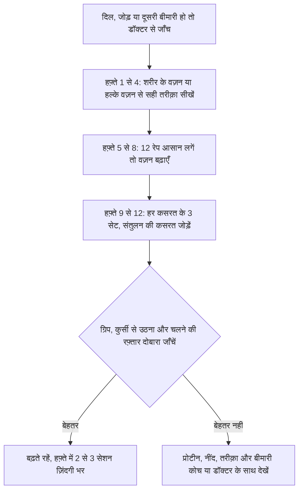

:::answer
अधेड़ उम्र से ज़्यादातर लोगों की मांसपेशियाँ धीरे-धीरे घटती हैं, और उससे भी तेज़ उनकी ताक़त, जब तक कुछ किया न जाए। जब यह कमी इतनी हो जाए कि रोज़मर्रा की ज़िंदगी पर असर पड़े, तो इसे सार्कोपीनिया कहते हैं, और इससे गिरने, हड्डी टूटने, अपंगता और बीमारी का ख़तरा बढ़ता है। अच्छी ख़बर यह है कि मांसपेशियाँ हर उम्र में कसरत पर जवाब देती हैं। हफ़्ते में दो-तीन बार धीरे-धीरे बढ़ने वाली ताक़त की कसरत, हर खाने में पर्याप्त प्रोटीन (भारतीय खाने में अक्सर नाश्ते और रात के खाने में प्रोटीन कम होता है), रोज़ की सैर और अच्छी नींद, यही काम करते हैं। ग्रिप स्ट्रेंथ, कुर्सी से उठने का समय और चलने की रफ़्तार जैसी आसान जाँचें बताती हैं कि आप कहाँ खड़े हैं।
:::

## मांसपेशियाँ: अच्छे बुढ़ापे का अंग

मांसपेशियाँ सिर्फ़ वज़न उठाने के लिए नहीं हैं। ये आपको चलाती हैं, सीधा रखती हैं, जोड़ों की रक्षा करती हैं, हर खाने की शुगर का बड़ा हिस्सा सोखती हैं, बीमारी में शरीर के काम आने वाला प्रोटीन जमा रखती हैं और हड्डियों को मज़बूत रखने में मदद करती हैं। मांसपेशियाँ घटने पर सीढ़ियाँ मुश्किल लगती हैं, ज़मीन से उठना कठिन होता है, गिरना बढ़ता है, बीमारी या सर्जरी से ठीक होने में देर लगती है और शुगर भी कम क़ाबू में रहती है।

PURE नाम के अंतरराष्ट्रीय अध्ययन में भारत समेत 17 देशों के लगभग 1.4 लाख वयस्कों की पकड़ की ताक़त (ग्रिप स्ट्रेंथ) नापी गई। कम ग्रिप स्ट्रेंथ किसी भी वजह से मौत और दिल की बीमारी से मौत के ज़्यादा ख़तरे से जुड़ी थी; हर 5 किलो कम ग्रिप पर अध्ययन अवधि में किसी भी वजह से मौत का ख़तरा 16% ज़्यादा था ([Lancet, 2015](https://doi.org/10.1016/S0140-6736(14)62000-6))। ग्रिप कोई जादू नहीं, बल्कि पूरे शरीर की ताक़त और सेहत की एक आसान झलक है।

## सार्कोपीनिया का असल मतलब

सार्कोपीनिया उम्र के साथ मांसपेशियों की ताक़त, मात्रा और काम-क्षमता का धीरे-धीरे घटना है, जिसे निष्क्रियता, ख़राब पोषण, बीमारी और कुछ दवाएँ और बढ़ाती हैं। यूरोपियन विशेषज्ञ समूह की नई परिभाषा में कमज़ोर ताक़त सबसे पहला संकेत है ([EWGSOP2, 2019](https://doi.org/10.1093/ageing/afy169))।

एशियाई शरीर के आकार और बनावट अलग होने से एशियन वर्किंग ग्रुप फ़ॉर सार्कोपीनिया ने 2019 में अपने पैमाने तय किए ([AWGS, 2019](https://pubmed.ncbi.nlm.nih.gov/32033882/)): कम ताक़त मतलब पुरुषों में 28 किलो से कम और महिलाओं में 18 किलो से कम ग्रिप; कम काम-क्षमता मतलब 6 मीटर पर 1.0 मीटर प्रति सेकंड से धीमा चलना, बिना हाथों के पाँच बार कुर्सी से उठने में 12 सेकंड या ज़्यादा, या एक छोटे परफ़ॉर्मेंस टेस्ट में कम स्कोर। समूह ने "संभावित सार्कोपीनिया" की श्रेणी भी बनाई, ताकि पूरी जाँच से पहले ही लोग सुधार शुरू कर सकें।

बैठे-बैठे ऑफ़िस की ज़िंदगी, लंबा सफ़र और कम प्रोटीन वाला खाना कई भारतीयों को 40-50 की उम्र तक ज़रूरत से कम मांसपेशियों के साथ पहुँचा देता है।

[[ad]]

## ख़ुद जाँचें: तीन आसान टेस्ट

ये जाँच के संकेत हैं, निदान नहीं। नतीजे कमज़ोर हों, ख़ासकर बड़ी उम्र या बीमारियों में, तो डॉक्टर से बात करें।

**1. ग्रिप स्ट्रेंथ:** कई जिम, फ़िज़ियोथेरेपी क्लिनिक और कुछ डॉक्टरों के पास हैंड डायनेमोमीटर होता है। हर हाथ से दो-तीन बार पूरी ताक़त से दबाएँ और सबसे अच्छा नतीजा लिखें। हर तीन महीने में अपना नंबर ट्रैक करें।

**2. पाँच बार कुर्सी से उठना:** साधारण कुर्सी पर बाँहें सीने पर क्रॉस करके बैठें। जितना तेज़ सुरक्षित हो, पाँच बार पूरा खड़े होकर वापस बैठने का समय नापें। 12 सेकंड या ज़्यादा पैरों की कम ताक़त का संकेत है। संतुलन पक्का न हो तो किसी को पास खड़ा रखें।

**3. चलने की रफ़्तार:** समतल फ़र्श पर 6 मीटर नापें। अपनी सामान्य रफ़्तार से, लाइन से कुछ क़दम पहले शुरू करके, समय नापें। 6 सेकंड से ज़्यादा लगना (यानी 1 मीटर प्रति सेकंड से धीमा) कम काम-क्षमता का संकेत है।

## भारतीय खाने में प्रोटीन: नाश्ते और रात की कमी

कसरत के बाद मांसपेशी बनाने और उम्र के साथ घटने से रोकने के लिए प्रोटीन चाहिए। बढ़ती उम्र की मांसपेशियाँ थोड़े प्रोटीन पर कम जवाब देती हैं, इसलिए हर खाने की मात्रा मायने रखती है, सिर्फ़ दिन का कुल नहीं। बुज़ुर्गों के प्रोटीन पर अंतरराष्ट्रीय विशेषज्ञ समूह (PROT-AGE) ने सुझाया कि स्वस्थ बुज़ुर्ग रोज़ शरीर के वज़न के हर किलो पर लगभग 1.0 से 1.2 ग्राम प्रोटीन का लक्ष्य रखें, और बीमार या ज़्यादा सक्रिय लोग इससे ज़्यादा, जब तक किडनी की बीमारी की वजह से डॉक्टर कुछ और न कहें ([PROT-AGE, 2013](https://doi.org/10.1016/j.jamda.2013.05.021))। ICMR-NIN के दिशानिर्देश भी प्रोटीन दाल, दूध-दही, अंडे, मछली और मांस जैसे विविध खाने से लेने की बात करते हैं, सप्लीमेंट से नहीं ([ICMR-NIN, 2024](https://www.nin.res.in/dietaryguidelines/index.html))।

आम शाकाहारी दिन: नाश्ते में चाय-बिस्कुट या पोहा, दोपहर में दाल-रोटी-चावल-सब्ज़ी, शाम को चाय-नमकीन, और देर रात रोटी-चावल वाला खाना। प्रोटीन दोपहर में सिमटा है, नाश्ते और रात में कम। यह आम है और आसानी से सुधर सकता है।

**नाश्ता:** बेसन या मूंग दाल चीला, पनीर या अंडा भुर्जी, फल-मेवों के साथ दही, अंकुरित पोहा, दूध के साथ रागी या ओट्स, रोटी के साथ दो अंडे। **दोपहर:** गाढ़ी दाल (ज़्यादा दाल, कम पानी), साथ में दही या छाछ, और हफ़्ते में दो-तीन बार चना, राजमा, पनीर, सोया या चिकन। **शाम:** बिस्कुट-नमकीन की जगह भुना चना, दूध या छाछ, अंकुरित चाट, मूँगफली या उबला अंडा। **रात:** दाल या सांभर के साथ पनीर, टोफ़ू, सोया, अंडा, मछली या चिकन, कम रोटियाँ और ज़्यादा सब्ज़ी।

ज़्यादातर लोगों को अच्छी योजना के साथ प्रोटीन पाउडर की ज़रूरत नहीं। लेना चाहें तो पहले डॉक्टर से पूछें, ख़ासकर किडनी की बीमारी या डायबिटीज़ हो तो।

[[ad]]

## ताक़त की योजना: 12 हफ़्ते, हफ़्ते में दो-तीन सेशन

WHO की गाइडलाइन सभी वयस्कों के लिए हफ़्ते में दो या ज़्यादा दिन मांसपेशी मज़बूत करने वाली गतिविधि और 150 से 300 मिनट मध्यम एरोबिक गतिविधि की सलाह देती है, और बुज़ुर्गों के लिए हफ़्ते में तीन या ज़्यादा दिन संतुलन वाली कसरत भी ([WHO, 2020](https://doi.org/10.1136/bjsports-2020-102955))।

**पूरे शरीर के लिए छह कसरतें:** (1) कुर्सी तक स्क्वैट, आत्मनिर्भरता के लिए सबसे ज़रूरी, बाद में डम्बल या थैला पकड़कर; (2) पुश: दीवार पर पुश-अप, फिर मेज़ या बेंच पर, फिर घुटनों पर या पूरे; (3) पुल: रेज़िस्टेंस बैंड से रो, या बेंच पर एक हाथ रखकर डम्बल रो; (4) हिंज: ज़मीन पर हिप ब्रिज, फिर सीधी पीठ के साथ डम्बल रोमानियन डेडलिफ़्ट; (5) कैरी: हर हाथ में भारी थैला या डम्बल लेकर 20-30 मीटर चलें; (6) स्टेप-अप: नीची, मज़बूत सीढ़ी पर, शुरू में रेलिंग पकड़कर।

**सुरक्षित तरीक़े से बढ़ें:** हर कसरत के 10-12 रेप के एक-दो सेट से शुरू करें; 12 अच्छे रेप आसान लगें तो थोड़ा वज़न बढ़ाएँ; हर सेट के आख़िरी दो-तीन रेप सच में भारी लगें, पर जोड़ों में दर्द न हो; एक ही मांसपेशी के सेशन के बीच एक-दो दिन आराम दें; एक पैर पर खड़े होना या एड़ी-पंजा चलना जैसी संतुलन की कसरत जोड़ें; और रोज़ सैर जारी रखें। हमारा [वर्कआउट बिल्डर](/health/workout-builder) घर या जिम के सेशन बनाने में मदद कर सकता है।

:::tip 40 के बाद ताक़त की कसरत टिकाने के टिप्स
- सेशन अपॉइंटमेंट की तरह तय करें: हफ़्ते के दो-तीन पक्के दिन और समय।
- अहं जितना चाहे उससे हल्के से शुरू करें; ज़्यादातर चोटें जल्दबाज़ी से लगती हैं।
- उठाते समय साँस छोड़ें और नीचे लाते समय लें; ज़ोर लगाते हुए साँस न रोकें।
- कसरत के कुछ घंटों में प्रोटीन वाला खाना या नाश्ता लें।
- सात या ज़्यादा घंटे सोएँ; मांसपेशियों की मरम्मत ज़्यादातर नींद में होती है।
- हर कसरत का एक नंबर (वज़न या रेप) डायरी में लिखें; प्रगति दिखना हौसला देता है।
- किसी दोस्त, जीवनसाथी या कोच के साथ ट्रेन करें।
:::

## ख़ास हालात

**जोड़ों का दर्द और गठिया:** ताक़त की कसरत आमतौर पर घुटने और कूल्हे के गठिया में जोड़ों को सहारा देकर मदद करती है; दर्द न बढ़ाने वाली कसरतें चुनें और फ़िज़ियोथेरेपिस्ट से बदलाव पूछें। **डायबिटीज़, दिल की बीमारी, हाई BP:** इन सबमें फ़ायदा है, पर पहले डॉक्टर की हाँ लें और धीरे बढ़ें; इंसुलिन या सल्फ़ोनिलयूरिया लेते हैं तो कसरत का शुगर पर असर समझें। **ऑस्टियोपोरोसिस:** सही चुनी ताक़त और संतुलन की कसरत हड्डियों की मदद करती है और गिरने का ख़तरा घटाती है; भारी मरोड़ और आगे झुकने वाली कसरतों के बारे में डॉक्टर या फ़िज़ियोथेरेपिस्ट से ख़ास सलाह लें। **बीमारी या अस्पताल के बाद:** बिस्तर पर रहने से मांसपेशी जल्दी घटती है; डॉक्टर की इजाज़त मिलते ही प्रोटीन वाले खाने और छोटी-छोटी सैर से शुरुआत करें। **मेनोपॉज़ के बाद महिलाएँ:** हड्डियाँ तेज़ी से घटती हैं; ताक़त की कसरत और डॉक्टर की सलाह के अनुसार प्रोटीन, कैल्शियम और विटामिन D अब ख़ास ज़रूरी हैं। **दफ़्तर में बैठने वाले:** हर आधे घंटे में दो मिनट उठकर चलें, फ़ोन खड़े होकर सुनें, और पानी भरते समय दस बार कुर्सी स्क्वैट करें।

:::warning रुकें और जल्दी डॉक्टर से मिलें अगर
- कसरत में सीने में दर्द, दबाव या असामान्य रूप से साँस फूले
- चक्कर या बेहोशी जैसा लगे, या धड़कन तेज़ या बेतरतीब हो
- जोड़ में अचानक तेज़ दर्द हो, या कसरत के बाद जोड़ सूज जाए
- बिना वजह वज़न घटे या कमज़ोरी तेज़ी से बढ़े
- आप गिर जाएँ, ख़ासकर सिर पर चोट लगे या बाद में पैर पर वज़न न डाल पाएँ
- नई सुन्नता, एक तरफ़ कमज़ोरी या बोलने में दिक़्क़त हो (तुरंत 112 पर कॉल करें)
:::

[[ad]]

## मिथक और सच

:::mythfact
| मिथक | सच |
|---|---|
| "इस उम्र में वज़न उठाना ख़तरनाक है।" | निगरानी में, धीरे बढ़ने वाली ताक़त की कसरत ज़्यादातर वयस्कों के लिए सुरक्षित है और WHO हर उम्र में इसकी सलाह देता है। |
| "सैर काफ़ी है।" | सैर दिल और शुगर के लिए बढ़िया है, पर मांसपेशियों की ताक़त बचाने में कम मदद करती है। हफ़्ते में दो-तीन बार ताक़त की कसरत जोड़ें। |
| "शाकाहारी पर्याप्त प्रोटीन नहीं ले सकते।" | दाल, दही, पनीर, दूध, सोया, चना और अंकुरित दालें योजना के साथ ज़रूरत पूरी कर सकते हैं। प्रोटीन हर खाने में बाँटें। |
| "प्रोटीन स्वस्थ किडनी ख़राब करता है।" | खाने से मिलने वाली सामान्य मात्रा स्वस्थ किडनी के लिए ठीक है। किडनी की बीमारी में डॉक्टर की सलाह ज़रूरी है। |
| "60 में शुरू करने में बहुत देर हो चुकी।" | बहुत बड़ी उम्र में भी मांसपेशियाँ कसरत पर जवाब देती हैं। हर उम्र में ताक़त और काम-क्षमता बढ़ती दिखी है। |
:::

## अक्सर पूछे जाने वाले सवाल

:::faq
### 40 के बाद कितना प्रोटीन चाहिए?
कई स्वस्थ बुज़ुर्गों को शरीर के वज़न के हर किलो पर रोज़ लगभग 1.0 से 1.2 ग्राम प्रोटीन, खानों में बाँटकर, लेने की सलाह दी जाती है। ज़रूरत सेहत, सक्रियता और किडनी के हिसाब से बदलती है, इसलिए डॉक्टर या डाइटीशियन से पूछें।

### क्या बिना जिम के घर पर मांसपेशी बन सकती है?
हाँ। कुर्सी स्क्वैट, दीवार या मेज़ पर पुश-अप, बैंड से रो, हिप ब्रिज, स्टेप-अप और भारी थैले उठाकर चलना अच्छा काम करते हैं। समय के साथ बैंड, डम्बल या पानी भरी बोतलों से वज़न बढ़ाएँ।

### नतीजे कितनी जल्दी दिखेंगे?
बहुत से लोग चार से आठ हफ़्तों में ज़्यादा ताक़तवर महसूस करते हैं, क्योंकि दिमाग़ मांसपेशियों का बेहतर इस्तेमाल सीखता है। दिखने वाली मांसपेशी और बड़ी ताक़त के लिए महीनों की नियमित कसरत और पर्याप्त प्रोटीन चाहिए।

### क्या क्रिएटिन या प्रोटीन पाउडर ज़रूरी है?
ज़्यादातर लोग खाने से ज़रूरत पूरी कर सकते हैं। कुछ सप्लीमेंट ख़ास समूहों के लिए सबूत रखते हैं, पर सबको ज़रूरी नहीं और कुछ बीमारियों में ठीक नहीं। कोई भी सप्लीमेंट शुरू करने से पहले डॉक्टर से बात करें।

### घुटने में दर्द है, क्या पैरों की कसरत न करूँ?
आमतौर पर नहीं। जाँघ और कूल्हे की मज़बूत मांसपेशियाँ अक्सर घुटने का दर्द घटाती हैं। ऊँची कुर्सी तक स्क्वैट जैसी बिना दर्द वाली रेंज चुनें, और दर्द बना रहे तो फ़िज़ियोथेरेपिस्ट से पूछें।
:::

## आख़िरी बात

मांसपेशी दिखावा नहीं, आत्मनिर्भरता, संतुलन, शुगर पर क़ाबू और ताक़त है। हफ़्ते में दो-तीन बार धीरे बढ़ने वाली ताक़त की कसरत, हर खाने में प्रोटीन, रोज़ सैर और अच्छी नींद से आप हर उम्र में इसे बचा और बढ़ा सकते हैं। आज ख़ुद को जाँचें और बारह हफ़्ते बाद फिर।

सुरक्षित, धीरे बढ़ने वाला प्रोग्राम चाहिए तो सेक्टर 93, नोएडा के रॉयल फ़िटनेस क्लब के ट्रेनर रोज़ 40, 50 और 60 की उम्र के सदस्यों के साथ काम करते हैं। शुरुआत के लिए फ़्री ट्रायल सेशन बुक करें।
