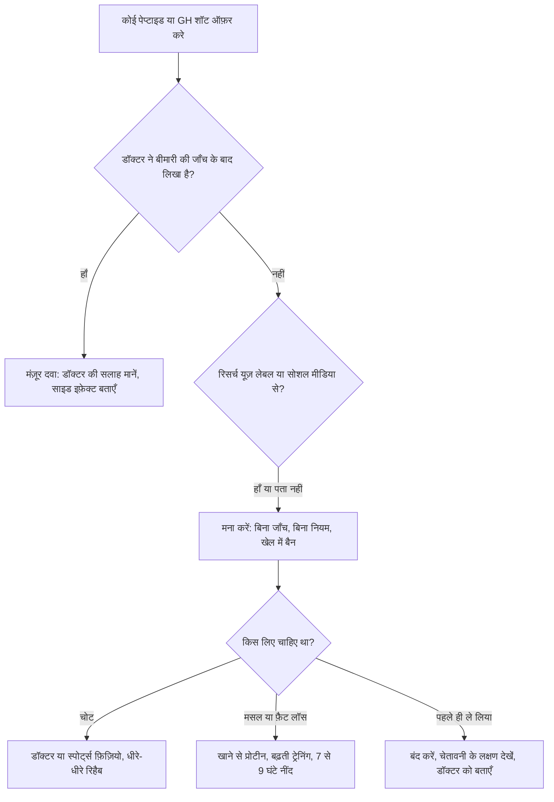

:::answer
"पेप्टाइड" एक बड़ा शब्द है, जिसमें आज़माई हुई दवाएँ भी आती हैं और बिना जाँचे जिम प्रोडक्ट भी। इंसुलिन, डायबिटीज़ और वज़न की GLP-1 दवाएँ, और असली कमी होने पर डॉक्टर का लिखा ग्रोथ हॉर्मोन, ये मंज़ूरशुदा पेप्टाइड दवाएँ हैं। ऑनलाइन बिकने वाले BPC-157, TB-500 जैसे "रिसर्च पेप्टाइड" अलग चीज़ हैं। इनके लगभग सारे सबूत चूहों और लैब के प्रयोगों से हैं, इंसानों में इनकी सुरक्षा ठीक से जाँची नहीं गई, शीशियाँ दवा के स्तर पर नहीं बनतीं, और खेल में ये हमेशा बैन हैं। MK-677 तो पेप्टाइड भी नहीं है, और रिसर्च में इससे शुगर और भूख बढ़ी। चोट है तो स्पोर्ट्स डॉक्टर या फ़िज़ियो से मिलें। मसल चाहिए तो खाना, नींद और लगातार बढ़ती ट्रेनिंग ही काम करती है।
:::

## जिम में अचानक पेप्टाइड की बातें क्यों

कुछ साल पहले नोएडा और गुरुग्राम के जिमों में स्टेरॉयड और SARMs की चर्चा होती थी। अब पेप्टाइड की होती है। रील्स, पॉडकास्ट, और वो सीनियर भाई जो कहते हैं कि एक "हीलिंग शॉट" से उनका कंधा ठीक हो गया। बेचने वाले कहते हैं कि ये स्टेरॉयड से सुरक्षित हैं, अमीनो एसिड से बने हैं इसलिए "नेचुरल" हैं, और लेबल पर "रिसर्च के लिए" लिखा है इसलिए क़ानूनी हैं।

इनमें से कोई बात जाँच में टिकती नहीं। इस लेख में हम बताएँगे कि पेप्टाइड क्या हैं, कौन-से असली दवा हैं, और जिम वाले पेप्टाइड पर रिसर्च क्या कहती है। हम यह नहीं बताएँगे कि इन्हें कैसे लें, कहाँ से लें या कितना लें, क्योंकि इंसानों के लिए कोई सुरक्षित मात्रा तय ही नहीं हुई है।

## पेप्टाइड होता क्या है

पेप्टाइड अमीनो एसिड की एक छोटी कड़ी है, वही अमीनो एसिड जिनसे प्रोटीन बनता है। हमारा शरीर हज़ारों पेप्टाइड बनाता है जो संदेशवाहक का काम करते हैं, यानी हॉर्मोन। इंसुलिन एक पेप्टाइड है। आँत का हॉर्मोन GLP-1 और भूख का हॉर्मोन घ्रेलिन भी पेप्टाइड हैं।

क्योंकि पेप्टाइड संदेश देते हैं, लैब में बना पेप्टाइड इंजेक्शन की जगह से दूर के अंगों में भी काम चालू या बंद कर सकता है। इसीलिए मंज़ूरशुदा दवाएँ सालों की जाँच से गुज़रती हैं, और बिना जाँचा पेप्टाइड एक जुआ है। "अमीनो एसिड से बना" होने का मतलब "सुरक्षित" नहीं है।

## मंज़ूरशुदा दवाएँ बनाम "रिसर्च पेप्टाइड"

**मंज़ूरशुदा पेप्टाइड दवाएँ** बड़े इंसानी ट्रायल से गुज़री हैं, भारत में CDSCO या अमेरिका में FDA जैसे नियामकों से मंज़ूर हैं, और लाइसेंस वाली फ़ैक्टरी में शुद्धता, स्टेरिलिटी और सही मात्रा की जाँच के साथ बनती हैं। जैसे:

- **इंसुलिन**, जो डायबिटीज़ के मरीज़ रोज़ लेते हैं
- **GLP-1 दवाएँ**, जैसे सेमाग्लूटाइड और टिर्ज़ेपाटाइड, जिन पर हमारी [जेनेरिक सेमाग्लूटाइड](/health/blog/generic-semaglutide-india-guide) और [टिर्ज़ेपाटाइड](/health/blog/tirzepatide-mounjaro-india-guide) गाइड हैं
- **ग्रोथ हॉर्मोन**, जो एंडोक्राइनोलॉजिस्ट जाँच से कमी साबित होने पर ही देते हैं

इनके भी साइड इफ़ेक्ट होते हैं, और ये पर्चे व डॉक्टर की निगरानी में ही ली जाती हैं।

**"रिसर्च पेप्टाइड"**, जैसे BPC-157 और TB-500, ऑनलाइन और जिम के जान-पहचान वालों से "सिर्फ़ रिसर्च के लिए, इंसानों के लिए नहीं" लेबल के साथ बिकते हैं। यह लेबल बेचने वाले का क़ानूनी बचाव है। वर्ल्ड एंटी-डोपिंग एजेंसी (WADA) BPC-157 को "नॉन-अप्रूव्ड सब्सटेंस" यानी S0 श्रेणी में रखती है, जिसका मतलब है कि किसी भी देश के स्वास्थ्य नियामक ने इसे इंसानी इलाज के लिए मंज़ूरी नहीं दी है ([WADA, 2026](https://www.wada-ama.org/en/prohibited-list))।

## BPC-157: "हीलिंग पेप्टाइड"

BPC-157 लैब में बना पेप्टाइड है, जो पेट के रस में मिलने वाले एक प्रोटीन के टुकड़े पर आधारित है। इसे टेंडन, लिगामेंट, मसल टियर और पेट की दिक़्क़तें जल्दी ठीक करने वाला शॉट बताकर बेचा जाता है।

### रिसर्च असल में क्या दिखाती है

सबसे अच्छा सार 2025 की एक सिस्टमैटिक रिव्यू है, जो *HSS Journal* में हड्डी और स्पोर्ट्स मेडिसिन के डॉक्टरों ने लिखी। उन्हें 544 रिकॉर्ड मिले, जिनमें से 36 स्टडी काम की थीं। इन 36 में से 35 जानवरों या लैब पर थीं, और सिर्फ़ एक इंसानों पर ([HSS Journal, 2025](https://pmc.ncbi.nlm.nih.gov/articles/PMC12313605/))।

वह इकलौती इंसानी स्टडी घुटने के दर्द वाले 12 मरीज़ों के पुराने रिकॉर्ड की समीक्षा थी। 12 में से 7 ने कहा कि छह महीने से ज़्यादा आराम रहा। कोई तुलना वाला समूह नहीं था, इसलिए पता नहीं कि कितने लोग समय, आराम या प्लेसिबो से ख़ुद ही ठीक हो जाते। सुरक्षा का डेटा भी नहीं दिया गया।

चूहों में BPC-157 से सूजन कम होती और टेंडन, मसल और हड्डी जल्दी जुड़ती दिखी। यह इंसानी ट्रायल करने की वजह है, यह सबूत नहीं कि यह आपके कंधे में काम करेगा या सुरक्षित है। रिव्यू के लेखकों ने लिखा कि जानवरों में भी छह हफ़्ते से आगे के साइड इफ़ेक्ट नहीं देखे गए, इंसानों में सुरक्षा जाँची ही नहीं गई, और "सप्लीमेंट" या "रिसर्च केमिकल" के नाम पर बिकने वाले प्रोडक्ट की क्वालिटी की कोई पुष्टि नहीं होती।

### अमेरिकी FDA ने क्या कहा, और 2026 में क्या बदला

2023 में अमेरिकी FDA ने BPC-157 को "कैटेगरी 2" में रखा, यानी ऐसे पदार्थ जिनसे सुरक्षा के गंभीर ख़तरे हैं ([HSS Journal, 2025](https://pmc.ncbi.nlm.nih.gov/articles/PMC12313605/))। FDA की चिंता थी कि इससे इम्यून रिएक्शन हो सकता है, इसकी अशुद्धियों पर काबू पाना मुश्किल है, और इंसानों में सुरक्षा की जानकारी बहुत कम या न के बराबर है ([FDA, 2026](https://www.fda.gov/drugs/human-drug-compounding/certain-bulk-drug-substances-use-compounding-may-present-significant-safety-risks))।

2026 में सोशल मीडिया पर "FDA ने BPC-157 को मंज़ूरी दे दी" जैसी पोस्ट दिखेंगी। असल में हुआ यह:

- **अप्रैल 2026:** BPC-157, TB-500 और दस दूसरे पेप्टाइड का नामांकन करने वालों ने नामांकन वापस ले लिया, तो FDA ने इन्हें कैटेगरी 2 से हटा दिया। क़ानूनी जानकारों के मुताबिक़ इससे ये न तो मंज़ूर हुए, न इन्हें बनाना क़ानूनी हुआ ([Frier Levitt, 2026](https://www.frierlevitt.com/articles/fda-peptides-do-not-compound-list-update-2026/))।
- **जुलाई 2026:** FDA की एक सलाहकार समिति ने 8 बनाम 6 वोट (एक ने वोट नहीं दिया) से सिफ़ारिश की कि BPC-157 और TB-500 को फ़ार्मेसी में बनाए जा सकने वाले पदार्थों की सूची में जोड़ा जाए। FDA के अपने वैज्ञानिकों ने इसका विरोध किया था, क्योंकि उपलब्ध स्टडी छोटी और कम समय की थीं। यह वोट बाध्यकारी नहीं है ([AJMC, 2026](https://www.ajmc.com/view/fda-panel-backs-6-peptides-for-compounding))।

यानी नवंबर 2026 तक BPC-157 अमेरिका में भी मंज़ूर दवा नहीं है। और यह अमेरिकी काग़ज़ी कार्रवाई इंस्टाग्राम या व्हाट्सऐप पर बिकने वाली शीशियों पर लागू नहीं होती।

## TB-500

TB-500 को रिकवरी और लचीलेपन का पेप्टाइड बताकर बेचा जाता है। यह थाइमोसिन बीटा-4 नाम के एक प्राकृतिक प्रोटीन के हिस्से पर आधारित है। FDA के मुताबिक़ इस टुकड़े पर इंसानों का कोई डेटा नहीं मिला, और अशुद्धियों से इम्यून रिएक्शन का ख़तरा है ([FDA, 2026](https://www.fda.gov/drugs/human-drug-compounding/certain-bulk-drug-substances-use-compounding-may-present-significant-safety-risks))। WADA थाइमोसिन बीटा-4 और TB-500 को S2.3 श्रेणी में हमेशा के लिए बैन करती है ([WADA, 2026](https://www.wada-ama.org/en/prohibited-list))।

## ग्रोथ हॉर्मोन और "GH बूस्टर"

असली ग्रोथ हॉर्मोन पर्चे वाली दवा है। जिम में इसका ग़लत इस्तेमाल फ़ैट लॉस और "फ़ुलनेस" के लिए होता है। 2017 की एक रिव्यू के मुताबिक़ इस बात के बहुत कम सबूत हैं कि अकेले GH से परफ़ॉर्मेंस में कोई ख़ास सुधार होता है ([Molecular and Cellular Endocrinology, 2017](https://pmc.ncbi.nlm.nih.gov/articles/PMC5723243/))।

इसी रिव्यू के अनुसार GH के ग़लत इस्तेमाल के असर एक्रोमेगली जैसे माने जाते हैं, वह बीमारी जिसमें सालों तक ज़्यादा GH बनता है:

- **इंसुलिन रेज़िस्टेंस और डायबिटीज़**
- **हाई BP** और शरीर में पानी रुकना, हाथ-पैर सूजना
- **जोड़ों में दर्द** और कार्पल टनल (कलाई की नस दबने से उँगलियाँ सुन्न होना)
- **दिल पर ज़ोर**, हार्ट फ़ेलियर तक
- समय के साथ **जबड़ा, हाथ-पैर बड़े होना** और चेहरे के नक़्श मोटे होना

रिव्यू यह भी बताती है कि पुराने ज़माने में मुर्दा शरीर की पिट्यूटरी से निकाला गया GH एक जानलेवा दिमाग़ी बीमारी (क्रॉयत्ज़फ़ेल्ट-जैकब) से जुड़ा था, और ऐसा GH अनियंत्रित बाज़ार में अब भी मिल सकता है। WADA ग्रोथ हॉर्मोन, उसके रिलीज़िंग हॉर्मोन और GH बढ़ाने वाले पेप्टाइड को S2.2 में हमेशा के लिए बैन करती है।

## MK-677: "GH की गोली", जो पेप्टाइड नहीं है

MK-677 (इबुटामोरेन) अक्सर पेप्टाइड के साथ बिकता है, पर यह मुँह से ली जाने वाली छोटी केमिकल गोली है। यह भूख के हॉर्मोन घ्रेलिन की नक़ल करता है और पिट्यूटरी से ज़्यादा GH निकलवाता है। इसे कभी दवा के रूप में मंज़ूरी नहीं मिली।

सबसे जानी-मानी स्टडी में 60 से 81 साल के 65 स्वस्थ लोगों को दो साल तक MK-677 या प्लेसिबो दिया गया ([Annals of Internal Medicine, 2008](https://pubmed.ncbi.nlm.nih.gov/18981485/)):

- GH और IGF-1 जवानों जितने हो गए
- फ़ैट-फ़्री मास लगभग 1.1 किलो बढ़ा (प्लेसिबो में लगभग 0.5 किलो घटा), पर **ताक़त और कामकाज में कोई सुधार नहीं हुआ**
- वज़न लगभग 2.7 किलो बढ़ा, जबकि प्लेसिबो में 0.8 किलो
- **ख़ाली पेट शुगर** औसतन लगभग 0.3 mmol/L बढ़ी और इंसुलिन सेंसिटिविटी घटी
- सबसे आम साइड इफ़ेक्ट था **भूख बढ़ना**, साथ में पैरों में हल्की सूजन और मसल दर्द

हिप फ़्रैक्चर से उबर रहे 123 बुज़ुर्गों पर दूसरा ट्रायल कुछ मरीज़ों में हार्ट फ़ेलियर के संकेत की वजह से जल्दी रोक दिया गया ([Archives of Gerontology and Geriatrics, 2011](https://pubmed.ncbi.nlm.nih.gov/21067829/))। हम भारतीयों में डायबिटीज़ कम उम्र और कम वज़न पर ही हो जाती है, इसलिए बिना वजह शुगर और भूख बढ़ाने वाली गोली लेना घाटे का सौदा है। WADA इबुटामोरेन (MK-677) को नाम लेकर बैन करती है।

## "रिसर्च यूज़ ओनली" शीशी में क्या हो सकता है

इंजेक्शन त्वचा और आँतों की सुरक्षा को पार करके सीधे शरीर में जाता है। मंज़ूर दवाएँ स्टेराइल बनती हैं और उनकी मात्रा व बैक्टीरियल टॉक्सिन की जाँच होती है। "रिसर्च" शीशियों में यह कुछ भी पक्का नहीं:

- **ग़लत सामग्री**: नाम वाला पेप्टाइड कम, ज़्यादा, बिल्कुल नहीं, या कोई और चीज़
- **अशुद्धियाँ**: टूटी या बदली हुई कड़ियाँ, जो इम्यून रिएक्शन कर सकती हैं ([FDA, 2026](https://www.fda.gov/drugs/human-drug-compounding/certain-bulk-drug-substances-use-compounding-may-present-significant-safety-risks))
- **बिना जाँच की क्वालिटी**: सप्लीमेंट या रिसर्च केमिकल के नाम पर बिकने वाले प्रोडक्ट दवा नियमों से बाहर हैं ([HSS Journal, 2025](https://pmc.ncbi.nlm.nih.gov/articles/PMC12313605/))
- **गंदगी**: चेंजिंग रूम में पाउडर घोलना, शीशी और सुई शेयर करना

इसके नतीजे सीधे हैं: फोड़ा, फैलता इन्फ़ेक्शन, गंभीर एलर्जी, और सुई शेयर करने पर हेपेटाइटिस B, हेपेटाइटिस C और HIV।

:::tip इसकी जगह क्या करें
- चोट है तो पहले डॉक्टर या स्पोर्ट्स फ़िज़ियो को दिखाएँ। सही जाँच से अक्सर पूरा प्लान बदल जाता है।
- चोट वाले हिस्से पर धीरे-धीरे वज़न बढ़ाएँ। टेंडन हफ़्तों की धीमी, बढ़ती लोडिंग से मज़बूत होते हैं।
- खाने से पूरा प्रोटीन लें। हमारा [प्रोटीन कैलकुलेटर](/health/blog/protein-requirement-calculator-india) शुरुआती आँकड़ा देता है।
- 7 से 9 घंटे सोएँ। रिकवरी आराम में होती है, इंजेक्शन में नहीं।
- कोई सबूत वाला सप्लीमेंट जानना हो तो पहले हमारी [क्रिएटिन गाइड](/health/blog/creatine-guide-india) पढ़ें।
- कोई ट्रेनर या जिम-साथी शीशी ऑफ़र करे तो मना करें और जिम मालिक को बताएँ।
:::

## कोलेजन पेप्टाइड: दुकान पर मिलने वाला "पेप्टाइड"

कोलेजन पेप्टाइड दवा नहीं, खाने का सप्लीमेंट है, जो जानवरों की खाल, हड्डी या मछली से बनता है। इसे खाया जाता है, इंजेक्ट नहीं किया जाता। सबूत हल्के और मिले-जुले हैं:

- **जोड़:** 2024 के एक मेटा-एनालिसिस में ऑस्टियोआर्थराइटिस वाले 3,165 लोगों पर 35 ट्रायल जोड़े गए। कोलेजन से दर्द और कामकाज में छोटा-से-मध्यम सुधार दिखा, और साइड इफ़ेक्ट नहीं बढ़े ([Osteoarthritis and Cartilage, 2024](https://pubmed.ncbi.nlm.nih.gov/38218227/))।
- **त्वचा:** 2025 के मेटा-एनालिसिस में 1,474 लोगों पर 23 ट्रायल थे। सब मिलाकर फ़ायदा दिखा, पर कंपनी के पैसे से न हुई स्टडी और अच्छी क्वालिटी की स्टडी में फ़ायदा ग़ायब हो गया। लेखकों के मुताबिक़ त्वचा की उम्र रोकने के लिए कोलेजन का फ़िलहाल कोई क्लिनिकल सबूत नहीं है ([American Journal of Medicine, 2025](https://pubmed.ncbi.nlm.nih.gov/40324552/))।

कोलेजन में कुछ ज़रूरी अमीनो एसिड कम होते हैं, इसलिए मसल के लिए दाल, पनीर, दही, अंडा, सोया, चिकन और मछली बेहतर हैं। किडनी की बीमारी हो तो कोलेजन से पहले डॉक्टर से पूछें, और FSSAI लाइसेंस नंबर वाला प्रोडक्ट ही लें।

## चेंजिंग रूम के मिथक

:::mythfact
| मिथक | सच |
|---|---|
| "पेप्टाइड नेचुरल हैं, इसलिए सुरक्षित।" | अमीनो एसिड से बनना सुरक्षा की गारंटी नहीं। इंसुलिन भी पेप्टाइड है और ज़्यादा हो जाए तो जान ले सकता है। रिसर्च पेप्टाइड पर इंसानी सुरक्षा डेटा नहीं है। |
| "BPC-157 से चोट ठीक होना साबित है।" | 2025 की रिव्यू में 35 जानवर या लैब स्टडी और इंसानों पर सिर्फ़ 12 मरीज़ों की एक छोटी स्टडी मिली, बिना तुलना समूह के। |
| "2026 में FDA ने BPC-157 मंज़ूर कर दिया।" | नहीं। एक सलाहकार पैनल ने कम अंतर से, FDA वैज्ञानिकों की राय के ख़िलाफ़, सिफ़ारिश भर की। यह अब भी मंज़ूर दवा नहीं है। |
| "रिसर्च यूज़ ओनली मतलब क़ानूनी और जाँचा हुआ।" | मतलब इंसानों के लिए किसी ने मंज़ूर नहीं किया। सामग्री, शुद्धता और स्टेरिलिटी की कोई पुष्टि नहीं। |
| "MK-677 सुरक्षित GH गोली है।" | बुज़ुर्गों के ट्रायल में इससे शुगर बढ़ी और इंसुलिन सेंसिटिविटी घटी। दूसरा ट्रायल हार्ट फ़ेलियर के संकेत पर रुका। |
| "पेप्टाइड डोप टेस्ट में नहीं आते।" | WADA BPC-157, TB-500, MK-677 और GH पेप्टाइड को हमेशा बैन करती है, और NADA India इसी सूची से टेस्ट करती है। |
:::

## अगर आप खेलते हैं

राज्य, नेशनल या यूनिवर्सिटी स्तर पर खेलते हैं तो NADA India, WADA की प्रोहिबिटेड लिस्ट से टेस्ट करती है और इसे अपनी वेबसाइट पर देती है ([NADA India](https://nadaindia.yas.gov.in/))। BPC-157 (S0), TB-500 (S2.3), और GH, उसके रिलीज़िंग फ़ैक्टर व MK-677 (S2.2) मैच के अंदर और बाहर, हर समय बैन हैं ([WADA, 2026](https://www.wada-ama.org/en/prohibited-list))। "मुझे पता नहीं था" या "सप्लीमेंट में था" बचाव नहीं माना जाता।

:::warning तुरंत डॉक्टर को दिखाएँ या अस्पताल जाएँ अगर
- इंजेक्शन की जगह लाल, गरम, सूजी, बहुत दर्द वाली हो या मवाद निकले
- इंजेक्शन के बाद बुख़ार या कँपकँपी हो
- होंठ, चेहरा या गला सूजे, पूरे शरीर पर दाने हों या साँस लेने में दिक़्क़त हो
- बहुत प्यास लगे, बार-बार पेशाब आए, या शुगर की रीडिंग ज़्यादा हो
- सीने में दर्द, साँस फूलना या पैरों में नई सूजन हो
- उँगलियाँ बार-बार सुन्न हों, या अँगूठी और जूते तंग होने लगें
- आपने किसी के साथ सुई या शीशी शेयर की हो (हेपेटाइटिस B, C और HIV की जाँच के बारे में पूछें)
:::

डॉक्टर को साफ़ बताएँ कि आपने क्या लिया था। इससे इलाज सही होता है।

## आम सवाल

:::faq
### क्या भारत में BPC-157 क़ानूनी है?
हमें भारत या कहीं और BPC-157 की दवा के रूप में कोई मंज़ूरी नहीं मिली। WADA इसे ऐसे पदार्थों में रखती है जिन्हें किसी सरकार ने इंसानी इलाज के लिए मंज़ूर नहीं किया। "रिसर्च यूज़" लिखकर बेचने से यह सुरक्षित नहीं हो जाता।

### क्या BPC-157 या TB-500 से टेंडन की चोट जल्दी ठीक होगी?
इसका अच्छा इंसानी सबूत नहीं है। लगभग सारी रिसर्च जानवरों पर है। डॉक्टर की जाँच और फ़िज़ियो का रिहैब प्लान ही सबूत वाला रास्ता है।

### MK-677 गोली है, तो क्या स्टेरॉयड से सुरक्षित है?
मुँह से लेने से कोई चीज़ सुरक्षित नहीं हो जाती। दो साल के ट्रायल में इससे शुगर और भूख बढ़ी, और दूसरा ट्रायल हार्ट फ़ेलियर के संकेत पर रुका। यह मंज़ूर दवा नहीं है और खेल में बैन है।

### क्या कोलेजन पेप्टाइड और जिम पेप्टाइड एक ही हैं?
नहीं। कोलेजन खाने का सप्लीमेंट है जो दूसरे प्रोटीन की तरह पचता है। आर्थराइटिस के दर्द में इससे थोड़ा फ़ायदा दिखा है। BPC-157 जैसे जिम पेप्टाइड बिना मंज़ूरी की दवाएँ हैं जिन्हें इंजेक्ट किया जाता है।

### क्या पेप्टाइड डोप टेस्ट में पकड़े जाते हैं?
पकड़े जा सकते हैं। WADA इन सबको हमेशा बैन करती है, NADA India यही सूची मानती है, और सैंपल रखकर बाद में दोबारा जाँचे जा सकते हैं।
:::

## निचोड़

पेप्टाइड का शोर एक आसान सपना बेचता है: एक छोटा शॉट जो जल्दी ठीक करे और स्टेरॉयड के नुकसान के बिना बड़ा बनाए। सबूत इसका साथ नहीं देते। जो चीज़ें लोग इंजेक्ट कर रहे हैं वे इंसानों पर जाँची नहीं गईं, उनकी क्वालिटी पर कोई नियम नहीं, और वे खेल में बैन हैं। "GH बूस्टर" शुगर और दिल के लिए असली ख़तरा रखते हैं। मंज़ूरशुदा पेप्टाइड दवाएँ होती हैं, पर वे जाँच, पर्चे और डॉक्टर के साथ आती हैं।

हमने इस पर अपने YouTube चैनल [Royal Fitness TV](https://www.youtube.com/@RoyalFitnessTV?sub_confirmation=1) पर एक छोटा हिंग्लिश वीडियो बनाया है।

चोट है या प्रोग्रेस रुक गई है, तो सेक्टर 93, नोएडा के रॉयल फ़िटनेस क्लब के ट्रेनर्स से बात करें। हम सुरक्षित ट्रेनिंग में मदद करेंगे और ज़रूरत हो तो डॉक्टर के पास भेजेंगे।
