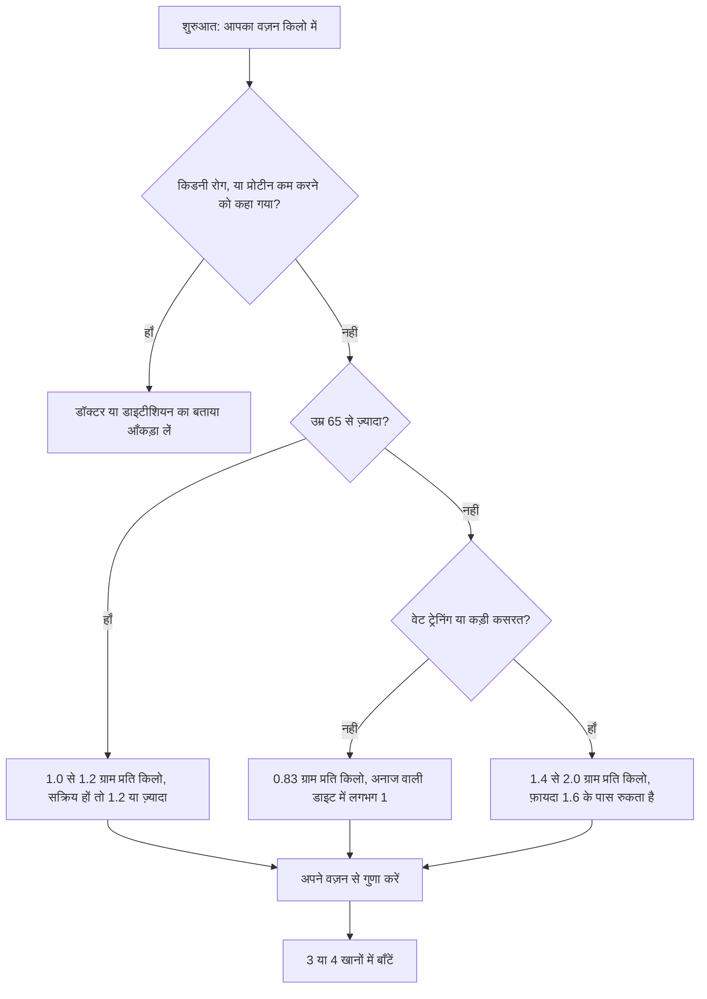

:::answer
ICMR-NIN के हिसाब से एक स्वस्थ भारतीय वयस्क को रोज़ अपने वज़न के हर किलो पर 0.83 ग्राम प्रोटीन चाहिए। 65 किलो के आदमी के लिए यह लगभग 54 ग्राम और 55 किलो की महिला के लिए लगभग 46 ग्राम बनता है। अगर आप वेट ट्रेनिंग करते हैं, तो स्पोर्ट्स न्यूट्रिशन के विशेषज्ञ 1.4 से 2.0 ग्राम प्रति किलो बताते हैं, और रिसर्च में मांसपेशियों का फ़ायदा लगभग 1.6 ग्राम प्रति किलो पर रुक जाता है। प्रोटीन को तीन-चार खानों में बाँटें। स्वस्थ लोगों में ज़्यादा प्रोटीन से किडनी की कार्यक्षमता बिगड़ी नहीं दिखी, लेकिन किडनी की बीमारी, किडनी पर असर वाली डायबिटीज़ या कोई शक हो तो पहले डॉक्टर से पूछें। प्रोटीन पाउडर ज़रूरी नहीं है।
:::

## प्रोटीन को लेकर इतना शोर क्यों

नोएडा के किसी भी जिम में दो उलटी बातें सुनने को मिलती हैं। कोई कहता है रोज़ दो स्कूप व्हे के बिना वर्कआउट बेकार है। कोई और कहता है ज़्यादा प्रोटीन से किडनी ख़राब हो जाती है। दोनों बातें पूरी तरह सही नहीं हैं।

प्रोटीन मांसपेशियाँ बनाता और उनकी मरम्मत करता है, एंज़ाइम और हॉर्मोन बनाने में काम आता है, और पेट भरा रखता है। हमारी थाली ज़्यादातर चावल या रोटी पर टिकी होती है। अनाज में प्रोटीन होता तो है, पर कम, और अकेले अनाज के प्रोटीन की क्वालिटी दाल, दूध या अंडे जितनी अच्छी नहीं होती। इसीलिए ICMR-NIN थाली में अनाज, दाल और दूध का बेहतर मेल माँगता है, लगभग 3:1:2.5 के अनुपात में ([ICMR-NIN, 2020](https://www.nin.res.in/rdabook/brief_note.pdf))।

## ICMR-NIN असल में क्या कहता है

2020 में ICMR-नेशनल इंस्टीट्यूट ऑफ़ न्यूट्रिशन ने भारतीयों की पोषण ज़रूरतें दोबारा तय कीं। स्वस्थ वयस्कों के लिए प्रोटीन के दो आँकड़े दिए गए ([ICMR-NIN, 2020](https://www.nin.res.in/rdabook/brief_note.pdf)):

- **औसत ज़रूरत (EAR): 0.66 ग्राम प्रति किलो प्रति दिन।**
- **सिफ़ारिश की गई मात्रा (RDA): 0.83 ग्राम प्रति किलो प्रति दिन।** इसने 2010 के पुराने 1 ग्राम प्रति किलो की जगह ली।

उसी दस्तावेज़ के संदर्भ वज़न से यह 65 किलो के आदमी के लिए लगभग 54 ग्राम और 55 किलो की महिला के लिए लगभग 46 ग्राम रोज़ बनता है। गर्भावस्था की दूसरी तिमाही में लगभग 9.5 ग्राम और तीसरी में 22 ग्राम अतिरिक्त चाहिए, और स्तनपान के पहले छह महीनों में लगभग 17 ग्राम अतिरिक्त।

एक फ़ुटनोट भारतीय घरों के लिए बहुत अहम है। जिनका खाना ज़्यादातर अनाज वाला है और प्रोटीन की क्वालिटी कम है, उनके लिए ज़रूरत लगभग 1 ग्राम प्रति किलो रोज़ है। अगर आपका दिन चाय, दो परांठे, पतली दाल-चावल और कुछ बिस्किट में निकलता है, तो आप शायद इसी समूह में हैं।

ये आँकड़े सेहत के लिए न्यूनतम हैं, मांसपेशियाँ बनाने का लक्ष्य नहीं।

## उम्र, लक्ष्य और मेहनत के हिसाब से ज़रूरत

### अगर आप वेट ट्रेनिंग करते हैं

इंटरनेशनल सोसाइटी ऑफ़ स्पोर्ट्स न्यूट्रिशन (ISSN) ने रिसर्च देखकर कहा कि कसरत करने वाले ज़्यादातर लोगों के लिए 1.4 से 2.0 ग्राम प्रोटीन प्रति किलो रोज़ मांसपेशियाँ बनाने और बचाने के लिए काफ़ी है ([ISSN, 2017](https://pmc.ncbi.nlm.nih.gov/articles/PMC5477153/))। उसी में यह भी लिखा है कि यह ज़रूरत साधारण खाने से पूरी हो सकती है।

2018 में ब्रिटिश जर्नल ऑफ़ स्पोर्ट्स मेडिसिन में 49 ट्रायल और 1,863 लोगों का एक बड़ा विश्लेषण छपा। वेट ट्रेनिंग के साथ अतिरिक्त प्रोटीन से ताक़त और मांसपेशियाँ बढ़ीं, पर थोड़ी: औसतन वन-रेप मैक्स में लगभग 2.5 किलो और लीन मास में लगभग 0.3 किलो ज़्यादा। फ़ायदा कुल लगभग 1.6 ग्राम प्रति किलो रोज़ पर रुक गया, और लेखकों के मुताबिक़ असली आँकड़ा 2.2 ग्राम प्रति किलो तक हो सकता है ([Morton et al., BJSM 2018](https://pmc.ncbi.nlm.nih.gov/articles/PMC5867436/))। मतलब प्रोटीन मदद करता है, पर मांसपेशियाँ असल में ट्रेनिंग से बनती हैं।

### अगर आपकी उम्र 65 से ज़्यादा है

बढ़ती उम्र में मांसपेशियाँ प्रोटीन पर कम असर दिखाती हैं। PROT-AGE विशेषज्ञ समूह 65 से ऊपर के लोगों के लिए कम से कम 1.0 से 1.2 ग्राम प्रति किलो रोज़ की सलाह देता है, सक्रिय लोगों के लिए 1.2 ग्राम या ज़्यादा, और किसी बीमारी में ज़्यादातर लोगों के लिए 1.2 से 1.5 ग्राम। गंभीर किडनी रोग (eGFR 30 से कम) वाले बुज़ुर्ग जो डायलिसिस पर नहीं हैं, उन्हें प्रोटीन सीमित करना पड़ सकता है ([PROT-AGE, 2013](https://pubmed.ncbi.nlm.nih.gov/23867520/))। इस पर हमारा [40 के बाद मांसपेशियाँ](/health/blog/muscle-after-40-sarcopenia-india) वाला लेख भी पढ़ें।

### अगर आप चर्बी घटा रहे हैं

कम खाने पर चर्बी के साथ मांसपेशियाँ भी घटती हैं। ISSN की रेंज (1.4 ग्राम प्रति किलो से ऊपर) में रहना और साथ में ताक़त की कसरत करना मांसपेशियाँ बचाने में मदद करता है। अगर वज़न बहुत ज़्यादा है, तो डाइटीशियन से पूछें कि हिसाब किस वज़न से लगाना है।

[[ad]]

## आपका आसान प्रोटीन कैलकुलेटर

ऐप की ज़रूरत नहीं। बस अपना वज़न और एक गुणा।

### उदाहरण 1: 70 किलो का आदमी जो जिम जाता है

- न्यूनतम: 70 × 0.83 = 58 ग्राम रोज़
- ISSN की ट्रेनिंग रेंज: 70 × 1.4 = 98 ग्राम से 70 × 2.0 = 140 ग्राम
- जहाँ फ़ायदा रुकता है: 70 × 1.6 = 112 ग्राम

उनके लिए लगभग 100 से 115 ग्राम रोज़ ठीक लक्ष्य है।

### उदाहरण 2: 58 किलो की महिला जो अभी कसरत नहीं करतीं

- न्यूनतम: 58 × 0.83 = 48 ग्राम रोज़
- अगर खाना ज़्यादातर रोटी-चावल है: 58 × 1.0 = 58 ग्राम

हफ़्ते में दो दिन वेट ट्रेनिंग शुरू करें तो धीरे-धीरे 58 × 1.4 = 81 ग्राम की ओर बढ़ सकती हैं।

### उदाहरण 3: 68 साल के 60 किलो के बुज़ुर्ग जो रोज़ टहलते हैं

- PROT-AGE रेंज: 60 × 1.0 = 60 ग्राम से 60 × 1.2 = 72 ग्राम रोज़

## आम भारतीय खाने में कितना प्रोटीन

सबसे भरोसेमंद आँकड़े ICMR-NIN की इंडियन फ़ूड कम्पोज़िशन टेबल्स (IFCT 2017) से आते हैं, जिनमें देश भर से खाने के नमूने जाँचे गए। अंडे को छोड़कर सारे आँकड़े कच्चे खाने के हैं, यानी दाल और सोयाबीन सूखे तौले गए हैं ([IFCT 2017](https://nin.res.in/ebooks/IFCT2017.pdf))।

हर 100 ग्राम में IFCT 2017 के मुताबिक़:

- चिकन ब्रेस्ट, बिना खाल: 21.8 ग्राम
- पनीर: 18.9 ग्राम
- उबला अंडा: 13.4 ग्राम
- सोयाबीन (भूरा, साबुत, सूखा): 35.6 ग्राम
- मसूर दाल, सूखी: 24.4 ग्राम
- मूँगफली: 23.7 ग्राम
- काला चना, साबुत, सूखा: 18.8 ग्राम
- गाय का दूध: 3.3 ग्राम
- गेहूँ का आटा: 10.6 ग्राम
- कच्चा चावल: 7.9 ग्राम

रोज़ खाई जाने वाली मात्रा में बदलें तो: 100 ग्राम कच्चा चिकन ब्रेस्ट लगभग 21.8 ग्राम, 100 ग्राम पनीर लगभग 18.9 ग्राम और 100 ग्राम उबला अंडा लगभग 13.4 ग्राम प्रोटीन देता है। 30 ग्राम सूखा सोयाबीन लगभग 10.7 ग्राम, 30 ग्राम सूखी मसूर दाल लगभग 7.3 ग्राम, 30 ग्राम चना लगभग 5.6 ग्राम और 30 ग्राम मूँगफली लगभग 7.1 ग्राम। 200 ग्राम दूध से लगभग 6.5 ग्राम, 60 ग्राम आटे से लगभग 6.3 ग्राम और 60 ग्राम कच्चे चावल से लगभग 4.8 ग्राम। ये गुणा हमने IFCT के आँकड़ों से ख़ुद किए हैं।

एक कटोरी दाल मदद करती है, पर अकेले पूरा दिन नहीं चला सकती। अनाज भी जुड़ता है: दिन भर में 200 ग्राम आटे की रोटियाँ लगभग 21 ग्राम प्रोटीन देती हैं। शाकाहारियों के लिए सोया और पनीर सबसे काम के हैं। सोया चंक्स बिना तेल वाले सोया आटे से बनते हैं, इसलिए उनका प्रोटीन पैकेट पर देखें।

### वेज या नॉन-वेज: क्या शाकाहारी मसल बना सकते हैं?

हाँ, बिलकुल। ट्रेनिंग के नियम वही हैं। फ़र्क़ बस मात्रा और मेल का है। दाल-अनाज के प्रोटीन के साथ कार्ब और फ़ाइबर ज़्यादा आता है, इसलिए हिस्सा थोड़ा बड़ा रखना पड़ता है। चावल-दाल, रोटी-चना, इडली-सांभर जैसे मेल प्रोटीन की क्वालिटी बेहतर करते हैं, और यही बात ICMR-NIN अनाज-दाल-दूध के मेल में कहता है। दूध, दही और पनीर काम और आसान कर देते हैं। पूरे दिन के प्लान के लिए हमारी [हाई-प्रोटीन शाकाहारी गाइड](/health/blog/high-protein-vegetarian-india-guide) देखें।

:::tip भारतीय दिन में प्रोटीन बढ़ाने के आसान तरीक़े
- नाश्ता: एक परांठे की जगह मूँग दाल या बेसन का चीला, या दो उबले अंडे, या एक कटोरी दही।
- दोपहर: दाल गाढ़ी और कटोरी बड़ी करें, साथ में अंकुरित मूँग या चने का सलाद।
- शाम: बिस्किट की जगह भुना चना, दूध या छाछ, या मुट्ठी भर मूँगफली।
- रात: पनीर या टोफ़ू भुर्जी, सोया पुलाव, कम ग्रेवी और ज़्यादा पीस वाली मछली या चिकन करी।
- लेबल पढ़ें: "सर्विंग" के बजाय प्रति 100 ग्राम प्रोटीन देखें।
:::

## प्रोटीन को खानों में बाँटना

बहुत से घरों में नाश्ते में लगभग कोई प्रोटीन नहीं होता और ज़्यादातर रात के खाने में आता है। मांसपेशियों के लिए बराबर बाँटना बेहतर है। ISSN हर खाने में शरीर के वज़न के हिसाब से लगभग 0.25 ग्राम प्रति किलो, यानी 20 से 40 ग्राम अच्छा प्रोटीन, हर तीन-चार घंटे पर सुझाता है ([ISSN, 2017](https://pmc.ncbi.nlm.nih.gov/articles/PMC5477153/))। 70 किलो के व्यक्ति के लिए 0.25 × 70 = लगभग 18 ग्राम प्रति खाना न्यूनतम है। यह मांसपेशियाँ बनाने का एक व्यावहारिक लक्ष्य है, पचाने की कोई सीमा नहीं।

IFCT के आँकड़ों से 70 किलो वाले जिम जाने वाले का एक आसान दिन, कुल लगभग 100 ग्राम:

1. नाश्ता, लगभग 20 ग्राम: 100 ग्राम उबला अंडा (13.4 ग्राम) और 200 ग्राम दूध (6.5 ग्राम)।
2. दोपहर, लगभग 32 ग्राम: 30 ग्राम सूखी मसूर दाल (7.3 ग्राम), 60 ग्राम आटे की रोटी (6.3 ग्राम) और 100 ग्राम पनीर (18.9 ग्राम)।
3. शाम, लगभग 13 ग्राम: 30 ग्राम चना (5.6 ग्राम) और 30 ग्राम मूँगफली (7.1 ग्राम)।
4. रात, लगभग 34 ग्राम: 100 ग्राम चिकन ब्रेस्ट (21.8 ग्राम), 30 ग्राम सूखी दाल (7.3 ग्राम) और 60 ग्राम चावल (4.8 ग्राम)।

शाकाहारी चिकन की जगह 30 ग्राम सूखा सोयाबीन (10.7 ग्राम) और थोड़ा ज़्यादा पनीर या दही ले सकते हैं।

[[ad]]

## किडनी का सवाल: स्वस्थ किडनी बनाम किडनी रोग

2018 के एक विश्लेषण में किडनी रोग से मुक्त 1,358 वयस्कों पर हुए 28 ट्रायल जोड़े गए। "हाई प्रोटीन" का मतलब था कम से कम 1.5 ग्राम प्रति किलो रोज़, या 20% कैलोरी, या 100 ग्राम रोज़। हाई प्रोटीन के बाद किडनी की फ़िल्टरिंग (GFR) थोड़ी ज़्यादा दिखी, जो ज़्यादा प्रोटीन पर सामान्य प्रतिक्रिया है, लेकिन समय के साथ किडनी की कार्यक्षमता में बदलाव सामान्य या कम प्रोटीन वाली डाइट से अलग नहीं था ([Devries et al., J Nutr 2018](https://pubmed.ncbi.nlm.nih.gov/30383278/))। ज़्यादातर ट्रायल छोटे थे, इसलिए दशकों तक बहुत ज़्यादा प्रोटीन के बारे में पक्का नहीं कहा जा सकता।

क्रोनिक किडनी डिज़ीज़ (CKD) की बात अलग है। KDIGO 2024 की मरीज़ों के लिए गाइड CKD वालों के लिए लगभग 0.8 ग्राम प्रति किलो रोज़ या उससे कम प्रोटीन बताती है, और डाइट डाइटीशियन के साथ तय करने को कहती है ([KDIGO, 2024](https://kdigo.org/wp-content/uploads/2025/01/Key-Takeaways_KDIGO-2024-CKD-Guideline_People-Living-with-CKD.pdf))। आपका आँकड़ा आपके नेफ़्रोलॉजिस्ट तय करेंगे।

दिक़्क़त यह है कि CKD अक्सर चुपचाप होता है। डायबिटीज़ या हाई BP हो, परिवार में किडनी रोग हो, या उम्र 60 से ज़्यादा हो, तो प्रोटीन बढ़ाने से पहले क्रिएटिनिन (eGFR) और यूरिन एल्ब्यूमिन की जाँच करा लें।

ICMR-NIN के 2024 के आहार दिशानिर्देश भी शरीर बनाने के लिए प्रोटीन सप्लीमेंट से बचने को कहते हैं, और चेताते हैं कि लंबे समय तक बहुत ज़्यादा प्रोटीन पाउडर लेने से हड्डियों के मिनरल घटने और किडनी को नुक़सान जैसे ख़तरे हो सकते हैं ([ThePrint, 2024](https://theprint.in/india/icmr-calls-for-avoiding-protein-supplements-issues-dietary-guidelines-for-indians/2077477/); [ICMR-NIN, 2024](https://www.nin.res.in/dietaryguidelines/index.html))। समझदारी यही है: स्वस्थ लोगों के लिए खाने से आया प्रोटीन ठीक है, पर सालों तक पाउडर से बहुत ज़्यादा प्रोटीन पर रिसर्च कम है।

:::warning प्रोटीन बढ़ाने से पहले, या जल्दी, डॉक्टर से मिलें अगर
- आपको किडनी की पुरानी बीमारी है, किडनी ट्रांसप्लांट हुआ है, या क्रिएटिनिन/eGFR गड़बड़ बताया गया है
- डायबिटीज़ या हाई BP है और कभी किडनी की जाँच नहीं हुई
- पैरों या चेहरे पर सूजन, झागदार पेशाब, या पेशाब बहुत कम हो
- लिवर की बीमारी है, या सप्लीमेंट शुरू करने के बाद आँखें पीली, पेशाब गहरा या खुजली हो
- आप गर्भवती हैं, स्तनपान करा रही हैं, या उम्र 18 से कम है और पाउडर सोच रहे हैं
- गाउट या पथरी है और डाइट में बड़ा बदलाव करना है
- बिना कोशिश के वज़न घट रहा है, या बीमारी या उदासी की वजह से बहुत कम खा रहे हैं
:::

## प्रोटीन पाउडर: काम का, पर ज़रूरी नहीं

प्रोटीन पाउडर डिब्बे में बंद खाना है। बड़ा लक्ष्य रखने वाले शाकाहारी, ज़्यादा सफ़र करने वाले या कम भूख वाले लोगों के लिए यह सुविधा है। मसल बनाने के लिए यह ज़रूरी नहीं, और ISSN ख़ुद कहता है कि साधारण खाने से ज़रूरत पूरी हो सकती है।

### भारतीय बाज़ार की जाँच में क्या मिला

2024 में भारतीय डॉक्टरों और शोधकर्ताओं की टीम ने "सिटिज़न्स प्रोटीन प्रोजेक्ट" जर्नल Medicine में छापा। उन्होंने भारत में बिकने वाले 36 लोकप्रिय प्रोटीन सप्लीमेंट जाँचे। 25 (69.4%) में लेबल से कम प्रोटीन था। 5 (13.9%) में फफूँद से बनने वाला ज़हर अफ़्लाटॉक्सिन मिला और 3 (8.3%) में कीटनाशक के अंश। कुछ में लेबल से ज़्यादा प्रोटीन दिखा, जिस पर लेखकों ने सस्ते अमीनो एसिड मिलाकर "स्पाइकिंग" की आशंका जताई, हालाँकि इसकी अलग से जाँच नहीं हुई ([Philips et al., Medicine 2024](https://pmc.ncbi.nlm.nih.gov/articles/PMC10994440/))। यह एक ही अध्ययन है, पर साफ़ चेतावनी है कि लेबल हमेशा सच नहीं होता।

भारत में प्रोटीन पाउडर दवा नहीं, खाने के तौर पर FSSAI के नियमों में बिकते हैं। हेल्थ सप्लीमेंट के लेबल पर "HEALTH SUPPLEMENT" और "NOT FOR MEDICINAL USE" लिखा होना चाहिए। इससे पता चलता है कि यह क्या है, पर यह साबित नहीं होता कि सामने लिखा प्रोटीन सही है।

अगर पाउडर लेना ही है:

- ब्रांड के अपने स्टोर या बड़े अधिकृत विक्रेता से लें, जिम या सोशल मीडिया पर बिकने वाले "इम्पोर्टेड" डिब्बों से नहीं।
- FSSAI लाइसेंस नंबर और लेबलिंग देखें।
- छोटी सामग्री सूची चुनें। "मास गेनर", हर्बल मिश्रण और "फ़ैट बर्नर" वाले उत्पादों से बचें।
- इसे दिन के कुल प्रोटीन में गिनें, ऊपर से न जोड़ें।

## जिम और घर में सुनी जाने वाली बातें और सच

:::mythfact
| भ्रम | सच |
|---|---|
| "प्रोटीन से किडनी ख़राब होती है।" | स्वस्थ लोगों के ट्रायल में ज़्यादा प्रोटीन से किडनी की कार्यक्षमता नहीं बिगड़ी। किडनी रोग वालों को डॉक्टर का बताया आँकड़ा चाहिए। |
| "शाकाहारी मसल नहीं बना सकते।" | बना सकते हैं। अनाज-दाल का मेल, दूध, दही, पनीर, सोया और लगातार बढ़ती ट्रेनिंग से। |
| "जितना ज़्यादा प्रोटीन, उतनी ज़्यादा मसल।" | फ़ायदा लगभग 1.6 ग्राम प्रति किलो पर रुक जाता है। उसके ऊपर ज़्यादातर बस कैलोरी बढ़ती है। |
| "जिम के लिए प्रोटीन पाउडर ज़रूरी है।" | ज़रूरी नहीं। दाल, दही, पनीर, अंडा, सोया और चिकन से ज़्यादातर लक्ष्य पूरे हो जाते हैं। |
| "शरीर एक बार में सिर्फ़ 30 ग्राम ले पाता है।" | 20 से 40 ग्राम हर खाने में मांसपेशियों के लिए लक्ष्य है, पचाने की सख़्त सीमा नहीं। |
| "देसी खाने में प्रोटीन अपने आप पूरा हो जाता है।" | ज़्यादा अनाज वाली डाइट में अक्सर कमी रहती है। ICMR-NIN ऐसी डाइट के लिए लगभग 1 ग्राम प्रति किलो कहता है। |
:::

## अक्सर पूछे जाने वाले सवाल

:::faq
### भारत में रोज़ कितना प्रोटीन चाहिए?
स्वस्थ वयस्क के लिए ICMR-NIN 0.83 ग्राम प्रति किलो बताता है, यानी 65 किलो के आदमी के लिए लगभग 54 ग्राम और 55 किलो की महिला के लिए लगभग 46 ग्राम। ज़्यादा अनाज वाली डाइट में लगभग 1 ग्राम प्रति किलो रखें। वेट ट्रेनिंग करते हैं तो 1.4 से 2.0 ग्राम प्रति किलो।

### क्या 2 ग्राम प्रति किलो सुरक्षित है?
सामान्य किडनी वाले स्वस्थ लोगों के ट्रायल में नुक़सान नहीं दिखा, हालाँकि ज़्यादातर ट्रायल छोटे थे। मसल का फ़ायदा 1.6 ग्राम के पास रुक जाता है। डायबिटीज़, हाई BP या किडनी की दिक़्क़त हो तो पहले डॉक्टर से पूछें।

### क्या अंडे या मांस के बिना पूरा प्रोटीन मिल सकता है?
हाँ। गाढ़ी दाल, चना, राजमा, सोया, पनीर, दही, दूध और मूँगफली से, ख़ासकर अनाज-दाल साथ खाने पर। हिस्सा थोड़ा बड़ा रखना पड़ सकता है।

### क्या मसल बनाने के लिए व्हे प्रोटीन लेना चाहिए?
ज़रूरी नहीं। लक्ष्य पूरा न हो पाए तो सुविधा के लिए ले सकते हैं। अधिकृत विक्रेता से लें, FSSAI लेबलिंग देखें और इसे दिन के कुल प्रोटीन में गिनें।

### क्या बुज़ुर्गों को ज़्यादा प्रोटीन चाहिए?
हाँ। PROT-AGE समूह 65 से ऊपर वालों के लिए कम से कम 1.0 से 1.2 ग्राम प्रति किलो और सक्रिय लोगों के लिए 1.2 ग्राम या ज़्यादा कहता है। गंभीर किडनी रोग वालों को डॉक्टर की सलाह चाहिए।
:::

:::takeaways
- ICMR-NIN: स्वस्थ वयस्क के लिए 0.83 ग्राम प्रति किलो रोज़, ज़्यादा अनाज वाली डाइट में लगभग 1 ग्राम।
- वेट ट्रेनिंग में 1.4 से 2.0 ग्राम प्रति किलो, और मसल का फ़ायदा लगभग 1.6 पर रुकता है।
- अपने वज़न को सही आँकड़े से गुणा करें और तीन-चार खानों में बाँटें।
- स्वस्थ किडनी ने ट्रायल में ज़्यादा प्रोटीन झेला; किडनी रोग में डॉक्टर का आँकड़ा।
- प्रोटीन पाउडर ज़रूरी नहीं, और भारत की जाँच में कई लेबल ग़लत निकले।
:::

## आख़िरी बात

आपका प्रोटीन एक मिनट का हिसाब है: वज़न गुणा आपकी उम्र और मेहनत के हिसाब से सही ग्राम प्रति किलो। ज़्यादातर स्वस्थ भारतीयों के लिए इसका मतलब है नाश्ते और दोपहर में ज़्यादा दाल, दही, पनीर, अंडा या सोया, पाउडर का डिब्बा नहीं। डायबिटीज़, हाई BP या परिवार में किडनी रोग हो तो किडनी की जाँच कराएँ, और असली काम ट्रेनिंग को करने दें।

प्रोटीन के इन भ्रमों पर हमने अपने YouTube चैनल [Royal Fitness TV](https://www.youtube.com/@RoyalFitnessTV?sub_confirmation=1) पर एक छोटा हिंग्लिश वीडियो भी बनाया है।

अगर आप अपने प्रोटीन के साथ सही ट्रेनिंग प्लान चाहते हैं, तो नोएडा सेक्टर 93 के रॉयल फ़िटनेस क्लब के ट्रेनर आपको सुरक्षित शुरुआत करवा सकते हैं।
