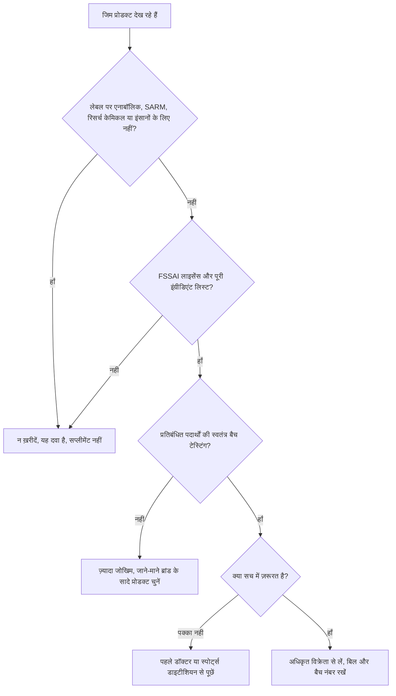

:::answer
SARMs (सिलेक्टिव एंड्रोजन रिसेप्टर मॉड्यूलेटर) सप्लीमेंट नहीं, प्रयोग के दौर की दवाएँ हैं। दुनिया के किसी भी दवा नियामक ने इन्हें इंसानों के लिए मंज़ूरी नहीं दी है, खेलों में ये हर समय बैन हैं, और ये आपका अपना टेस्टोस्टेरॉन और अच्छा कोलेस्ट्रॉल घटा सकती हैं और लिवर को नुकसान पहुँचा सकती हैं। अमेरिका के एक अध्ययन में ऑनलाइन ख़रीदे गए SARMs में से सिर्फ़ लगभग आधे में सच में SARM था। अलग से, आम दिखने वाले जिम सप्लीमेंट में भी छिपे स्टेरॉयड मिले हैं। सबसे सुरक्षित रास्ता: कम प्रोडक्ट, सीधे-सादे इंग्रीडिएंट, FSSAI लाइसेंस, स्वतंत्र बैच टेस्टिंग, और लेबल पर "एनाबॉलिक" जैसे वादे नहीं।
:::

आपने रील देखी होंगी: एक दुबला लड़का कुछ कैप्सूल से "नेचुरली" शेप में आ गया, और कमेंट में "भाई, लिंक?"। इनमें से ज़्यादातर प्रोडक्ट या तो SARMs होते हैं या उसी वादे के साथ बिकने वाली कोई चीज़। यह लेख बताता है कि ये क्या हैं, सबूत क्या कहते हैं, और "नेचुरल" कहकर बिकने वाले कुछ सप्लीमेंट में स्टेरॉयड कैसे निकले। हम किसी सेलर, प्रोडक्ट या डोज़ का नाम नहीं लेंगे, और इन दवाओं को लेने का तरीक़ा नहीं बताएँगे।

## SARMs क्या हैं

टेस्टोस्टेरॉन मसल, हड्डी, त्वचा, प्रोस्टेट और दिमाग़ में "एंड्रोजन रिसेप्टर" से जुड़कर काम करता है। SARMs लैब में बने ऐसे केमिकल हैं जिन्हें इन्हीं रिसेप्टर से जुड़ने के लिए बनाया गया, ख़ासकर मसल और हड्डी में। दवा कंपनियों ने इन्हें कैंसर में मसल घटने, बुढ़ापे की कमज़ोरी और हड्डी कमज़ोर होने के लिए बनाना शुरू किया था। पर कोई भी SARM मंज़ूरी के लिए ज़रूरी ट्रायल पास नहीं कर पाया।

आम नाम हैं ऑस्टारिन (एनोबोसार्म), लिगैंड्रॉल (LGD-4033), RAD-140, एंडारिन, S-23 और YK-11। सेलर इन्हें "रिसर्च केमिकल" कहते हैं या "इंसानों के लिए नहीं" छाप देते हैं, ताकि नियमों से बच सकें। अमेरिकी FDA साफ़ कहता है कि सप्लीमेंट कहकर बिकने पर भी ये बिना मंज़ूरी की दवाएँ हैं, सप्लीमेंट नहीं ([FDA, 2025](https://www.fda.gov/drugs/fraudulent-products/certain-bodybuilding-products-put-consumers-risk-heart-attack-stroke-serious-liver-damage-and-more))। साथ में बिकने वाले MK-677, कार्डारिन और SR9009 SARM नहीं हैं, पर ये भी बिना मंज़ूरी की प्रयोग वाली दवाएँ हैं।

### "सिलेक्टिव" का मतलब सुरक्षित नहीं

एक प्लेसिबो-कंट्रोल्ड ट्रायल में 76 स्वस्थ नौजवानों ने सिर्फ़ 21 दिन लिगैंड्रॉल या प्लेसिबो लिया। मसल थोड़ा बढ़ा, पर ली गई मात्रा के हिसाब से कुल टेस्टोस्टेरॉन गिरा और HDL ("अच्छा") कोलेस्ट्रॉल भी घटा। इस छोटे, निगरानी वाले ट्रायल में छोड़ने के बाद लेवल लौट आए ([Basaria et al., 2013](https://pubmed.ncbi.nlm.nih.gov/22459616/))। जिम में लोग अक्सर ज़्यादा लंबे समय तक, कई चीज़ें मिलाकर और बिना डॉक्टर के लेते हैं।

FDA SARMs के संभावित नुकसान में हार्ट अटैक या स्ट्रोक, साइकोसिस और भ्रम, नींद की दिक़्क़त, सेक्स से जुड़ी दिक़्क़त, लिवर को नुकसान और लिवर फ़ेल होना, बाँझपन, गर्भपात और अंडकोष का सिकुड़ना गिनाता है। उसके अनुसार अस्पताल में भर्ती करने लायक़ लिवर इंजरी समेत जानलेवा रिएक्शन हुए हैं ([FDA, 2025](https://www.fda.gov/drugs/fraudulent-products/certain-bodybuilding-products-put-consumers-risk-heart-attack-stroke-serious-liver-damage-and-more))।

## नौजवान इनके झाँसे में क्यों आते हैं

- **"स्मार्ट" विकल्प बताकर बेचा जाता है।** "सिलेक्टिव" शब्द वैज्ञानिक और सुरक्षित लगता है।
- **इंजेक्शन नहीं, कैप्सूल।** कैप्सूल निगलना हल्का लगता है, पर असली ख़तरे से इस एहसास का कोई लेना-देना नहीं।
- **मँगाना आसान।** इंस्टाग्राम या व्हाट्सऐप पर एक मैसेज और कूरियर।
- **नतीजे दिखते हैं, साइड इफ़ेक्ट नहीं।** बिफ़ोर-आफ़्टर फ़ोटो दिखती है, ब्लड रिपोर्ट या पीलिया वाला अस्पताल नहीं।
- **"भाई, मैंने लिया, कुछ नहीं हुआ।"** लिवर और हॉर्मोन की दिक़्क़त अक्सर चुपचाप बढ़ती है।

FDA ख़ास तौर पर उन सोशल मीडिया पोस्ट की चेतावनी देता है जो किशोरों और नौजवानों को निशाना बनाती हैं। बढ़ते शरीर को हॉर्मोन जैसी दवाओं से सबसे ज़्यादा बचाना चाहिए। माँ-बाप को बच्चे के कमरे में ऑस्टारिन, लिगैंड्रॉल या RAD-140 जैसे नाम वाले कैप्सूल मिलें, तो पहले शांति से बात करें, फिर साथ में डॉक्टर के पास जाएँ।

## लिवर इंजरी के मामले

डॉक्टर SARMs लेने वाले स्वस्थ नौजवानों में लिवर इंजरी के केस छाप रहे हैं:

- एक 24 साल के युवक को ऑस्टारिन के बाद गहरा पीलिया हुआ। उसका बिलीरुबिन (पीलिया वाला पीला पिगमेंट) बहुत ऊपर गया, अस्पताल में लिवर-सपोर्ट डायलिसिस के कई सेशन लगे, और बिलीरुबिन सामान्य होने में लगभग छह महीने लगे ([Zeitschrift für Gastroenterologie, 2024](https://pubmed.ncbi.nlm.nih.gov/37871633/))।
- एक 26 साल के युवक को RAD-140 के बाद अचानक पीलिया हुआ; छोड़ने के दो महीने बाद लिवर टेस्ट सामान्य हुए ([Journal of Medical Case Reports, 2023](https://pubmed.ncbi.nlm.nih.gov/36978171/))।

ईमानदारी से: केस रिपोर्ट बताती हैं कि ऐसा हो सकता है, यह नहीं कि कितनी बार होता है। बहुत लोग डॉक्टर के पास जाते ही नहीं, इसलिए हल्के मामले दर्ज नहीं होते।

## आधी बोतलों में वह नहीं था जो लेबल पर लिखा था

2016 में शोधकर्ताओं ने इंटरनेट से SARMs कहकर बिकने वाले 44 प्रोडक्ट ख़रीदे और WADA से मान्य तरीक़ों से जाँचे ([Van Wagoner et al., JAMA 2017](https://pubmed.ncbi.nlm.nih.gov/29183075/)):

- सिर्फ़ 23 (52%) में एक या ज़्यादा SARM था
- 17 (39%) में कोई दूसरी बिना मंज़ूरी वाली दवा थी
- 4 (9%) में कोई सक्रिय दवा थी ही नहीं
- 11 (25%) में ऐसे पदार्थ थे जो लेबल पर नहीं लिखे थे
- सिर्फ़ 18 (41%) में मात्रा लेबल के क़रीब थी

यह अमेरिका का अध्ययन है; भारत में बिकने वाले SARMs पर ऐसा कोई प्रकाशित सर्वे नहीं है।

## मिलावटी "नेचुरल" सप्लीमेंट: वह ख़तरा जिसे लोग भूल जाते हैं

SARMs ख़रीदे बिना भी आप स्टेरॉयड ले सकते हैं। कुछ प्रोटीन, मास गेनर, "टेस्ट बूस्टर" और हर्बल मसल बिल्डर में ऐसी दवाएँ मिली हैं जो लेबल पर नहीं थीं।

- एक अंतरराष्ट्रीय अध्ययन में 13 देशों के 215 सप्लायरों से 634 बिना-हॉर्मोन वाले सप्लीमेंट ख़रीदे गए। लगभग 15% (94 प्रोडक्ट) में बिना बताए एनाबॉलिक स्टेरॉयड या उनके पूर्ववर्ती पदार्थ मिले, कुछ में इतने कि डोप टेस्ट पॉज़िटिव आ जाए ([Geyer et al., 2004](https://pubmed.ncbi.nlm.nih.gov/14986195/))। अध्ययन पुराना है, पर अपनी तरह के सबसे बड़े अध्ययनों में है।
- 2007 से 2016 तक की FDA चेतावनियों की समीक्षा में 776 मिलावटी सप्लीमेंट मिले। मसल बनाने वाले 92 में से 82 (लगभग 89%) में सिंथेटिक स्टेरॉयड या स्टेरॉयड जैसे पदार्थ थे ([Tucker et al., JAMA Network Open 2018](https://pubmed.ncbi.nlm.nih.gov/30646238/))।

**भारत में।** अप्रैल 2026 में NADA इंडिया की इंटेलिजेंस यूनिट की टिप पर दिल्ली के नजफ़गढ़ में फ़ूड सेफ़्टी अफ़सरों और पुलिस ने छापा मारा। हज़ारों गोलियाँ-कैप्सूल ज़ब्त हुए जिनमें WADA से प्रतिबंधित एनाबॉलिक स्टेरॉयड और लगभग 1,500 SARM कैप्सूल थे, साथ में बिक्री के लिए रखा लगभग 45 किलो एक्सपायर्ड प्रोटीन और मास गेनर ([Outlook India, अप्रैल 2026](https://www.outlookindia.com/sports/others/nada-intelligence-and-investigations-unit-tip-najafgarh-raid-update))। भारत में कितने सप्लीमेंट मिलावटी हैं, इस पर अभी कोई बड़ा प्रकाशित अध्ययन नहीं है। कोई सटीक प्रतिशत बताए तो वह अंदाज़ा है।

## नियम क्या कहते हैं

**WADA और NADA।** WADA की 2026 की प्रतिबंधित सूची में एनाबॉलिक एजेंट हर समय बैन हैं, और "अन्य एनाबॉलिक एजेंट" में SARMs नाम से दर्ज हैं: एंडारिन, एनोबोसार्म (ऑस्टारिन), LGD-4033 (लिगैंड्रॉल), RAD140, S-23 और YK-11 ([WADA, 2026](https://www.wada-ama.org/en/prohibited-list))। NADA इंडिया यही सूची लागू करती है। खेल में "स्ट्रिक्ट लायबिलिटी" का नियम है: सैंपल में प्रतिबंधित पदार्थ मिला तो ज़िम्मेदारी खिलाड़ी की, भले वह भरोसे से ख़रीदे मिलावटी प्रोटीन से आया हो ([FSSAI, 2019](https://www.fssai.gov.in/upload/uploadfiles/files/Guidance_Document_Sportsperson_10_07_2019.pdf))।

**FSSAI।** भारत में प्रोटीन पाउडर और स्पोर्ट्स सप्लीमेंट FSSAI के तहत खाद्य पदार्थ माने जाते हैं। FSSAI की गाइडेंस कहती है कि नियम किसी भी खाद्य पदार्थ में हॉर्मोन, स्टेरॉयड या साइकोट्रॉपिक चीज़ें डालने की इजाज़त नहीं देते, और खिलाड़ियों वाले प्रोडक्ट में WADA सूची का कोई पदार्थ नहीं होना चाहिए ([FSSAI, 2019](https://www.fssai.gov.in/upload/uploadfiles/files/Guidance_Document_Sportsperson_10_07_2019.pdf))। FSSAI लाइसेंस नंबर एक बुनियादी जाँच है, शुद्धता की गारंटी नहीं: इससे पता चलता है कि कारोबार रजिस्टर्ड है, यह नहीं कि हर बैच छिपी दवाओं के लिए जाँचा गया।

:::tip समझदारी से सप्लीमेंट चुनें
- खाने से शुरू करें: दाल, चना, राजमा, पनीर, दही, अंडे, चिकन, मछली और सोया से ज़्यादातर ज़रूरत पूरी होती है।
- कम प्रोडक्ट, कम ख़तरा। बहुत से लोगों को प्रोटीन पाउडर और शायद क्रिएटिन से ज़्यादा कुछ नहीं चाहिए, और कई को इनकी भी ज़रूरत नहीं।
- "व्हे प्रोटीन" या "क्रिएटिन मोनोहाइड्रेट" जैसे एक सादे इंग्रीडिएंट वाले प्रोडक्ट चुनें, छिपी मात्रा वाले "प्रोप्राइटरी ब्लेंड" नहीं।
- पैक पर FSSAI लाइसेंस नंबर, पूरी इंग्रीडिएंट लिस्ट, बैच नंबर और एक्सपायरी देखें।
- खेलते हैं तो प्रतिबंधित पदार्थों की स्वतंत्र थर्ड-पार्टी टेस्टिंग देखें, और बैच टेस्टर की वेबसाइट पर ख़ुद जाँचें।
- "स्टेरॉयड जैसा", "एनाबॉलिक", "टेस्ट बूस्टर" वाले वादों से दूर रहें। असली फ़ूड सप्लीमेंट क़ानूनन ऐसा नहीं कर सकता, इसलिए यह वादा ही चेतावनी है।
- ब्रांड के अधिकृत विक्रेता या भरोसेमंद दुकान से लें। खुले डिब्बे, बिना भारतीय लेबल के पैक और इंस्टाग्राम-व्हाट्सऐप सेलर से बचें।
:::

## अगर आप पहले ही कुछ ले चुके हैं

घबराएँ नहीं, और आगे न लें। फिर:

1. **प्रोडक्ट बंद करें** और डिब्बा, लेबल और बिल संभाल कर रखें।
2. **डॉक्टर से मिलें** और ठीक-ठीक बताएँ कि क्या और कितने समय लिया। लिवर टेस्ट, लिपिड प्रोफ़ाइल, किडनी टेस्ट और पुरुष हैं तो हॉर्मोन टेस्ट करवाएँ।
3. **कुछ हफ़्ते लक्षणों पर नज़र रखें:** पीली आँखें, खुजली, गहरा पेशाब, हल्के रंग का मल, मतली, पेट दर्द, सीने में दर्द या मूड में अजीब बदलाव।
4. **टेस्ट होने वाले खिलाड़ी हैं** तो अगले मुक़ाबले से पहले फ़ेडरेशन के एंटी-डोपिंग संपर्क या NADA इंडिया से बात करें।
5. **प्रोडक्ट की शिकायत करें।** असुरक्षित खाने और दवाओं की शिकायत FSSAI और राज्य के ड्रग कंट्रोल विभाग सुनते हैं।

:::warning तुरंत डॉक्टर के पास या अस्पताल जाएँ अगर
- आँखें या त्वचा पीली हों, या पेशाब गहरा भूरा हो
- तेज़ खुजली के साथ हल्के रंग का मल, मतली या दाईं पसलियों के नीचे दर्द हो
- सीने में दर्द, बहुत तेज़ या अनियमित धड़कन, या अचानक साँस फूले
- एक पैर सूजकर दर्द और गर्मी के साथ लाल हो
- अचानक एक तरफ़ कमज़ोरी, बोलने में दिक़्क़त या तेज़ सिरदर्द हो
- उलझन हो, ऐसी चीज़ें दिखें-सुनें जो हैं नहीं, या बहुत उदासी और नाउम्मीदी हो
- आप गर्भवती हैं या गर्भ की कोशिश कर रही हैं और इनमें से कुछ लिया है
:::

## जिम में सुनी जाने वाली बातें और सच

:::mythfact
| मिथक | सच |
|---|---|
| "SARMs क़ानूनी और सेफ़ स्टेरॉयड हैं।" | SARMs कहीं भी इंसानों के लिए मंज़ूर नहीं, खेल में बैन हैं, और अपना टेस्टोस्टेरॉन व अच्छा कोलेस्ट्रॉल घटाते हैं। |
| "रिसर्च केमिकल मतलब शुद्ध लैब वाला माल।" | एक अध्ययन में सिर्फ़ 52% SARM प्रोडक्ट में SARM था, और 9% में कोई सक्रिय दवा नहीं थी। |
| "दुकान पर बिक रहा है तो जाँचा हुआ होगा।" | आम सप्लीमेंट में भी छिपे स्टेरॉयड मिले हैं। लाइसेंस रजिस्ट्रेशन दिखाता है, बैच की शुद्धता नहीं। |
| "नेचुरल बनाम स्टेरॉयड लेबल से पता चल जाता है।" | लेबल झूठ बोल सकते हैं। स्वतंत्र बैच टेस्टिंग देखें और "एनाबॉलिक" वादों से बचें। |
| "लिवर ख़राब सिर्फ़ इंजेक्शन से होता है।" | SARMs मुँह से लिए जाते हैं, और नौजवानों में गंभीर लिवर इंजरी के केस छपे हैं। |
| "सप्लीमेंट से डोप टेस्ट फ़ेल हुआ तो मेरी ग़लती नहीं।" | स्ट्रिक्ट लायबिलिटी में सैंपल में जो मिला उसकी ज़िम्मेदारी खिलाड़ी की है। |
:::

## अक्सर पूछे जाने वाले सवाल

:::faq
### क्या भारत में SARMs क़ानूनी हैं?
SARMs भारत में या कहीं और दवा के रूप में मंज़ूर नहीं हैं, और FSSAI नियम खाद्य पदार्थों या सप्लीमेंट में हॉर्मोन जैसी चीज़ों की इजाज़त नहीं देते। NADA इंडिया जो WADA सूची मानती है, उसमें भी ये बैन हैं। इन्हें बिना मंज़ूरी की दवा ही मानें।

### क्या ऑस्टारिन बाक़ी SARMs से सुरक्षित है?
ऐसा कोई अच्छा सबूत नहीं कि जिम के लिए कोई भी SARM सुरक्षित है। ऑस्टारिन से जुड़ा एक गंभीर लिवर इंजरी का केस छपा है जिसमें ठीक होने में महीनों लगे।

### क्या आम व्हे प्रोटीन से डोप टेस्ट फ़ेल हो सकता है?
अगर प्रोडक्ट मिलावटी हो तो हो सकता है, हालाँकि ज़्यादातर जाने-माने प्रोटीन ऐसे नहीं होते। टेस्ट होते हैं तो स्वतंत्र बैच टेस्टिंग वाले प्रोडक्ट लें और बिल व बैच नंबर रखें।

### मैंने कुछ हफ़्ते SARMs लिए और ठीक महसूस कर रहा हूँ। क्या फिर भी जाँच करवाऊँ?
हाँ। लिवर पर ज़ोर और हॉर्मोन के बदलाव शुरुआत में हमेशा लक्षण नहीं देते। डॉक्टर लिवर, लिपिड और हॉर्मोन की जाँच से बता सकते हैं कि आगे देखने की ज़रूरत है या नहीं।
:::

## आख़िरी बात

SARMs सप्लीमेंट की मुस्कान के साथ बिकने वाली प्रयोग की दवाएँ हैं। ये हॉर्मोन दबाती हैं, लिवर को नुकसान पहुँचा सकती हैं, खेल में बैन हैं, और अक्सर लेबल पर लिखी चीज़ भी नहीं होतीं। मिलावटी "नेचुरल" प्रोडक्ट में यही ख़तरा चुपचाप रहता है। सप्लीमेंट की लिस्ट छोटी और सादी रखें, जाँचे हुए प्रोडक्ट जाने-माने विक्रेता से लें, असली खाने और लगातार ट्रेनिंग पर भरोसा करें, और कुछ ले चुके हैं तो डॉक्टर से बात करें।

हमने इस पर अपने YouTube चैनल [Royal Fitness TV](https://www.youtube.com/@RoyalFitnessTV?sub_confirmation=1) पर एक छोटा हिंग्लिश वीडियो भी बनाया है।

बिना दवा का ईमानदार प्लान चाहिए तो सेक्टर 93, नोएडा के रॉयल फ़िटनेस क्लब के ट्रेनर असली खाने और लगातार ट्रेनिंग पर आधारित प्लान बनाने में मदद कर सकते हैं।
