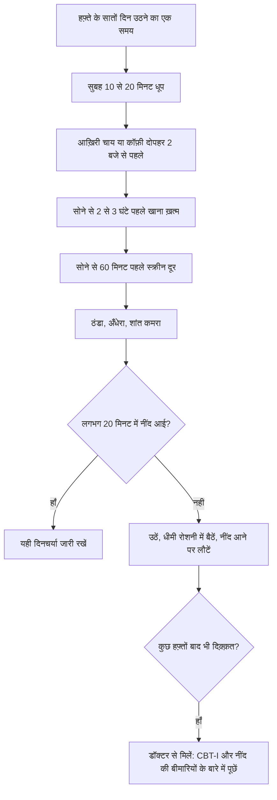

:::answer
ज़्यादातर वयस्कों को नियमित रूप से हर रात कम से कम सात घंटे की नींद चाहिए। भारतीय घरों में नींद के आम चोर हैं: देर से रात का खाना, शाम की चाय या कॉफ़ी, बिस्तर में फ़ोन, गर्म या शोर वाला कमरा, लंबा सफ़र और नाइट शिफ़्ट। कैफ़ीन जल्दी लेना, रोज़ एक तय समय पर उठना, सोने से एक घंटा पहले स्क्रीन बंद करना और कमरे को रोशनी, शोर और गर्मी से बचाना बहुत कुछ ठीक कर देता है। अगर नींद न आने की दिक़्क़त तीन महीने से ज़्यादा हो, तो सबसे ज़्यादा परखा हुआ इलाज CBT-I नाम का एक व्यवस्थित प्रोग्राम है, नींद की गोलियाँ नहीं। और तेज़ ख़र्राटे, साँस रुकना, रात में घुटन या दिन में नींद आना "बस ख़र्राटे" नहीं हैं: यह स्लीप एप्निया हो सकता है, जिसके लिए डॉक्टर ज़रूरी है।
:::

## असल में कितनी नींद चाहिए

अमेरिकन एकेडमी ऑफ़ स्लीप मेडिसिन और स्लीप रिसर्च सोसाइटी ने सबूतों की समीक्षा करके कहा कि वयस्कों को नियमित रूप से सात घंटे या ज़्यादा सोना चाहिए; लगातार कम सोना वज़न बढ़ने, डायबिटीज़, हाई BP, दिल की बीमारी, डिप्रेशन, कमज़ोर इम्युनिटी, ज़्यादा दर्द, कम काम-क्षमता और हादसों से जुड़ा है ([AASM, 2015](https://aasm.org/seven-or-more-hours-of-sleep-per-night-a-health-necessity/))। बच्चों और किशोरों को इससे ज़्यादा चाहिए।

"मुझे पाँच घंटे काफ़ी हैं" सबसे आम और ज़्यादातर लोगों के लिए सबसे ग़लत बात है। लगातार कम सोने वाले थकान के आदी हो जाते हैं और भूल जाते हैं कि वे कितने कम चुस्त हैं। मात्रा जितनी ही गुणवत्ता भी ज़रूरी है: बार-बार जागना, उठकर तरोताज़ा न लगना, या रोज़ तीन बार स्नूज़ दबाना बताता है कि नींद अपना काम नहीं कर रही।

## भारतीय घरों के नींद के चोर

**सोचे से ज़्यादा देर की चाय-कॉफ़ी।** कैफ़ीन दिमाग़ के उस रसायन (एडेनोसिन) को रोकता है जो दिन भर में नींद का दबाव बनाता है, और इसका असर घंटों रहता है। एक नियंत्रित अध्ययन में सोने से छह घंटे पहले ली गई कैफ़ीन की डोज़ ने भी कुल नींद एक घंटे से ज़्यादा घटा दी, जबकि लोगों को ख़ुद अक्सर पता भी नहीं चला ([JCSM, 2013](https://doi.org/10.5664/jcsm.3170))। वह डोज़ बड़ी थी, कई कड़क कप जितनी, पर सबक़ साफ़ है: शाम 5 बजे की चाय रात 11 बजे की नींद के ख़िलाफ़ काम कर रही होती है। कैफ़ीन ग्रीन टी, कोला, एनर्जी ड्रिंक, चॉकलेट और कुछ दर्द-ज़ुकाम की गोलियों में भी छिपा होता है।

**बिस्तर में फ़ोन, लैपटॉप और टीवी।** स्क्रीन की रोशनी शरीर की घड़ी को "दिन" का संकेत देती है, कंटेंट दिमाग़ को जगाए रखता है, और आदत सोने का समय खिसका देती है। एक अध्ययन में सोने से पहले रोशनी वाले ई-रीडर पर पढ़ने से, छपी किताब के मुक़ाबले, मेलाटोनिन देर से निकला, नींद आने में ज़्यादा समय लगा और अगली सुबह लोग कम चुस्त रहे ([PNAS, 2015](https://doi.org/10.1073/pnas.1418490112))। नाइट मोड थोड़ा मदद करता है; सोने से एक घंटा पहले फ़ोन रख देना कहीं ज़्यादा।

**देर का भारी खाना।** बहुत से परिवार रात 9:30 या 10 बजे दिन का सबसे बड़ा खाना खाते हैं और जल्दी सो जाते हैं। भरा पेट और लेटने पर एसिडिटी नींद बिगाड़ते हैं। सोने से दो-तीन घंटे पहले हल्का खाना खाने से अक्सर फ़र्क़ पड़ता है।

**उठने का अनियमित समय।** रविवार को देर तक सोकर "नींद पूरी करना" शरीर की घड़ी खिसका देता है, फिर रविवार की रात नींद नहीं आती और सोमवार की सुबह जेट लैग जैसी लगती है।

**गर्म, रोशन, शोर वाला कमरा और 2 बजे रात का दिमाग़।** स्ट्रीट लाइट, हॉर्न, खड़खड़ाता पंखा, गर्मी, और लाइट बंद होते ही काम, पैसे या परिवार की चिंताएँ, सब नींद तोड़ते हैं।

[[ad]]

## असली भारतीय घर में काम करने वाली योजना

**1. उठने का समय पक्का करें,** छुट्टी के दिन भी, और सोने का समय उससे साढ़े सात-आठ घंटे पहले रखें। **2. सुबह की धूप:** उठने के बाद बालकनी, छत या छोटी सैर में 10–20 मिनट की रोशनी शरीर की घड़ी सेट करती है। **3. कैफ़ीन जल्दी:** दो हफ़्ते दोपहर 2 बजे की सीमा आज़माएँ; शाम की चाय की जगह हल्दी वाला गर्म दूध, अजवाइन या जीरा पानी लें। **4. रात का खाना जल्दी और हल्का:** परिवार की वजह से मुश्किल हो तो देर का खाना छोटा और शाम का नाश्ता थोड़ा बड़ा रखें। **5. सुकून का एक घंटा:** गुनगुना स्नान, हल्की स्ट्रेचिंग, धीमी साँस ([योगा टाइमर](/health/yoga-timer) आज़माएँ), छपी किताब, शांत बातचीत; फ़ोन हो सके तो कमरे के बाहर चार्ज करें। **6. कमरा ठीक करें:** रोशनी के लिए मोटे पर्दे या आई मास्क, शोर के लिए ईयरप्लग या पंखे की लगातार आवाज़, और कमरा ठंडा; बिस्तर ऑफ़िस का काम करने की जगह न हो। **7. बिस्तर में नींद से लड़ें नहीं:** लगभग बीस मिनट में नींद न आए तो उठकर धीमी रोशनी में कुछ शांत काम करें और नींद आने पर लौटें।

:::tip छोटे बदलाव, बड़ा फ़र्क़
- सिर्फ़ उठने का नहीं, सोने से 60 मिनट पहले "स्क्रीन बंद" का भी अलार्म लगाएँ।
- बिस्तर के पास एक डायरी रखें: लाइट बंद करने से पहले कल के काम लिख दें, ताकि दिमाग़ छोड़ सके।
- दोपहर की लंबी झपकी से बचें; लें तो 30 मिनट से कम और 3 बजे से पहले।
- ज़्यादातर दिन कसरत करें, पर भारी वर्कआउट सोने से कुछ घंटे पहले ख़त्म करें।
- शराब कम करें। इससे नींद आती लगती है, पर रात के दूसरे हिस्से में नींद टूटती है और ख़र्राटे बढ़ते हैं।
- साथी ख़र्राटे लेता है तो सिर्फ़ कमरा बदलने की बजाय जाँच कराएँ।
:::

## नाइट और बदलती शिफ़्ट वालों के लिए

अस्पताल, IT और कॉल सेंटर, सिक्योरिटी, ट्रांसपोर्ट, फ़ैक्ट्री, पुलिस और डिलीवरी में लाखों भारतीय रात में काम करते हैं। रात का काम शरीर की घड़ी से लड़ता है, और इंटरनेशनल एजेंसी फ़ॉर रिसर्च ऑन कैंसर ने नाइट शिफ़्ट को "शायद कैंसरकारी" श्रेणी में रखा है, मुख्य रूप से शरीर की घड़ी में गड़बड़ी के आधार पर ([IARC, 2020](https://publications.iarc.who.int/593))। नौकरी हमेशा नहीं बदल सकते, पर नुकसान घटा सकते हैं: दिन की नींद को अपॉइंटमेंट की तरह बचाएँ (ब्लैकआउट पर्दे, आई मास्क, ईयरप्लग, फ़ोन साइलेंट, परिवार के लिए "सो रहे हैं" का संकेत); काम के दिनों में सोने का एक ही समय रखें और छुट्टी में पूरी तरह उलटने की बजाय थोड़ा ही खिसकाएँ; सुबह घर लौटते समय गहरा चश्मा पहनें; शिफ़्ट की शुरुआत में तेज़ रोशनी और आख़िर में धीमी रखें; कैफ़ीन शिफ़्ट के शुरू में ही लें; शिफ़्ट से पहले ठीक से खाएँ और रात में हल्का; और नींद में कभी गाड़ी न चलाएँ।

## स्लीप एप्निया: जब ख़र्राटे चेतावनी हों

ऑब्सट्रक्टिव स्लीप एप्निया में नींद के दौरान साँस की नली बार-बार सिकुड़ जाती है, जिससे घंटे में कई बार साँस रुकती या बहुत धीमी हो जाती है। हर बार दिमाग़ आपको थोड़ा जगाता है, अक्सर आपको पता भी नहीं चलता, और पूरी रात नींद टूटती रहती है। बिना इलाज के यह हाई BP, डायबिटीज़, दिल की बीमारी, स्ट्रोक, उदासी और सड़क हादसों से जुड़ा है। डॉक्टर अक्सर STOP-Bang नाम की छोटी प्रश्नावली से तय करते हैं कि किसकी जाँच हो: ख़र्राटे, थकान, साँस रुकते देखा जाना, हाई BP, BMI, उम्र, गर्दन का नाप और लिंग ([Anesthesiology, 2008](https://doi.org/10.1097/ALN.0b013e31816d83e4))। इनमें से कई बातें आप पर लागू हों तो डॉक्टर को बताएँ।

जाँच अक्सर घर पर स्लीप स्टडी से होती है और CPAP मशीन, वज़न घटाना, करवट से सोना और मुँह के उपकरण जैसे असरदार इलाज मौजूद हैं। विस्तार से हमारी [ख़र्राटे और स्लीप एप्निया गाइड](/health/blog/sleep-apnea-indian-guide) (अंग्रेज़ी) में पढ़ें।

## पुरानी अनिद्रा: गोलियाँ पहला जवाब क्यों नहीं

मौक़ा होने के बावजूद नींद आने, टिकने या बहुत जल्दी जागने की दिक़्क़त, जिससे दिन पर असर पड़े, अनिद्रा है। हफ़्ते में कम से कम तीन रातें, तीन महीने या ज़्यादा हो तो डॉक्टर इसे पुरानी अनिद्रा कहते हैं। अमेरिकन कॉलेज ऑफ़ फ़िज़िशियंस पुरानी अनिद्रा वाले वयस्कों के लिए पहले इलाज के रूप में CBT-I की सलाह देता है ([Annals of Internal Medicine, 2016](https://doi.org/10.7326/M15-2175)), जो आमतौर पर छह-आठ हफ़्ते का प्रोग्राम है और नींद की आदतें व जगाए रखने वाले विचार दोनों ठीक करता है। नींद की गोलियाँ कुछ लोगों के लिए डॉक्टर की देखरेख में थोड़े समय के लिए ठीक हैं, पर वजह नहीं मिटातीं और उनसे निर्भरता, अगले दिन सुस्ती और बुज़ुर्गों में गिरने का ख़तरा हो सकता है। किसी और की नींद की गोली न लें, बिना पर्चे न ख़रीदें, और लिखी हुई गोली अचानक बंद न करें, पहले डॉक्टर से पूछें।

**नींद, वज़न और कसरत:** कम नींद अगले दिन भूख और मीठे-तले की तलब बढ़ाती है, और कसरत के बाद मांसपेशियों की मरम्मत ज़्यादातर नींद में होती है। कई लोग पाते हैं कि नींद ठीक होते ही वज़न और जिम दोनों में प्रगति लौट आती है।

**बच्चे और किशोर:** किशोरों की शरीर की घड़ी स्वाभाविक रूप से देर से चलती है और सुबह के स्कूल-कोचिंग से टकराती है। रात में फ़ोन बेडरूम के बाहर चार्ज हों, उठने का तय समय हो, और सुबह धूप मिले। बच्चे के तेज़ ख़र्राटे, मुँह से साँस, बेचैन नींद या दिन में व्यवहार की दिक़्क़तें टॉन्सिल या एडेनॉइड बढ़ने का संकेत हो सकती हैं, बच्चों के डॉक्टर को दिखाएँ।

:::warning जल्दी डॉक्टर से मिलें अगर
- किसी ने आपको नींद में साँस रुकते या घुटते देखा हो, या आप हाँफते हुए जागें
- गाड़ी चलाते समय नींद आए या स्टीयरिंग पर झपकी लगी हो
- दिन में काम करते-करते अचानक नींद आ जाए
- नींद न आने के साथ उदासी, निराशा या ख़ुद को नुकसान पहुँचाने के ख़याल हों (टेली-मानस 14416 पर कॉल करें, इमरजेंसी में 112)
- रात में पैरों में बेचैनी और हिलाने की इच्छा से नींद न आए
- बच्चा ज़्यादातर रातों तेज़ ख़र्राटे ले, साँस रुके, या दिन में बहुत सुस्त या बहुत चंचल रहे
- अच्छी आदतों के बावजूद अनिद्रा तीन महीने से ज़्यादा हो
:::

[[ad]]

## मिथक और सच

:::mythfact
| मिथक | सच |
|---|---|
| "मुझे पाँच घंटे की आदत है, शरीर ढल गया है।" | ज़्यादातर वयस्कों को सात या ज़्यादा घंटे चाहिए। लगातार कम सोने वाले अपनी सुस्ती को कम आँकते हैं। |
| "शाम की चाय से मुझे फ़र्क़ नहीं पड़ता, नींद आ जाती है।" | नींद आ जाए फिर भी कैफ़ीन नींद को छोटा और हल्का कर सकता है। दो हफ़्ते दोपहर 2 बजे की सीमा आज़माएँ। |
| "तेज़ ख़र्राटे मतलब गहरी नींद।" | साँस रुकने या हाँफने के साथ तेज़ ख़र्राटे स्लीप एप्निया हो सकते हैं, जो नींद तोड़ता है और दिल को नुकसान पहुँचाता है। |
| "एक पैग से नींद अच्छी आती है।" | शराब से सुस्ती आती है, पर रात के दूसरे हिस्से में नींद टूटती है और ख़र्राटे-एप्निया बढ़ते हैं। |
| "छुट्टी में नींद पूरी कर लूँगा।" | देर तक सोना शरीर की घड़ी खिसकाता है और सोमवार और मुश्किल बनाता है। उठने का तय समय बेहतर है। |
| "नींद की गोली ही अनिद्रा का इलाज है।" | पुरानी अनिद्रा में पहला सुझाया इलाज CBT-I है। गोलियाँ डॉक्टर की देखरेख में थोड़े समय का सहारा हैं। |
:::

## अक्सर पूछे जाने वाले सवाल

:::faq
### सोने का सबसे अच्छा समय क्या है?
हर किसी के लिए एक तय घड़ी का समय नहीं है। सबसे ज़रूरी है सात या ज़्यादा घंटे सोना और उठने का समय एक जैसा रखना। उठने के समय से पीछे गिनकर सोने का समय तय करें।

### क्या शाम को चाय पीना बुरा है?
बहुत से लोगों में दोपहर बाद या शाम का कैफ़ीन नींद को छोटा और हल्का कर देता है, भले ही नींद आसानी से आ जाए। दो हफ़्ते दोपहर तक कैफ़ीन बंद करके देखें कि कैसा लगता है।

### दिन की झपकी अच्छी है या बुरी?
दोपहर के बीच तक ली गई लगभग 30 मिनट तक की छोटी झपकी रात की नींद बिगाड़े बिना चुस्ती बढ़ा सकती है। लंबी या देर की झपकी रात में नींद मुश्किल कर सकती है, ख़ासकर अनिद्रा में।

### क्या बिना दवा के अनिद्रा ठीक हो सकती है?
बहुत से लोगों में हाँ। अच्छी आदतें मदद करती हैं, और पुरानी अनिद्रा में CBT-I पहला सुझाया इलाज है। डॉक्टर डिप्रेशन, चिंता, दर्द, स्लीप एप्निया या नींद बिगाड़ने वाली दवाओं जैसी वजहें भी देख सकते हैं।

### कैसे पता चले कि मुझे स्लीप एप्निया है?
तेज़ ख़र्राटे, दूसरों का साँस रुकते देखना, घुटन के साथ जागना, सुबह सिरदर्द, दिन में नींद और हाई BP इसके संकेत हैं। पक्का सिर्फ़ स्लीप स्टडी से होता है, इसलिए कई संकेत हों तो डॉक्टर से बात करें।
:::

## आख़िरी बात

अच्छी नींद कोई विलासिता नहीं; यह वज़न, शुगर, BP, मूड और काम-क्षमता की नींव है। ज़्यादातर भारतीयों के लिए सबसे बड़ा फ़ायदा उठने के तय समय, जल्दी कैफ़ीन, जल्दी और हल्के रात के खाने, बिस्तर से बाहर फ़ोन, और अँधेरे-ठंडे कमरे से मिलता है। फिर भी नींद ख़राब रहे, या ख़र्राटे और दिन की नींद साथ हों, तो मदद लें: असरदार इलाज मौजूद हैं।

नियमित कसरत से भी बहुत लोगों की नींद सुधरती है। शिफ़्ट या लंबे दिनों के हिसाब से दिनचर्या चाहिए तो सेक्टर 93, नोएडा के रॉयल फ़िटनेस क्लब के ट्रेनर मदद कर सकते हैं।
