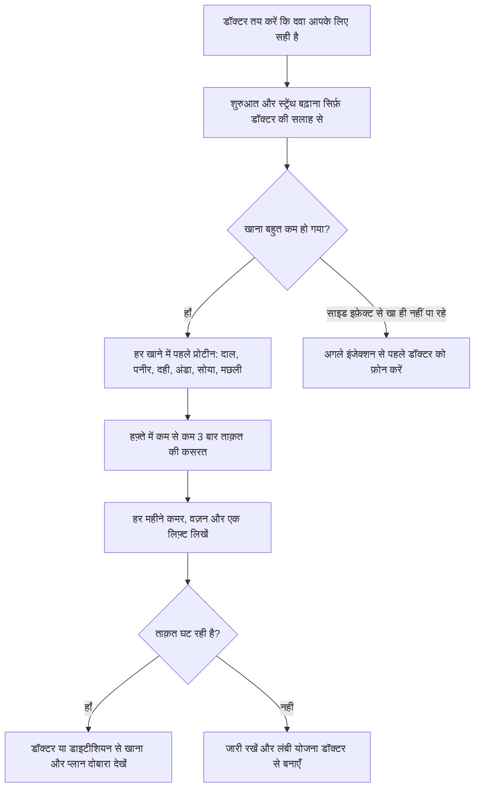

:::answer
टिर्ज़ेपाटाइड, जो भारत में मार्च 2025 से Mounjaro नाम से बिक रहा है, हफ़्ते में एक बार लगने वाला पर्चे का इंजेक्शन है: टाइप 2 डायबिटीज़ के लिए, और मोटापे (या वज़न से जुड़ी बीमारी के साथ ज़्यादा वज़न) के लिए। मोटापे के मुख्य ट्रायल में 72 हफ़्तों में औसतन 15% से 21% वज़न घटा, जबकि प्लेसिबो में लगभग 3%। आमने-सामने के ट्रायल में यह सेमाग्लूटाइड से आगे रहा। पर शर्तें भी हैं: पेट के साइड इफ़ेक्ट आम हैं, एक स्टडी में घटे वज़न का लगभग एक-चौथाई हिस्सा लीन मास था, और दवा छोड़ने पर बहुत-सा वज़न लौट आया। यह शादी से पहले का शॉर्टकट नहीं, और इंस्टाग्राम से ख़रीदने की चीज़ नहीं। डॉक्टर इसे आपके लिए सही मानें, तो हर खाने में प्रोटीन और ताक़त की कसरत साथ रखें, और सिर्फ़ लाइसेंस वाले केमिस्ट से ख़रीदें।
:::

## टिर्ज़ेपाटाइड क्या है, आसान शब्दों में

खाने के बाद हमारी आँतें कुछ हॉर्मोन छोड़ती हैं जो दिमाग़ को "पेट भर गया" बताते हैं और पैंक्रियास से इंसुलिन निकलवाते हैं। इनमें दो हैं GLP-1 और GIP। सेमाग्लूटाइड (Ozempic, Wegovy) सिर्फ़ GLP-1 की नक़ल करता है। टिर्ज़ेपाटाइड एक ही अणु में दोनों की नक़ल करता है।

असर में तीन बातें होती हैं: पेट जल्दी भरता है और खाने का ख़याल कम आता है, पेट धीरे ख़ाली होता है, और शुगर बढ़ने पर इंसुलिन ज़्यादा निकलता है। अमेरिकी लेबल में भी इसे कम कैलोरी वाले खाने और ज़्यादा एक्टिविटी के साथ इस्तेमाल की दवा बताया गया है ([FDA label, 2024](https://www.accessdata.fda.gov/drugsatfda_docs/label/2024/217806s013lbl.pdf))।

## भारत में Mounjaro: अब तक क्या हुआ

- **मार्च 2025:** एली लिली ने भारत में Mounjaro वायल के रूप में लॉन्च किया, पिछले साल CDSCO की मंज़ूरी के बाद। इसे मोटापे (या बीमारी के साथ ज़्यादा वज़न) में लंबे समय तक वज़न कंट्रोल और टाइप 2 डायबिटीज़ के लिए मंज़ूरी मिली ([ThePrint, मार्च 2025](https://theprint.in/health/fat-busting-drug-mounjaro-launched-in-india-heres-how-much-it-will-cost/2557079))।
- **जून 2025:** CDSCO ने पहले से भरे पेन (KwikPen) को मंज़ूरी दी। उसी हफ़्ते नोवो नॉर्डिस्क ने भारत में Wegovy लॉन्च किया ([ThePrint, जून 2025](https://theprint.in/health/in-battle-for-indian-anti-obesity-market-eli-lillys-pre-filled-pen-on-one-side-novo-nordisks-on-other/2671483))।
- **अप्रैल 2026:** हरियाणा के ड्रग कंट्रोल विभाग ने गुरुग्राम में नक़ली "Mounjaro" ज़ब्त किया। लिली ने कहा कि भारत में असली टिर्ज़ेपाटाइड सिर्फ़ Mounjaro और Yurpeak नाम से, अधिकृत डिस्ट्रीब्यूटर और लाइसेंस वाली फ़ार्मेसी से बिकता है ([The Week, अप्रैल 2026](https://www.theweek.in/news/health/2026/04/30/counterfeit-mounjaro-seizure-in-gurugram-raises-fresh-concerns-over-fake-drugs-market.html))।

### ख़र्च, जैसा ख़बरों में बताया गया

मार्च 2025 में लॉन्च के समय ThePrint के मुताबिक़ शुरुआती स्ट्रेंथ पर महीने का ख़र्च लगभग ₹14,000 और अगली स्ट्रेंथ पर लगभग ₹17,500 था ([ThePrint, मार्च 2025](https://theprint.in/health/fat-busting-drug-mounjaro-launched-in-india-heres-how-much-it-will-cost/2557079))। क़ीमतें स्ट्रेंथ और पैक के हिसाब से अलग होती हैं और बदल सकती हैं, इसलिए इसे उस तारीख़ का मोटा अंदाज़ा मानें और केमिस्ट से मौजूदा क़ीमत पूछें। मार्च 2026 से जेनेरिक सेमाग्लूटाइड सस्ता हुआ है, जिस पर हमारी [जेनेरिक सेमाग्लूटाइड गाइड](/health/blog/generic-semaglutide-india-guide) है। अपने आप दवा बदलें नहीं; यह फ़ैसला डॉक्टर के साथ करें।

[[ad]]

## यह दवा किसके लिए है

1. **टाइप 2 डायबिटीज़** वाले बड़े, जिनकी शुगर ठीक से काबू में नहीं है।
2. **मोटापे** वाले बड़े, या ज़्यादा वज़न के साथ कोई बीमारी, जैसे हाई BP, प्रीडायबिटीज़, स्लीप एप्निया, हाई कोलेस्ट्रॉल या फ़ैटी लिवर।

भारतीयों के लिए वज़न भारतीय पैमाने से देखना चाहिए, क्योंकि हमारे पेट पर चर्बी ज़्यादा जमती है और कम वज़न पर ही डायबिटीज़ हो जाती है। हमारा [BMI कैलकुलेटर](/health/health-calculators/bmi-calculator) भारतीय पैमाना इस्तेमाल करता है।

### किन्हें नहीं लेनी चाहिए, या ज़्यादा सावधानी चाहिए

अमेरिकी लेबल के मुताबिक़ ([FDA label, 2024](https://www.accessdata.fda.gov/drugsatfda_docs/label/2024/217806s013lbl.pdf)):

- आपको या परिवार में किसी को **मेडुलरी थायरॉइड कैंसर** हुआ हो, या **MEN2** हो, तो न लें। चूहों में इससे थायरॉइड ट्यूमर हुए; इंसानों में ऐसा होता है या नहीं, पता नहीं।
- इससे पहले **गंभीर एलर्जी** हुई हो तो न लें।
- **गर्भावस्था:** बच्चे को नुकसान हो सकता है; गर्भ का पता चलते ही बंद करनी होती है।
- **गर्भनिरोधक गोलियाँ:** इसके साथ ये कम भरोसेमंद हो सकती हैं। लेबल शुरू करने के बाद और हर बार स्ट्रेंथ बढ़ने के बाद 4 हफ़्ते तक दूसरा तरीक़ा अपनाने या कंडोम जोड़ने की सलाह देता है।
- **पेट की गंभीर बीमारी** में इसकी सलाह नहीं दी जाती।
- **बच्चों और किशोरों** में वज़न के लिए इसकी सुरक्षा साबित नहीं है।
- **डायबिटीज़ से आँखों पर असर** हो तो निगरानी ज़रूरी है।

खाने से जुड़ी बीमारी (एनोरेक्सिया, बुलीमिया), दुबले-कमज़ोर बुज़ुर्ग, या पहले पैंक्रियाटाइटिस हुआ हो, तो विशेषज्ञ की राय लें।

## ट्रायल ने असल में क्या दिखाया

**SURMOUNT-1 (बिना डायबिटीज़):** 2,539 लोगों को 72 हफ़्तों तक तीन में से एक स्ट्रेंथ या प्लेसिबो दिया गया। औसत वज़न सबसे कम स्ट्रेंथ पर लगभग 15.0%, बीच वाली पर 19.5% और सबसे ज़्यादा पर 20.9% घटा, जबकि प्लेसिबो में 3.1% ([NEJM, 2022](https://www.nejm.org/doi/full/10.1056/NEJMoa2206038))। शुरुआती औसत वज़न 104.8 किलो था, यानी 20% का मतलब लगभग 20 किलो। साइड इफ़ेक्ट की वजह से 4.3% से 7.1% लोगों ने दवा छोड़ी, प्लेसिबो में 2.6%।

**SURPASS-2 (डायबिटीज़):** 1,879 मरीज़ों में 40 हफ़्तों में HbA1c टिर्ज़ेपाटाइड से लगभग 2.0 से 2.3 अंक और सेमाग्लूटाइड से 1.86 अंक घटा ([NEJM, 2021](https://www.nejm.org/doi/full/10.1056/NEJMoa2107519))।

**SURMOUNT-5 (सेमाग्लूटाइड से सीधी टक्कर):** 751 लोगों में 72 हफ़्तों में वज़न टिर्ज़ेपाटाइड से 20.2% और सेमाग्लूटाइड से 13.7% घटा, और कमर 18.4 सेमी बनाम 13.0 सेमी कम हुई ([NEJM, 2025](https://www.nejm.org/doi/full/10.1056/NEJMoa2416394))। यह ट्रायल ओपन-लेबल था और लिली ने इसका ख़र्च उठाया।

**SURMOUNT-4 (दवा छोड़ने पर):** सबने 36 हफ़्ते टिर्ज़ेपाटाइड लिया और औसतन 20.9% वज़न घटाया। फिर आधे लोगों को बिना बताए प्लेसिबो पर डाला गया। अगले 52 हफ़्तों में दवा जारी रखने वालों का 5.5% और घटा, जबकि प्लेसिबो वालों का 14.0% वज़न वापस बढ़ गया ([JAMA, 2024](https://pmc.ncbi.nlm.nih.gov/articles/PMC10714284/))। मतलब यह दवा लंबी चलने वाली स्थिति का इलाज करती है, शरीर को हमेशा के लिए "रीसेट" नहीं करती।

## साइड इफ़ेक्ट, बिना छिपाए

सबसे आम असर पेट पर होते हैं, ख़ासकर स्ट्रेंथ बढ़ाते समय। SURPASS-2 में टिर्ज़ेपाटाइड पर 17% से 22% लोगों को मतली, 13% से 16% को दस्त और 6% से 10% को उल्टी हुई ([NEJM, 2021](https://www.nejm.org/doi/full/10.1056/NEJMoa2107519))। कब्ज़, डकार, पेट फूलना और भूख कम लगना भी आम हैं, और ज़्यादातर हफ़्तों में ठीक हो जाते हैं।

लेबल में लिखे कम आम पर गंभीर ख़तरे: **पैंक्रियाटाइटिस**, **पित्ताशय की बीमारी**, पानी की कमी से **किडनी पर असर**, इंसुलिन या सल्फ़ोनाइल्यूरिया गोलियों के साथ **शुगर बहुत गिरना**, **गंभीर एलर्जी**, **डिप्रेशन या आत्महत्या के ख़याल** पर नज़र रखना, और बेहोशी की दवा के दौरान खाना फेफड़ों में जाने का ख़तरा, इसलिए किसी भी ऑपरेशन से पहले डॉक्टर को बताएँ ([FDA label, 2024](https://www.accessdata.fda.gov/drugsatfda_docs/label/2024/217806s013lbl.pdf))।

:::warning तुरंत डॉक्टर को दिखाएँ या अस्पताल जाएँ अगर
- पेट के ऊपरी हिस्से में तेज़ या लगातार दर्द हो, उल्टी के साथ या बिना
- एक दिन तक पानी भी पेट में न टिके, या पेशाब बहुत कम आए
- आँखें या त्वचा पीली हों, या दाईं पसलियों के नीचे दर्द के साथ बुख़ार हो
- काँपना, पसीना और उलझन हो (शुगर गिरने का संकेत), ख़ासकर इंसुलिन या डायबिटीज़ की गोली के साथ
- चेहरा, होंठ या गला सूजे, या साँस लेने में दिक़्क़त हो
- गले में गाँठ, निगलने में दिक़्क़त या लगातार भारी आवाज़ हो
- अचानक नज़र बदले, या ख़ुद को नुकसान पहुँचाने के ख़याल आएँ
:::

## मांसपेशियाँ बचाना: सबसे ज़रूरी हिस्सा

कम खाने पर चर्बी के साथ कुछ मांसपेशी भी घटती है। SURMOUNT-1 की एक उप-स्टडी में 160 लोगों के DXA स्कैन हुए। टिर्ज़ेपाटाइड पर फ़ैट मास 33.9% और लीन मास 10.9% घटा, प्लेसिबो में 8.2% और 2.6%। घटे वज़न का लगभग एक-चौथाई हिस्सा लीन मास था ([Diabetes, Obesity and Metabolism, 2025](https://pmc.ncbi.nlm.nih.gov/articles/PMC11965027/))। लेखकों (जिनमें कई लिली के कर्मचारी हैं) ने इसे दूसरे तरीक़ों जितना ही माना, पर ताक़त, संतुलन और आराम में कैलोरी जलाना इसी लीन मास पर टिका है।

2025 में अमेरिका की चार पोषण और मोटापा संस्थाओं की संयुक्त सलाह में कहा गया कि बिना ताक़त की कसरत के सिर्फ़ प्रोटीन से मांसपेशी बचना मुश्किल है। सलाह है: हफ़्ते में कम से कम 3 बार स्ट्रेंथ ट्रेनिंग, हफ़्ते में कम से कम 150 मिनट मध्यम एरोबिक एक्टिविटी, और वज़न घटाते समय रोज़ लगभग 1.2 से 1.6 ग्राम प्रोटीन प्रति किलो वज़न ([Obesity Pillars, 2025](https://pmc.ncbi.nlm.nih.gov/articles/PMC12264624/))। किडनी की बीमारी हो तो डॉक्टर या डाइटीशियन से पूछें। हमारा [प्रोटीन कैलकुलेटर](/health/blog/protein-requirement-calculator-india) शुरुआती आँकड़ा देता है।

भूख कम हो तो थाली का प्रोटीन वाला हिस्सा पहले खाएँ, चावल-रोटी बाद में, और चार-पाँच छोटे खाने लें: गाढ़ी दाल, सांभर, मूंग या बेसन चीला, दही, छाछ, पनीर, टोफ़ू, अंडा, मछली, हल्की करी में चिकन, भुना चना, सोया पुलाव, अंकुरित चाट।

कसरत के लिए महँगा सामान ज़रूरी नहीं: कुर्सी तक स्क्वैट, दीवार या बेंच पर पुश-अप, बैंड या डम्बल से रो, हिप ब्रिज, और भारी थैला उठाकर चलना। हफ़्तों में धीरे-धीरे वज़न बढ़ाएँ। सिर्फ़ पैदल चलना दिल और शुगर के लिए बढ़िया है, पर बड़ी मात्रा में वज़न घटाते समय अकेले मांसपेशी नहीं बचाता।

:::tip दवा को आसान बनाने वाली आदतें
- धीरे खाएँ और "आराम से भरा" लगते ही रुकें। ज़्यादा खाने पर अक्सर मतली होती है।
- तला और बहुत तेल वाला खाना कभी-कभार ही लें।
- दिन भर पानी पीते रहें, ख़ासकर NCR की गर्मी में।
- एक छोटी डायरी रखें: वज़न, कमर, एक लिफ़्ट और साइड इफ़ेक्ट। हर विज़िट पर ले जाएँ।
- स्ट्रेंथ ख़ुद न बदलें, आगे न बढ़ें, बीच में न छोड़ें। सिर्फ़ डॉक्टर की सलाह के अनुसार लें।
:::

## सोशल मीडिया वाली नक़ली दवा: NCR में असली ख़तरा

अप्रैल 2026 में गुरुग्राम में, नोएडा से ज़्यादा दूर नहीं, नक़ली Mounjaro ज़ब्त हुआ। लिली ने कहा कि ये उसकी सप्लाई चेन के नहीं थे और नक़ली प्रोडक्ट मंज़ूर क्वालिटी कंट्रोल में नहीं बनते। चेतावनी के संकेत: बिना लाइसेंस वाला विक्रेता, छेड़छाड़ वाली या टूटी पैकिंग, बैच नंबर या एक्सपायरी न होना, और स्पेलिंग की ग़लतियाँ या अनजान लोगो ([The Week, अप्रैल 2026](https://www.theweek.in/news/health/2026/04/30/counterfeit-mounjaro-seizure-in-gurugram-raises-fresh-concerns-over-fake-drugs-market.html))।

- सिर्फ़ पर्चे के साथ, फ़्रिज में दवा रखने वाले लाइसेंस वाले केमिस्ट से लें।
- इंस्टाग्राम, व्हाट्सऐप ग्रुप, जिम के जान-पहचान वालों या ऑनलाइन मार्केटप्लेस से न लें।
- खुली शीशी, घोलने वाला पाउडर या "रिसर्च" टिर्ज़ेपाटाइड न लें।
- कुछ भी अजीब लगे तो इंजेक्ट न करें; केमिस्ट को दिखाएँ।

[[ad]]

## सुने-सुनाए मिथक

:::mythfact
| मिथक | सच |
|---|---|
| "Mounjaro चर्बी पिघला देता है, खाने-कसरत की ज़रूरत नहीं।" | ट्रायल में दवा के साथ जीवनशैली की सलाह भी थी। प्रोटीन और कसरत के बिना ज़्यादा मांसपेशी घटती है। |
| "यह Ozempic से तेज़ है, तो सबके लिए बेहतर।" | SURMOUNT-5 में वज़न ज़्यादा घटा, पर सही दवा आपकी सेहत, साइड इफ़ेक्ट, दिल-किडनी के जोखिम और बजट पर निर्भर है। |
| "तीन महीने लो, वज़न हमेशा के लिए गया।" | SURMOUNT-4 में प्लेसिबो पर गए लोगों का एक साल में 14% वज़न लौट आया। |
| "इंस्टाग्राम वाली दवा वही है, बस सस्ती।" | 2026 में गुरुग्राम में नक़ली Mounjaro पकड़ा गया। नक़ली दवा में कुछ भी हो सकता है। |
| "बड़ी स्ट्रेंथ से जल्दी असर, तो ऊपर से शुरू करो।" | स्ट्रेंथ धीरे बढ़ाई जाती है ताकि साइड इफ़ेक्ट कम हों। जल्दबाज़ी से उल्टी, पानी की कमी और पैंक्रियाटाइटिस का ख़तरा बढ़ता है। |
:::

## आम सवाल

:::faq
### क्या Mounjaro और Ozempic एक ही हैं?
नहीं। Ozempic और Wegovy में सेमाग्लूटाइड है, जो एक हॉर्मोन (GLP-1) की नक़ल करता है। Mounjaro में टिर्ज़ेपाटाइड है, जो दो (GLP-1 और GIP) की नक़ल करता है। दोनों पर्चे की दवाएँ हैं और साइड इफ़ेक्ट मिलते-जुलते हैं।

### क्या दो-चार किलो घटाने के लिए बिना डॉक्टर के ले सकते हैं?
नहीं। यह डायबिटीज़ और मोटापे की पर्चे वाली दवा है, जिसमें पैंक्रियाटाइटिस, पित्ताशय की बीमारी और पानी की कमी जैसे ख़तरे हैं। कुछ किलो के लिए प्रोटीन वाला खाना, कसरत और नींद ज़्यादा सुरक्षित और सस्ते हैं।

### क्या इससे मांसपेशी घटेगी?
घटे वज़न में कुछ हिस्सा लीन मास होगा; एक स्टडी में लगभग एक-चौथाई। पूरा प्रोटीन और हफ़्ते में कम से कम तीन बार ताक़त की कसरत से ज़्यादा मांसपेशी बचती है।

### Mounjaro छोड़ने पर क्या होता है?
SURMOUNT-4 में 36 हफ़्ते बाद प्लेसिबो पर गए लोगों का अगले साल 14% वज़न लौट आया। दवा छोड़ने की योजना डॉक्टर के साथ बनाएँ और आदतें जारी रखें।

### कैसे पता करें कि पेन असली है?
सिर्फ़ पर्चे के साथ, ठंडे में रखने वाले लाइसेंस वाले केमिस्ट से लें। सही पैकिंग, बैच नंबर, एक्सपायरी और स्पेलिंग देखें। लिली के मुताबिक़ भारत में असली टिर्ज़ेपाटाइड सिर्फ़ Mounjaro और Yurpeak नाम से बिकता है।
:::

## निचोड़

ट्रायल में टिर्ज़ेपाटाइड से वज़न काफ़ी घटा, एक सीधी टक्कर में सेमाग्लूटाइड से भी ज़्यादा, और अब यह भारत में मिलता है। पर यह लंबी चलने वाली गंभीर दवा है: पेट के साइड इफ़ेक्ट आम हैं, कुछ दुर्लभ पर गंभीर ख़तरे हैं, मांसपेशी घटने का जोखिम है, और छोड़ने पर वज़न लौटता है। डॉक्टर की निगरानी, हर खाने में प्रोटीन और नियमित कसरत के साथ यह सेहत बदल सकती है। सोशल मीडिया से ख़रीदी या शादी से पहले जल्दी वज़न घटाने के लिए ली गई, तो निराश या नुकसान कर सकती है।

हमने इस पर अपने YouTube चैनल [Royal Fitness TV](https://www.youtube.com/@RoyalFitnessTV?sub_confirmation=1) पर एक छोटा हिंग्लिश वीडियो बनाया है।

ताक़त की ट्रेनिंग में मदद चाहिए, तो सेक्टर 93, नोएडा के रॉयल फ़िटनेस क्लब के ट्रेनर्स डॉक्टर की सलाह के साथ चलने वाला सुरक्षित प्लान बना सकते हैं।
