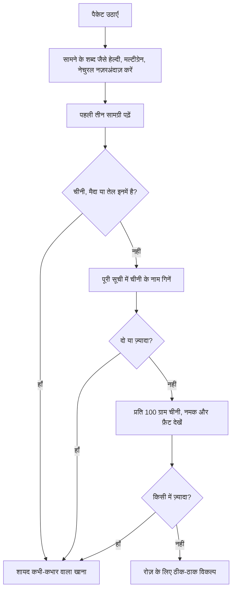

:::answer
अल्ट्रा-प्रोसेस्ड फ़ूड ज़्यादातर रिफ़ाइंड चीज़ों और एडिटिव से बने औद्योगिक उत्पाद हैं, जैसे पैकेट वाले चिप्स, बिस्कुट, मीठे पेय, इंस्टेंट नूडल्स, कई ब्रेकफ़ास्ट सीरियल और तैयार नाश्ते। WHO और ICRIER की एक रिपोर्ट के अनुसार भारत में 2011 से 2021 के बीच इनकी खुदरा बिक्री लगभग 13.37% सालाना की दर से बढ़ी। बड़े अध्ययन इनके ज़्यादा सेवन को मोटापे, टाइप 2 डायबिटीज़, दिल की बीमारी और मानसिक सेहत की दिक़्क़तों से जोड़ते हैं, और एक नियंत्रित ट्रायल में लोग अल्ट्रा-प्रोसेस्ड खाने पर बस ज़्यादा कैलोरी खा गए। पैकेट वाला खाना पूरी तरह छोड़ना ज़रूरी नहीं: सामग्री की सूची पढ़ें (पहली तीन चीज़ें, और चीनी के कितने नाम), प्रति 100 ग्राम चीनी, नमक और फ़ैट देखें, और पहले रोज़ की आदतें बदलें: पेय, बिस्कुट और नमकीन।
:::

## एक नंबर में रुझान

विश्व स्वास्थ्य संगठन और ICRIER की 2023 की रिपोर्ट ने भारत में अल्ट्रा-प्रोसेस्ड फ़ूड के पाँच समूहों की बिक्री देखी: चॉकलेट और मिठाई-कैंडी, नमकीन स्नैक्स, पेय, तैयार और कन्वीनियंस फ़ूड, और ब्रेकफ़ास्ट सीरियल। 2011 से 2021 तक इनकी खुदरा बिक्री का मूल्य 13.37% की सालाना चक्रवृद्धि दर से बढ़ा ([WHO–ICRIER, 2023](https://www.icrier.org/pdf/PPT_WHO-report-release_Aug17_2023.pdf))। महामारी वाले साल में रफ़्तार कम हुई और फिर बढ़ गई। यह हर भारतीय शहर में दिखता है: दुकानों में पैकेट वाले नाश्ते और पेय की ज़्यादा जगह, रात 11 बजे की ज़्यादा डिलीवरी, और ऐसे बच्चे जो सब्ज़ियों से पहले ब्रांड के नाम जानते हैं।

## "अल्ट्रा-प्रोसेस्ड" का असल मतलब

हर प्रोसेसिंग बुरी नहीं। वैज्ञानिक आमतौर पर NOVA प्रणाली इस्तेमाल करते हैं, जो खाने को चार समूहों में बाँटती है: (1) बिना या बहुत कम प्रोसेस किया हुआ, जैसे ताज़ी सब्ज़ी, फल, अनाज, दाल, दूध, अंडे, सादा दही, फ़्रोज़न मटर; (2) रसोई की चीज़ें, जैसे तेल, घी, नमक, चीनी, गुड़; (3) प्रोसेस्ड खाना, जैसे पनीर, घर का अचार, कम सामग्री वाली स्थानीय बेकरी की ब्रेड, डिब्बाबंद चना; और (4) अल्ट्रा-प्रोसेस्ड: औद्योगिक फ़ॉर्मूले, आमतौर पर पाँच या ज़्यादा सामग्री के साथ, जिनमें ऐसी चीज़ें होती हैं जो घर की रसोई में नहीं मिलतीं, जैसे फ़्लेवर एन्हांसर, रंग, इमल्सिफ़ायर, हाइड्रोजनेटेड फ़ैट, माल्टोडेक्सट्रिन, इनवर्ट सिरप या प्रोटीन आइसोलेट।

मूल बात: अल्ट्रा-प्रोसेस्ड खाना सस्ता, लंबे समय तक चलने वाला, सुविधाजनक और बहुत आसानी से ज़्यादा खा जाने लायक़ बनाया जाता है। घी के चम्मच के साथ घर की रोटी, दाल और सब्ज़ी अल्ट्रा-प्रोसेस्ड नहीं है, भले ही घी और आटा प्रोसेस्ड हैं। यही इस वर्गीकरण की ख़ूबी है: यह पारंपरिक खाना पकाने को औद्योगिक फ़ॉर्मूलों से अलग करता है।

[[ad]]

## सेहत के लिए यह क्यों मायने रखता है

**लोग बिना जाने ज़्यादा खाते हैं।** अमेरिका के एक नियंत्रित ट्रायल में वयस्क चार हफ़्ते एक रिसर्च यूनिट में रहे और दो-दो हफ़्ते अल्ट्रा-प्रोसेस्ड और बिना प्रोसेस वाला आहार लिया, जिसमें उपलब्ध कैलोरी, चीनी, फ़ैट, फ़ाइबर और नमक बराबर रखे गए। अल्ट्रा-प्रोसेस्ड आहार पर उन्होंने रोज़ लगभग 500 कैलोरी ज़्यादा खाईं और वज़न बढ़ा; बिना प्रोसेस वाले आहार पर वज़न घटा ([Cell Metabolism, 2019](https://doi.org/10.1016/j.cmet.2019.05.008))।

**बीमारियों से संबंध।** BMJ में 2024 की एक अम्ब्रेला समीक्षा ने लगभग एक करोड़ लोगों वाले 45 मेटा-एनालिसिस इकट्ठा किए। ज़्यादा अल्ट्रा-प्रोसेस्ड खाना 32 स्वास्थ्य परिणामों के ज़्यादा ख़तरे से जुड़ा था; सबसे पक्के सबूत दिल की बीमारी से मौत, टाइप 2 डायबिटीज़ और चिंता जैसी आम मानसिक समस्याओं के लिए थे ([BMJ, 2024](https://doi.org/10.1136/bmj-2023-077310))। ये अवलोकन वाले अध्ययन हैं, इसलिए संबंध दिखाते हैं, कारण साबित नहीं करते, पर पैटर्न कई आबादियों में एक जैसा है।

**एक ही पैकेट में चीनी, नमक और फ़ैट।** कई अल्ट्रा-प्रोसेस्ड खानों में फ़ैट, चीनी या नमक बहुत होता है (HFSS)। WHO मुफ़्त शर्करा (फ़्री शुगर) को रोज़ की ऊर्जा के 10% से कम, और हो सके तो 5% से कम रखने की सलाह देता है ([WHO, 2015](https://www.who.int/publications/i/item/9789241549028))। ICMR-NIN के दिशानिर्देश HFSS और अल्ट्रा-प्रोसेस्ड खाना सीमित करने और लेबल ध्यान से पढ़ने को कहते हैं ([ICMR-NIN, 2024](https://www.nin.res.in/dietaryguidelines/index.html))।

## 30 सेकंड में भारतीय फ़ूड लेबल कैसे पढ़ें

FSSAI के लेबलिंग नियमों के तहत ज़्यादातर पैकेट वाले खाने पर सामग्री की सूची (वज़न के घटते क्रम में) और प्रति 100 ग्राम या 100 ml पोषण जानकारी होनी चाहिए ([FSSAI](https://www.fssai.gov.in/))।

**1. सामने का हिस्सा नज़रअंदाज़ करें।** "हेल्दी", "मल्टीग्रेन", "तला नहीं, बेक्ड", "नेचुरल", "हाई प्रोटीन" जैसे शब्द मार्केटिंग हैं। "मल्टीग्रेन" बिस्कुट भी ज़्यादातर मैदा और चीनी हो सकता है। पैकेट पलटें।

**2. पहली तीन सामग्री पढ़ें।** सामग्री वज़न के हिसाब से सबसे ज़्यादा से कम लिखी जाती है। चीनी, मैदा या वनस्पति तेल पहली तीन में हो तो उत्पाद उन्हीं पर बना है।

**3. चीनी के नाम गिनें।** चीनी कई नामों में छिपती है: शुगर, इनवर्ट शुगर या इनवर्ट सिरप, लिक्विड ग्लूकोज़, ग्लूकोज़ सिरप, डेक्सट्रोज़, माल्टोडेक्सट्रिन, फ़्रुक्टोज़, हाई-फ़्रुक्टोज़ कॉर्न सिरप, शहद, गुड़ पाउडर, माल्ट एक्सट्रैक्ट, फलों के रस का कॉन्सन्ट्रेट। निर्माता चीनी को कई नामों में बाँट सकते हैं ताकि कोई एक सबसे ऊपर न दिखे। दो या ज़्यादा नाम चेतावनी है।

**4. प्रति 100 ग्राम नंबर देखें,** "प्रति सर्विंग" नहीं, क्योंकि भारतीय पैकेट पर सर्विंग अक्सर बहुत छोटी लिखी होती है। भारत में अभी पैकेट पर "ज़्यादा" के आधिकारिक पैमाने नहीं हैं, पर ब्रिटेन की ट्रैफ़िक-लाइट प्रणाली एक काम का पैमाना है: खाने में प्रति 100 ग्राम 22.5 ग्राम से ज़्यादा चीनी "ज़्यादा" और 5 ग्राम या कम "कम"; 1.5 ग्राम से ज़्यादा नमक (लगभग 600 mg सोडियम) "ज़्यादा"; और 17.5 ग्राम से ज़्यादा फ़ैट या 5 ग्राम से ज़्यादा सैचुरेटेड फ़ैट "ज़्यादा"।

**एक उदाहरण (काल्पनिक, किसी असली ब्रांड का नहीं):** एक "मल्टीग्रेन डाइजेस्टिव" बिस्कुट की सामग्री: मैदा, चीनी, पाम तेल, गेहूँ का आटा (12%), इनवर्ट सिरप, ओट्स का आटा (3%), मिल्क सॉलिड, रेज़िंग एजेंट, नमक, इमल्सिफ़ायर, माल्ट एक्सट्रैक्ट, फ़्लेवर। पहली तीन चीज़ें मैदा, चीनी और पाम तेल; चीनी तीन नामों में (चीनी, इनवर्ट सिरप, माल्ट एक्सट्रैक्ट); "मल्टीग्रेन" अनाज कुल मिलाकर लगभग 15%। सामने कुछ भी लिखा हो, यह मीठा रिफ़ाइंड नाश्ता है: कभी-कभार ठीक, रोज़ का "हेल्दी" विकल्प नहीं।

**पैकेट के सामने चेतावनी का क्या हुआ?** FSSAI ने 2022 में पहली बार फ़्रंट-ऑफ़-पैक लेबलिंग का प्रस्ताव रखा था और यह मामला एक जनहित याचिका में सुप्रीम कोर्ट में है। सितंबर 2026 तक कोर्ट ने FSSAI की प्रस्तावित समय-सीमा पर सवाल उठाने के बाद फ़्रंट-ऑफ़-पैक चेतावनी लेबल पर अपना आदेश सुरक्षित रखा था। जब तक साफ़ चेतावनी पैकेट पर न आए, सामग्री की सूची और पोषण तालिका ही आपके सबसे अच्छे औज़ार हैं। हमारा [बारकोड स्कैनर](/health/barcode-scanner) जल्दी जाँच में मदद कर सकता है।

[[ad]]

## ऐसे बदलाव जो सज़ा न लगें

मक़सद परफ़ेक्शन नहीं, रोज़ की आदतों को घर के बने और कम प्रोसेस वाले खाने की ओर ले जाना, और अल्ट्रा-प्रोसेस्ड को कभी-कभार की ट्रीट बनाना है। **पहले पेय:** सॉफ़्ट ड्रिंक, पैकेट जूस, मीठी आइस्ड टी और फ़्लेवर वाले दूध की जगह पानी, बिना चीनी की छाछ, बहुत कम या बिना चीनी का नींबू पानी, कभी-कभी नारियल पानी या सादा दूध। **चाय के साथ बिस्कुट:** भुना चना, मुट्ठी भर मूँगफली या मेवे, घर पर हल्के नमक-मसाले में भुना मखाना, फल, या बेसन चीला। **नमकीन और चिप्स:** भुना मखाना या चना, अंकुरित चाट, घर पर सब्ज़ियों के साथ मुरमुरे की भेल। **इंस्टेंट नूडल्स और तैयार खाना:** सब्ज़ी पोहा, उपमा, दलिया, खिचड़ी या अंडा भुर्जी-रोटी; कई 15 मिनट में बनते हैं, और छुट्टी के दिन दाल-चावल पहले से बना लेने से रात का खाना आसान होता है। **ब्रेकफ़ास्ट सीरियल:** कई "हेल्थ" सीरियल में चीनी बहुत होती है; दूध-फल के साथ ओट्स या दलिया, इडली, डोसा, दही के साथ पराठा या अंडे लें। **पैकेट वाली मिठाई:** त्योहारों के लिए रखें; आम दिनों में दही के साथ फल या घर की मिठाई का छोटा टुकड़ा।

:::tip ख़रीदारी और रसोई के काम के तरीक़े
- लिस्ट लेकर और खाना खाकर ख़रीदारी करें; भूखे ख़रीदार ज़्यादा स्नैक्स उठाते हैं।
- फल, भुना चना और मेवे सामने रखें; पैकेट नज़र से दूर।
- रविवार को बैच में पकाएँ: उबला चना, दाल, कटी सब्ज़ियाँ और हफ़्ते भर का आटा।
- "हेल्दी दिखने वाले" उत्पादों का लेबल भी पढ़ें: प्रोटीन बार, ग्रेनोला, फ़्लेवर वाला दही और "डाइट" नमकीन।
- घर में मीठे पेय न रखें; सिर्फ़ मौक़ों पर ख़रीदें।
- रात 9 बजे के बाद स्नैक्स ऑर्डर न करने का नियम बनाएँ, और ऑफ़िस डेस्क पर भुना चना या फल रखें।
- बच्चों को नाश्ता बनाने में शामिल करें: भेल, सैंडविच, फ्रूट चाट।
:::

## बच्चे और बीमारियों वाले लोग

बच्चे चिप्स, मिठाई, चॉकलेट और मीठे पेय के विज्ञापनों का मुख्य निशाना हैं, और जल्दी बनी आदतें टिकती हैं। ज़्यादातर दिन घर का टिफ़िन भेजें (पराठा रोल, पोहा, इडली, सब्ज़ी-पनीर सैंडविच, फल); पैकेट वाले स्नैक्स रोज़ का इनाम नहीं, कभी-कभार की ट्रीट हों; सॉफ़्ट ड्रिंक और पैकेट जूस की जगह पानी और दूध दें; और बड़े बच्चों को "लेबल जासूस" बनने दें।

डायबिटीज़, हाई BP या दिल की बीमारी वालों के लिए अल्ट्रा-प्रोसेस्ड खाना चीनी, नमक और अस्वस्थ फ़ैट जोड़ता है जो इलाज के ख़िलाफ़ काम करते हैं। डायबिटीज़ में चीनी, BP में सोडियम, और दिल के लिए सैचुरेटेड और ट्रांस फ़ैट देखें। "शुगर-फ़्री" मिठाई में भी मैदा, फ़ैट और कैलोरी ज़्यादा हो सकती है। अपने डॉक्टर या डाइटीशियन की खान-पान की सलाह मानें।

:::warning जल्दी डॉक्टर से मिलें अगर
- बहुत प्यास लगे, बार-बार पेशाब आए और बिना कोशिश वज़न घटे (शुगर बढ़ने का संकेत हो सकता है)
- सीने में दर्द, साँस फूलना या पैरों में सूजन हो
- खाने पर क़ाबू न रहे, छिपकर खाएँ, या खाने या शरीर को लेकर गहरी परेशानी हो
- बच्चे का वज़न बहुत तेज़ी से बढ़े, या गर्दन-बगल की त्वचा काली और मख़मली हो जाए (इंसुलिन रेज़िस्टेंस का संकेत)
- तेज़ सिरदर्द हो या BP की रीडिंग बहुत ज़्यादा आए
:::

[[ad]]

## पैकेट वाले खाने के मिथक

:::mythfact
| मिथक | सच |
|---|---|
| "मल्टीग्रेन या आटा बिस्कुट हेल्दी हैं।" | कई ज़्यादातर मैदा, चीनी और तेल होते हैं, थोड़ा साबुत अनाज। पहली तीन सामग्री पढ़ें। |
| "तला नहीं, बेक्ड है तो हेल्दी है।" | बेक्ड स्नैक्स में भी नमक, फ़ैट और रिफ़ाइंड स्टार्च ज़्यादा हो सकता है। प्रति 100 ग्राम नंबर देखें। |
| "नो ऐडेड शुगर मतलब चीनी नहीं।" | फलों के कॉन्सन्ट्रेट, माल्ट या दूध से चीनी आ सकती है, और रिफ़ाइंड स्टार्च भी बहुत हो सकता है। |
| "हर प्रोसेस्ड खाना बुरा है।" | सादा दही, पनीर, फ़्रोज़न सब्ज़ियाँ, डिब्बाबंद चना और ओट्स प्रोसेस्ड हैं पर अल्ट्रा-प्रोसेस्ड नहीं। रोज़ के लिए ठीक हैं। |
| "पैकेट जूस फल जितना अच्छा है।" | जूस में फ़ाइबर नहीं होता और अक्सर चीनी मिली होती है। साबुत फल बेहतर है। |
| "डाइट नमकीन से वज़न नहीं बढ़ेगा।" | यह भी आसानी से ज़्यादा खा जाने वाला नाश्ता है। मात्रा मायने रखती है, और लेबल अक्सर ज़्यादा नमक-फ़ैट दिखाते हैं। |
:::

## अक्सर पूछे जाने वाले सवाल

:::faq
### क्या हर पैकेट वाला खाना अल्ट्रा-प्रोसेस्ड है?
नहीं। सादा दही, पनीर, फ़्रोज़न सब्ज़ियाँ, ओट्स, सादा आटा, दालें और डिब्बाबंद चना पैकेट में हैं पर कम प्रोसेस्ड हैं। अल्ट्रा-प्रोसेस्ड वे औद्योगिक फ़ॉर्मूले हैं जिनमें बहुत सी सामग्री और एडिटिव हों, जैसे ज़्यादातर चिप्स, बिस्कुट, मीठे पेय और इंस्टेंट नूडल्स।

### लेबल पर कितनी चीनी ज़्यादा है?
पैमाने के तौर पर, ब्रिटेन की ट्रैफ़िक-लाइट प्रणाली प्रति 100 ग्राम 22.5 ग्राम से ज़्यादा चीनी को "ज़्यादा" और 5 ग्राम या कम को "कम" मानती है। WHO मुफ़्त शर्करा को रोज़ की ऊर्जा के 10% से कम, हो सके तो 5% से कम रखने को कहता है।

### क्या पैकेट वाले खाने में गुड़ या शहद चीनी से बेहतर है?
ये भी ऐडेड शुगर ही हैं। गुड़ में थोड़े खनिज होते हैं, पर पैकेट वाले खाने में यह सफ़ेद चीनी की तरह ही चीनी जोड़ता है। लेबल पढ़ते समय इन्हें चीनी ही गिनें।

### क्या पैकेट वाला खाना पूरी तरह छोड़ना होगा?
नहीं। मक़सद घर का बना और कम प्रोसेस वाला खाना आहार का आधार बनाना है, और अल्ट्रा-प्रोसेस्ड को रोज़ की चीज़ की बजाय कभी-कभार की ट्रीट रखना है।

### क्या "प्रोटीन" बार और स्नैक्स हेल्दी हैं?
कुछ ठीक हैं, पर कई अल्ट्रा-प्रोसेस्ड हैं, जिनमें ऐडेड शुगर, शुगर अल्कोहल और रिफ़ाइंड स्टार्च होते हैं। लेबल पढ़ें, और याद रखें कि दाल, दही, पनीर, अंडे और चना प्रोटीन से भरपूर साबुत खाने हैं।
:::

## आख़िरी बात

भारत आज दस साल पहले से कहीं ज़्यादा अल्ट्रा-प्रोसेस्ड खाना खा रहा है, और सेहत पर असर दिखने लगा है। हर पैकेट से डरने की ज़रूरत नहीं। 30 सेकंड की लेबल जाँच सीखें, पहले रोज़ की आदतें बदलें (पेय, बिस्कुट, नमकीन), कुछ और सादे घर के खाने बनाएँ, और पैकेट वाली ट्रीट मौक़ों के लिए रखें।

अल्ट्रा-प्रोसेस्ड खाना घटाना नियमित कसरत के साथ और बेहतर काम करता है। दिनचर्या बनाने में मदद चाहिए तो सेक्टर 93, नोएडा के रॉयल फ़िटनेस क्लब के ट्रेनर आपके साथ योजना बना सकते हैं।
