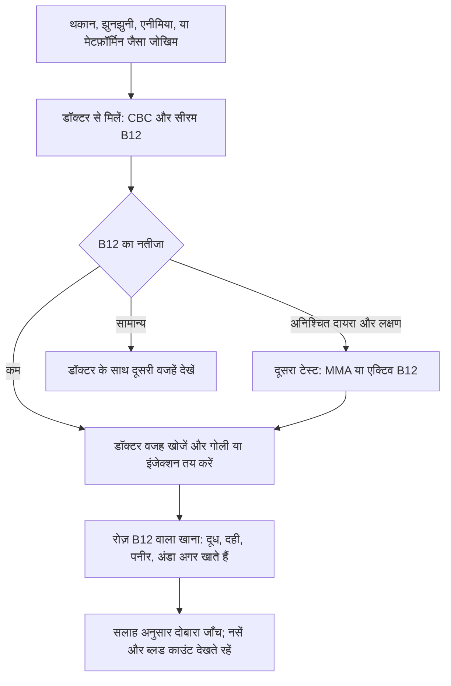

:::answer
विटामिन B12 लगभग सिर्फ़ जानवरों से मिलने वाले खाने में होता है: दूध, दही, पनीर, अंडा, मछली और मांस। इसीलिए बहुत से भारतीय शाकाहारियों में, ख़ासकर जो दूध-दही कम लेते हैं, B12 कम रहता है। इसकी कमी से थकान, साँस फूलना, पीली त्वचा, हाथ-पैरों में झुनझुनी या सुन्नपन, याददाश्त कमज़ोर होना और मन उदास रहना हो सकता है, और यह कमी सालों में धीरे-धीरे बनती है। ब्लड टेस्ट से इसकी जाँच होती है, पर "बॉर्डरलाइन" नतीजे को अंदाज़े से नहीं, दोबारा ध्यान से देखना चाहिए। रोज़ दूध-दही, अंडा अगर खाते हैं, और फ़ोर्टिफ़ाइड खाना मदद करते हैं; गोली या इंजेक्शन जाँच के बाद, डॉक्टर की सलाह से ही शुरू करें, क्योंकि सही तरीक़ा कमी की वजह पर निर्भर है। जो लोग सालों से मेटफ़ॉर्मिन या एसिडिटी की गोली लेते हैं, वे डॉक्टर से B12 जाँच के बारे में पूछें।
:::

## B12 क्या करता है, और शाकाहारियों को ख़तरा क्यों

विटामिन B12 (कोबालामिन) स्वस्थ लाल रक्त कोशिकाएँ बनाने, नसों को ठीक से चलाने और कोशिकाओं के बँटते समय DNA बनाने के लिए ज़रूरी है। शरीर कुछ B12 लिवर में जमा रखता है, इसलिए खाने में कमी होने के बाद भी लक्षण आने में सालों लग सकते हैं।

पौधे B12 नहीं बनाते। इसे बैक्टीरिया बनाते हैं और यह हम तक जानवरों से मिलने वाले खाने के ज़रिए पहुँचता है। अमेरिका के NIH के अनुसार इसके प्राकृतिक स्रोत मछली, मांस, चिकन, अंडा, दूध और दूध से बनी चीज़ें हैं, जबकि पौधों के खाने में भरोसेमंद B12 तभी होता है जब उसे फ़ोर्टिफ़ाइड किया गया हो ([NIH ODS](https://ods.od.nih.gov/factsheets/VitaminB12-HealthProfessional/))।

शाकाहारी भारतीय के लिए मुख्य स्रोत बचते हैं दूध, दही, छाछ, पनीर और चीज़। इनमें B12 होता है, पर बहुत से लोग इन्हें रोज़ इतनी मात्रा में नहीं खाते कि ज़रूरत पूरी हो, ख़ासकर जब दिन का ज़्यादातर "दूध" चाय में ही जाता है।

यह दिक़्क़त सिर्फ़ शाकाहारियों की नहीं है। पुणे के वयस्कों पर हुए एक अध्ययन में लगभग तीन-चौथाई लोगों में B12 की कमी के मेटाबॉलिक संकेत मिले, और शोधकर्ताओं ने कहा कि शाकाहारी खाना इसकी सिर्फ़ एक हिस्सा वजह था ([AJCN, 2001](https://doi.org/10.1093/ajcn/74.2.233))। तो हफ़्ते में एक बार मांस खाते हैं, तब भी यह न मानें कि आप सुरक्षित हैं।

## वे संकेत जिन्हें लोग अनदेखा करते हैं

शुरुआती लक्षण धुंधले होते हैं और लोग इन्हें तनाव, उम्र या "कमज़ोरी" मान लेते हैं। आम संकेत:

- आराम के बाद भी न जाने वाली **थकान**
- सीढ़ियाँ चढ़ते **साँस फूलना**, दिल तेज़ धड़कना, चक्कर जैसा लगना
- **पीली या हल्की पीलापन लिए त्वचा**
- हाथ-पैरों में **झुनझुनी, सुई चुभने जैसा या सुन्नपन**, अक्सर दोनों तरफ़
- **चलते समय लड़खड़ाना**, ख़ासकर अँधेरे में
- **जीभ लाल, चिकनी और दुखती**, या मुँह में छाले
- **भूलना, दिमाग़ धुंधला लगना, चिड़चिड़ापन या उदासी**

नसों वाले लक्षण सबसे अहम हैं। B12 से होने वाला एनीमिया इलाज से अक्सर ठीक हो जाता है, पर लंबे समय तक छोड़ी गई नसों की क्षति पूरी तरह ठीक नहीं भी हो सकती। इसलिए शाकाहारी, मेटफ़ॉर्मिन लेने वाले डायबिटीज़ के मरीज़ या बुज़ुर्ग के पैरों में झुनझुनी हो तो उसे टालें नहीं, जाँच कराएँ।

B12 की कमी में लाल रक्त कोशिकाएँ बड़ी हो जाती हैं, जिसे CBC रिपोर्ट में बढ़े हुए MCV के रूप में देखा जा सकता है। पर भारत में बहुत से लोगों में साथ-साथ आयरन की कमी भी होती है, जो MCV को नीचे खींचती है। दोनों एक-दूसरे को छिपा सकते हैं, इसलिए "सामान्य" MCV से B12 की कमी रद्द नहीं होती।

## किसे जाँच करानी चाहिए

सिर्फ़ शाकाहारी होने और ठीक महसूस करने पर हर साल B12 टेस्ट ज़रूरी नहीं। पर डॉक्टर से पूछें अगर आप:

- ऊपर के लक्षण महसूस कर रहे हैं, ख़ासकर झुनझुनी, सुन्नपन या बिना वजह एनीमिया
- डायबिटीज़ या प्रीडायबिटीज़ के लिए कई साल से **मेटफ़ॉर्मिन** ले रहे हैं। अमेरिका के एक बड़े ट्रायल में मेटफ़ॉर्मिन के हर अतिरिक्त साल के साथ B12 कम होने की संभावना बढ़ी, और कम B12 नसों की दिक़्क़तों से जुड़ा था ([JCEM, 2016](https://doi.org/10.1210/jc.2015-3754))
- दो साल या ज़्यादा से **एसिडिटी की गोलियाँ** (जैसे ओमेप्राज़ोल, पैंटोप्राज़ोल) ले रहे हैं; एक बड़े अध्ययन ने इनके लंबे इस्तेमाल को B12 की कमी से जोड़ा ([JAMA, 2013](https://doi.org/10.1001/jama.2013.280490))
- **60 साल से ऊपर** हैं, जब पेट B12 कम अच्छी तरह सोखता है
- पेट या आँतों की सर्जरी, सीलिएक, क्रोन्स या लंबे समय से पाचन की दिक़्क़त रही है
- **गर्भवती हैं, गर्भ की योजना है या स्तनपान करा रही हैं** और दूध-दही कम लेती हैं
- पूरी तरह **वीगन** हैं और फ़ोर्टिफ़ाइड खाना नहीं लेते

[[ad]]

## अपनी B12 रिपोर्ट कैसे पढ़ें

भारत की लैब आमतौर पर "सीरम विटामिन B12" टेस्ट करती हैं, जो ख़ून में कुल B12 नापता है। यह उपयोगी है, पर पूरा नहीं, क्योंकि ख़ून के B12 का एक हिस्सा ऐसे वाहक से जुड़ा होता है जिसे कोशिकाएँ इस्तेमाल नहीं कर पातीं।

ब्रिटेन की NICE गाइडलाइन (2024) कुल B12 के लिए ये पैमाने देती है, साथ ही कहती है कि हर लैब अपने जाँचे-परखे कट-ऑफ़ इस्तेमाल करे ([NICE NG239](https://www.nice.org.uk/guidance/ng239)):

| कुल B12 | आमतौर पर मतलब |
|---|---|
| 180 ng/L (pg/mL) से कम | कमी पक्की |
| 180 से 350 ng/L | अनिश्चित: कम भी हो सकता है, ठीक भी |
| 350 ng/L से ज़्यादा | कमी की संभावना कम |

ध्यान दें कि कई भारतीय रिपोर्टों में "नॉर्मल रेंज" लगभग 200 से शुरू होती है, तो 220 का नतीजा नॉर्मल लिखा हो सकता है, जबकि वह अनिश्चित दायरे में है। लक्षण हों और नतीजा इस दायरे में हो, तो NICE उसी टेस्ट को दोहराने की बजाय मिथाइलमैलोनिक एसिड (MMA) या "एक्टिव B12" जैसा दूसरा टेस्ट सुझाती है।

कुछ और बातें जो तस्वीर उलझा देती हैं: हाल की गोली या इंजेक्शन कुछ समय के लिए नंबर बढ़ा देते हैं, भले असली दिक़्क़त बनी रहे। गर्भावस्था में कुल B12 अपने-आप कम होता है, इसलिए NICE तब एक्टिव B12 टेस्ट सुझाती है। और फ़ोलिक एसिड रिपोर्ट में B12 वाला एनीमिया ठीक दिखा सकता है जबकि नसों की क्षति चलती रहे, इसलिए "कमज़ोरी" के लिए अपने मन से मल्टीविटामिन लेकर रुक जाना ठीक नहीं। नतीजा हमेशा डॉक्टर के साथ, CBC, लक्षणों और दवाओं के साथ पढ़ें।

## क़दम-दर-क़दम योजना

**1. लक्षणों से ख़ुद निदान न करें।** थकान और झुनझुनी की कई वजहें हैं: थायरॉइड, आयरन की कमी, डायबिटीज़, विटामिन D की कमी। डॉक्टर और ब्लड टेस्ट इन्हें अलग करते हैं।

**2. सिर्फ़ नंबर नहीं, वजह जानें।** B12 कम है तो डॉक्टर पूछेंगे क्यों: खाना? दवाएँ? पेट से B12 न सोख पाना, जैसे परनीशियस एनीमिया नाम की ऑटोइम्यून बीमारी? जवाब से इलाज तय होता है। जो खाने से B12 नहीं सोख पाते, उन्हें अक्सर इंजेक्शन चाहिए, जबकि खाने से जुड़ी कमी आमतौर पर गोली से ठीक होती है।

**3. सलाह के अनुसार इलाज।** गोली या इंजेक्शन का प्रकार, डोज़ और अवधि हर व्यक्ति में अलग होती है, इसलिए B12 सिर्फ़ डॉक्टर की सलाह के अनुसार लें। बेहतर महसूस होते ही बंद न करें; भंडार भरने में समय लगता है।

**4. लंबे समय के लिए खाना सुधारें।** इलाज कमी पूरी करता है, पर खाना तय करता है कि वह दोबारा न लौटे।

**5. दोबारा जाँच।** डॉक्टर की दी योजना के अनुसार। मेटफ़ॉर्मिन या एसिडिटी की गोली जारी है तो पूछें कितने समय में टेस्ट कराएँ।

## भारतीय शाकाहारी रसोई में B12

ICMR-NIN की *भारतीयों के लिए आहार गाइडलाइन* (2024) रोज़ के खाने में दूध और दूध से बनी चीज़ें शामिल करने की सलाह देती है और बताती है कि शाकाहारी, ख़ासकर कम दूध-दही लेने वाले, B12 की कमी के जोखिम में हैं ([ICMR-NIN, 2024](https://www.nin.res.in/dietaryguidelines/pdfjs/locale/DGI24thJune2024fin.pdf))। व्यवहार में:

- **दूध-दही को कभी-कभार नहीं, रोज़ की आदत बनाएँ।** एक गिलास दूध, दोपहर में दही या छाछ, और हफ़्ते में कुछ बार पनीर।
- **चाय को दूध न गिनें।** दो कप चाय का दूध बहुत थोड़ा होता है।
- **अंडा**, अगर खाते हैं, अच्छा स्रोत है, ज़्यादातर पीले हिस्से में।
- **मछली और चिकन** मांसाहारियों के लिए भरपूर स्रोत हैं।
- **फ़ोर्टिफ़ाइड खाना**, जैसे कुछ नाश्ते के सीरियल, फ़ोर्टिफ़ाइड दूध या पौधों का दूध, ख़ासकर वीगन लोगों के लिए। लेबल पर "vitamin B12" देखें; FSSAI का "+F" निशान फ़ोर्टिफ़ाइड खाने की पहचान है।

जो भरोसेमंद नहीं: स्पिरुलिना, मशरूम, समुद्री शैवाल और "फ़र्मेंटेड खाने से B12" का अक्सर प्रचार होता है, पर NIH बताता है कि इनमें से कई में B12 जैसे ऐसे रूप होते हैं जिन्हें शरीर इस्तेमाल नहीं कर पाता ([NIH ODS](https://ods.od.nih.gov/factsheets/VitaminB12-HealthProfessional/))।

**वीगन, जैन और बार-बार व्रत:** वीगन खाने में प्राकृतिक B12 बिल्कुल नहीं होता, तो डॉक्टर के साथ चुना फ़ोर्टिफ़ाइड खाना या सप्लीमेंट ज़रूरी है। जैन खाने में अक्सर दूध-दही होता है, पर अंडा नहीं, तो दूध रोज़ की आदत होनी चाहिए। नवरात्रि या सावन जैसे लंबे व्रतों में थाली अक्सर साबूदाना, आलू और फल की होती है; व्रत की थाली में भी दही, दूध या पनीर रखें।

:::tip रोज़ B12 बढ़ाने के आसान तरीक़े
- दोपहर के खाने में रोज़ एक कटोरी दही या एक गिलास छाछ, सिर्फ़ गर्मियों में नहीं।
- नाश्ते में सिर्फ़ पोहा या टोस्ट की बजाय पनीर, दही या अंडा जोड़ें।
- रात में तीसरे कप चाय की जगह हल्दी वाला दूध लें।
- वीगन हैं तो फ़ोर्टिफ़ाइड पौधों का दूध या सीरियल चुनें, और डॉक्टर से सप्लीमेंट के बारे में पूछें।
- मेटफ़ॉर्मिन या एसिडिटी की दवा डॉक्टर के कहे अनुसार जारी रखें, पर B12 जाँच के बारे में पूछें।
- अपना B12 नतीजा और तारीख़ फ़ोन में लिख लें, ताकि अगली बार तुलना कर सकें।
:::

## ख़ास लोग

**गर्भावस्था और स्तनपान:** बच्चे के दिमाग़ और नसों के लिए B12 ज़रूरी है। पुणे मैटरनल न्यूट्रिशन स्टडी में छह गाँवों की लगभग दो-तिहाई गर्भवती महिलाओं में B12 कम था, और जिन बच्चों की माँओं में B12 कम और फ़ोलेट ज़्यादा था, वे छह साल की उम्र में सबसे ज़्यादा इंसुलिन रेज़िस्टेंट थे ([Diabetologia, 2008](https://doi.org/10.1007/s00125-007-0793-y))। शाकाहारी हैं और गर्भवती हैं या योजना बना रही हैं, तो डॉक्टर को अपने खाने के बारे में बताएँ। गर्भावस्था में अपने मन से सप्लीमेंट शुरू या बंद न करें।

**बच्चे और किशोर:** कम B12 वाली माँओं के बच्चे और बहुत सीमित खाने वाले बच्चे भी प्रभावित हो सकते हैं। थकान, धीमी बढ़त, शिशुओं में पड़ाव देर से आना और बड़े बच्चों में ध्यान न लगना संकेत हो सकते हैं।

**बुज़ुर्ग:** उम्र के साथ पेट में एसिड कम बनता है, जो खाने से B12 निकालने के लिए ज़रूरी है। बहुत से बुज़ुर्ग एसिडिटी की गोली या मेटफ़ॉर्मिन भी लेते हैं। लड़खड़ाना, सुन्न पैर या याददाश्त में बदलाव को "उम्र" मानने से पहले B12 जाँच कराएँ।

**डायबिटीज़ वाले:** मेटफ़ॉर्मिन सुरक्षित और असरदार है, इस लेख की वजह से इसे बंद न करें। बस समय-समय पर B12 जाँच कराएँ। डायबिटीज़ में पैरों की झुनझुनी शुगर से, कम B12 से या दोनों से हो सकती है, और इलाज अलग है।

[[ad]]

## B12, कसरत और ऊर्जा

जिम आने वाले अक्सर थकान को ट्रेनिंग या "कम प्रोटीन" पर डाल देते हैं। कई बार असली वजह कम B12 या आयरन होती है। ऊर्जा कम है, कसरत असामान्य रूप से भारी लगती है, हल्की मेहनत पर साँस फूलती है या पैरों में झुनझुनी है, तो अगला सप्लीमेंट ख़रीदने से पहले ब्लड टेस्ट कराएँ। क्लिनिक के बाहर दिए जाने वाले "एनर्जी इंजेक्शन" न लगवाएँ; B12 इंजेक्शन एक दवा है जो निदान के बाद दी जाती है।

:::warning जल्दी डॉक्टर को दिखाएँ अगर
- हाथ-पैरों में सुन्नपन, झुनझुनी या जलन फैल रही है या बढ़ रही है
- चलना लड़खड़ाने लगा है या आप बार-बार गिर रहे हैं
- हल्की मेहनत पर साँस फूलती है या चक्कर आता है, या आराम में दिल तेज़ धड़कता है
- याददाश्त कम हो रही है, उलझन है या मूड में बड़ा बदलाव है
- गर्भवती हैं या योजना है और दूध-दही कम लेती हैं
- सालों से मेटफ़ॉर्मिन या एसिडिटी की गोली ले रहे हैं और कभी B12 जाँच नहीं हुई
- बच्चा पीला, बहुत थका, ठीक से नहीं बढ़ रहा, या शिशु पड़ाव में पीछे है
:::

[[ad]]

## मिथक और सच

:::mythfact
| मिथक | सच |
|---|---|
| "रोज़ चाय पीता हूँ, तो दूध काफ़ी हो जाता है।" | कुछ कप चाय का दूध बहुत कम है। असली दूध, दही, छाछ और पनीर गिनें। |
| "स्पिरुलिना और मशरूम से शाकाहारियों को B12 मिलता है।" | इनमें से कई में B12 के ऐसे रूप हैं जिन्हें शरीर इस्तेमाल नहीं कर पाता। |
| "रिपोर्ट में नॉर्मल लिखा है, तो सब ठीक।" | 180–350 ng/L का नतीजा अनिश्चित है। लक्षण हों तो दूसरा टेस्ट चाहिए हो सकता है। |
| "B12 की कमी सिर्फ़ शाकाहारियों को होती है।" | उम्र, मेटफ़ॉर्मिन, एसिडिटी की गोलियाँ और पेट की दिक़्क़तें मांसाहारियों में भी कमी करती हैं। |
| "B12 का इंजेक्शन तुरंत ताक़त देगा।" | इंजेक्शन पक्की कमी का इलाज है। B12 पहले से ठीक हो तो इससे ऊर्जा नहीं बढ़ती। |
| "डायबिटीज़ में पैरों की झुनझुनी हमेशा शुगर से।" | कम B12 भी यही लक्षण दे सकता है, और उसका इलाज अलग है। |
:::

## अक्सर पूछे जाने वाले सवाल

:::faq
### विटामिन B12 का नॉर्मल लेवल क्या है?
लैब की रेंज थोड़ी अलग होती है। ब्रिटेन की NICE गाइडलाइन 180 ng/L से कम को कमी, 180 से 350 को अनिश्चित और 350 से ऊपर को कमी की कम संभावना मानती है। डॉक्टर नतीजा आपके लक्षणों और ब्लड काउंट के साथ पढ़ेंगे।

### क्या शाकाहारी खाने से पूरा B12 पा सकते हैं?
बहुत से लोग पा सकते हैं, अगर रोज़ दूध-दही लें और अंडा खाते हों तो अंडा भी। कम दूध लेने वाले, वीगन, बुज़ुर्ग और कुछ दवाएँ लेने वालों को अक्सर फ़ोर्टिफ़ाइड खाना या डॉक्टर की सलाह से सप्लीमेंट चाहिए।

### क्या मेटफ़ॉर्मिन से B12 कम होता है?
लंबे समय तक मेटफ़ॉर्मिन लेना कुछ लोगों में कम B12 से जुड़ा है। यह मेटफ़ॉर्मिन छोड़ने की वजह नहीं है। डॉक्टर से समय-समय पर B12 जाँच के बारे में पूछें, ख़ासकर झुनझुनी हो तो।

### B12 की कमी ठीक होने में कितना समय लगता है?
यह इस पर निर्भर है कि कमी कितनी और कितने समय से थी। ब्लड काउंट अक्सर इलाज के कुछ हफ़्तों में सुधरने लगता है। नसों के लक्षणों में ज़्यादा समय लगता है, और पुरानी क्षति पूरी ठीक न भी हो, इसलिए जल्दी जाँच ज़रूरी है।

### क्या बिना जाँच B12 की गोली ले लूँ?
पहले जाँच बेहतर है। पहले गोली लेने से बाद की रिपोर्ट में दिक़्क़त छिप सकती है, और सही प्रकार और डोज़ वजह पर निर्भर है। B12 सिर्फ़ डॉक्टर की सलाह से लें।
:::

## आख़िरी बात

भारत में B12 की कमी आम है, शाकाहारियों और मांसाहारियों दोनों में, और यह चुपचाप बनती है। रोज़ दूध-दही, अंडा या मछली अगर खाते हैं, और फ़ोर्टिफ़ाइड खाना ज़्यादातर लोगों को बचाते हैं। झुनझुनी, बिना वजह थकान या एनीमिया हो, या आप लंबे समय से मेटफ़ॉर्मिन या एसिडिटी की गोली ले रहे हैं, तो डॉक्टर से B12 जाँच के बारे में पूछें और बॉर्डरलाइन नतीजे ध्यान से पढ़ें।

अगर आप सेक्टर 93, नोएडा के रॉयल फ़िटनेस क्लब में ट्रेन करते हैं और ऊर्जा गिर गई है, तो ट्रेनर को बताएँ; जाँच होने तक हम प्लान को हल्का कर देंगे।
