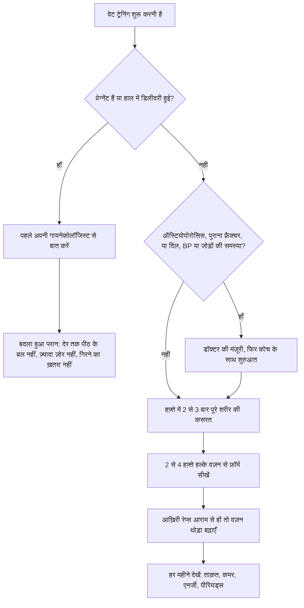

:::answer
वज़न उठाने से कोई लड़की अपने-आप बॉडीबिल्डर जैसी नहीं बन जाती। एक जैसे प्रोग्राम पर महिलाओं की मांसपेशियाँ भी उसी अनुपात में बढ़ती हैं जितनी पुरुषों की, पर शुरुआत कम मांसपेशी से होती है। इसलिए ज़्यादातर महिलाओं को शरीर ज़्यादा सुडौल, कसा हुआ और मज़बूत दिखता है। ताक़त की कसरत हड्डियों को मज़बूत रखती है (भारत में मेनोपॉज़ के बाद कमज़ोर हड्डियाँ आम हैं), PCOS में इंसुलिन रेज़िस्टेंस में मदद करती है, और बिना जटिलता वाली प्रेग्नेंसी में व डिलीवरी के बाद भी, कुछ बदलावों के साथ, सलाह दी जाती है। पीरियड के फ़ेज़ के हिसाब से ट्रेनिंग बदलने के पक्ष में रिसर्च कमज़ोर है, इसलिए अपने शरीर की सुनें। हफ़्ते में दो-तीन बार पूरे शरीर की कसरत से शुरू करें, सही फ़ॉर्म सीखें, और वज़न धीरे-धीरे बढ़ाएँ।
:::

## ज़्यादातर भारतीय महिलाएँ वेट सेक्शन से दूर क्यों रहती हैं

नोएडा या गुरुग्राम के किसी भी जिम में शाम 7 बजे जाइए। रैक और बेंच के पास लड़के, और ट्रेडमिल, क्रॉस-ट्रेनर या योगा मैट पर लड़कियाँ। पूछिए तो जवाब लगभग एक जैसे मिलते हैं: "मुझे आदमियों जैसा नहीं दिखना", "मम्मी कहती हैं वज़न उठाने से बच्चेदानी पर असर पड़ता है", "PCOS है, तो सिर्फ़ कार्डियो", "पीरियड्स में आराम करना चाहिए", "प्रेग्नेंट हूँ, वज़न बिल्कुल नहीं"।

ये बातें कहीं परिवार से आती हैं, कहीं पुरानी मैगज़ीन से, और कहीं उन ट्रेनरों से जिन्होंने कभी महिलाओं को ट्रेन करना सीखा ही नहीं। इन्हें हल्के में नहीं लेना चाहिए, क्योंकि यही डर बहुत-सी महिलाओं को उस कसरत से दूर रखते हैं जो दशकों तक हड्डियों, मांसपेशियों और शुगर को बचाती है। तो एक-एक करके देखते हैं कि रिसर्च असल में क्या कहती है, और जहाँ सबूत कमज़ोर है वहाँ साफ़-साफ़ बताएँगे।

## डर नंबर 1: "वज़न उठाऊँगी तो बल्की हो जाऊँगी"

सबसे बड़ा डर यही है, और इसका जवाब सबसे आसान है।

2020 की एक बड़ी समीक्षा (मेटा-एनालिसिस) में उन स्टडीज़ को जोड़ा गया जहाँ पुरुषों और महिलाओं ने एक ही प्रोग्राम किया। 10 स्टडीज़ के आँकड़ों में मांसपेशी बढ़ने (हाइपरट्रॉफ़ी) में, शुरुआती स्तर के हिसाब से, दोनों में कोई ख़ास फ़र्क़ नहीं मिला। पैरों की ताक़त भी लगभग बराबर बढ़ी। ऊपरी शरीर की ताक़त तो महिलाओं में अनुपात के हिसाब से ज़्यादा बढ़ी, शायद इसलिए कि बहुतों ने पहले कभी ऊपरी शरीर की ट्रेनिंग नहीं की थी ([Journal of Strength and Conditioning Research, 2020](https://doi.org/10.1519/JSC.0000000000003521))।

फिर वज़न उठाने वाली महिलाएँ पुरुषों जैसी क्यों नहीं दिखतीं? क्योंकि कम शुरुआती मांसपेशी पर उतनी ही प्रतिशत बढ़त असल में कम किलो होती है। साल भर गंभीरता से ट्रेन करके कुछ किलो मांसपेशी बनाने वाली महिला आमतौर पर ज़्यादा पतली और टोन्ड दिखती है, ख़ासकर अगर साथ में थोड़ी चर्बी भी घटे। स्टेज या इंस्टाग्राम पर दिखने वाला "बल्की" लुक सालों की ख़ास ट्रेनिंग, बहुत सख़्त डाइट, फ़ोटो से पहले पानी कम करने, लाइटिंग और कई बार दवाओं से आता है। हफ़्ते में तीन दिन स्क्वाट और रो करने से नहीं।

शुरू के हफ़्तों में मांसपेशियाँ थोड़ा ज़्यादा पानी और ग्लाइकोजन रखती हैं, और दर्द से फूली-सी लगती हैं। यह ठीक हो जाता है। अगर महीने भर बाद कपड़े जाँघों पर टाइट लगें, तो फ़ैसला करने से पहले कमर का नाप और वज़न दोनों देखें। ज़्यादातर बार कमर कम हो चुकी होती है।

[[ad]]

## हड्डियाँ: 20 और 30 की उम्र में शुरू करने की असली वजह

ऑस्टियोपोरोसिस में हड्डियाँ इतनी पतली और कमज़ोर हो जाती हैं कि छोटी-सी चोट में टूट जाती हैं। फ़्रैक्चर होने तक इसका पता नहीं चलता, अक्सर कलाई, रीढ़ या कूल्हे में।

भारत में यह आम है। मेनोपॉज़ के बाद की भारतीय महिलाओं पर हुई स्टडीज़ की 2022 की समीक्षा में रीढ़ के निचले हिस्से (लम्बर स्पाइन) में 29% और जाँघ की हड्डी के ऊपरी हिस्से (फ़ीमोरल नेक) में 29% महिलाओं में ऑस्टियोपोरोसिस मिला, और पूरे कूल्हे के हिस्से में 6% में। इससे पहले वाली अवस्था, ऑस्टियोपीनिया, लम्बर स्पाइन में 37% में थी ([Journal of Mid-life Health, 2022](https://doi.org/10.4103/jmh.jmh_207_21))। ये आँकड़े कम स्टडीज़ से हैं जिनके तरीक़े अलग-अलग थे, इसलिए इन्हें मोटी तस्वीर मानें। तस्वीर फिर भी साफ़ है।

हड्डी वज़न और झटके से मज़बूत होती है। पैदल चलना थोड़ा मदद करता है, पर हड्डियाँ सबसे अच्छा तब जवाब देती हैं जब उन पर रोज़मर्रा से ज़्यादा भारी या तेज़ ज़ोर पड़े।

### LIFTMOR ट्रायल

सालों तक डॉक्टर कमज़ोर हड्डियों वाली महिलाओं को भारी वज़न से रोकते थे, कि कहीं हड्डी न टूट जाए। ऑस्ट्रेलिया के LIFTMOR ट्रायल ने यही जाँचा। इसमें 101 महिलाएँ थीं, औसत उम्र 65, मेनोपॉज़ के बाद और पहले से कम बोन डेंसिटी वाली। आधी महिलाओं ने 8 महीने तक हफ़्ते में दो बार, 30 मिनट के, विशेषज्ञ की कड़ी निगरानी में भारी वज़न और झटके वाली कसरत की, जो धीरे-धीरे बढ़ाकर 5-5 रेप्स के 5 सेट तक, अपनी अधिकतम क्षमता के 85% से ज़्यादा वज़न पर पहुँची। बाक़ी आधी ने घर पर हल्की कसरत की ([Journal of Bone and Mineral Research, 2018](https://doi.org/10.1002/jbmr.3284))।

नतीजे:

- वज़न उठाने वाले ग्रुप में रीढ़ की बोन डेंसिटी लगभग 2.9% बढ़ी, हल्की कसरत वाले ग्रुप में लगभग 1.2% घटी
- फ़ीमोरल नेक पर वज़न वाले ग्रुप में लगभग 0.3% बढ़त, हल्के ग्रुप में लगभग 1.9% कमी
- लंबाई, कमर और पैरों की ताक़त, और संतुलन, सब वज़न वाले ग्रुप में ज़्यादा सुधरे
- वज़न वाले ग्रुप में सिर्फ़ एक छोटी परेशानी हुई: कमर में खिंचाव, जिससे दो सेशन छूटे

दो ज़रूरी बातें। ये महिलाएँ पहले जाँची गई थीं और विशेषज्ञ की निगरानी में ट्रेन हुईं। और 8 महीने छोटा समय है, यह ट्रायल फ़्रैक्चर कम होना साबित करने लायक़ बड़ा नहीं था। यह बताता है कि अच्छी कोचिंग में भारी वज़न कमज़ोर हड्डियों वाली महिलाओं के लिए भी संभव और फ़ायदेमंद है। यह नहीं कहता कि कल घर पर बारबेल लाद लें। अगर आपको पहले से ऑस्टियोपोरोसिस है या कभी हड्डी टूटी है, तो पहले डॉक्टर से पूछें और कोच के साथ ही ट्रेन करें।

कम उम्र की महिलाओं के लिए सबक़ बड़ा है। हड्डियों का द्रव्यमान जवानी में सबसे ऊँचा होता है। 20, 30 और 40 की उम्र में जितनी हड्डी बनाएँगी और बचाएँगी, मेनोपॉज़ के बाद उतना ज़्यादा "बैंक बैलेंस" रहेगा।

## PCOS और इंसुलिन रेज़िस्टेंस: कसरत इलाज का हिस्सा है

PCOS (पॉलीसिस्टिक ओवरी सिंड्रोम) प्रजनन उम्र की महिलाओं की सबसे आम हॉर्मोन समस्या है। 2023 की अंतरराष्ट्रीय PCOS गाइडलाइन के मुताबिक़ दुनिया भर में 10% से 13% महिलाओं को यह है, और कुछ एशियाई आबादियों में शायद ज़्यादा ([JCEM, 2023](https://doi.org/10.1210/clinem/dgad463))। इसमें पीरियड्स, त्वचा, बाल, वज़न, मूड और गर्भधारण पर असर पड़ सकता है। इंसुलिन रेज़िस्टेंस, यानी शुगर संभालने के लिए शरीर को सामान्य से ज़्यादा इंसुलिन की ज़रूरत, कई महिलाओं में होता है, चाहे वज़न कुछ भी हो।

गाइडलाइन कसरत पर क्या कहती है:

- PCOS वाली **हर** महिला को सेहतमंद खाना और शारीरिक गतिविधि की सलाह, चाहे वज़न घटाना लक्ष्य हो या न हो।
- हफ़्ते में 150 से 300 मिनट मध्यम कसरत, या 75 से 150 मिनट तेज़ कसरत, **साथ में हफ़्ते के 2 अलग-अलग (लगातार नहीं) दिनों में मांसपेशी मज़बूत करने वाली कसरत**।
- थोड़ा वज़न घटाने और वापस न आने देने के लिए कम से कम 250 मिनट मध्यम या 150 मिनट तेज़ कसरत, फिर से 2 दिन ताक़त की कसरत के साथ।
- किसी एक तरह की कसरत के बाक़ी से बेहतर होने का अच्छा सबूत नहीं है, और इस बात पर सबूत को कम भरोसे वाला माना गया। सलाह है: वह चुनें जो आपको पसंद हो और जिसे आप जारी रख सकें।

गाइडलाइन यह भी कहती है कि रोज़मर्रा के इलाज में इंसुलिन के ब्लड टेस्ट काम के नहीं हैं, इसलिए लैब पैकेज के "फ़ास्टिंग इंसुलिन" नंबर के पीछे न भागें ([JCEM, 2023](https://doi.org/10.1210/clinem/dgad463))। "PCOS में सिर्फ़ कार्डियो" वाली सलाह पुरानी हो चुकी है। ज़्यादातर दिन तेज़ चलना या साइकिल, और हफ़्ते में दो-तीन बार ताक़त की कसरत, यह मेल अच्छा काम करता है। खाने के बाद शुगर का बड़ा हिस्सा मांसपेशियों में जाता है, इसलिए मांसपेशी बनाना इंसुलिन रेज़िस्टेंस के लिए समझदारी का क़दम है।

## पीरियड्स: क्या फ़ेज़ के हिसाब से ट्रेनिंग बदलें?

सोशल मीडिया पर "साइकिल सिंकिंग" की बहुत बातें हैं: एक फ़ेज़ में भारी वज़न, दूसरे में सिर्फ़ योग। सुनने में वैज्ञानिक लगता है, पर इसके पीछे सबूत कमज़ोर है।

अब तक की सबसे बड़ी समीक्षा में 78 स्टडीज़ देखी गईं। उसमें पाया गया कि पीरियड के शुरुआती दिनों (अर्ली फ़ॉलिक्युलर फ़ेज़) में परफ़ॉर्मेंस **बहुत मामूली** कम हो सकती है। असर इतना छोटा, स्टडीज़ इतनी अलग-अलग और सबूत की क्वालिटी इतनी कम थी कि लेखकों ने कहा कोई आम नियम नहीं बनाया जा सकता; हर महिला अपने अनुभव से तय करे ([Sports Medicine, 2020](https://doi.org/10.1007/s40279-020-01319-3))।

2023 की एक और समीक्षा, जो ख़ास ताक़त की ट्रेनिंग पर थी, ने कहा कि यह मानना जल्दबाज़ी है कि पीरियड का फ़ेज़ उस दिन की ताक़त या लंबे समय में मांसपेशी बढ़ने पर ख़ास असर डालता है। कई स्टडीज़ ने तो यह भी ठीक से पक्का नहीं किया था कि महिला किस फ़ेज़ में थी ([Frontiers in Sports and Active Living, 2023](https://doi.org/10.3389/fspor.2023.1054542))।

तो क्या करें?

- मन हो तो पीरियड्स में ट्रेनिंग ठीक है। कई महिलाओं को इससे ऐंठन और मूड में राहत मिलती है।
- बहुत ज़्यादा ब्लीडिंग, तेज़ दर्द या थकान हो, तो उस दिन हल्का करें या आराम करें।
- तीन महीने या उससे ज़्यादा पीरियड्स न आएँ, बहुत भारी हों, या तेज़ ट्रेनिंग शुरू करने के बाद अनियमित हो जाएँ, तो गायनेकोलॉजिस्ट को दिखाएँ। कम खाने के साथ भारी ट्रेनिंग से पीरियड्स रुकना हड्डियों के लिए नुक़सानदेह है।

:::tip महिलाओं के लिए वज़न उठाना आसान बनाने की पाँच आदतें
- सही नाप की स्पोर्ट्स ब्रा पहनें, और स्क्वाट-डेडलिफ़्ट के लिए सपाट, सख़्त तलवे वाले जूते।
- ज़ोर लगाते समय साँस बाहर छोड़ें। हर रेप पर ज़ोर से साँस रोकने से BP बढ़ता है और पेल्विक फ़्लोर पर दबाव पड़ता है।
- हर खाने में प्रोटीन: दाल, दही, पनीर, अंडा, चना, सोया या चिकन। अपनी ज़रूरत हमारे [प्रोटीन कैलकुलेटर](/health/blog/protein-requirement-calculator-india) से देखें।
- जो वज़न उठाया, लिख लें। लगातार दो सेशन वही वज़न आसान लगे, तो थोड़ा बढ़ाएँ।
- पहले हफ़्तों में ट्रेनर से फ़ॉर्म चेक करवाएँ।
:::

## प्रेग्नेंसी: क्या सुरक्षित है, किससे बचें

बहुत से भारतीय घरों में आज भी प्रेग्नेंसी को नौ महीने का आराम माना जाता है। डॉक्टरी सलाह अब बदल चुकी है।

अमेरिकन कॉलेज ऑफ़ ऑब्सटेट्रिशियन्स एंड गायनेकोलॉजिस्ट्स (ACOG) कहता है कि अगर कोई मेडिकल या प्रेग्नेंसी की जटिलता न हो, तो प्रेग्नेंसी में शारीरिक गतिविधि सुरक्षित और फ़ायदेमंद है, और जो महिलाएँ पहले से सक्रिय थीं, तेज़ कसरत वाली भी, वे आमतौर पर कुछ बदलावों के साथ जारी रख सकती हैं ([ACOG Committee Opinion 804, 2020](https://www.acog.org/clinical/clinical-guidance/committee-opinion/articles/2020/04/physical-activity-and-exercise-during-pregnancy-and-the-postpartum-period))। WHO की 2020 गाइडलाइन भी यही कहती है: बिना रोक वाली प्रेग्नेंट और नई माँएँ हफ़्ते में कम से कम 150 मिनट मध्यम कसरत करें और **मांसपेशी मज़बूत करने वाली कसरत भी शामिल करें**। WHO के मुताबिक़ इससे प्री-एक्लेम्पसिया, प्रेग्नेंसी में हाई BP, जेस्टेशनल डायबिटीज़, ज़्यादा वज़न बढ़ने, डिलीवरी की जटिलताओं और डिलीवरी के बाद डिप्रेशन का ख़तरा घटता है, और मृत शिशु जन्म या बच्चे के वज़न पर बुरा असर नहीं बढ़ता ([BJSM, 2020](https://doi.org/10.1136/bjsports-2020-102955))।

### प्रेग्नेंसी में ये बदलाव करें

ACOG की सलाह ([ACOG, Exercise During Pregnancy](https://www.acog.org/womens-health/faqs/exercise-during-pregnancy)):

- देर तक पीठ के बल न लेटें और देर तक एक जगह खड़ी न रहें, दोनों से BP गिर सकता है। प्रेस बेंच को झुकाकर, बैठकर या खड़े होकर करें।
- गिरने या पेट पर चोट के ख़तरे वाले खेल न करें: कॉन्टैक्ट स्पोर्ट्स, घुड़सवारी, जिमनास्टिक्स, ऑफ़-रोड साइकिलिंग।
- हॉट योगा, हॉट पिलाटीज़, बहुत गर्म-उमस वाले दिन बाहर कसरत, और स्कूबा डाइविंग से बचें।
- हॉर्मोन से जोड़ों के लिगामेंट ढीले होते हैं, इसलिए झटके वाली हरकतें न करें।
- कसरत से पहले, दौरान और बाद में पानी पिएँ।

ताक़त की कसरत में इसका मतलब है: इतना वज़न जो आराम से साँस लेते हुए उठ सके, मुश्किल बारबेल लिफ़्ट की जगह मशीन या डम्बल, और नया रिकॉर्ड बनाने की कोशिश नहीं। कुछ प्रेग्नेंसी में, जैसे प्लेसेंटा की कुछ समस्याओं या समय से पहले लेबर के ख़तरे में, कसरत सीमित या बंद करनी पड़ती है। इसीलिए पहला क़दम हमेशा डॉक्टर से बात है।

[[ad]]

## डिलीवरी के बाद: धीरे-धीरे वापसी

ACOG के मुताबिक़, स्वस्थ प्रेग्नेंसी और नॉर्मल डिलीवरी के बाद ज़्यादातर महिलाएँ कुछ दिनों में, या जब ठीक महसूस करें, हल्की कसरत शुरू कर सकती हैं। सिज़ेरियन या जटिल डिलीवरी के बाद गायनेकोलॉजिस्ट से पूछें। शुरुआत रोज़ 20 से 30 मिनट हल्की गतिविधि से करें, जैसे टहलना और पेट-कमर की हल्की कसरत, फिर हफ़्ते में कम से कम 150 मिनट मध्यम कसरत और कम से कम 2 दिन ताक़त की कसरत तक पहुँचें ([ACOG, Exercise After Pregnancy](https://www.acog.org/womens-health/faqs/exercise-after-pregnancy))।

- **पहले पेल्विक फ़्लोर।** कीगल एक्सरसाइज़ पेशाब पर नियंत्रण में मदद करती है। कूदने या भारी वज़न पर पेशाब निकलना आम है, पर अनदेखा न करें; महिलाओं के फ़िज़ियोथेरेपिस्ट मदद कर सकते हैं।
- **पेट की मांसपेशियों में गैप।** पेट के बीच में उभार या गड्ढा दिखे, तो भारी क्रंच या भारी वज़न से पहले फ़िज़ियोथेरेपिस्ट से पूछें।
- **स्तनपान।** कसरत से पहले बच्चे को दूध पिला लें। ज़्यादा पानी पिएँ।
- **नींद।** टूटी नींद में शरीर रिकवर हो रहा है। बच्चा सोए तब के 10 मिनट के स्क्वाट, रो और कैरी भी असली वर्कआउट हैं।

:::warning इन हालात में कसरत से पहले या दौरान डॉक्टर को दिखाएँ
- प्रेग्नेंसी में योनि से ख़ून या पानी आना, नियमित दर्द वाले संकुचन, सीने में दर्द, चक्कर या बेहोशी, सिरदर्द, पिंडली में दर्द या सूजन, या कसरत से पहले ही साँस फूलना (रुकें और गायनेकोलॉजिस्ट को फ़ोन करें)
- किसी भी वर्कआउट में सीने में दर्द, तेज़ या अनियमित धड़कन, या बेहोशी
- ट्रेनिंग शुरू करने के बाद तीन महीने या ज़्यादा पीरियड्स न आना, या बहुत भारी या दर्द वाले पीरियड्स
- ऑस्टियोपोरोसिस, मामूली गिरने से हड्डी टूटना, या लंबाई कम होना
- डिलीवरी के बाद पेशाब निकलना, योनि में भारीपन, या पेट में उभार
- ट्रेनिंग के बाद कोई जोड़ कई दिन तक सूजा या दर्द वाला रहे
:::

## शुरुआत के लिए 3 दिन का प्लान

यह स्वस्थ वयस्कों के लिए आम शुरुआत है, डॉक्टरी पर्चा नहीं। ऊपर की कोई बात आप पर लागू हो, तो पहले डॉक्टर से बात करें।

**कितनी बार:** हफ़्ते में तीन दिन, बीच में एक दिन आराम (जैसे सोम, बुध, शुक्र)।

**वार्म-अप (8 से 10 मिनट):** तेज़ चलना या साइकिल, फिर 10 बॉडीवेट स्क्वाट, 10 हिप हिंज, हाथ घुमाना और कुछ धीमे लंज।

**मुख्य कसरत:** हर एक्सरसाइज़ के 8 से 12 रेप्स के 2 से 3 सेट। वज़न ऐसा हो कि आख़िरी दो रेप्स मुश्किल लगें पर फ़ॉर्म साफ़ रहे। सेट के बीच 1 से 2 मिनट आराम।

1. **गॉब्लेट स्क्वाट बेंच तक:** डम्बल सीने पर, पीछे बैठकर बेंच छुएँ, खड़ी हों
2. **डम्बल रोमानियन डेडलिफ़्ट:** घुटने हल्के मुड़े, कूल्हे पीछे, कमर सीधी
3. **इनक्लाइन पुश-अप:** हाथ बेंच पर; ताक़त बढ़े तो ऊँचाई कम करें
4. **एक हाथ से डम्बल रो:** एक हाथ और घुटना बेंच पर, डम्बल कूल्हे तक खींचें
5. **ग्लूट ब्रिज या हिप थ्रस्ट:** पीठ का ऊपरी हिस्सा बेंच या ज़मीन पर, कूल्हे ऊपर उठाएँ
6. **फ़ार्मर्स कैरी:** दोनों हाथों में डम्बल, सीधी चलें 20 से 30 मीटर

बाक़ी दिनों में 30 मिनट तेज़ चलें। जिम की पूरी शुरुआती जानकारी हमारी [बिगिनर जिम गाइड](/health/blog/beginner-gym-guide-india) में है।

## चेंजिंग रूम में सुने जाने वाले मिथक

:::mythfact
| मिथक | सच |
|---|---|
| "वज़न उठाने से आदमियों जैसी बल्की हो जाऊँगी।" | एक जैसे प्रोग्राम पर महिलाओं की मांसपेशी भी उसी अनुपात में बढ़ती है, पर कम शुरुआती मात्रा से। ज़्यादातर महिलाएँ ज़्यादा पतली और कसी हुई दिखती हैं। |
| "वज़न उठाना बच्चेदानी के लिए बुरा है।" | इसका कोई अच्छा सबूत नहीं। स्वस्थ प्रेग्नेंसी में भी बदलावों के साथ ताक़त की कसरत की सलाह है। |
| "PCOS में सिर्फ़ कार्डियो करो।" | 2023 की PCOS गाइडलाइन हफ़्ते में 2 दिन ताक़त की कसरत की सलाह देती है। कोई एक कसरत सबसे अच्छी साबित नहीं हुई। |
| "पीरियड्स में कभी ट्रेनिंग मत करो।" | फ़ेज़ और ताक़त पर रिसर्च कमज़ोर और मिली-जुली है। ठीक लगे तो करें, ख़राब दिन हल्का करें। |
| "प्रेग्नेंसी में पूरा आराम ज़रूरी है।" | जटिलता न हो, तो ACOG और WHO नियमित गतिविधि, ताक़त की कसरत समेत, की सलाह देते हैं। |
| "भारी वज़न से कमज़ोर हड्डियाँ टूट जाएँगी।" | LIFTMOR ट्रायल में निगरानी में भारी वज़न से कमज़ोर हड्डियों वाली महिलाओं की रीढ़ की डेंसिटी बढ़ी। निगरानी ज़रूरी है। |
:::

## आम सवाल

:::faq
### क्या वज़न उठाने से मेरा "फ़ेमिनिन" शेप चला जाएगा?
ज़्यादातर महिलाओं को उल्टा अनुभव होता है। ताक़त की कसरत कूल्हे, कंधे और पीठ को आकार देती है, और अच्छे खाने के साथ कमर की चर्बी घटाने में मदद करती है।

### मुझे PCOS है पर वज़न ज़्यादा नहीं। फिर भी वज़न उठाऊँ?
हाँ। 2023 की गाइडलाइन PCOS वाली हर महिला के लिए, वज़न कुछ भी हो, हफ़्ते में 2 दिन ताक़त की कसरत समेत गतिविधि की सलाह देती है। दुबली महिलाओं में भी इंसुलिन रेज़िस्टेंस हो सकता है।

### क्या प्रेग्नेंसी में पहली बार वेट ट्रेनिंग शुरू कर सकती हूँ?
अगर गायनेकोलॉजिस्ट कहें कि कोई जटिलता नहीं है, तो कई महिलाएँ हल्की ताक़त की कसरत शुरू कर सकती हैं। हल्का वज़न, छोटे सेशन, आराम से साँस, और देर तक पीठ के बल लेटने या गिरने के ख़तरे वाली चीज़ों से बचें।

### सिज़ेरियन के कितने दिन बाद वज़न उठा सकती हूँ?
यह आपकी रिकवरी पर निर्भर है, इसलिए गायनेकोलॉजिस्ट से पूछें। ज़्यादातर महिलाएँ टहलने और हल्की पेट व पेल्विक फ़्लोर की कसरत से शुरू करती हैं, और डॉक्टर की हाँ के बाद धीरे-धीरे वज़न पर आती हैं।

### 50 के बाद शुरू करना देर तो नहीं?
नहीं। LIFTMOR की महिलाओं की औसत उम्र 65 थी और 8 महीने में उनकी बोन डेंसिटी और ताक़त बढ़ी। कोई बीमारी हो तो पहले डॉक्टर से जाँच करवाएँ, और कोच के साथ सीखें।
:::

## आख़िरी बात

वेट सेक्शन जितना पुरुषों का है, उतना ही महिलाओं का। वज़न उठाने से रोज़ के कामों की ताक़त मिलती है, मेनोपॉज़ से पहले और बाद हड्डियाँ बचती हैं, PCOS में इंसुलिन रेज़िस्टेंस में मदद मिलती है, और यह स्वस्थ प्रेग्नेंसी व डिलीवरी के बाद की रिकवरी का हिस्सा बन सकता है। हल्के से शुरू करें, फ़ॉर्म सीखें, धीरे बढ़ाएँ, और प्रेग्नेंसी, हाल की डिलीवरी या किसी बीमारी में पहले डॉक्टर से पूछें।

इन मिथकों पर हमने अपने YouTube चैनल [Royal Fitness TV](https://www.youtube.com/@RoyalFitnessTV?sub_confirmation=1) पर एक छोटा हिंग्लिश वीडियो बनाया है।

अगर आप किसी कोच से शुरुआत सीखना चाहती हैं, तो सेक्टर 93, नोएडा के रॉयल फ़िटनेस क्लब के ट्रेनर आपके लिए सुरक्षित शुरुआती प्रोग्राम बना सकते हैं।
