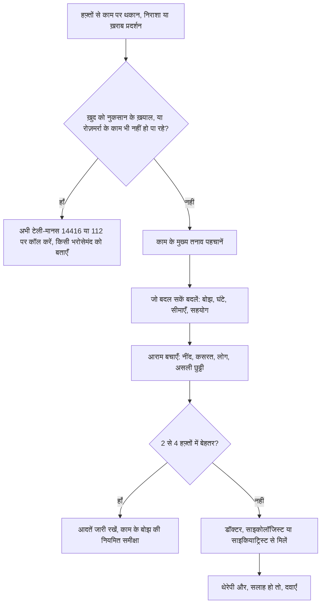

:::answer
बर्नआउट कमज़ोरी या "हिम्मत की कमी" नहीं है। विश्व स्वास्थ्य संगठन इसे काम से जुड़ी एक स्थिति (ऑक्यूपेशनल फ़िनॉमिनन) मानता है, जो लंबे समय के ऐसे कार्यस्थल तनाव से होती है जिसे ठीक से सँभाला नहीं गया, और इसकी तीन पहचान हैं: थकान, काम से दूरी या उसके प्रति निराशा, और काम में घटती क्षमता। यह डिप्रेशन और चिंता से मिलता-जुलता है, जो भारत में आम हैं और अक्सर बिना इलाज के रह जाते हैं। मदद मिलती है काम पर बदलावों (काम का बोझ, सीमाएँ, सहयोग), काम के बाहर आराम (नींद, कसरत, लोग, छुट्टी) और लक्षण बने रहें या रोज़मर्रा पर असर डालें तो विशेषज्ञ की मदद से। अगर निराशा हो या ख़ुद को नुकसान पहुँचाने के ख़याल आएँ, तो टेली-मानस पर 14416 पर कॉल करें (मुफ़्त, 24×7, कई भारतीय भाषाओं में) या इमरजेंसी में 112।
:::

## बर्नआउट क्या है, और क्या नहीं

2019 में WHO ने बर्न-आउट को इंटरनेशनल क्लासिफ़िकेशन ऑफ़ डिज़ीज़ (ICD-11) में काम से जुड़ी स्थिति के रूप में शामिल किया, किसी बीमारी के रूप में नहीं। इसकी परिभाषा: लंबे समय के ऐसे कार्यस्थल तनाव से होने वाला सिंड्रोम जिसे सफलतापूर्वक सँभाला नहीं गया, जिसमें ऊर्जा ख़त्म होने या थकान का एहसास, काम से बढ़ती मानसिक दूरी या उसके प्रति नकारात्मकता, और काम में घटती क्षमता होती है। WHO साफ़ कहता है कि यह शब्द काम के संदर्भ के लिए है ([WHO, 2019](https://www.who.int/news/item/28-05-2019-burn-out-an-occupational-phenomenon-international-classification-of-diseases))।

यह परिभाषा तीन वजहों से काम की है: यह वजह को अक्सर वहाँ रखती है जहाँ वह होती है, यानी काम कैसे बनाया और चलाया जाता है, सिर्फ़ व्यक्ति पर नहीं; यह बर्नआउट को आम तनाव से अलग करती है, जो डेडलाइन के साथ आता-जाता है; और याद दिलाती है कि बर्नआउट डिप्रेशन नहीं है, हालाँकि दोनों मिल सकते हैं।

**तनाव** अक्सर "बहुत ज़्यादा" जैसा लगता है: जल्दबाज़ी, दौड़ते विचार, खिंचाव; दबाव हटने या अच्छे आराम से कम हो जाता है। **बर्नआउट** "बहुत कम" जैसा लगता है: निचुड़ जाना, अलगाव, काम को लेकर "क्या फ़ायदा", और कोशिश के बावजूद काम बिगड़ना; एक वीकेंड की छुट्टी से ठीक नहीं होता। **डिप्रेशन** पूरी ज़िंदगी पर असर डालता है: दो हफ़्ते या ज़्यादा, ज़्यादातर दिन उदासी या पसंद की चीज़ों में रुचि ख़त्म होना, अक्सर नींद, भूख, ऊर्जा, ध्यान और आत्म-सम्मान में बदलाव, और कभी-कभी मौत के ख़याल। लक्षण ज़िंदगी के हर हिस्से में फैल जाएँ, या ख़ुद को नुकसान पहुँचाने के विचार हों, तो इसे बर्नआउट से ज़्यादा मानें और विशेषज्ञ की मदद लें।

[[ad]]

## भारत में यह कितना आम है

NIMHANS के राष्ट्रीय मानसिक स्वास्थ्य सर्वे (2015–16) के अनुसार लगभग 15 करोड़ भारतीयों को मानसिक स्वास्थ्य सेवा की ज़रूरत थी, और अलग-अलग मानसिक बीमारियों में इलाज न मिलने वालों का हिस्सा (ट्रीटमेंट गैप) 28% से 83% तक था ([NMHS सारांश](https://mohfw.gov.in/sites/default/files/National%20Mental%20Health%20Survey%2C%202015-16%20-%20Summary%20Report_0.pdf))। यानी जूझ रहे ज़्यादातर लोगों को मदद नहीं मिलती। बर्नआउट ख़ुद राष्ट्रीय सर्वे में नहीं नापा जाता, पर इसके पीछे के दबाव बहुत से भारतीय कामगारों के जाने-पहचाने हैं: लंबे घंटे और लंबा सफ़र, हर समय चालू WhatsApp ग्रुप, नौकरी की असुरक्षा, टार्गेट, घर की देखभाल की ज़िम्मेदारियाँ, और ऐसी संस्कृति जहाँ "मैं परेशान हूँ" कहना जोखिम भरा लगता है।

## चेतावनी के संकेत

बर्नआउट धीरे-धीरे बनता है; एक बुरे दिन की नहीं, हफ़्तों के पैटर्न की बात है। **शरीर में:** ऐसी थकान जो नींद से न जाए; सिरदर्द, पेट ख़राब, दर्द, बार-बार बीमार पड़ना; नींद न आना या बहुत ज़्यादा सोना; भूख में बदलाव; दिन निकालने के लिए कैफ़ीन, मीठा, शराब या तंबाकू पर ज़्यादा निर्भरता। **मन और मूड में:** काम से पहले डर, ख़ासकर रविवार की शाम; काम, सहकर्मियों या ग्राहकों के प्रति चिड़चिड़ापन या निराशा; अलगाव, सुन्नपन या "ऑटोपायलट" पर चलना; ध्यान न लगना, ज़्यादा ग़लतियाँ, भूलना; और यह एहसास कि आप कुछ भी करें, कोई फ़र्क़ नहीं पड़ता। **व्यवहार में:** दोस्तों-परिवार से दूर होना; टालना और फिर देर रात तक काम; कसरत और शौक़ में रुचि ख़त्म; घर पर लोगों पर झुँझलाना।

## बाहर निकलने का रास्ता, क़दम दर क़दम

**1. पहचानें कि क्या थका रहा है।** काम की तीन सबसे थकाने वाली चीज़ें लिखें: समय के मुक़ाबले बहुत ज़्यादा काम, अस्पष्ट उम्मीदें, काम के तरीक़े पर नियंत्रण न होना, नाइंसाफ़ी, पहचान की कमी, टकराव, अपने मूल्यों से टकराते मूल्य, या काम और घर के बीच कोई सीमा न होना। नाम देने से धुंध ख़ास समस्याओं में बदल जाती है।

**2. काम पर जो बदल सकें, बदलें।** मैनेजर से ठोस बात करें: "मेरे पास X, Y और Z हैं, किसे पीछे रखूँ?" "मैं तनाव में हूँ" से बेहतर काम करता है। उम्मीदें साफ़ करें: "पूरा" का मतलब क्या है और कब तक। जहाँ भूमिका इजाज़त दे, रात में काम के ग्रुप म्यूट करें और यह खुलकर बताएँ। अपनी छुट्टियाँ लें। पूछें कि क्या काउंसलिंग (एम्प्लॉयी असिस्टेंस प्रोग्राम), लचीले घंटे या काम के बोझ की समीक्षा मिल सकती है। WHO की कार्यस्थल मानसिक स्वास्थ्य गाइडलाइन संगठनों से मैनेजरों को प्रशिक्षित करने, काम का बोझ ठीक करने और कर्मचारियों का साथ देने को कहती है, सिर्फ़ व्यक्तियों से "सँभालने" को नहीं ([WHO, 2022](https://www.who.int/publications/i/item/9789240053052))।

**पैसे और घर के दबाव भी देखें।** EMI, परिवार की उम्मीदें, लंबा सफ़र या माता-पिता की देखभाल सँभलने लायक़ नौकरी को भी असंभव बना सकते हैं। पैसे की चिंता हो तो किसी भरोसेमंद सदस्य या सलाहकार के साथ सीधी योजना बनाना काफ़ी बोझ हल्का कर सकता है; घर की ज़िम्मेदारियाँ असमान हों तो बाँटने पर ईमानदार बातचीत रिकवरी का हिस्सा है।

**3. आराम बचाएँ।** आराम आलस नहीं, अच्छे से काम करते रहने की शर्त है। **नींद:** उठने का तय समय, सोने से एक घंटा पहले स्क्रीन दूर, कैफ़ीन दोपहर से पहले। **कसरत:** 2024 की एक बड़ी समीक्षा में सैर या जॉगिंग, योग और ताक़त की कसरत, सबने डिप्रेशन के लक्षण घटाए ([BMJ, 2024](https://doi.org/10.1136/bmj-2023-075847)); ज़्यादातर दिनों 20–30 मिनट भी मदद करते हैं। **लोग:** उन दोस्तों और परिवार के साथ समय जिनसे आप बेहतर महसूस करें; अकेलापन बर्नआउट को बढ़ाता है। **दूरी:** ऐसी गतिविधियाँ जो काम से पूरी तरह ध्यान हटाएँ: शौक़, संगीत, खाना बनाना, खेल, प्रार्थना या ध्यान, प्रकृति में समय।

[[ad]]

:::tip काम पर बचाव की आदतें
- दिन की शुरुआत ईमेल या WhatsApp खोलने से पहले सबसे ज़रूरी काम से करें।
- ध्यान लगाकर टुकड़ों में काम करें (जैसे 45 मिनट), बीच में खड़े होकर स्ट्रेच करें और पानी पिएँ।
- असली लंच ब्रेक लें, स्क्रीन से दूर, हो सके तो छोटी सैर के साथ।
- करने वाले कामों के साथ "हो गए" कामों की सूची भी रखें; यह "कुछ ख़त्म नहीं होता" के एहसास को काटती है।
- टीम के साथ जवाब देने के समय के नियम तय करें, ताकि हर संदेश अर्जेंट न हो।
- सफ़र को स्विच-ऑफ़ का समय बनाएँ: संगीत, पॉडकास्ट या बस शांति, और ईमेल नहीं।
- हर हफ़्ते ख़ुद से पूछें: ऊर्जा, मूड और नींद, 1 से 10 में।
:::

## अलग-अलग कामों में अलग दबाव

IT, BPO और रात की शिफ़्ट वालों में टाइम-ज़ोन की कॉल और बदलती शिफ़्टें नींद खा जाती हैं, इसलिए सोने का नियमित समय और असली छुट्टी और ज़रूरी है। डॉक्टरों, नर्सों और स्वास्थ्यकर्मियों पर मरीज़ों का भारी बोझ, लंबी शिफ़्ट और भावनात्मक दबाव होता है; साथियों का सहारा और शिफ़्टों के बीच आराम मदद करते हैं। शिक्षकों के लिए माता-पिता के देर रात के संदेशों पर सीमा रखना वाजिब है। छोटे कारोबारी और दुकानदार हफ़्ते में एक तय आधा दिन भी छुट्टी लें और काम बाँटें। गिग और डिलीवरी कर्मियों के लिए छोटे ब्रेक, पानी और सुरक्षित ड्राइविंग पहले हैं। कोचिंग और परीक्षा की तैयारी वाले छात्रों में भी बर्नआउट असली है; नींद, कसरत, दोस्त और माता-पिता से ईमानदार बातचीत ज़रूरी है, और टेली-मानस छात्रों के लिए भी है। गृहिणी और देखभाल करने वाले (बच्चे, बुज़ुर्ग माता-पिता या बीमार सदस्य) भी बिना छुट्टी का, अक्सर अनदेखा काम करते हैं; काम बाँटना, रोज़ छोटे ब्रेक और सहायता समूह मदद करते हैं।

## कब और कहाँ विशेषज्ञ की मदद लें

बदलावों के बावजूद लक्षण दो हफ़्ते से ज़्यादा रहें, काम, रिश्तों या रोज़मर्रा पर असर पड़े, सहने के लिए शराब या दूसरे नशे पर निर्भर हो जाएँ, या निराशा हो, तो मदद लें। मदद लेने का मतलब "पागल" या कमज़ोर होना नहीं; इसका मतलब है अपनी सेहत को उतनी ही गंभीरता से लेना जितना डायबिटीज़ या BP को।

**भारत में विकल्प:** टेली-मानस, सरकार की मुफ़्त, 24×7 टेली-मेंटल हेल्थ सेवा: **14416** या **1-800-891-4416** पर कॉल करें। यह अक्टूबर 2022 में शुरू हुई, लगभग 20 भारतीय भाषाओं में सहायता देती है और आगे के इलाज से जोड़ सकती है ([टेली-मानस](https://telemanas.mohfw.gov.in/))। आपके फ़ैमिली डॉक्टर, जो जाँच सकते हैं और थकान की शारीरिक वजहें (जैसे थायरॉइड, ख़ून की कमी, विटामिन की कमी) देख सकते हैं; साइकोलॉजिस्ट और काउंसलर, बातचीत वाली थेरेपी के लिए; साइकियाट्रिस्ट, जो डॉक्टर हैं और ज़रूरत हो तो दवा लिख सकते हैं; और कार्यस्थल का एम्प्लॉयी असिस्टेंस प्रोग्राम, अगर हो। डिप्रेशन या चिंता की दवाएँ डॉक्टर लिखें तो वे उस तरह की लत नहीं लगातीं जिसका डर होता है, और बहुत असरदार हो सकती हैं। इन्हें कभी ख़ुद शुरू, बंद या न बदलें, डॉक्टर की सलाह से ही।

**किसी सहकर्मी या परिवार वाले की मदद:** एकांत और शांत समय चुनें और बिना फ़ैसला सुनाए बताएँ कि आपने क्या देखा: "तुम काफ़ी थके-थके लग रहे हो, सब ठीक है?" बोलें कम, सुनें ज़्यादा; "सब तनाव में हैं" या "बस पॉज़िटिव सोचो" न कहें; काम में हाथ बँटाने, साथ सैर पर जाने या काउंसलर खोजने में मदद करें; चिंता हो तो सीधे आत्महत्या के बारे में पूछें, पूछने से यह विचार नहीं आता बल्कि बात करने की इजाज़त मिलती है; ख़तरा हो तो उनके साथ रहें और तुरंत मदद लें।

:::warning तुरंत मदद लें अगर
- ख़ुद को नुकसान पहुँचाने या ज़िंदगी ख़त्म करने के ख़याल हों: टेली-मानस 14416 या 112 पर कॉल करें, या नज़दीकी अस्पताल की इमरजेंसी में जाएँ, और अभी किसी भरोसेमंद को बताएँ
- ख़ुद को सुरक्षित न रख पाने का एहसास हो
- कई दिनों तक बिस्तर से न उठ पाएँ, न खा पाएँ, न अपना ख़याल रख पाएँ
- ऐसी आवाज़ें सुनें या चीज़ें देखें जो दूसरों को नहीं दिखतीं, या बहुत शक या उलझन हो
- सहने के लिए बहुत शराब या नशा कर रहे हों और रुक न पा रहे हों
- कोई जानने वाला आत्महत्या की बात करे, सामान बाँटने लगे या अलविदा कहे: उसके साथ रहें और मदद लें
:::

[[ad]]

## तनाव और बर्नआउट के मिथक

:::mythfact
| मिथक | सच |
|---|---|
| "बर्नआउट मतलब कमज़ोर या आलसी।" | बर्नआउट बिना सँभाले लंबे कार्यस्थल तनाव से होता है, और अक्सर सबसे समर्पित लोगों को होता है। |
| "एक छुट्टी से ठीक हो जाएगा।" | ब्रेक मदद करता है, पर काम की वजहें न बदलें तो लक्षण अक्सर हफ़्तों में लौट आते हैं। |
| "बस तनाव है, सबको होता है।" | महीनों रहने वाला और काम-काज पर असर डालने वाला तनाव ध्यान माँगता है, और डिप्रेशन या चिंता में बदल सकता है। |
| "साइकियाट्रिस्ट के पास जाने का मतलब 'पागल' होना।" | साइकियाट्रिस्ट डिप्रेशन और चिंता जैसी आम, इलाज योग्य समस्याओं का इलाज करते हैं, जैसे दूसरे डॉक्टर डायबिटीज़ का। |
| "डिप्रेशन की दवा से लत लगती है और व्यक्तित्व बदल जाता है।" | लिखी गई एंटीडिप्रेसेंट दवाएँ उस तरह लत नहीं लगातीं और आपको बदलती नहीं। हमेशा डॉक्टर की सलाह मानें। |
| "काम पर इसकी बात करने से करियर ख़त्म हो जाएगा।" | जोखिम भरा लग सकता है, पर कई कार्यस्थल अब गोपनीय सहायता देते हैं, और जल्दी मदद बड़ी समस्याएँ रोकती है। |
:::

## अक्सर पूछे जाने वाले सवाल

:::faq
### क्या बर्नआउट एक बीमारी का निदान है?
WHO ICD-11 में बर्न-आउट को काम से जुड़ी स्थिति मानता है, बीमारी नहीं। फिर भी डॉक्टर इसे गंभीरता से लेते हैं और डिप्रेशन, चिंता या मिलती-जुलती शारीरिक समस्याओं की जाँच करते हैं।

### कैसे जानूँ कि यह बर्नआउट है या डिप्रेशन?
बर्नआउट मुख्य रूप से काम से जुड़ा है; डिप्रेशन पूरी ज़िंदगी पर असर डालता है, दो हफ़्ते या ज़्यादा, ज़्यादातर दिन उदासी या रुचि ख़त्म होने के साथ। दोनों अक्सर मिल जाते हैं। पक्का न हो, या रोज़मर्रा पर असर हो, तो डॉक्टर या साइकोलॉजिस्ट से मिलें।

### क्या कसरत सच में तनाव और उदासी में मदद करती है?
हाँ। ट्रायल्स की एक बड़ी समीक्षा में सैर, जॉगिंग, योग और ताक़त की कसरत, सबने डिप्रेशन के लक्षण घटाए। कसरत नींद और ऊर्जा भी सुधारती है। यह दूसरी मदद के साथ सबसे अच्छा काम करती है, ज़रूरत हो तो इलाज की जगह नहीं।

### क्या टेली-मानस मुफ़्त है?
टेली-मानस सरकार की मुफ़्त टेली-मेंटल हेल्थ सेवा है, 14416 या 1-800-891-4416 पर 24×7, कई भारतीय भाषाओं में। काउंसलर आपकी बात सुनकर आगे के इलाज से जोड़ सकते हैं।

### क्या मुझे नौकरी छोड़ देनी चाहिए?
कभी-कभी नौकरी बदलना सही होता है, पर यह बड़ा फ़ैसला सबसे बुरे दौर में न लें। पहले काम पर बदलाव, आराम की आदतें और विशेषज्ञ की मदद आज़माएँ; फिर साफ़ दिमाग़ से तय करें।
:::

## आख़िरी बात

बर्नआउट संकेत है कि आप पर माँगें बहुत समय से आपके संसाधनों से आगे निकल गई हैं। दोनों तरफ़ से काम करें: काम पर जो बदल सकें बदलें, और नींद, कसरत, लोग और छुट्टी को बचाएँ। सुधार न हो, या निराशा हो, तो हाथ बढ़ाएँ: डॉक्टर, काउंसलर, टेली-मानस 14416, या किसी भरोसेमंद की ओर।

नियमित कसरत तनाव घटाने के सबसे भरोसेमंद तरीक़ों में है। हफ़्ते को सँभालने के लिए एक शांत, नियमित दिनचर्या चाहिए तो सेक्टर 93, नोएडा के रॉयल फ़िटनेस क्लब के ट्रेनर आपकी रफ़्तार से शुरू करने में मदद कर सकते हैं।
