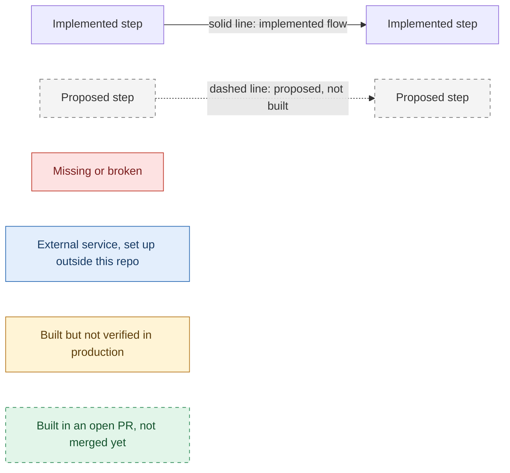
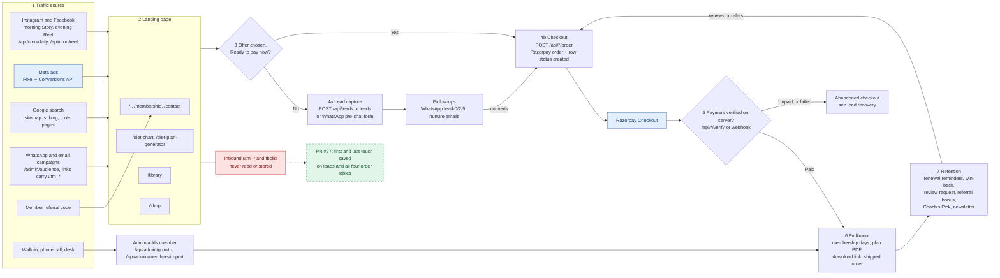
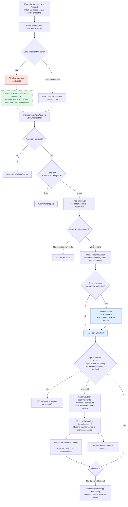
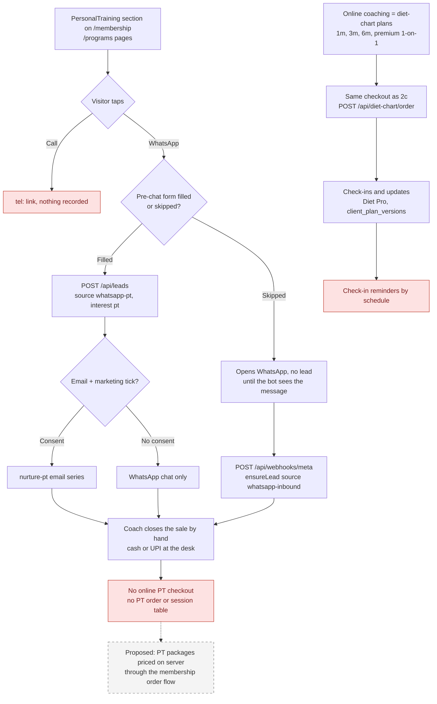
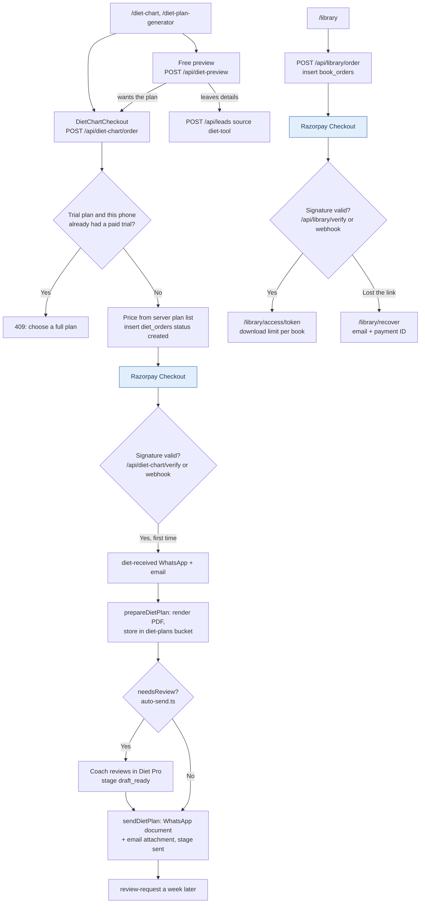
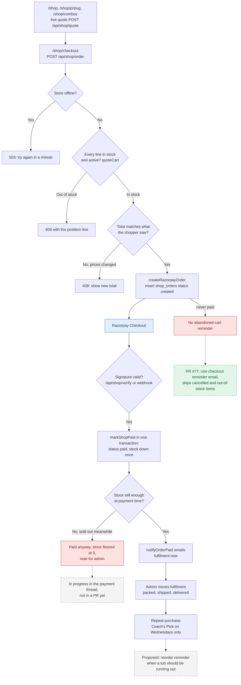
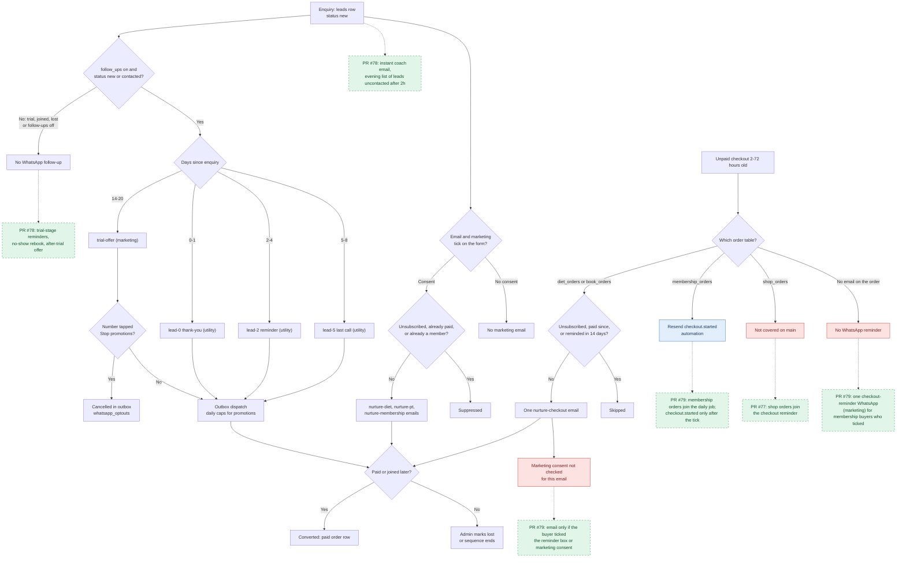
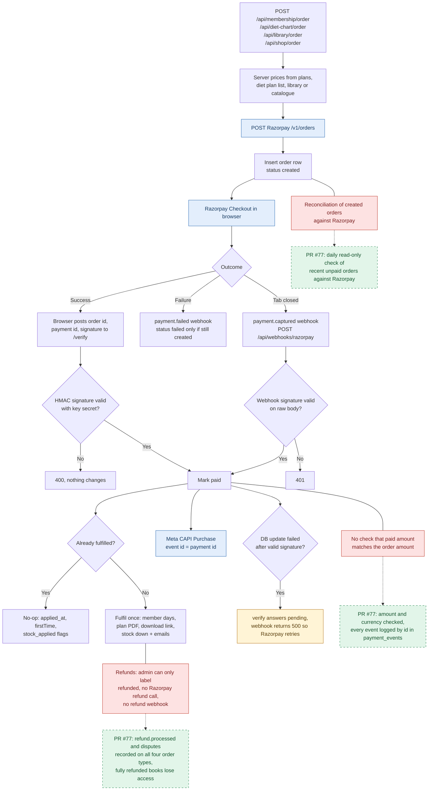
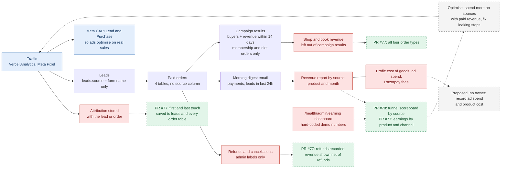

# Sales funnel flowchart

How a visitor becomes a paying, returning customer in the Royal Fitness Club app, drawn from the code on `main` at commit `9382eea` (19 Oct 2026). Work that is built in an open pull request but not merged is shown separately: PR #77 (payment hardening, attribution, real earnings dashboard, supplement checkout reminders, head `8f0f75d`) and PR #78 (trial booking, coach alerts, funnel scoreboard, head `34dedbe`). Every box names the real route, table, job or integration that handles that step. Update: PR #77 has since been merged to `main` as `40e42df`, so everything marked "PR #77" below is now live code once its migrations are applied. The `/health` site has its own demo monetization (payments are switched off in production by `src/health/lib/monetization/live-guard.ts`), so it is out of scope here.

This document describes the code. It does not contain conversion rates, revenue or customer numbers, because the repository holds none that are real (see the analytics loop).

## Legend

Each Mermaid block draws its own styles, so the same legend applies to every diagram below.

- **Solid line**: the code for this step exists on `main` and is reached from the step before it.
- **Dashed line and dashed box**: a proposal. Nothing dashed is built on `main`. Work that another branch is building right now is labelled "in progress" and is still dashed.
- **Red box**: a step a customer or the business needs that the code does not do, or does wrongly.
- **Blue box**: depends on configuration in an outside service (Razorpay dashboard, Meta Business Manager, Resend automations, Vercel). The repo can't prove it is set up.
- **Amber box**: implemented, but behaviour in production can't be verified from the repository (needs credentials, dashboards or live data).
- **Green dashed box**: built and tested in an open pull request, not on `main` yet. It is not live until the PR is merged, its migration is applied and, where noted, its setup step is done.

The two open pull requests these boxes refer to:

- **PR #77, payment hardening.** Webhook events logged by id in `payment_events` (resends skipped), amount and currency checked before applying a payment, `refund.processed` and `payment.dispute.created` recorded on all four order types, a daily read-only reconciliation against Razorpay, first and last touch attribution on leads and orders, campaign revenue across all four order types net of refunds, a real earnings dashboard replacing the demo numbers, and checkout reminders for supplement orders. Needs migrations `20261019120000_payment_events.sql` and `20261019150000_attribution.sql`, plus the two extra webhook events in Razorpay.
- **PR #78, lead funnel.** Trial day and hour picked on the form, confirmation and reminder, came or no-show with rebooking, plans the day after and a day-4 nudge, an instant coach email for every lead, an evening list of leads still uncontacted after 2 hours, and a funnel scoreboard by source. Needs migration `20261019130000_trial_booking.sql` and five new WhatsApp templates approved by Meta.

Supplement oversell is being worked on in the payment thread but is not in a PR yet, so it is still shown as a proposal.

---

## 1. Customer journey

**Purpose.** The single path every product shares: get a visit, capture a lead or take a payment, confirm it on the server, deliver, then bring the customer back.

**Customer experience.** A visitor lands from social, search or a campaign link, picks a plan or product, and either pays by Razorpay or leaves their number (form or the WhatsApp pre-chat popup). Paid customers get an instant WhatsApp and email confirmation.

**Failure cases.**
- On `main`, campaign links are tagged with `utm_source/utm_medium/utm_campaign` (`src/lib/growth/audience.ts:81`, `src/lib/growth/daily-posts.ts:216`, `src/lib/growth/sales-emails.ts:18`), but no gym-site page or API reads them. `leads.source` only stores which form was used (`home`, `contact`, `whatsapp-diet`, `diet-tool`, `whatsapp-inbound`), and the four order tables have no source column. Attribution after the click is lost. PR #77 adds a 90-day first-party cookie and an `attribution` column on leads and orders.
- The WhatsApp pre-chat form is mounted only in the site layout (`src/app/(gym)/(site)/layout.tsx:25`), not under `/shop`, so WhatsApp clicks from the store create no lead.
- If Razorpay keys are missing every checkout returns 503 and tells the visitor to call or WhatsApp.

**Metric to measure.** Visit-to-lead rate and visit-to-paid-order rate per traffic source. On `main` neither can be computed from the database; with PR #77 merged, leads and paid orders by first touch can be.

| Step | Route or job | Code | Table |
|---|---|---|---|
| Social posts | `GET /api/cron/daily` (Story), `GET /api/cron/reel` (Reel) | `src/lib/social/automation.ts:216`, `src/lib/social/automation.ts:238`, `vercel.json` | `social_posts`, `integration_tokens` |
| Lead form | `POST /api/leads` | `src/app/api/leads/route.ts`, `src/components/home/LeadForm.tsx` | `leads`, `marketing_contacts` |
| WhatsApp pre-chat | client form, then `POST /api/leads` | `src/components/ui/WhatsAppCapture.tsx` | `leads` |
| Inbound WhatsApp | `POST /api/webhooks/meta` | `src/app/api/webhooks/meta/route.ts`, `src/lib/social/automation.ts:51` | `social_inbox`, `leads`, `chat_contacts` |
| Ads tracking | Pixel in layout, CAPI from server | `src/components/ui/MetaPixel.tsx`, `src/lib/growth/meta-capi.ts` | none |

---

## 2. The four sales funnels

### 2a. Gym membership

**Purpose.** Sell and renew gym memberships online, and turn free-trial enquiries into members.

**Customer experience.** The visitor picks a plan, pays with Razorpay, and gets a WhatsApp welcome with their member code and end date. A week before the end they get a one-tap renewal link; a month after lapsing, a come-back offer.

**Failure cases.**
- A lead marked "trial" falls out of every automatic follow-up, because `openLeads` and `nurtureLeads` only select `new` and `contacted` (`src/lib/growth/leads.ts:26`, `src/lib/growth/leads.ts:75`). The person who actually visited gets nothing. Fixed in PR #78, which also lets the visitor pick a trial time instead of "reply with a time".
- Abandoned membership checkouts are chased only by a Resend automation (`src/lib/growth/resend-events.ts:71`) whose steps live in the Resend dashboard. A buyer who left no email gets no reminder at all, and the daily recovery job does not look at `membership_orders` (`src/lib/growth/daily.ts:125`). No open PR changes this.
- If applying the order fails (for example a plan duration that can't be parsed, `src/lib/growth/members.ts:254`), payment is recorded but no member row is created. The growth admin lists these paid-but-unapplied orders (`unappliedPaidOrders`, `src/lib/growth/members.ts:311`) so someone can add the member by hand.

**Metric to measure.** Trial lead to paid member rate, and renewal rate per expiry month (`members.expires_on` against new paid `membership_orders`).

| Step | Route or job | Code | Table |
|---|---|---|---|
| Order | `POST /api/membership/order` | `src/app/api/membership/order/route.ts:35`, `src/app/api/membership/order/route.ts:56` | `membership_orders` |
| Verify | `POST /api/membership/verify` | `src/app/api/membership/verify/route.ts:22` | `membership_orders` |
| Apply | called from verify and webhook | `src/lib/growth/hooks.ts`, `src/lib/growth/members.ts:239` | `members`, `referral_rewards` |
| Renewals | `GET /api/cron/daily` 02:15 UTC | `src/lib/growth/messages.ts:181`, `src/lib/growth/daily.ts:63` | `message_outbox`, `automation_events` |
| Desk members | `POST /api/admin/members/import` | `src/app/api/admin/members/import/route.ts`, `src/lib/growth/member-import.ts` | `members` |

### 2b. Personal training and online coaching

**Purpose.** Sell one-to-one training at the gym and remote coaching.

**Customer experience.** In-gym PT is sold only by conversation: the PT cards link to WhatsApp and phone (`src/components/home/PersonalTraining.tsx`). Online coaching is bought online as a diet-chart package (`src/lib/growth/config.ts`, plans `1m`, `3m`, `6m`, `premium`), which includes check-ins.

**Failure cases.**
- There is no PT product, price list, order table or payment route. Every PT sale depends on someone answering WhatsApp, and none of it shows up in reports.
- Phone taps leave no record, so PT demand from calls is invisible.
- Clients can see when their next plan update is due on `/account/plans` (`src/lib/growth/entitlement.ts`), but I found no scheduled message that reminds them, so check-ins depend on the client remembering or the coach chasing. [Likely, from searching `daily.ts` and `messages.ts`.]

**Metric to measure.** PT leads (`leads.interest = 'pt'`) per week, and the share that later appear as paying members. Coaching renewals per plan.

### 2c. Diet and workout PDF plans

**Purpose.** Sell personalised diet charts (₹49 trial to ₹5,999 premium, `src/lib/growth/config.ts:19`) and ready-made PDF books.

**Customer experience.** The buyer fills an intake form and pays. A draft plan is generated straight away and, unless the intake needs a coach's review, sent on WhatsApp and email within the same request. Book buyers get a private download page.

**Failure cases.**
- If PDF generation fails after payment, the client gets the "received" message but no plan; it waits for the coach (`src/lib/growth/hooks.ts`, the `prepareDietPlan` catch). The morning digest lists these under plans to review (`src/lib/growth/daily.ts`, `digestData`).
- The trial upsell (₹49 trial to a full plan) has no dedicated follow-up in the daily job. [Likely, from reading `runDaily`.]
- The diet-plan `verify` route is the only path that runs the slow PDF build when the webhook is missing, so a buyer who closes the tab before verify depends on the webhook being configured in Razorpay.

**Metric to measure.** Trial to paid full plan rate; median time from `diet_orders.paid_at` to `sent_at`.

| Step | Route or job | Code | Table |
|---|---|---|---|
| Diet order | `POST /api/diet-chart/order` | `src/app/api/diet-chart/order/route.ts:34`, `src/app/api/diet-chart/order/route.ts:38` | `diet_orders` |
| Diet verify | `POST /api/diet-chart/verify` | `src/app/api/diet-chart/verify/route.ts:21` | `diet_orders` |
| Plan build and send | after payment | `src/lib/growth/plan-delivery.ts:21`, `src/lib/growth/auto-send.ts:12` | `diet_orders`, `client_plan_versions`, storage bucket `diet-plans` |
| Book order and verify | `POST /api/library/order`, `POST /api/library/verify` | `src/app/api/library/order/route.ts`, `src/app/api/library/verify/route.ts` | `book_orders` |
| Download | `GET /api/library/download/[token]/[slug]` | `src/lib/library/orders.ts:105` | `book_orders.downloads` |

### 2d. Supplements store

**Purpose.** Sell supplements and combos with shipping, priced and stock-checked on the server.

**Customer experience.** The cart re-prices live, checkout refuses out-of-stock lines and changed prices before payment, and the customer gets an order email once paid. Signed-in customers see orders at `/shop/account`.

**Failure cases.**
- Stock is checked at checkout but only taken at payment (`src/lib/shop/store.ts:232`). Two people can pay for the last tub; the second order is marked paid with a "Stock was short" note (tested in `src/lib/shop/store.integration.test.ts`). Someone has to refund or source it by hand.
- On `main` an unpaid shop order is never followed up, because the daily recovery job covers only `diet_orders` and `book_orders` (`src/lib/growth/daily.ts:125`). PR #77 adds shop orders.
- On `main` campaign revenue ignores shop and book orders (`src/lib/growth/campaigns.ts:224`), so a campaign that sells supplements shows zero revenue. PR #77 counts all four order types net of refunds.
- WhatsApp clicks from the store create no lead, because the pre-chat form isn't mounted under `/shop`. It can't simply be added: a lead from the form gets the `lead-0` WhatsApp, which promises a free trial session (`src/lib/growth/messages.ts:43`), and the shop links to its own WhatsApp number (`shop_settings.whatsapp`). It needs a supplement-specific first message first.
- No repeat-purchase trigger exists for consumables, and no open PR adds one.

**Metric to measure.** Cart-to-paid rate, repeat-purchase rate within 60 days, and paid orders with a stock-short note.

| Step | Route or job | Code | Table |
|---|---|---|---|
| Quote | `POST /api/shop/quote` | `src/components/shop/useQuote.ts`, `src/lib/shop/pricing.ts` | `shop_products`, `shop_combos`, `shop_settings` |
| Order | `POST /api/shop/order` | `src/app/api/shop/order/route.ts:31`, `src/app/api/shop/order/route.ts:43` | `shop_orders` |
| Verify | `POST /api/shop/verify` | `src/app/api/shop/verify/route.ts`, `src/lib/shop/paid.ts` | `shop_orders`, `shop_products` |
| Catalogue feed for Meta | `GET /api/feeds/meta-catalog` | `src/app/api/feeds/meta-catalog/route.ts`, `src/lib/shop/meta-feed.ts` | `shop_products` |

---

## 3. Lead recovery

**Purpose.** Bring back people who asked but didn't buy, and people who started paying and stopped, without messaging anyone who opted out.

**Customer experience.** An enquiry gets a WhatsApp thank-you immediately, two reminders in the first week and a free-trial offer two weeks later. With an email and a ticked box they also get a short email series for their interest. A started-but-unpaid diet plan or book gets one reminder email.

**Failure cases.**
- On `main` the abandoned-checkout email (`kind = 'nurture-checkout'`) checks unsubscribes but not `consent_at` (`src/lib/growth/daily.ts:125`), so buyers who never ticked the marketing box still get it. PR #79 sends it only to buyers who ticked the new "remind me if my payment doesn't go through" box (membership, library, supplements) or gave marketing consent (diet plans). Until people tick it, fewer reminders go out than today.
- On `main` membership recovery depends on the Resend dashboard and orders without an email get nothing. PR #79 adds membership orders to the daily job and a WhatsApp reminder for membership buyers with no email; that template needs Meta approval. Shop recovery is added in PR #77.
- On `main`, leads in the "trial" stage get no follow-up (see 2a). Fixed in PR #78.
- On `main` the coach only hears about a new lead in the next morning's email. PR #78 emails `COACH_EMAIL` at once.
- WhatsApp opt-out is enforced at send time (`src/lib/growth/outbox.ts:166`) and in campaign audiences (`src/lib/growth/campaigns.ts`), so suppression for promotions is implemented. Email unsubscribes are enforced in each query that selects recipients (`src/lib/growth/leads.ts:77`, `src/lib/growth/daily.ts`), not at send time.

**Metric to measure.** Recovered revenue: paid orders within 7 days of a recovery message, divided by recovery messages sent.

| Step | Route or job | Code | Table |
|---|---|---|---|
| Lead WhatsApp sequence | daily cron | `src/lib/growth/messages.ts:194`, `src/lib/growth/leads.ts:26` | `leads`, `message_outbox` |
| Nurture emails | daily cron, and straight after the lead | `src/lib/growth/nurture.ts`, `src/lib/growth/hooks.ts` | `leads`, `marketing_contacts` |
| Abandoned checkouts | daily cron | `src/lib/growth/daily.ts:125`, `src/lib/growth/sales-emails.ts` | `diet_orders`, `book_orders`, `message_outbox` |
| Opt-out | "Stop promotions" reply, `/api/unsubscribe` | `src/lib/social/automation.ts:82`, `src/lib/growth/optouts.ts`, `src/app/api/unsubscribe/route.ts` | `whatsapp_optouts`, `marketing_contacts` |

---

## 4. Payment and order lifecycle

**Purpose.** Make sure every real payment is recorded and fulfilled exactly once, whichever of the browser or the webhook arrives first.

**Customer experience.** After paying, the customer sees a confirmation page. If the browser step fails after a valid signature, they are told the payment is being recorded.

**Failure cases.**
- Neither `/verify` nor the webhook compares the captured amount or currency with the order row (`src/lib/payments/orders.ts` `markPaid`, `src/app/api/webhooks/razorpay/route.ts:31`). The signature proves the payment belongs to that Razorpay order, and the order amount was set by the server, so the practical risk is low; it is still unchecked on `main`. PR #77 adds the check.
- There is no state between `created` and `paid` (no `pending` or `authorized`). If the Razorpay account is not set to auto-capture, `payment.authorized` is ignored. [Guessing on the account setting: it lives in the Razorpay dashboard.]
- Refunds exist only as admin labels (`fulfilment = 'refunded'` on shop orders, `stage = 'refunded'` on diet orders). No route calls the Razorpay refund API, no webhook handles `refund.processed`, and a refunded shop order does not put stock back. PR #77 records refunds made in the Razorpay dashboard; issuing a refund from the admin and restocking are still not built.
- No job reconciles orders stuck in `created` with Razorpay. If the webhook is not configured and the browser never reaches `/verify`, a real payment stays unrecorded. Whether the webhook is configured in the Razorpay dashboard can't be checked from the repo. PR #77 adds a daily reconciliation that catches these.
- `payment.captured` runs the four table updates in sequence with no shared transaction; one throwing returns 500 and Razorpay retries. That works because each update is idempotent.

**Metric to measure.** Orders still `created` after 24 hours, paid orders without fulfilment (member not applied, plan not sent, stock not applied), and refund count and amount per product.

| Step | Route or job | Code | Table |
|---|---|---|---|
| Razorpay client and signatures | | `src/lib/payments/razorpay.ts`, `src/lib/payments/signature.ts` | |
| Webhook | `POST /api/webhooks/razorpay` | `src/app/api/webhooks/razorpay/route.ts:31`, `src/app/api/webhooks/razorpay/route.ts:41` | all four order tables |
| Membership idempotency | | `src/lib/growth/members.ts:239` | `membership_orders.applied_at` |
| Diet idempotency | | `src/lib/growth/diet-orders.ts:55` | `diet_orders` |
| Shop idempotency | | `src/lib/shop/store.ts:232` | `shop_orders.stock_applied` |
| Admin payment list | `GET /api/admin/payments` | `src/app/api/admin/payments/route.ts` | `membership_orders` |

---

## 5. Analytics loop

**Purpose.** Know which source, offer and campaign produces paid revenue and profit, and move effort there.

**Customer experience.** None directly; this is the owner's view.

**Failure cases.**
- The only dashboard that shows revenue totals, `/health/admin/earning`, reads hard-coded demo values (`src/app/(health)/health/api/earn/stats/route.ts:4`). It must not be used for decisions. PR #77 replaces it with collected, refunded and net revenue from the order tables, and makes the stats API admin-only.
- On `main`, inbound UTMs are not stored, so revenue by source can't be computed from the database. PR #77 fixes this for new visits only; older leads and orders stay unattributed.
- Campaign revenue joins only `membership_orders` and `diet_orders` (`src/lib/growth/campaigns.ts:224`), and counts any purchase within 14 days of a message as caused by it.
- On `main`, refunds aren't recorded as money, so revenue is gross. PR #77 records them. Neither PR records ad spend or product cost, so profit, cost per customer and return on ad spend still can't be reported; PR #77's dashboard shows "Data not available" for them.
- Meta receives `Lead` and `Purchase` events (`src/lib/growth/meta-capi.ts`) only when `NEXT_PUBLIC_META_PIXEL_ID` and `META_CAPI_TOKEN` are set, and `Purchase` comes only from the webhook. Project notes from 19 Oct say `NEXT_PUBLIC_META_PIXEL_ID` is not set in Vercel, so no pixel events fire and Meta ads can't optimise on sales. [Likely: reported by another thread, not checked from this one.]

**Metric to measure.** Paid revenue minus refunds by first-touch source per month, then cost per paid customer once ad spend is entered.

| Data | Where it lives today | Code |
|---|---|---|
| Lead counts | `leads` | `src/lib/growth/leads.ts` |
| Paid revenue | `membership_orders`, `diet_orders`, `book_orders`, `shop_orders` | `src/lib/growth/daily.ts` (`digestData`) |
| Campaign attribution | `message_outbox` joined to paid orders | `src/lib/growth/campaigns.ts:224` |
| Health of daily jobs | `system_status` | `src/lib/growth/system-status.ts` |
| Demo numbers (do not use) | hard-coded | `src/app/(health)/health/api/earn/stats/route.ts` |

---

## Scheduled jobs, webhooks and integrations

| Kind | Name | Schedule or trigger | Code | Depends on |
|---|---|---|---|---|
| Cron | `/api/cron/daily` | 02:15 UTC (07:45 IST) | `src/app/api/cron/daily/route.ts`, `src/lib/growth/daily.ts` | `CRON_SECRET` |
| Cron | `/api/cron/reel` | 13:20 UTC, retry 15:40 UTC | `src/app/api/cron/reel/route.ts` | Meta Graph tokens |
| Cron | `/health/api/cron/daily` | 00:30 UTC | `src/app/(health)/health/api/cron/daily/route.ts` | health site only |
| Webhook | Razorpay | `payment.captured`, `payment.failed` | `src/app/api/webhooks/razorpay/route.ts` | `RAZORPAY_WEBHOOK_SECRET`, dashboard setup |
| Webhook | Meta (WhatsApp, Instagram, Facebook) | inbound messages, comments, calls | `src/app/api/webhooks/meta/route.ts` | Meta app setup |
| Integration | Razorpay Orders and Checkout | every checkout | `src/lib/payments/razorpay.ts` | `RAZORPAY_KEY_ID`, `RAZORPAY_KEY_SECRET` |
| Integration | WhatsApp Cloud API | outbox dispatch | `src/lib/growth/outbox.ts`, `src/lib/growth/providers.ts` | approved templates in Meta |
| Integration | Resend (email, events, automations) | outbox email, lifecycle events | `src/lib/growth/resend-events.ts`, `src/lib/growth/providers.ts` | automations built in Resend |
| Integration | Meta Pixel and Conversions API | page views, Lead, Purchase | `src/components/ui/MetaPixel.tsx`, `src/lib/growth/meta-capi.ts` | `NEXT_PUBLIC_META_PIXEL_ID`, `META_CAPI_TOKEN` |
| Integration | Vercel Analytics | page views | `src/components/ui/VercelAnalytics.tsx` | Vercel project |
| Storage | Supabase storage | plan PDFs, books, social media | `src/lib/growth/storage.ts` | Supabase project |

---

## The three highest-impact improvements

Ranked by money they can recover with the code that already exists. The first two are built in open PRs; nothing here is on `main`.

**1. Stop dropping leads at the trial stage. Built in PR #78.** [Certain] On `main`, `openLeads` and `nurtureLeads` select only `new` and `contacted` (`src/lib/growth/leads.ts:26`, `src/lib/growth/leads.ts:75`), so the moment the admin marks someone as "trial", the person closest to buying gets no reminder, no join offer and no rebooking. This is the step between a free visit and a paid membership, the biggest product. It goes live only after the PR is merged, its migration is applied and Meta approves the five new WhatsApp templates.

**2. Store the traffic source on every lead and order. Built in PR #77.** [Certain] On `main`, campaign links carry UTMs but nothing reads them on arrival, `leads.source` is just the form name, no order table has a source column, and campaign results leave out shop and book revenue (`src/lib/growth/campaigns.ts:224`). Without this no one can say which ads or posts make money. It only attributes visits after the merge, so the first useful numbers need a few weeks of traffic.

**3. Recover abandoned membership checkouts and buyers with no email. Built in PR #79, on top of PR #77.** [Certain] The daily recovery job never reads `membership_orders` (`src/lib/growth/daily.ts:125`), so a half-finished membership payment is chased only by a Resend automation outside the repo, and only when the buyer typed an email. Orders with just a phone number get nothing on any product. PR #77 adds supplement orders to the same job but leaves these gaps, and the reminder email still doesn't check `consent_at`. PR #79 adds membership orders to that job, sends one WhatsApp reminder when there is no email, and sends either only to buyers who ticked a new reminder box at checkout. The WhatsApp reminder is a Marketing template (Meta classes abandoned-cart nudges as marketing), so it carries "Stop promotions" and needs Meta approval before it sends.

### Still open after both PRs

These gaps are not covered by any open PR:

- Phone-only diet-plan, library and supplement checkouts still get no WhatsApp reminder (PR #79 covers memberships only).
- No online way to buy personal training, and no record of PT sales (2b).
- No scheduled check-in reminder for coaching clients (2b).
- No follow-up that moves ₹49 diet-trial buyers to a full plan (2c).
- No reorder reminder for supplements, and no WhatsApp pre-chat form on `/shop` (2d).
- No refund issued from the admin, and refunded supplement orders don't go back into stock (4).
- No ad spend or product cost recorded, so profit can't be reported (5).
- `NEXT_PUBLIC_META_PIXEL_ID` reportedly not set, so Meta gets no Lead or Purchase events (5).

## How this document was checked

- Every Mermaid block was parsed with the Mermaid CLI (`@mermaid-js/mermaid-cli`) and rendered without errors.
- Every file path in backticks was checked to exist in the repository, and every `file:line` reference was checked to point at the code it describes.
- Claims about PR #77 and PR #78 were checked against their descriptions and changed-file lists on GitHub on 19 Oct 2026, not by running those branches.
- No application code, database schema or configuration was changed to produce it.
